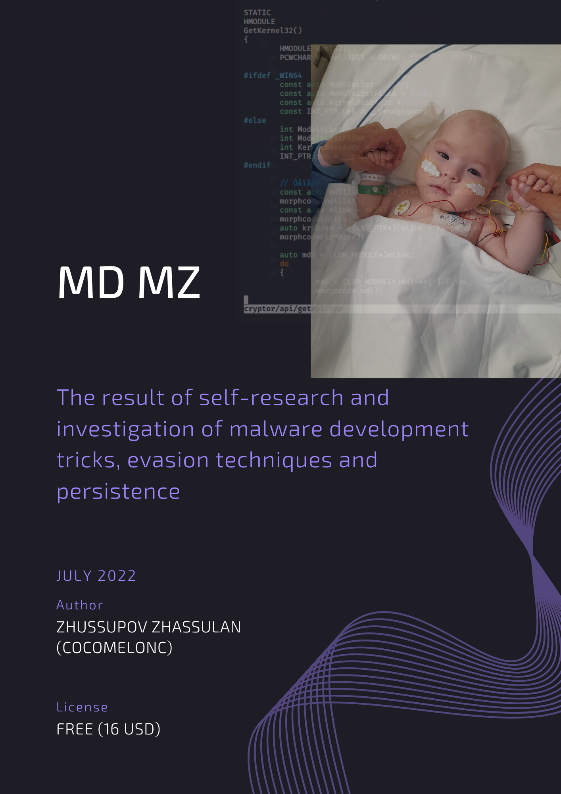

\newpage
\subsection{引言}

## 1. intro

{width="80%"}

本书献给我的妻子 Laura，以及我的孩子 Yerzhan 和 Munira。同时，感谢所有在这段艰难时期帮助过我的人。我将用本书的销售收入为 Munira 治病，并捐献给哈萨克斯坦的慈善基金：

{height="55%"}

现在我们的情况好转了，但我们仍在继续治疗。

愿真主——众世界的主——治愈我的女儿。

本书是 MD MZ——恶意软件开发（Malware Development Book）——2024 版的新版本。

若真主意欲，我也计划出版本书的这一版本。

本书第一版发布于 2022 年 7 月 17 日：

{height="55%"}

自那以后已过去两年多，我想用自己博客上的新文章来补充本书。因此，这个新版本现在已接近 1000 页。
