\newpage
\subsection{Windows shellcode 编写（第 2 部分）：查找 kernel32 地址}

在我关于 Windows shellcoding 的第一部分中，我们用下面的逻辑找到了 kernel32 和各个函数的地址：

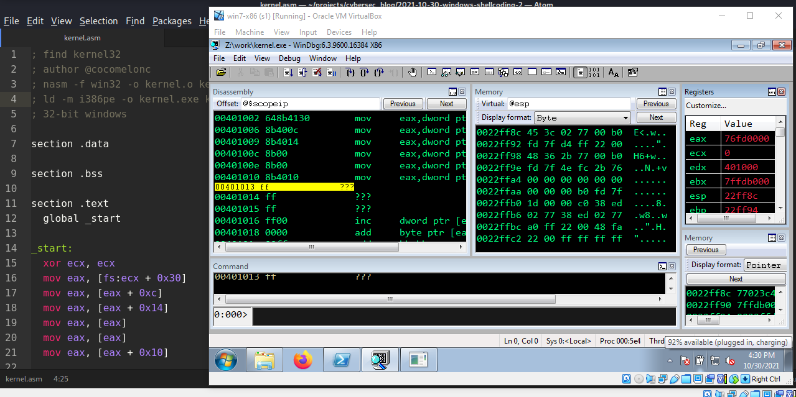{width="80%"}

In the [first](https://cocomelonc.github.io/tutorial/2021/10/27/windows-shellcoding-1.html) part of my post about windows shellcoding we found the addresses of `kernel32` and functions using the following logic:

```cpp
/*
getaddr.c - get addresses of functions
(ExitProcess, WinExec) in memory
*/
#include <windows.h>
#include <stdio.h>

int main() {
  unsigned long Kernel32Addr;  // kernel32.dll address
  unsigned long ExitProcessAddr;  // ExitProcess address
  unsigned long WinExecAddr;  // WinExec address

  Kernel32Addr = GetModuleHandle("kernel32.dll");
  printf("KERNEL32 address in memory: 0x%08p\n", Kernel32Addr);

  ExitProcessAddr = GetProcAddress(Kernel32Addr, "ExitProcess");
  printf("ExitProcess address in memory is: 0x%08p\n", 
  ExitProcessAddr);

  WinExecAddr = GetProcAddress(Kernel32Addr, "WinExec");
  printf("WinExec address in memory is: 0x%08p\n", WinExecAddr);

  getchar();
  return 0;

```

然后我们把找到的地址写进 shellcode：

```nasm
; void ExitProcess([in] UINT uExitCode);
xor  eax, eax  ; zero out eax
push eax  ; push NULL
mov  eax, 0x76ed214f  ; call ExitProcess function 
  ; addr in kernel32.dll
jmp  eax  ; execute the ExitProcess function
```

问题在于，所有 DLL 及其函数的地址在重启后会改变，而且在每个系统上都不一样。因此，我们不能在 ASM 代码里硬编码任何地址：

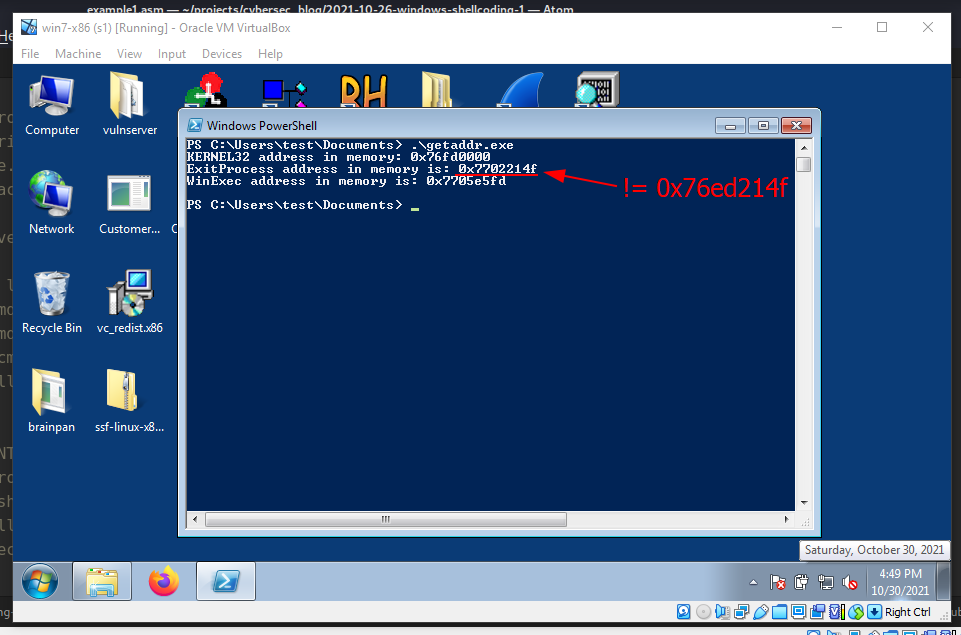{width="80%"}

首先，我们怎样才能找到 `kernel32.dll` 的地址？

### TEB 与 PEB 结构

每当我们执行任何 exe 文件时，操作系统中最先创建的东西（至少据我所知）是 PEB：

```cpp
typedef struct _PEB {
  BYTE  Reserved1[2];
  BYTE  BeingDebugged;
  BYTE  Reserved2[1];
  PVOID  Reserved3[2];
  PPEB_LDR_DATA  Ldr;
  PRTL_USER_PROCESS_PARAMETERS  ProcessParameters;
  PVOID  Reserved4[3];
  PVOID  AtlThunkSListPtr;
  PVOID  Reserved5;
  ULONG  Reserved6;
  PVOID  Reserved7;
  ULONG  Reserved8;
  ULONG  AtlThunkSListPtr32;
  PVOID  Reserved9[45];
  BYTE  Reserved10[96];
  PPS_POST_PROCESS_INIT_ROUTINE PostProcessInitRoutine;
  BYTE  Reserved11[128];
  PVOID  Reserved12[1];
  ULONG  SessionId;
} PEB, *PPEB;
```

以及 TEB：

```cpp
typedef struct _TEB {
  PVOID Reserved1[12];
  PPEB  ProcessEnvironmentBlock;
  PVOID Reserved2[399];
  BYTE  Reserved3[1952];
  PVOID TlsSlots[64];
  BYTE  Reserved4[8];
  PVOID Reserved5[26];
  PVOID ReservedForOle;
  PVOID Reserved6[4];
  PVOID TlsExpansionSlots;
} TEB, *PTEB;
```

PEB —— Windows 中的进程结构，由加载器在进程创建阶段填充，其中包含进程运行所必需的信息。

TEB 是一个用于存储当前进程中线程信息的结构，每个线程都有自己的 TEB。

让我们在 windbg 调试器中打开某个程序并运行命令：

```cmd
dt _teb
```

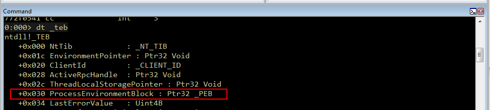{width="80%"}

如我们所见，PEB 的偏移是 `0x030`。同样，我们可以用下面的命令查看 PEB 结构的内容：

```cmd
dt _peb
```

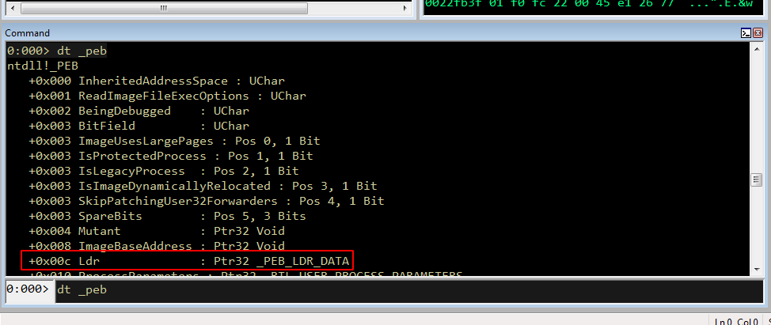{width="80%"}

现在我们需要查看 PEB 结构基址偏移 `0x00c` 处的成员，也就是 `PEB_LDR_DATA`。`PEB_LDR_DATA` 包含进程已加载模块的信息。

然后，我们也可以通过 windbg 查看 `PEB_LDR_DATA` 结构：

```cmd
dt _PEB_LDR_DATA
```

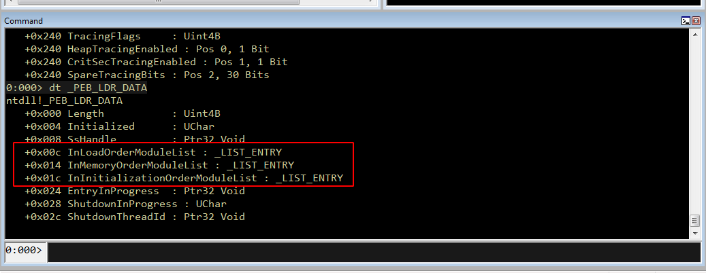{width="80%"}

`InInitializationOrderModuleList` —— `0x01c`

`InMemoryOrderModuleList` 是一个双向链表，其中每个列表项都指向一个 `LDR_DATA_TABLE_ENTRY` 结构，所以 Windbg 提示该结构类型为 `LIST_ENTRY`。

在继续之前，让我们运行命令：

```cmd
!peb
```

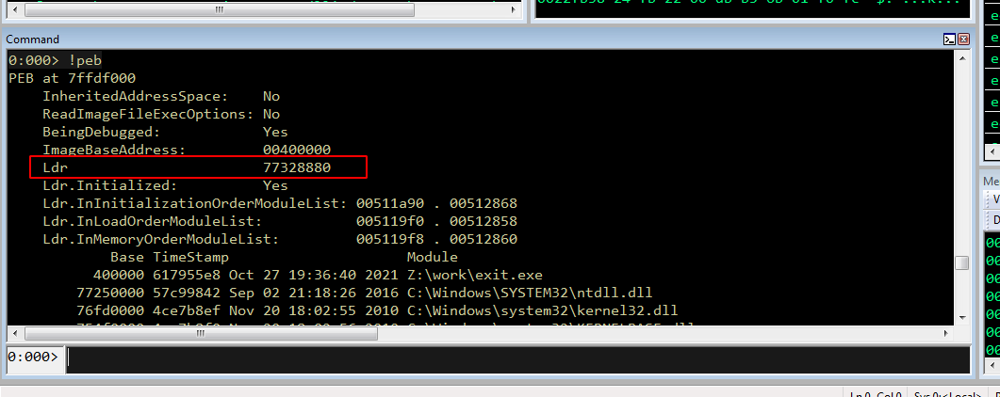{width="80%"}

如我们所见，LDR（PEB 结构）的地址是 —— 77328880。

现在，要查看 `InLoadOrderModuleList`、`InMemoryOrderModuleList` 和 `InInitializationOrderModuleList` 的地址，运行命令：

```cmd
dt _PEB_LDR_DATA 77328880
```

这会向我们显示各链表的相应起始地址和结束地址：

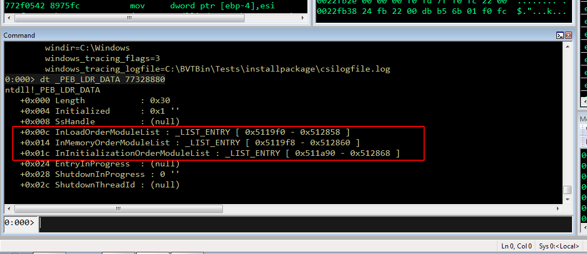{width="80%"}

让我们试着查看加载到 `LDR_DATA_TABLE_ENTRY` 结构中的模块，我们还会指出该结构的起始地址为 `0x5119f8`，这样我们就能看到已加载模块的基址。记住 `0x5119f8` 是这个结构的地址，所以第一个条目会比这个地址少 8 个字节：

```cmd
dt _LDR_DATA_TABLE_ENTRY 0x5119f8-8
```

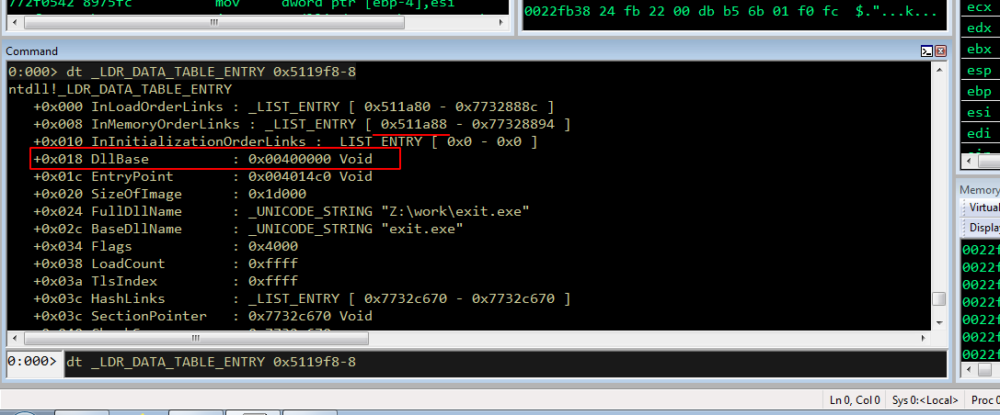{width="80%"}

偏移 `0x018` 处的 `DllBase` 包含 `BaseDllName` 的基址。现在，我们下一个已加载的模块应该距离 `0x511a88` 8 个字节，即 `0x5119f8-8`：

```cmd
dt _LDR_DATA_TABLE_ENTRY 0x5119f8-8
```

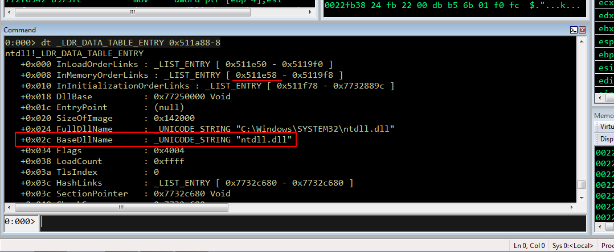{width="80%"}

如你所见，`BaseDllName` 是 `ntdll.dll`。它的地址是 `0x77250000`，下一个模块在 `0x511e58` 之后 8 个字节处。那么：

```cmd
dt _LDR_DATA_TABLE_ENTRY 0x511e58-8
```

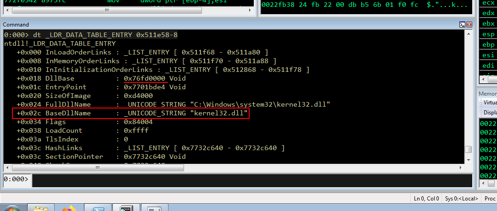{width="80%"}

如你所见，我们的第三个模块是 `kernel32.dll`，它的地址是 `0x76fd0000`，偏移是 `0x018`。为了确认这是正确的，我们可以运行我们的 `getaddr.exe`：

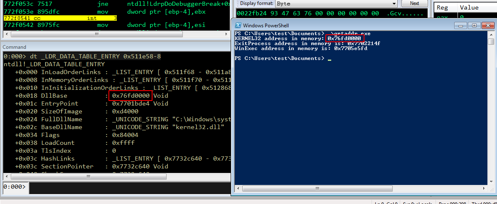{width="80%"}

这个模块加载顺序对于 Windows 10、7 来说总是固定的（至少据我所知）。所以当我们用 ASM 编写时，我们可以遍历整个 PEB LDR 结构，找到 `kernel32.dll` 的地址并把它加载进我们的 shellcode。

正如我在第一部分写的，下一个模块应该是 `kernelbase.dll`。只是为了做实验，确认这是正确的，我们可以运行：

```cmd
dt _LDR_DATA_TABLE_ENTRY 0x511f70-8
```

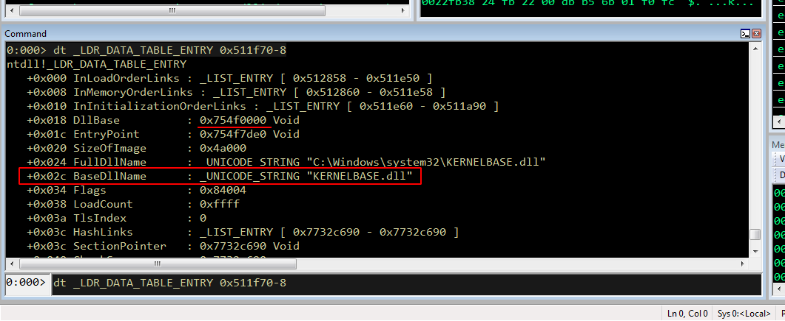{width="80%"}

到 `InMemoryOrderModuleList` 的偏移是 `0x014`

在所有近期版本的 Windows 操作系统中（至少据我所知），FS 寄存器指向 TEB。因此，要获取 `kernel32.dll` 的基址（`kernel.asm`）：

```nasm
; find kernel32
; author @cocomelonc
; nasm -f win32 -o kernel.o kernel.asm
; ld -m i386pe -o kernel.exe kernel.o
; 32-bit windows

section .data

section .bss

section .text
  global _start  ; must be declared for linker

_start:
  mov eax, [fs:ecx + 0x30]  ; offset to the PEB struct
  mov eax, [eax + 0xc]  ; offset to LDR within PEB
  mov eax, [eax + 0x14]  ; offset to 
  ; InMemoryOrderModuleList
  mov eax, [eax]  ; kernel.exe address loaded 
  ; in eax (1st module)
  mov eax, [eax]  ; ntdll.dll address loaded
  ; (2nd module)
  mov eax, [eax + 0x10]  ; kernel32.dll address 
  ; loaded (3rd module)
```

用这段汇编代码我们可以找到 `kernel32.dll` 的地址并把它存入 EAX 寄存器，所以编译它：

```bash
nasm -f win32 -o kernel.o kernel.asm
ld -m i386pe -o kernel.exe kernel.o
```

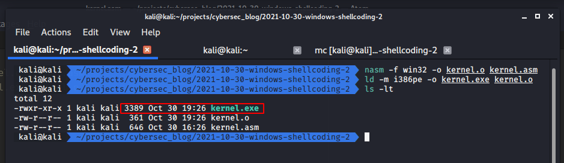{width="80%"}

把它复制到 Windows 7 上并在调试器中运行：

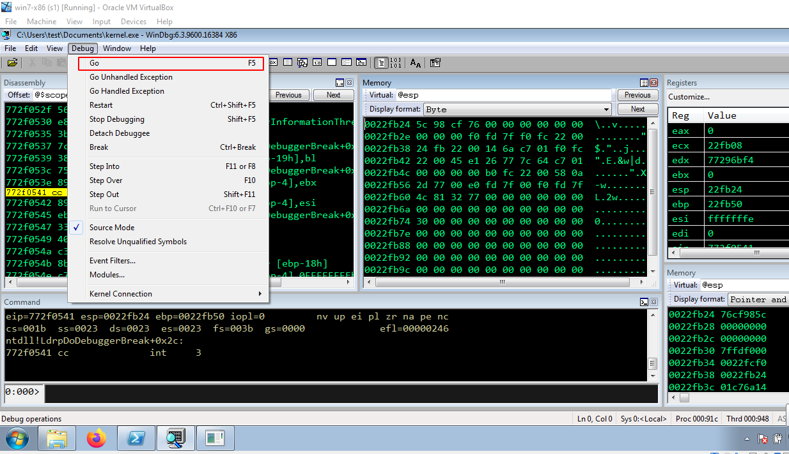{width="80%"}

运行：

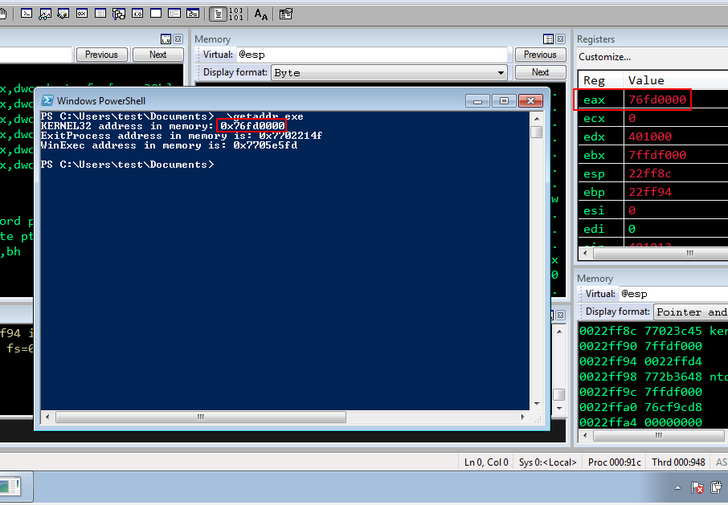{width="80%"}

如你所见，一切运行完美！

下一步是使用 `LoadLibraryA` 找到函数（例如 `ExitProcess`）的地址并调用该函数。这将在下一部分中讲述。

这里我们可以看到三个链表的偏移：

`InLoadOrderModuleList` —— `0x00c`

`InMemoryOrderModuleList` —— `0x014`

如你所见，`BaseDllName` 是我们的 `exit.exe`。这就是我执行的 exe。

另外，你可以看到 `InMemoryOrderLinks` 的地址现在是 `0x511a88`。

因此，得到如下结论：

到 PEB 结构的偏移是 `0x030`

PEB 内到 LDR 的偏移是 `0x00c`

第 1 个加载的模块是我们的 .exe

第 2 个加载的模块是 `ntdll.dll`

第 3 个加载的模块是 `kernel32.dll`

第 4 个加载的模块是 `kernelbase.dll`

### 参考资料
