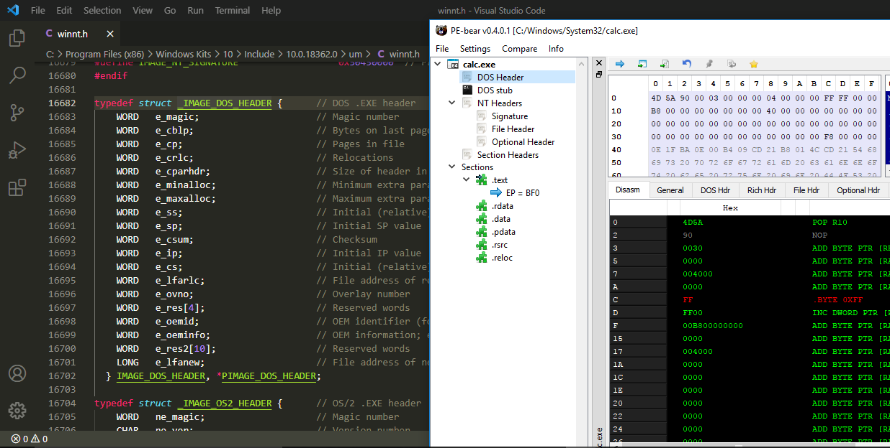
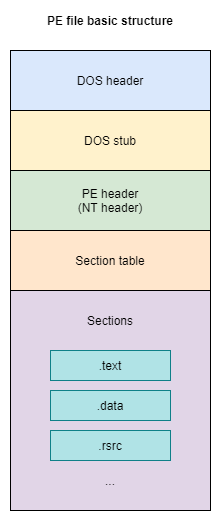
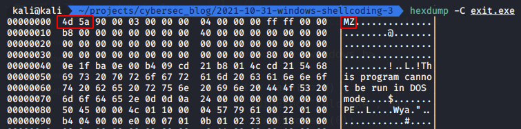
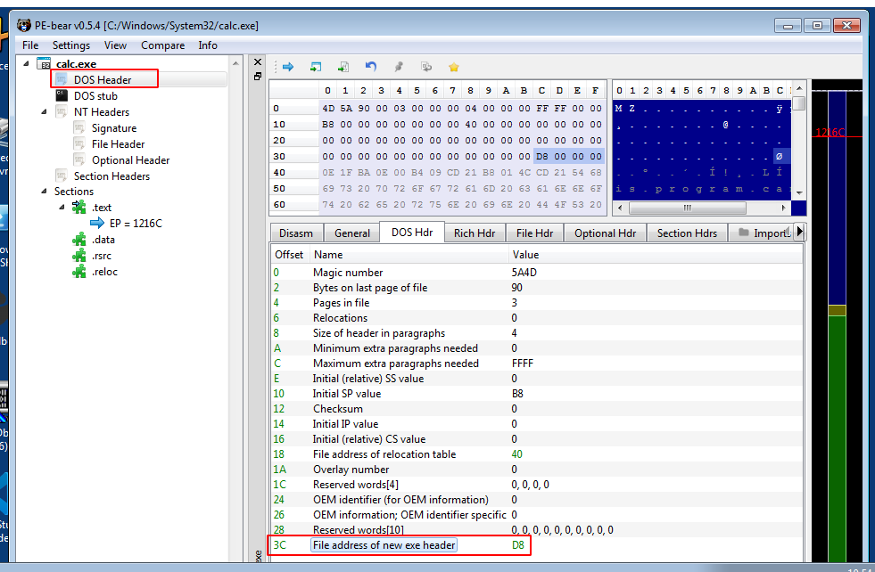
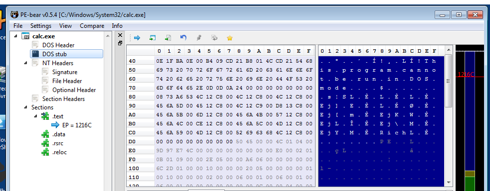
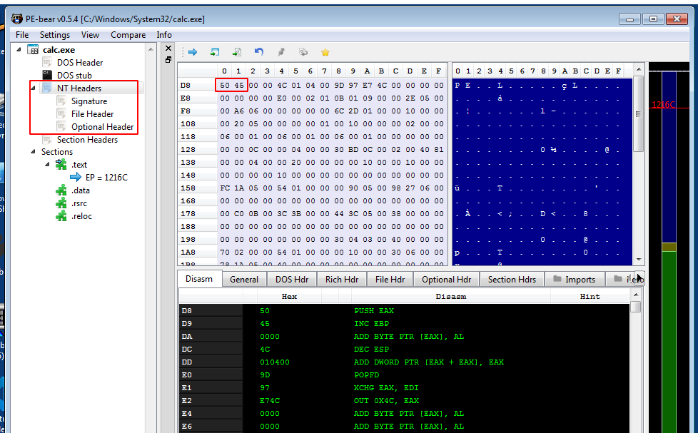
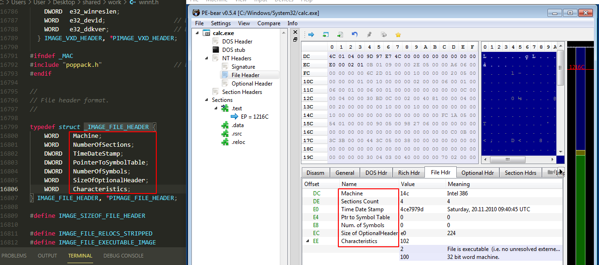
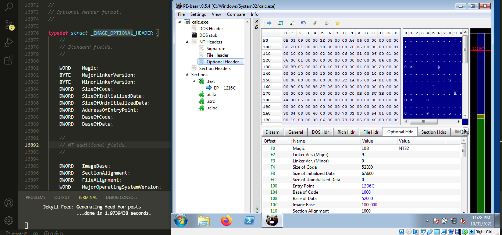
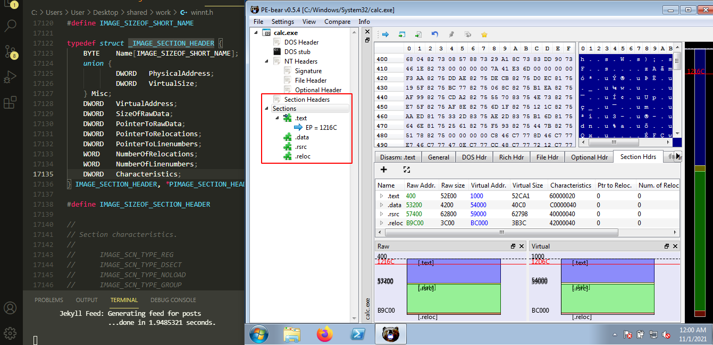
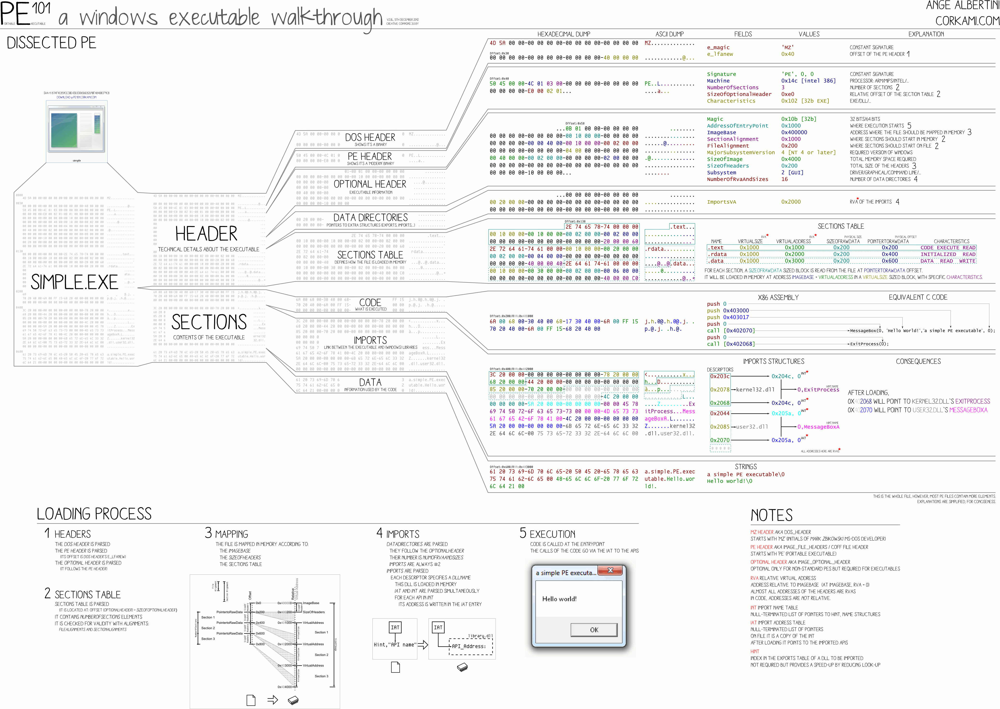

\newpage
\subsection{Windows shellcode 编写（第 3 部分）：PE 文件格式}

﷽

{width="80%"}

本节不仅可以作为前几节的延续来读，也可以作为一份独立的材料来读。这一节是 PE 文件格式的概览。

### PE 文件

什么是 PE 文件格式？它是 Win32 的原生文件格式。它的规范某种程度上源自 Unix 的 Coff（common object file format，通用目标文件格式）。“portable executable”（可移植可执行）的含义是：该文件格式在 Win32 平台上通用——每个 Win32 平台的 PE 加载器都能识别并使用这种文件格式，即使 Windows 运行在非 Intel 的 CPU 平台上也是如此。这并不意味着你的 PE 可执行文件无需修改就能移植到其他 CPU 平台。因此，研究 PE 文件格式能让你对 Windows 的结构获得宝贵的洞见。

基本上，PE 文件结构看起来是这样的：

{width="80%"}

PE 文件格式本质上是由 PE 头（PE Header）定义的，所以你会想先读那一部分。你不需要理解它的每一个部分，但你应该对它的结构有个概念，并且能识别出最重要的那些部分。

### DOS 头

DOS 头存储加载 PE 文件所需的信息。因此，这个头对于加载 PE 文件是必需的。

DOS 头结构：

```cpp
typedef struct _IMAGE_DOS_HEADER {// DOS .EXE header
  WORD  e_magic;  // Magic number
  WORD  e_cblp;  // Bytes on last page of file
  WORD  e_cp;  // Pages in file
  WORD  e_crlc;  // Relocations
  WORD  e_cparhdr;  // Size of header in paragraphs
  WORD  e_minalloc;  // Minimum extra paragraphs needed
  WORD  e_maxalloc;  // Maximum extra paragraphs needed
  WORD  e_ss;  // Initial (relative) SS value
  WORD  e_sp;  // Initial SP value
  WORD  e_csum;  // Checksum
  WORD  e_ip;  // Initial IP value
  WORD  e_cs;  // Initial (relative) CS value
  WORD  e_lfarlc;  // File address of relocation table
  WORD  e_ovno;  // Overlay number
  WORD  e_res[4];  // Reserved words
  WORD  e_oemid;  // OEM identifier (for e_oeminfo)
  WORD  e_oeminfo;  // OEM information; e_oemid specific
  WORD  e_res2[10];  // Reserved words
  LONG  e_lfanew;  // File address of new exe header
  } IMAGE_DOS_HEADER, *PIMAGE_DOS_HEADER;
```

它的大小是 64 字节。在这个结构中，最重要的字段是 `e_magic` 和 `e_lfanew`。头的前两个字节是魔数字节，用于标识文件类型，即 `4D 5A` 或“MZ”，这是 Mark Zbikowski 姓名的首字母，他在 Microsoft 从事 DOS 工作。这些魔数字节把它定义为 PE 文件：

{width="80%"}

`e_lfanew` —— 位于 DOS 头的偏移 `0x3c` 处，包含指向 PE 头的偏移：

{width="80%"}

### DOS stub

在文件的前 64 个字节之后，DOS stub 开始。这块内存在大多数情况下被零填充：

{width="80%"}

### PE 头

这一部分很小，只是包含一个文件签名，即魔数字节 `PE\0\0` 或 `50 45 00 00`：

{width="80%"}

它的结构：

```cpp
typedef struct _IMAGE_NT_HEADERS {
  DWORD Signature;
  IMAGE_FILE_HEADER FileHeader;
  IMAGE_OPTIONAL_HEADER32 OptionalHeader;
} IMAGE_NT_HEADERS32, *PIMAGE_NT_HEADERS32;
```

让我们更仔细地看看这个结构。

**File Header（或 COFF Header）** —— 一组描述文件基本特征的字段：

```cpp
typedef struct _IMAGE_FILE_HEADER {
  WORD  Machine;
  WORD  NumberOfSections;
  DWORD  TimeDateStamp;
  DWORD  PointerToSymbolTable;
  DWORD  NumberOfSymbols;
  WORD  SizeOfOptionalHeader;
  WORD  Characteristics;
} IMAGE_FILE_HEADER, *PIMAGE_FILE_HEADER;
```

{width="80%"}

**Optional Header** —— 在 COFF 目标文件的语境中它是可选的，但对 PE 文件不是。它包含许多重要变量，例如 `AddressOfEntryPoint`、`ImageBase`、`SectionAlignment`、`SizeOfImage`、`SizeOfHeaders` 以及 `DataDirectory`。这个结构有 32 位和 64 位两个版本：

```cpp
typedef struct _IMAGE_OPTIONAL_HEADER {
  //
  // Standard fields.
  //

  WORD  Magic;
  BYTE  MajorLinkerVersion;
  BYTE  MinorLinkerVersion;
  DWORD  SizeOfCode;
  DWORD  SizeOfInitializedData;
  DWORD  SizeOfUninitializedData;
  DWORD  AddressOfEntryPoint;
  DWORD  BaseOfCode;
  DWORD  BaseOfData;

  //
  // NT additional fields.
  //

  DWORD  ImageBase;
  DWORD  SectionAlignment;
  DWORD  FileAlignment;
  WORD  MajorOperatingSystemVersion;
  WORD  MinorOperatingSystemVersion;
  WORD  MajorImageVersion;
  WORD  MinorImageVersion;
  WORD  MajorSubsystemVersion;
  WORD  MinorSubsystemVersion;
  DWORD  Win32VersionValue;
  DWORD  SizeOfImage;
  DWORD  SizeOfHeaders;
  DWORD  CheckSum;
  WORD  Subsystem;
  WORD  DllCharacteristics;
  DWORD  SizeOfStackReserve;
  DWORD  SizeOfStackCommit;
  DWORD  SizeOfHeapReserve;
  DWORD  SizeOfHeapCommit;
  DWORD  LoaderFlags;
  DWORD  NumberOfRvaAndSizes;
  IMAGE_DATA_DIRECTORY 
  DataDirectory[IMAGE_NUMBEROF_DIRECTORY_ENTRIES];
} IMAGE_OPTIONAL_HEADER32, *PIMAGE_OPTIONAL_HEADER32;
```

{width="80%"}

这里我想提请你注意 `IMAGE_DATA_DIRECTORY`：

```cpp
typedef struct _IMAGE_DATA_DIRECTORY {
  DWORD VirtualAddress;
  DWORD Size;
} IMAGE_DATA_DIRECTORY, *PIMAGE_DATA_DIRECTORY;
```

它就是数据目录。简单来说，它是一个数组（大小为 16），其中每个元素都包含一个由 2 个 DWORD 值组成的结构。

目前，PE 文件可以包含以下数据目录：

Export Table

Import Table

Resource Table

Exception Table

Certificate Table

Base Relocation Table

Debug

Architecture

Global Ptr

TLS Table

Load Config Table

Bound Import

IAT（Import Address Table）

Delay Import Descriptor

CLR Runtime Header

Reserved, must be zero

正如我前面写的，我只会更详细地讨论其中的一些。

### 节表（Section Table）

包含一个 `IMAGE_SECTION_HEADER` 结构数组，这些结构定义了 PE 文件的各个节，例如 `.text` 和 `.data` 节。`IMAGE_SECTION_HEADER` 结构是：

```cpp
typedef struct _IMAGE_SECTION_HEADER {
  BYTE  Name[IMAGE_SIZEOF_SHORT_NAME];
  union {
  DWORD  PhysicalAddress;
  DWORD  VirtualSize;
  } Misc;
  DWORD  VirtualAddress;
  DWORD  SizeOfRawData;
  DWORD  PointerToRawData;
  DWORD  PointerToRelocations;
  DWORD  PointerToLinenumbers;
  WORD  NumberOfRelocations;
  WORD  NumberOfLinenumbers;
  DWORD  Characteristics;
} IMAGE_SECTION_HEADER, *PIMAGE_SECTION_HEADER;
```

它由 `0x28` 个字节组成。

### 节（Sections）

节表之后就是实际的节：

{width="80%"}

应用程序不直接访问物理内存，它们只访问虚拟内存。节是一块被分页到虚拟内存中的区域，所有工作都直接针对这些数据进行。虚拟内存中的地址（不带任何偏移）称为虚拟地址，简称 VA。换句话说，虚拟地址（VA）是应用程序所引用的内存地址。应用程序的首选加载位置由 `ImageBase` 字段设定。它就像是应用程序区域在虚拟内存中的起点。而偏移量 RVA（相对虚拟地址，Relative Virtual Address）是相对于这个点来度量的。我们可以借助下面的公式计算 RVA：`RVA = VA - ImageBase`。ImageBase 对我们来说总是已知的，而有了 VA 或 RVA，我们就能用其中一个来表达另一个。

每个节的大小在节表中是固定的，所以各节必须具有特定的大小，为此它们用 NULL 字节（`00`）来补齐。

Windows NT 中的应用程序通常有不同的预定义节，例如 `.text`、`.bss`、`.rdata`、`.data`、`.rsrc`。取决于应用程序，其中一些节会被使用，但并非全部都会被使用。

#### .text

在 Windows 中，所有代码段都位于一个名为 `.text` 的节中。

#### .rdata

文件系统上的只读数据，例如字符串和常量，位于一个名为 `.rdata` 的节中。

#### .rsrc

`.rsrc` 是资源节，它包含资源信息。在很多情况下，它显示的是作为文件资源一部分的图标和图像。它像大多数其他节一样以一个资源目录结构开始，但这个节的数据被进一步组织成一棵资源树。下面所示的 `IMAGE_RESOURCE_DIRECTORY` 构成这棵树的根和节点：

```cpp
typedef struct _IMAGE_RESOURCE_DIRECTORY {
  DWORD  Characteristics;
  DWORD  TimeDateStamp;
  WORD  MajorVersion;
  WORD  MinorVersion;
  WORD  NumberOfNamedEntries;
  WORD  NumberOfIdEntries;
} IMAGE_RESOURCE_DIRECTORY, *PIMAGE_RESOURCE_DIRECTORY;
```

#### .edata

`.edata` 节包含应用程序或 DLL 的导出数据。当它存在时，这个节包含一个用于获取导出信息的导出目录。`IMAGE_EXPORT_DIRECTORY` 结构是：

```cpp
typedef struct _IMAGE_EXPORT_DIRECTORY {
  ULONG  Characteristics;
  ULONG  TimeDateStamp;
  USHORT  MajorVersion;
  USHORT  MinorVersion;
  ULONG  Name;
  ULONG  Base;
  ULONG  NumberOfFunctions;
  ULONG  NumberOfNames;
  PULONG  *AddressOfFunctions;
  PULONG  *AddressOfNames;
  PUSHORT *AddressOfNameOrdinals;
} IMAGE_EXPORT_DIRECTORY, *PIMAGE_EXPORT_DIRECTORY;
```

导出的符号通常出现在 DLL 中，但 DLL 也可以导入符号。导出表的主要用途是把导出函数的名称和/或编号与它们的 RVA 关联起来，也就是与它们在进程内存中的位置关联起来。

导入地址表由函数指针组成，用于在 DLL 被加载时获取函数的地址。编译后的应用程序被设计成所有 API 调用都不使用直接硬编码的地址，而是通过函数指针来工作。

### 结语

PE 文件格式比我在这篇文章中写的要复杂得多，例如，关于 Windows 可执行文件的一个有趣的图解可以在 Ange Albertini 的 github 项目 corkami 中找到：

{width="80%"}

### 导入地址表（Import Address Table）

### 参考资料
