\newpage
\subsection{Windows API 挂钩：简单的 C++ 示例}

﷽

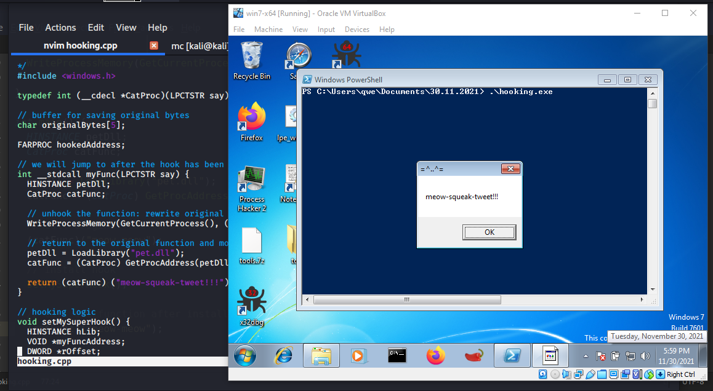{width="80%"}

### 什么是 API hooking？

API hooking 是一种技术，通过它我们可以插桩并修改 API 调用的行为和流程。许多 AV 解决方案也用这项技术来检测代码是否为恶意。

### 示例 1

在钩住 Windows API 函数之前，我先考虑一下如何对一个 DLL 中的导出函数做这件事。

例如，我们有一个具有如下逻辑的 DLL（`pet.cpp`）：

```cpp
/*
pet.dll - DLL example for basic hooking
*/

#include <windows.h>
#pragma comment (lib, "user32.lib")

BOOL APIENTRY DllMain(HMODULE hModule, 
DWORD ul_reason_for_call, LPVOID lpReserved) {
  switch (ul_reason_for_call) {
  case DLL_PROCESS_ATTACH:
  break;
  case DLL_PROCESS_DETACH:
  break;
  case DLL_THREAD_ATTACH:
  break;
  case DLL_THREAD_DETACH:
  break;
  }
  return TRUE;

extern "C" {
  __declspec(dllexport) int _cdecl Cat(LPCTSTR say) {
  MessageBox(NULL, say, "=^..^=", MB_OK);
	  return 1;
	}

extern "C" {
  __declspec(dllexport) int _cdecl Mouse(LPCTSTR say) {
  MessageBox(NULL, say, "<:3()~~", MB_OK);
	  return 1;
	}

extern "C" {
  __declspec(dllexport) int _cdecl Frog(LPCTSTR say) {
  MessageBox(NULL, say, "8)~", MB_OK);
	  return 1;
	}

extern "C" {
  __declspec(dllexport) int _cdecl Bird(LPCTSTR say) {
  MessageBox(NULL, say, "<(-)", MB_OK);
	  return 1;
	}

```

如你所见，这个 DLL 有最简单的导出函数：`Cat`、`Mouse`、`Frog`、`Bird`，都只有一个形参 `say`。如你所见，这些函数的逻辑也最简单，只是弹出一个带标题的消息框。

我们来编译它：

```bash
x86_64-w64-mingw32-gcc -shared -o pet.dll pet.cpp -fpermissive
```

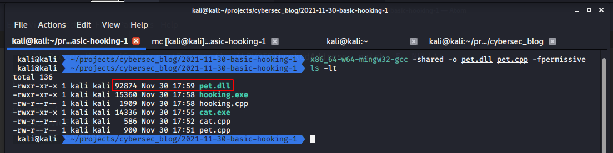{width="80%"}

然后，写一段简单的代码来验证这个 DLL（`cat.cpp`）：

```cpp
#include <windows.h>

typedef int (__cdecl *CatProc)(LPCTSTR say);
typedef int (__cdecl *BirdProc)(LPCTSTR say);

int main(void) {
  HINSTANCE petDll;
  CatProc catFunc;
  BirdProc birdFunc;
  BOOL freeRes;

  petDll = LoadLibrary("pet.dll");

  if (petDll != NULL) {
  catFunc = (CatProc) GetProcAddress(petDll, "Cat");
  birdFunc = (BirdProc) GetProcAddress(petDll, "Bird");
  if ((catFunc != NULL) && (birdFunc != NULL)) {
  (catFunc) ("meow-meow");
  (catFunc) ("mmmmeow");
  (birdFunc) ("tweet-tweet");
  }
  freeRes = FreeLibrary(petDll);
  }

  return 0;

```

我们来编译它：

```bash
x86_64-w64-mingw32-g++ -O2 cat.cpp -o cat.exe \
-mconsole -I/usr/share/mingw-w64/include/ -s \
-ffunction-sections -fdata-sections -Wno-write-strings \
-fno-exceptions -fmerge-all-constants -static-libstdc++ \
-static-libgcc -fpermissive
```

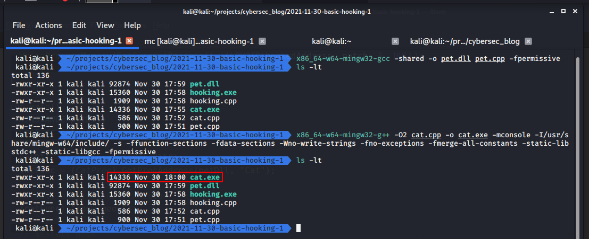{width="80%"}

并在 Windows 7 x64 上运行：

```cmd
.\cat.exe
```

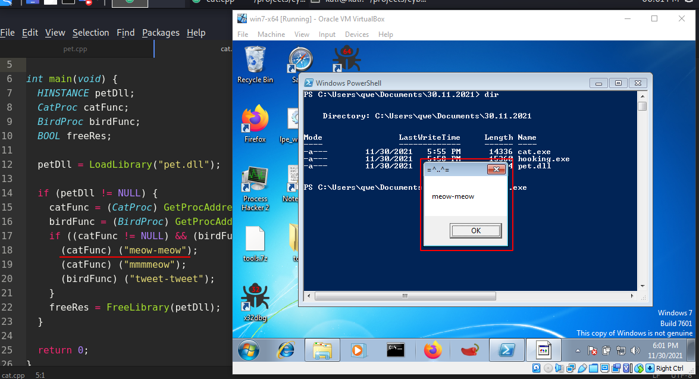{width="80%"}

{width="80%"}

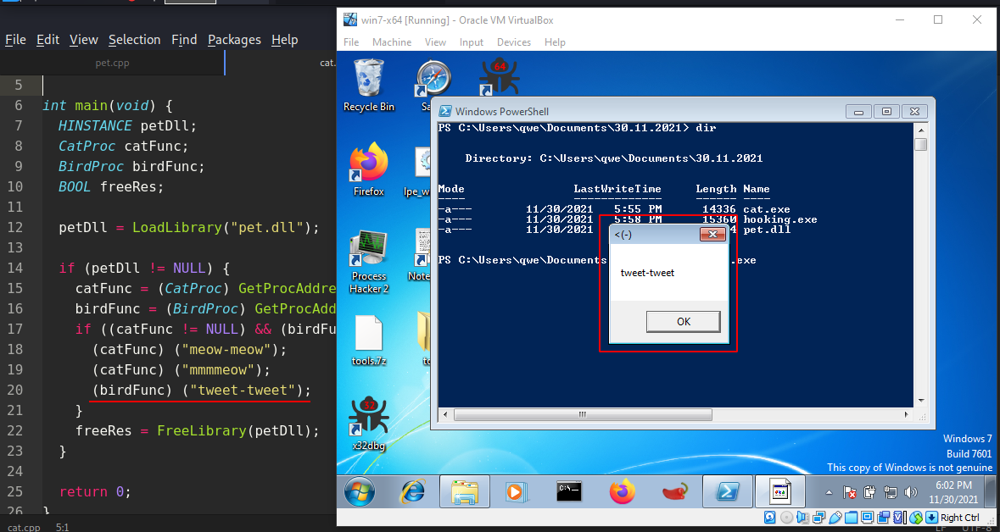{width="80%"}

如你所见，一切按预期工作。

然后，举例来说，在这个场景中 `Cat` 函数将被钩住，但它可以是任何函数。

这项技术的工作流程如下：

首先，获取 `Cat` 函数的内存地址。

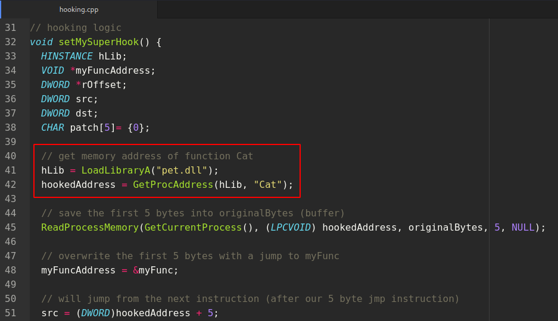{width="80%"}

然后，保存 `Cat` 函数的前 5 个字节。我们后面会用到这些字节：

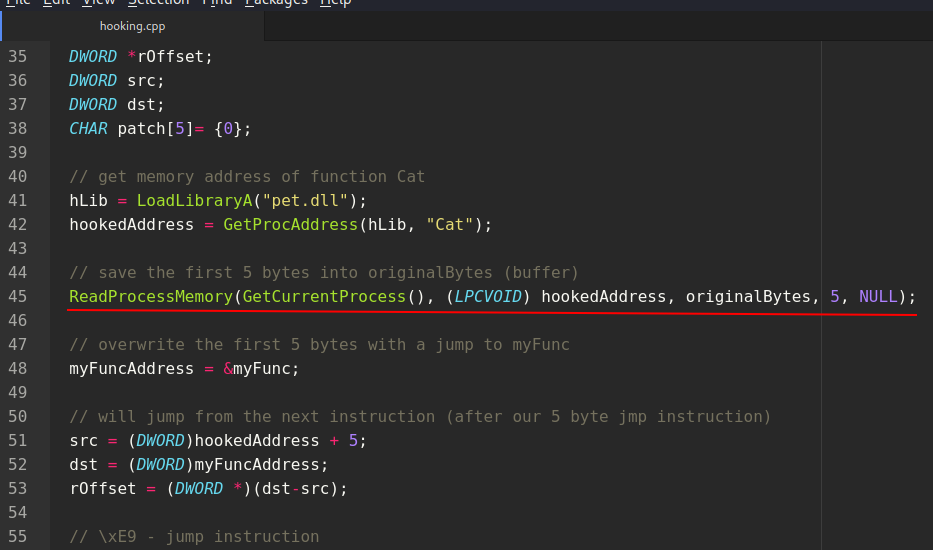{width="80%"}

然后，创建一个 `myFunc` 函数，它将在原始 `Cat` 被调用时执行：

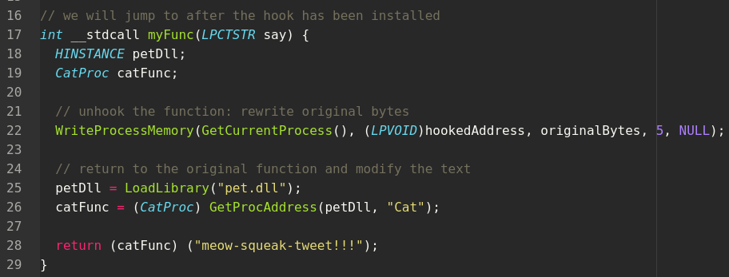{width="80%"}

用一条跳转到 `myFunc` 的指令覆盖 5 个字节：

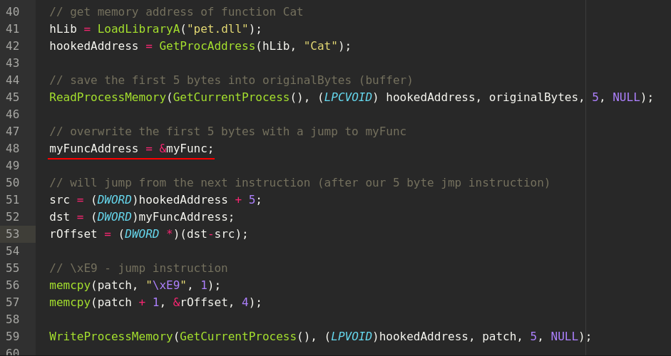{width="80%"}

然后，创建一个「补丁」：

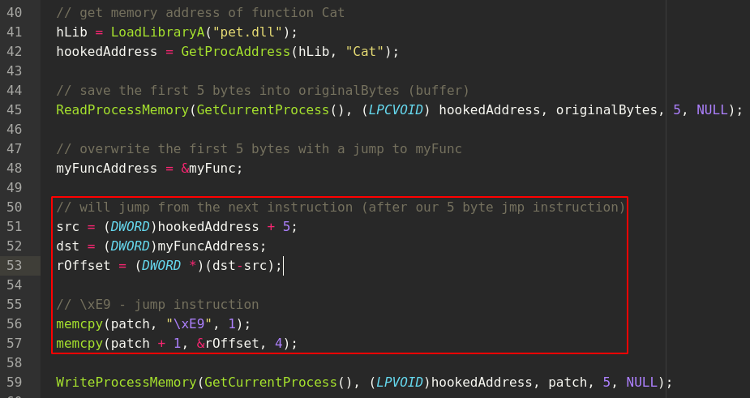{width="80%"}

下一步，给我们的 `Cat` 函数打补丁（把 `Cat` 函数重定向到 `myFunc`）：

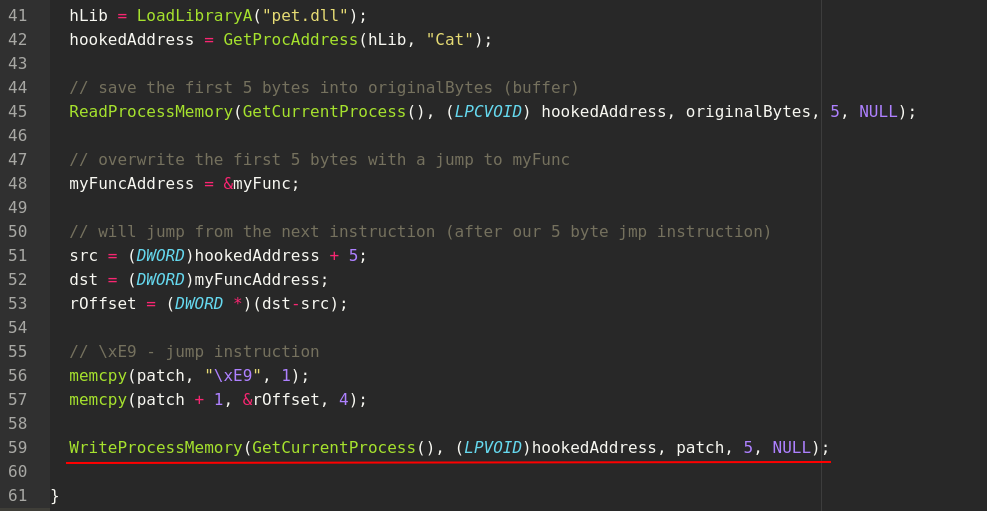{width="80%"}

那么我们在这里做了什么？这个技巧就是「经典 5 字节钩子」技术。如果我们反汇编这个函数：

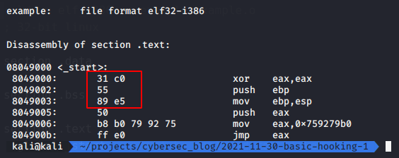{width="80%"}

高亮的 5 个字节是许多 API 函数中相当典型的一段序言。通过用一条 `jmp` 指令覆盖这前 5 个字节，我们把执行流重定向到我们自己定义的函数。我们会保存原始字节，以便之后想把执行流交还给被钩住的函数时引用。

那么首先，我们调用原始的 `Cat` 函数，安装我们的钩子，然后再次调用 `Cat`：

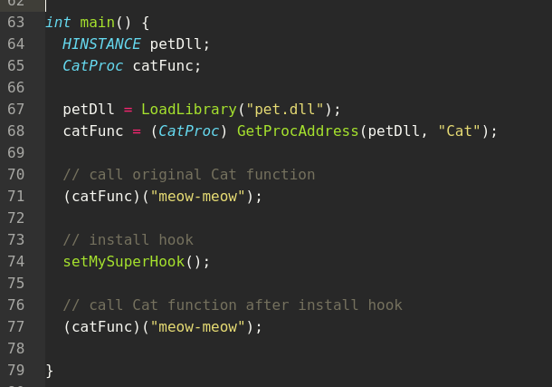{width="80%"}

完整源代码如下：

```cpp
/*
hooking.cpp
basic hooking example
author: @cocomelonc
https://cocomelonc.github.io/tutorial/
2021/11/30/basic-hooking-1.html
*/
#include <windows.h>

typedef int (__cdecl *CatProc)(LPCTSTR say);

// buffer for saving original bytes
char originalBytes[5];

FARPROC hookedAddress;

// we will jump to after the hook has been installed
int __stdcall myFunc(LPCTSTR say) {
  HINSTANCE petDll;
  CatProc catFunc;

  // unhook the function: rewrite original bytes
  WriteProcessMemory(GetCurrentProcess(), 
  (LPVOID)hookedAddress, 
  originalBytes, 5, NULL);

  // return to the original function and modify the text
  petDll = LoadLibrary("pet.dll");
  catFunc = (CatProc) GetProcAddress(petDll, "Cat");

  return (catFunc) ("meow-squeak-tweet!!!");

// hooking logic
void setMySuperHook() {
  HINSTANCE hLib;
  VOID *myFuncAddress;
  DWORD *rOffset;
  DWORD src;
  DWORD dst;
  CHAR patch[5]= {0};

  // get memory address of function Cat
  hLib = LoadLibraryA("pet.dll");
  hookedAddress = GetProcAddress(hLib, "Cat");

  // save the first 5 bytes into originalBytes (buffer)
  ReadProcessMemory(GetCurrentProcess(), 
  (LPCVOID) hookedAddress, 
  originalBytes, 5, NULL);

  // overwrite the first 5 bytes with a jump to myFunc
  myFuncAddress = &myFunc;

  // will jump from the next instruction 
  // (after our 5 byte jmp instruction)
  src = (DWORD)hookedAddress + 5;
  dst = (DWORD)myFuncAddress;
  rOffset = (DWORD *)(dst-src);

  // \xE9 - jump instruction
  memcpy(patch, "\xE9", 1);
  memcpy(patch + 1, &rOffset, 4);

  WriteProcessMemory(GetCurrentProcess(), 
  (LPVOID)hookedAddress, patch, 
  5, NULL);

int main() {
  HINSTANCE petDll;
  CatProc catFunc;

  petDll = LoadLibrary("pet.dll");
  catFunc = (CatProc) GetProcAddress(petDll, "Cat");

  // call original Cat function
  (catFunc)("meow-meow");

  // install hook
  setMySuperHook();

  // call Cat function after install hook
  (catFunc)("meow-meow");

```

我们来编译它：

```bash
x86_64-w64-mingw32-g++ -O2 hooking.cpp -o hooking.exe \
-mconsole -I/usr/share/mingw-w64/include/ -s \
-ffunction-sections -fdata-sections -Wno-write-strings \
-fno-exceptions -fmerge-all-constants -static-libstdc++ \
-static-libgcc -fpermissive
```

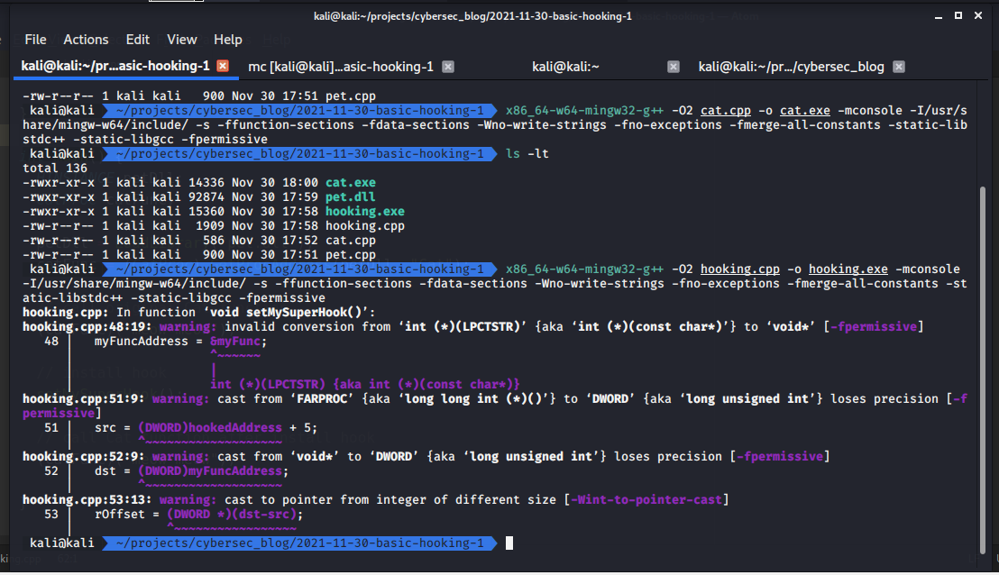{width="80%"}

然后看它实际运行（这里是在 Windows 7 x64 上）：

```cmd
.\hooking.exe
```

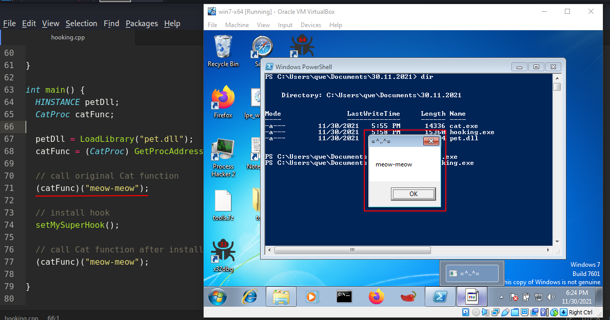{width="80%"}

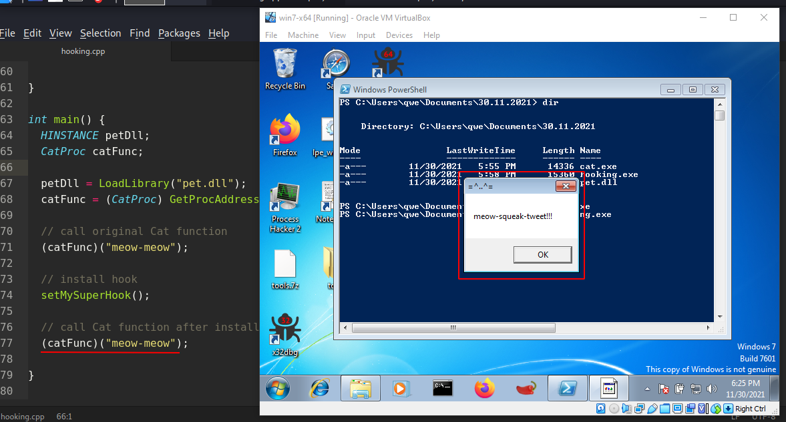{width="80%"}

如你所见，我们的钩子完美工作了！！`Cat` 弹出了 meow-squeak-tweet!!!，而不是 meow-meow！

### 示例 2

同样地，你可以钩住例如 `kernel32.dll` 中的 `WinExec` 函数（`hooking2.cpp`）：

```cpp
#include <windows.h>

// buffer for saving original bytes
char originalBytes[5];

FARPROC hookedAddress;

// we will jump to after the hook has been installed
int __stdcall myFunc(LPCSTR lpCmdLine, UINT uCmdShow) {

  // unhook the function: rewrite original bytes
  WriteProcessMemory(GetCurrentProcess(), 
  (LPVOID)hookedAddress, originalBytes, 5, NULL);

  // return to the original function and modify the text
  return WinExec("calc", uCmdShow);

// hooking logic
void setMySuperHook() {
  HINSTANCE hLib;
  VOID *myFuncAddress;
  DWORD *rOffset;
  DWORD src;
  DWORD dst;
  CHAR patch[5]= {0};

  // get memory address of function MessageBoxA
  hLib = LoadLibraryA("kernel32.dll");
  hookedAddress = GetProcAddress(hLib, "WinExec");

  // save the first 5 bytes into originalBytes (buffer)
  ReadProcessMemory(GetCurrentProcess(), 
  (LPCVOID) hookedAddress, originalBytes, 5, NULL);

  // overwrite the first 5 bytes with a jump to myFunc
  myFuncAddress = &myFunc;

  // will jump from the next instruction 
  // (after our 5 byte jmp instruction)
  src = (DWORD)hookedAddress + 5;
  dst = (DWORD)myFuncAddress;
  rOffset = (DWORD *)(dst-src);

  // \xE9 - jump instruction
  memcpy(patch, "\xE9", 1);
  memcpy(patch + 1, &rOffset, 4);

  WriteProcessMemory(GetCurrentProcess(), 
  (LPVOID)hookedAddress, patch, 5, NULL);

int main() {

  // call original
  WinExec("notepad", SW_SHOWDEFAULT);

  // install hook
  setMySuperHook();

  // call after install hook
  WinExec("notepad", SW_SHOWDEFAULT);

```

我们来编译：

```bash
x86_64-w64-mingw32-g++ -O2 hooking2.cpp -o hooking2.exe \
-mconsole -I/usr/share/mingw-w64/include/ -s \
-ffunction-sections -fdata-sections -Wno-write-strings \
-fno-exceptions -fmerge-all-constants -static-libstdc++ \
-static-libgcc -fpermissive
```

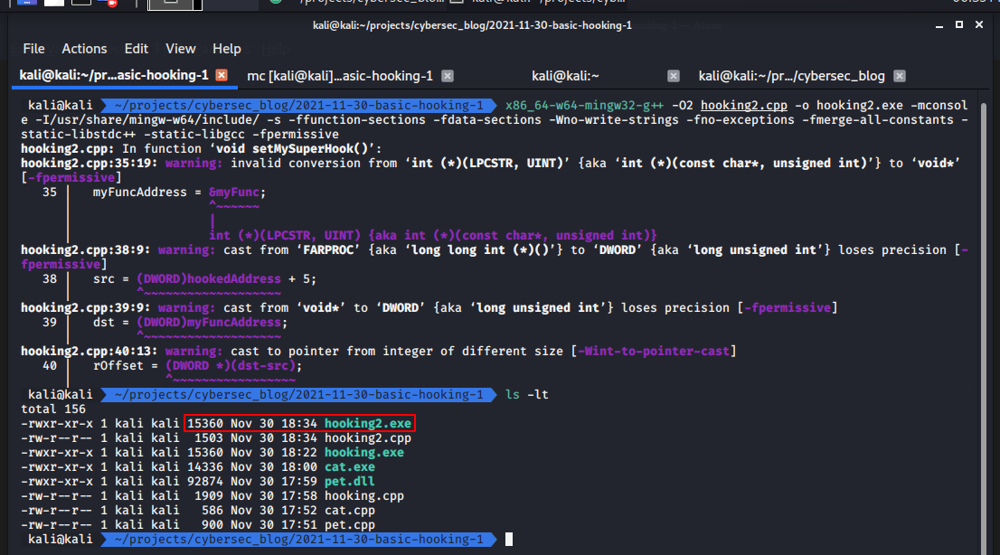{width="80%"}

然后运行：

```cmd
.\hooking2.exe
```

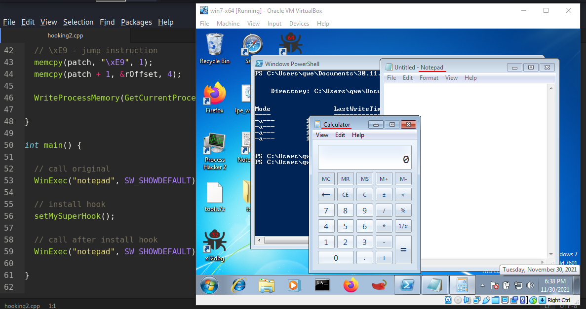{width="80%"}

一切按预期工作了。

[Source code in Github](https://github.com/cocomelonc/2021-11-30-basic-hooking-1)

[MessageBox](https://docs.microsoft.com/en-us/windows/win32/api/winuser/nf-winuser-messagebox)  
[WinExec](https://docs.microsoft.com/en-us/windows/win32/api/winbase/nf-winbase-winexec)  
[Exporting from DLL using __declspec](https://docs.microsoft.com/en-us/cpp/build/exporting-from-a-dll-using-declspec-dllexport?view=msvc-170)
