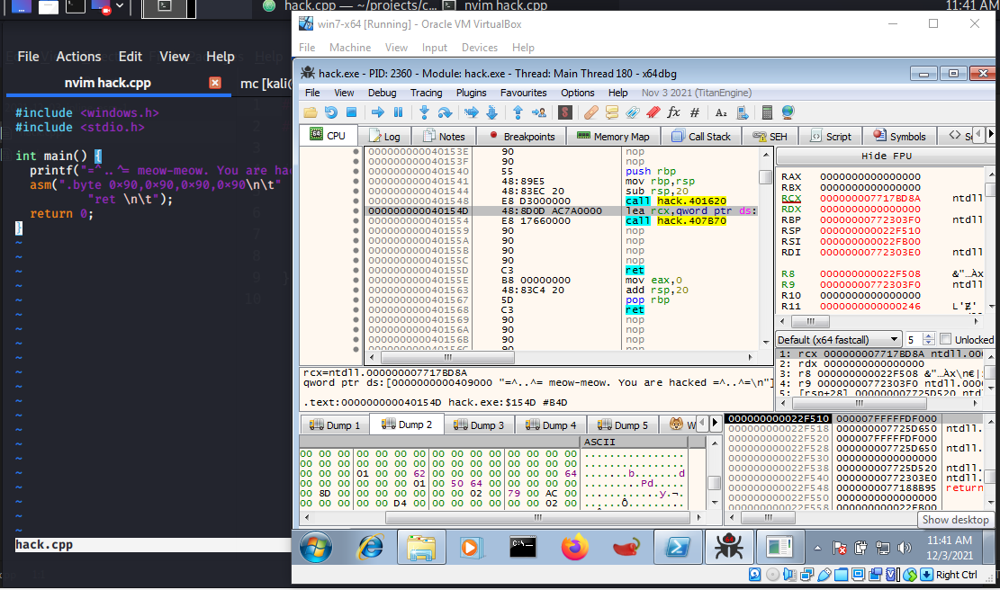
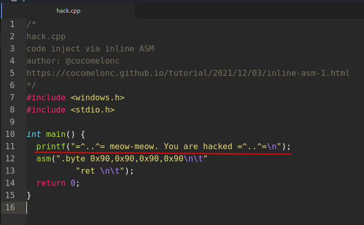
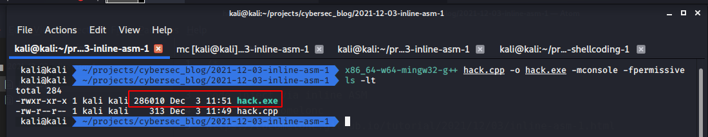
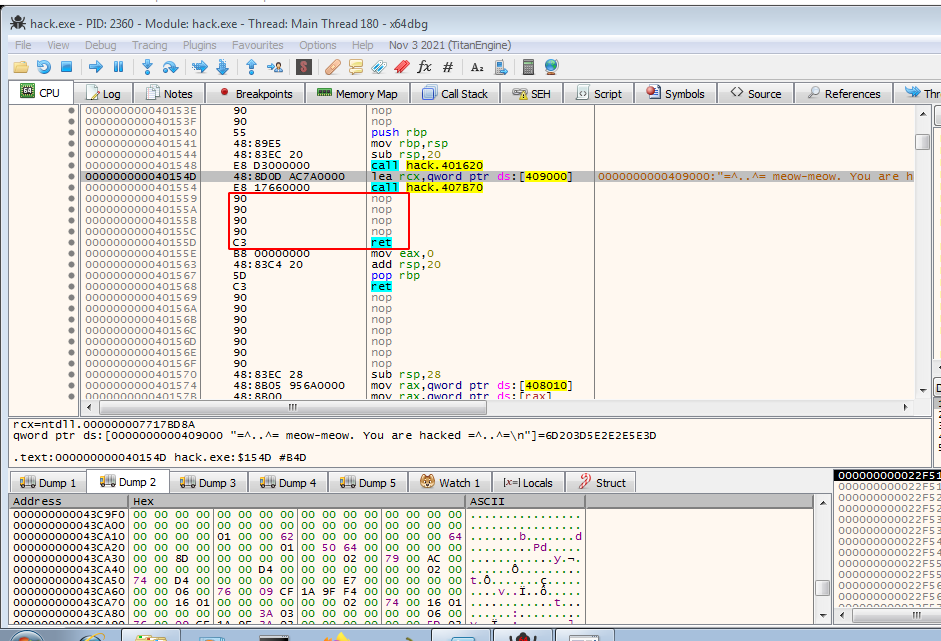

\newpage
\subsection{通过内联汇编运行 shellcode：简单的 C++ 示例}

﷽

{width="80%"}

这是一个非常短的章节，它描述了一个在恶意软件中用内联汇编运行 shellcode 的示例用法。

我们来看我们恶意软件的示例 C++ 源代码：

```cpp
/*
hack.cpp
code inject via inline ASM
author: @cocomelonc
https://cocomelonc.github.io/tutorial/
2021/12/03/inline-asm-1.html
*/
#include <windows.h>
#include <stdio.h>

int main() {
  printf("=^..^= meow-meow. You are hacked =^..^=\n");
  asm(".byte 0x90,0x90,0x90,0x90\n\t"
  "ret \n\t");
  return 0;

```

如你所见，逻辑最简单，我只是在前面加了一条打印 meow-meow 字符串的语句，再加 4 条 NOP 指令。我可以很容易地在调试器里根据这个 meow 字符串找到 shellcode：

{width="80%"}

我们来编译它：

```bash
x86_64-w64-mingw32-g++ hack.cpp -o hack.exe \
-mconsole -fpermissive
```

{width="80%"}

And run in `x96dbg` (on `Windows 7 x64` in my case):

{width="80%"}

如你所见，高亮的指令正是我的 NOP 指令，所以一切都如预期般完美运行。

这项技术之所以值得放进你的武器库，是因为它不需要用 `VirtualAlloc` 去申请新的 `RWX` 内存来把 shellcode 复制过去——`VirtualAlloc` 更常见、更可疑，也因此被蓝队更密切地研究。

我希望这篇文章能让蓝队了解这项有趣的技术，同时为红队的武器库增添一件武器。

[inline assembly](https://docs.microsoft.com/en-us/cpp/assembler/inline/inline-assembler?view=msvc-170)  
[source code in Github](https://github.com/cocomelonc/2021-12-03-inline-asm-1)
