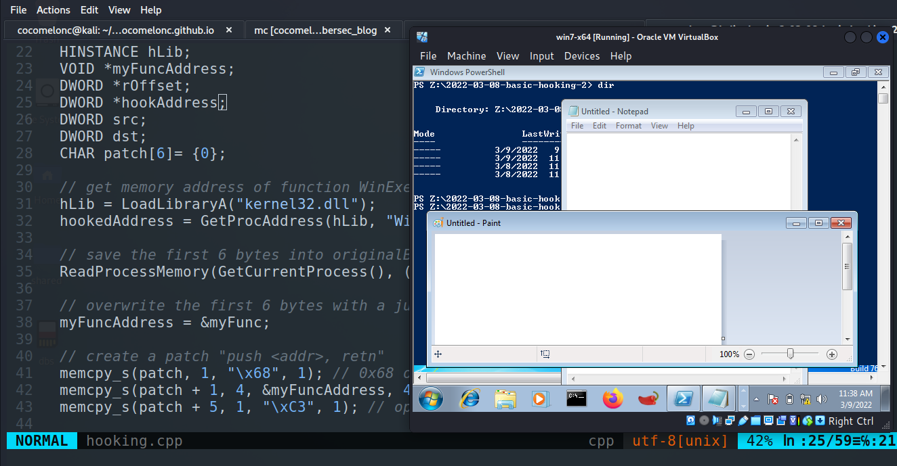
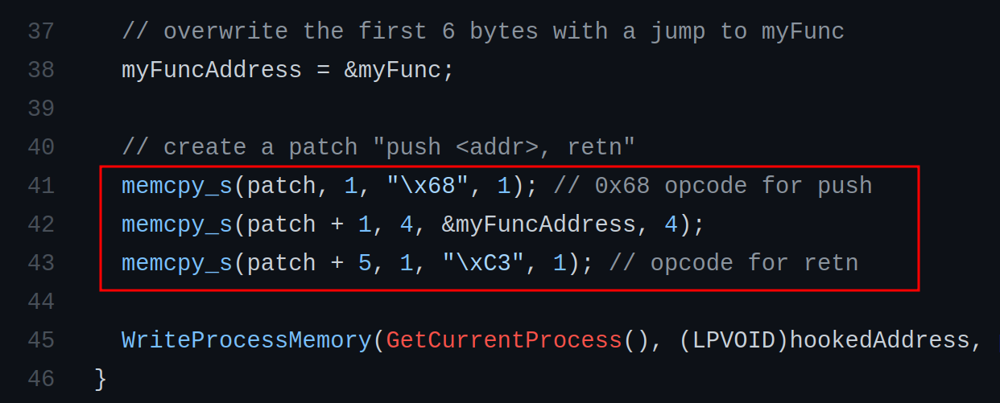
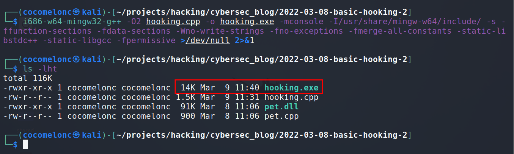
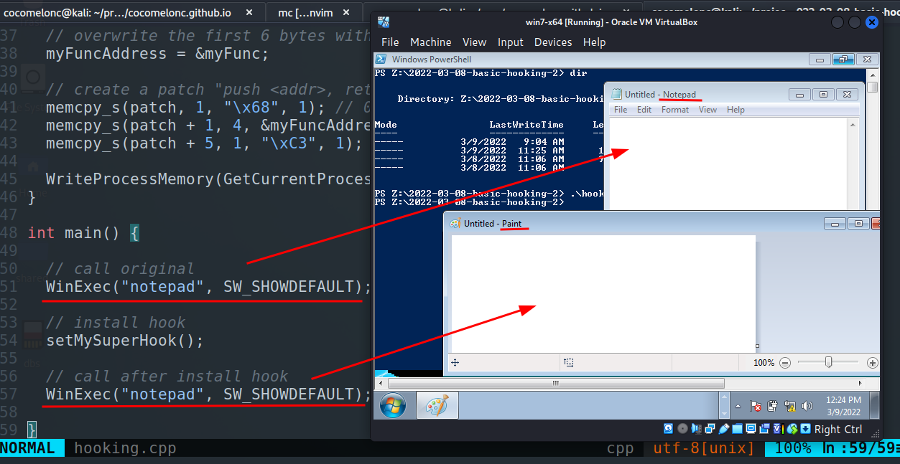

\newpage
\subsection{Windows API 挂钩（第 2 部分）：简单的 C++ 示例}

﷽

{width="80%"}

### 什么是 API hooking？

API hooking 是一种技术，通过它我们可以插桩并修改 API 调用的行为和流程。

钩子最简单的实现方式是插入一条跳转指令。在这一节中，我会展示一个稍微不同的例子——使用 `push`/`retn` 方法来实现钩子。

这个方法总共是 6 个字节，看起来是这样的。

`push` 指令把一个 32 位值压入栈，`retn` 指令从栈中弹出一个 32 位值，然后用它作为指令指针——因此我们跳转到我们想要的地址。

### 示例 1

我们来看一个例子。在这种情况下，我钩住 `kernel32.dll` 中的 `WinExec` 函数（`hooking.cpp`）：

```cpp
/*
hooking.cpp
basic hooking example with push/retn method
author: @cocomelonc
https://cocomelonc.github.io/tutorial/
2022/03/08/basic-hooking-2.html
*/
#include <windows.h>

// buffer for saving original bytes
char originalBytes[6];

FARPROC hookedAddress;

// we will jump to after the hook has been installed
int __stdcall myFunc(LPCSTR lpCmdLine, UINT uCmdShow) {
  WriteProcessMemory(GetCurrentProcess(), 
  (LPVOID)hookedAddress, originalBytes, 6, NULL);
  return WinExec("mspaint", uCmdShow);

// hooking logic
void setMySuperHook() {
  HINSTANCE hLib;
  VOID *myFuncAddress;
  DWORD *rOffset;
  DWORD *hookAddress;
  DWORD src;
  DWORD dst;
  CHAR patch[6]= {0};

  // get memory address of function WinExec
  hLib = LoadLibraryA("kernel32.dll");
  hookedAddress = GetProcAddress(hLib, "WinExec");

  // save the first 6 bytes into originalBytes (buffer)
  ReadProcessMemory(GetCurrentProcess(), 
  (LPCVOID) hookedAddress, 
  originalBytes, 6, NULL);

  // overwrite the first 6 bytes with a jump to myFunc
  myFuncAddress = &myFunc;

  // create a patch "push <addr>, retn"
  memcpy_s(patch, 1, "\x68", 1); // 0x68 opcode for push
  memcpy_s(patch + 1, 4, &myFuncAddress, 4);
  memcpy_s(patch + 5, 1, "\xC3", 1); // opcode for retn

  WriteProcessMemory(GetCurrentProcess(), 
  (LPVOID)hookedAddress, patch, 6, NULL);

int main() {

  // call original
  WinExec("notepad", SW_SHOWDEFAULT);

  // install hook
  setMySuperHook();

  // call after install hook
  WinExec("notepad", SW_SHOWDEFAULT);

```

如你所见，源代码与第一节中关于钩子的例子完全相同。唯一的区别是：

{width="80%"}

这将转换成以下汇编指令：

```nasm
// push myFunc memory address onto the stack
push myFunc

// jump to myFunc
retn
```

我们来编译它：

```bash
i686-w64-mingw32-g++ -O2 hooking.cpp -o hooking.exe \
-mconsole -I/usr/share/mingw-w64/include/ -s \
-ffunction-sections -fdata-sections -Wno-write-strings \
-fno-exceptions -fmerge-all-constants -static-libstdc++ \
-static-libgcc -fpermissive >/dev/null 2>&1
```

{width="80%"}

然后在 Windows 7 x64 上运行：

```cmd
.\hooking.exe
```

{width="80%"}

我们可以看到一切都完美工作了 :)

[x86 API Hooking Demystified](http://jbremer.org/x86-api-hooking-demystified/)  
[WinExec](https://docs.microsoft.com/en-us/windows/win32/api/winbase/nf-winbase-winexec)  
[source code in github](https://github.com/cocomelonc/2022-03-08-basic-hooking-2)
