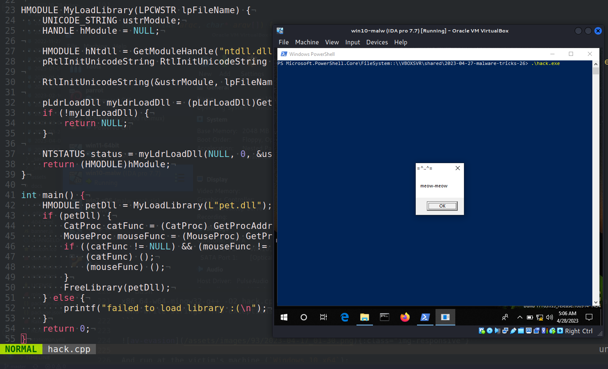
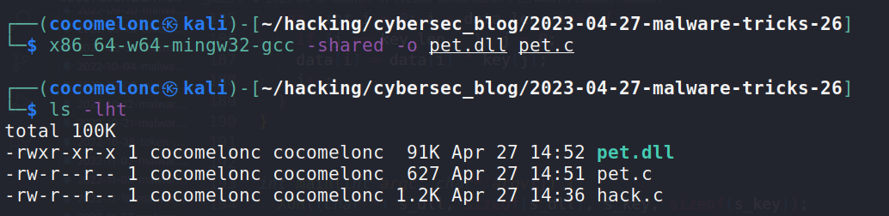
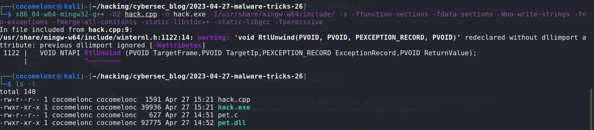
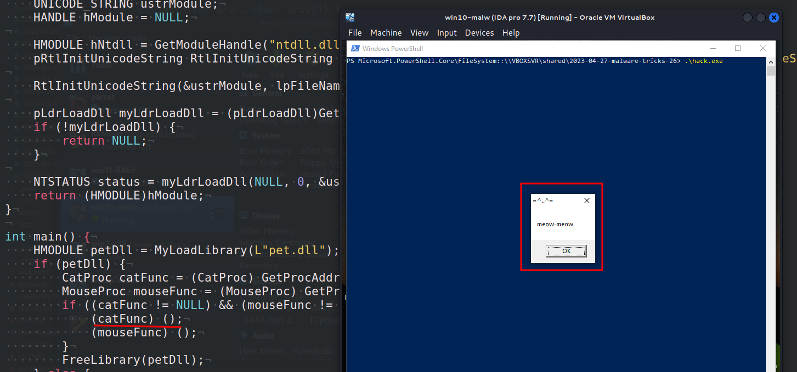
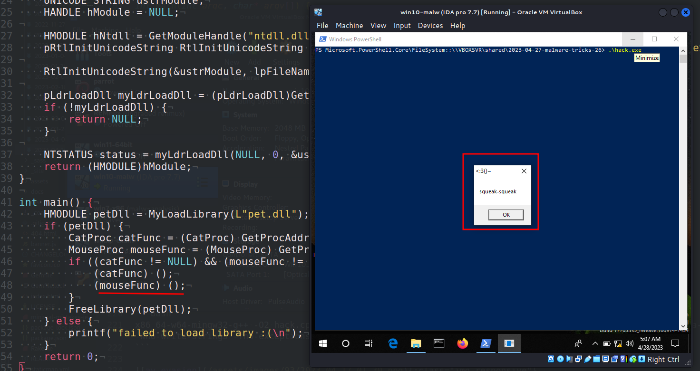
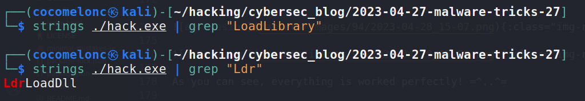

\newpage
\subsection{恶意软件开发技巧：WinAPI LoadLibrary 实现（简单的 C++ 示例）}

今天，我只是想把我的研究集中在另一个恶意软件开发技巧上：在某些情况和场景中，它对 AV 规避同样有帮助。

{width="80%"}

和之前关于 `GetModuleHandle` 和 `GetProcAddress` 实现的文章一样，我自己的 `LoadLibrary` 实现会是什么样呢？我们来试试。

### LoadLibrary

`LoadLibrary` 是一个 Windows API 函数，它允许你把一个动态链接库（DLL）模块加载到调用进程的地址空间中。

```cpp
HMODULE LoadLibraryA(
  LPCSTR lpLibFileName
);
```

`lpFileName`——一个以 null 结尾的字符串，指定模块的名称（可以是 `.dll` 或 `.exe` 文件）。

### 实战示例

首先，创建我们自己的 DLL。例如像这样（`pet.c`）：

```cpp
/*
pet.dll - DLL example for LoadLibrary
*/

#include <windows.h>
#pragma comment (lib, "user32.lib")

BOOL APIENTRY DllMain(HMODULE hModule,  DWORD  ul_reason_for_call, LPVOID lpReserved) {
  switch (ul_reason_for_call) {
  case DLL_PROCESS_ATTACH:
  break;
  case DLL_PROCESS_DETACH:
  break;
  case DLL_THREAD_ATTACH:
  break;
  case DLL_THREAD_DETACH:
  break;
  }
  return TRUE;

__declspec(dllexport) int _cdecl Cat() {
  MessageBox(NULL, "meow-meow", "=^..^=", MB_OK);
  return 1;

__declspec(dllexport) int _cdecl Mouse() {
  MessageBox(NULL, "squeak-squeak", "<:3()~", MB_OK);
  return 1;

```

然后，创建加载这个 DLL 的应用程序。`LoadLibrary` 逻辑的简单实现看起来像这样：

```cpp
/*
 * hack.c - LoadLibrary implementation. C++ implementation
 * @cocomelonc
 * https://cocomelonc.github.io/tutorial/2023/04/27/malware-tricks-27.html
*/
#include <stdlib.h>
#include <stdio.h>
#include <windows.h>
#include <winternl.h>

typedef int (__cdecl *CatProc)();
typedef int (__cdecl *MouseProc)();

typedef NTSTATUS(NTAPI *pLdrLoadDll) (
  PWCHAR PathToFile,
  ULONG Flags,
  PUNICODE_STRING ModuleFileName,
  PHANDLE ModuleHandle
);

typedef VOID (NTAPI *pRtlInitUnicodeString)(PUNICODE_STRING DestinationString,
 PCWSTR SourceString);

HMODULE MyLoadLibrary(LPCWSTR lpFileName) {
  UNICODE_STRING ustrModule;
  HANDLE hModule = NULL;

  HMODULE hNtdll = GetModuleHandle("ntdll.dll");
  pRtlInitUnicodeString RtlInitUnicodeString = 
  (pRtlInitUnicodeString)GetProcAddress(hNtdll, "RtlInitUnicodeString");

  RtlInitUnicodeString(&ustrModule, lpFileName);

  pLdrLoadDll myLdrLoadDll = (pLdrLoadDll)
  GetProcAddress(GetModuleHandle("ntdll.dll"), "LdrLoadDll");
  if (!myLdrLoadDll) {
  return NULL;
  }

  NTSTATUS status = myLdrLoadDll(NULL, 0, &ustrModule, &hModule);
  return (HMODULE)hModule;

int main() {
  HMODULE petDll = MyLoadLibrary(L"pet.dll");
  if (petDll) {
  CatProc catFunc = (CatProc) GetProcAddress(petDll, "Cat");
  MouseProc mouseFunc = (MouseProc) GetProcAddress(petDll, "Mouse");
  if ((catFunc != NULL) && (mouseFunc != NULL)) {
  (catFunc) ();
  (mouseFunc) ();
  }
  FreeLibrary(petDll);
  } else {
  printf("failed to load library :(\n");
  }
  return 0;

```

这个实现利用了未文档化的 `LdrLoadDll` 函数：

```cpp
NTSYSAPI 
NTSTATUS
NTAPI
LdrLoadDll(
  IN PWCHAR  PathToFile OPTIONAL,
  IN ULONG  Flags OPTIONAL,
  IN PUNICODE_STRING  ModuleFileName,
  OUT PHANDLE  ModuleHandle );
```

它是 `ntdll.dll` 库的一部分。

使用 `LdrLoadDll` 函数，我们可以通过提供必要的形参来手动加载一个库。

好，我们能通过 `MyLoadLibrary` 加载我们的 DLL 到其他应用程序中吗？是的，可以。

另外，如你所见，我们可以用 `GetProcAddress` 获取函数地址。

还有一点，我们使用 `RtlInitUnicodeString` 函数指针而不是直接调用该函数。

```bash
x86_64-w64-mingw32-gcc -shared -o pet.dll pet.c
```

{width="80%"}

好，我们来看看这一切的实际效果。首先编译我们的 `pet.c`：

```bash
x86_64-w64-mingw32-g++ -O2 hack.cpp -o hack.exe \
-I/usr/share/mingw-w64/include/ -s \
-ffunction-sections -fdata-sections -Wno-write-strings \
-fno-exceptions -fmerge-all-constants -static-libstdc++ \
-static-libgcc -fpermissive
```

{width="80%"}

然后，编译我们的「恶意软件」应用（`hack.cpp`）：

```powershell
.\hack.exe
```

{width="80%"}

{width="80%"}

{width="80%"}

最后，在受害机器上运行它（Windows 10 x64）：

我们可以看到一切都完美工作了！=..=

我希望这篇文章能让蓝队意识到这项有趣的恶意软件开发技术，同时为红队的武器库增添一件武器。

该函数以 DLL 的名称作为实参，并返回已加载模块的句柄。如果函数失败，它返回 NULL：

### 演示
