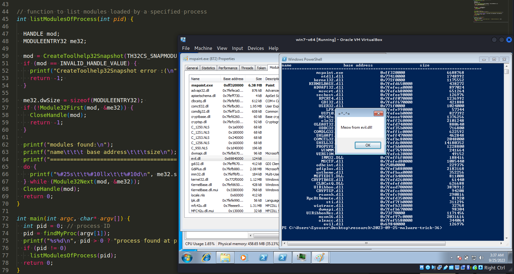
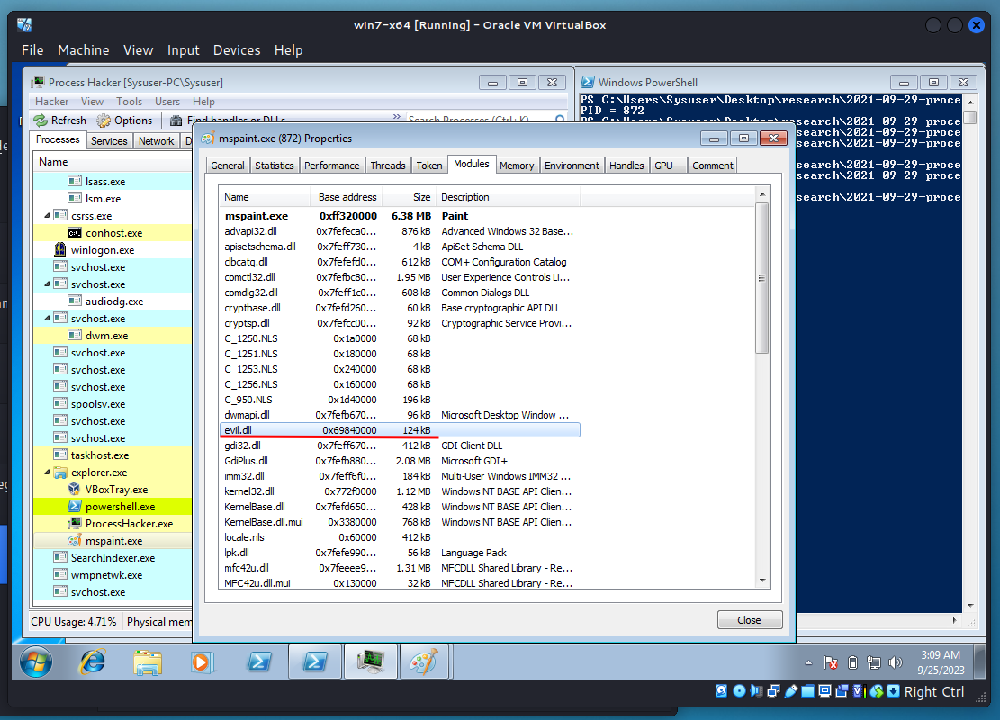
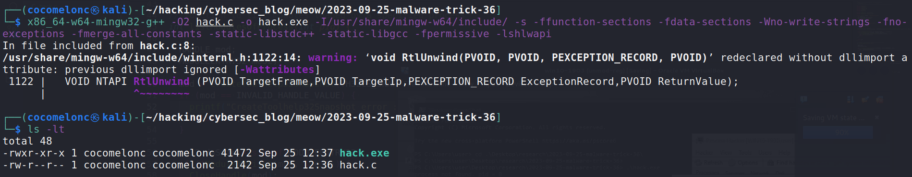
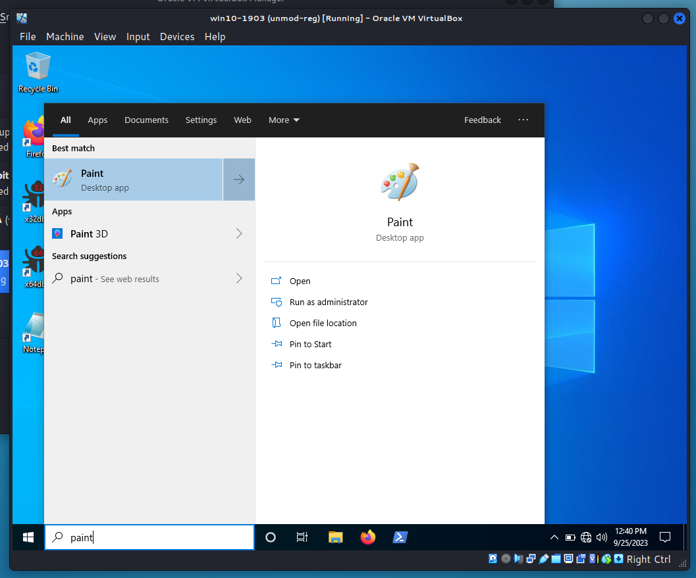
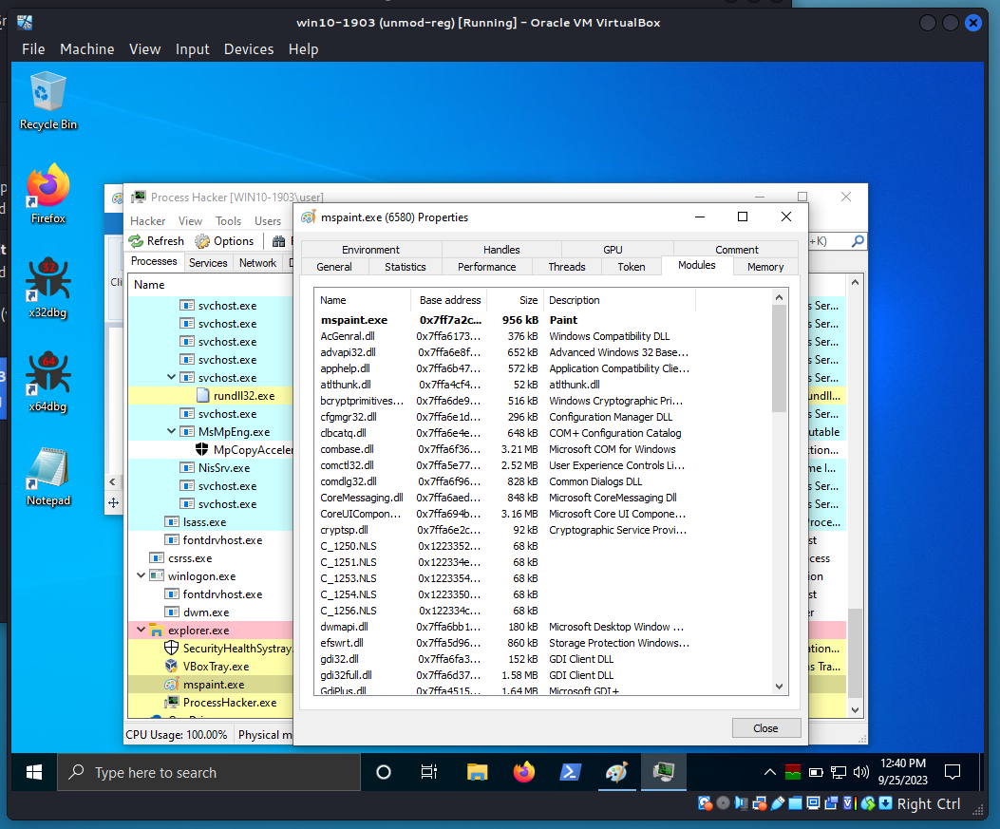
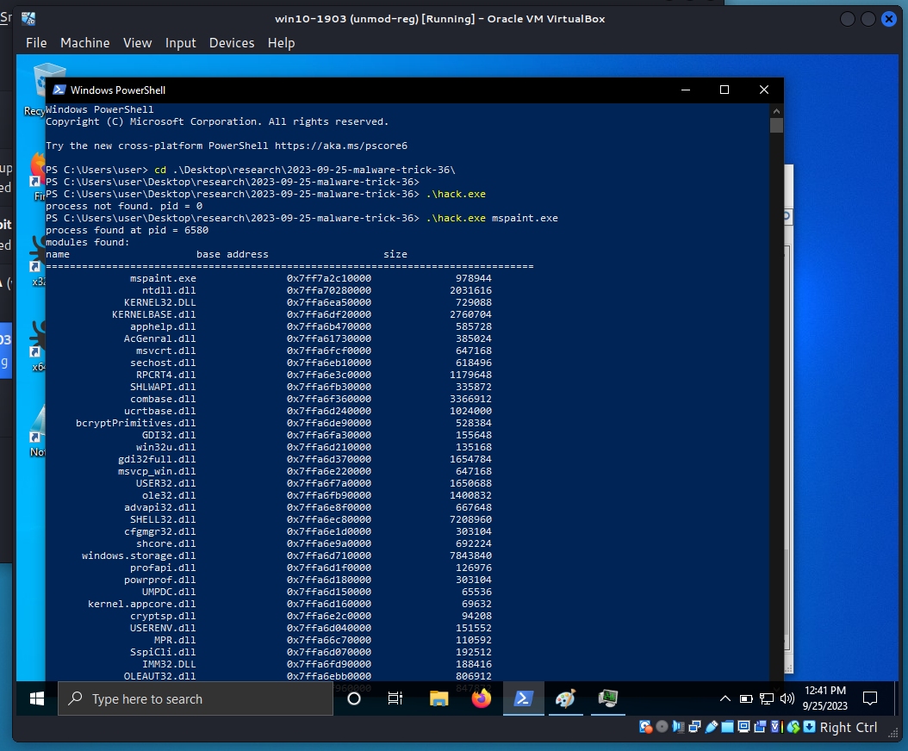
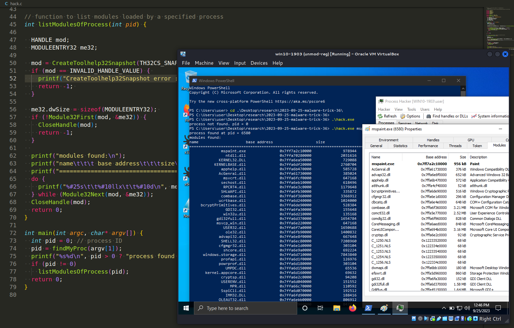
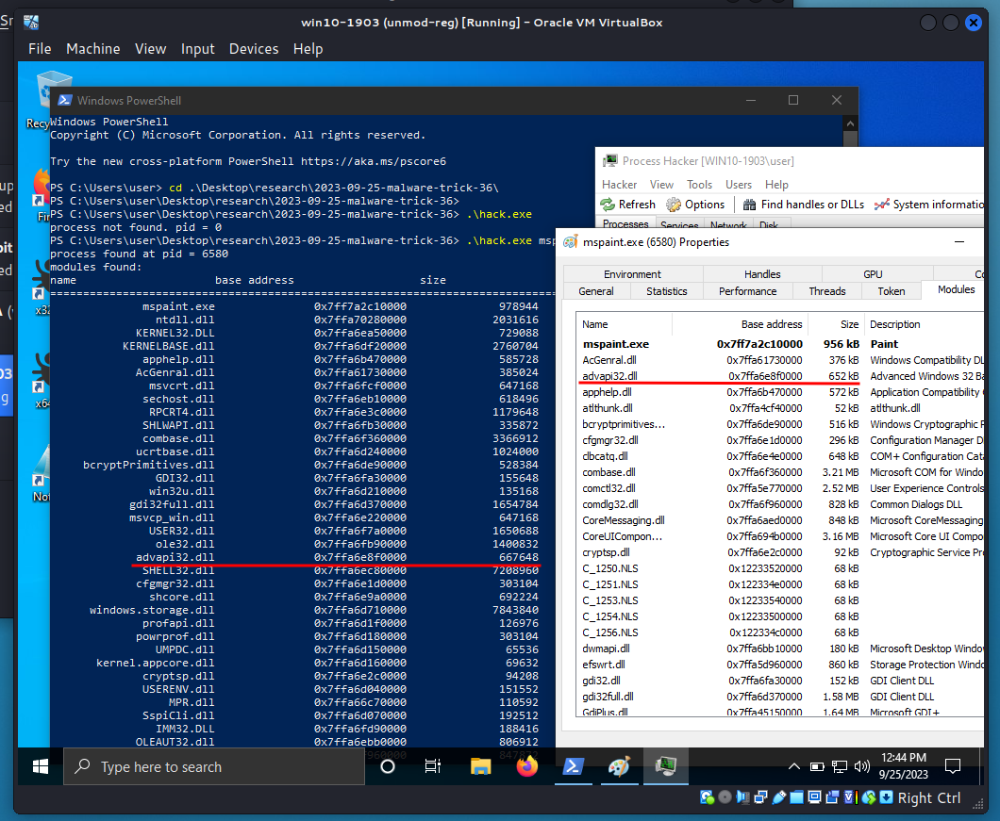
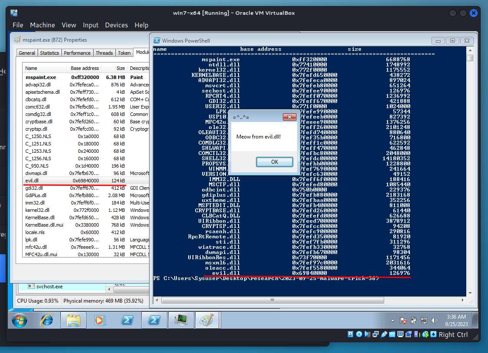

\newpage
\subsection{恶意软件开发技巧：枚举进程模块（简单的 C++ 示例）}

﷽

{width="80%"}

今天，这篇文章是我自己对另一个流行恶意软件开发技巧的研究结果：获取目标进程的模块列表。

假设我们已经成功地对进程完成了 DLL 注入。如何检查这个 DLL 是否在我们进程的模块列表中呢？

{width="80%"}

### 实战示例

首先，我们只是用其中一种方法来查找目标进程的 PID。例如我用了这个：

```cpp
typedef NTSTATUS (NTAPI * fNtGetNextProcess)(
  _In_ HANDLE ph,
  _In_ ACCESS_MASK DesiredAccess,
  _In_ ULONG HandleAttributes,
  _In_ ULONG Flags,
  _Out_ PHANDLE Newph
);

int findMyProc(const char * procname) {
  int pid = 0;
  HANDLE current = NULL;
  char procName[MAX_PATH];

  // resolve function address
  fNtGetNextProcess myNtGetNextProcess = 
  (fNtGetNextProcess) GetProcAddress(GetModuleHandle("ntdll.dll"), "NtGetNextProcess");

  // loop through all processes
  while (!myNtGetNextProcess(current, MAXIMUM_ALLOWED, 0, 0, &current)) {
  GetProcessImageFileNameA(current, procName, MAX_PATH);
  if (lstrcmpiA(procname, PathFindFileName((LPCSTR) procName)) == 0) {
  pid = GetProcessId(current);
  break;
  }
  }

  return pid;

```

然后，只需使用 Windows API 中的 `Module32First` 和 `Module32Next` 函数。

```cpp
// function to list modules loaded by a specified process
int listModulesOfProcess(int pid) {

  HANDLE mod;
  MODULEENTRY32 me32;

  mod = CreateToolhelp32Snapshot(TH32CS_SNAPMODULE | TH32CS_SNAPMODULE32, pid);
  if (mod == INVALID_HANDLE_VALUE) { 
  printf("CreateToolhelp32Snapshot error :(\n"); 
  return -1; 
  }

  me32.dwSize = sizeof(MODULEENTRY32); 
  if (!Module32First(mod, &me32)) {
  CloseHandle(mod);
  return -1;
  }
  
  printf("modules found:\n");
  printf("name\t\t\t base address\t\t\tsize\n");
  printf("======================================================================\n");
  do {
  printf("%#25s\t\t%#10llx\t\t%#10d\n", me32.szModule, me32.modBaseAddr, 
  me32.modBaseSize);
  } while (Module32Next(mod, &me32));
  CloseHandle(mod);
  return 0;

```

如你所见，这段代码与用 `CreateToolHelp32Snapshot`、`Process32First` 和 `Process32Next` 查找 PID 的逻辑有些相似。

那么，完整源代码看起来是这样的（`hack.c`）：

```cpp
/*
 * hack.c - get the list of modules of the process. C++ implementation
 * @cocomelonc
 * https://cocomelonc.github.io/malware/2023/09/25/malware-tricks-36.html
*/
#include <windows.h>
#include <stdio.h>
#include <winternl.h>
#include <tlhelp32.h>
#include <shlwapi.h>
#include <psapi.h>

#pragma comment(lib, "ntdll.lib")
#pragma comment(lib, "shlwapi.lib")

typedef NTSTATUS (NTAPI * fNtGetNextProcess)(
  _In_ HANDLE ph,
  _In_ ACCESS_MASK DesiredAccess,
  _In_ ULONG HandleAttributes,
  _In_ ULONG Flags,
  _Out_ PHANDLE Newph
);

int findMyProc(const char * procname) {
  int pid = 0;
  HANDLE current = NULL;
  char procName[MAX_PATH];

  // resolve function address
  fNtGetNextProcess myNtGetNextProcess = 
  (fNtGetNextProcess) GetProcAddress(GetModuleHandle("ntdll.dll"), "NtGetNextProcess");

  // loop through all processes
  while (!myNtGetNextProcess(current, MAXIMUM_ALLOWED, 0, 0, &current)) {
  GetProcessImageFileNameA(current, procName, MAX_PATH);
  if (lstrcmpiA(procname, PathFindFileName((LPCSTR) procName)) == 0) {
  pid = GetProcessId(current);
  break;
  }
  }

  return pid;

// function to list modules loaded by a specified process
int listModulesOfProcess(int pid) {

  HANDLE mod;
  MODULEENTRY32 me32;

  mod = CreateToolhelp32Snapshot(TH32CS_SNAPMODULE | TH32CS_SNAPMODULE32, pid);
  if (mod == INVALID_HANDLE_VALUE) { 
  printf("CreateToolhelp32Snapshot error :(\n"); 
  return -1; 
  }

  me32.dwSize = sizeof(MODULEENTRY32); 
  if (!Module32First(mod, &me32)) {
  CloseHandle(mod);
  return -1;
  }
  
  printf("modules found:\n");
  printf("name\t\t\t base address\t\t\tsize\n");
  printf("======================================================================\n");
  do {
  printf("%#25s\t\t%#10llx\t\t%#10d\n", me32.szModule, me32.modBaseAddr, 
  me32.modBaseSize);
  } while (Module32Next(mod, &me32));
  CloseHandle(mod);
  return 0;

int main(int argc, char* argv[]) {
  int pid = 0; // process ID
  pid = findMyProc(argv[1]);
  printf("%s%d\n", pid > 0 ? "process found at pid = " : 
  "process not found. pid = ", pid);
  if (pid != 0)
  listModulesOfProcess(pid);
  return 0;

```

你可以用这段代码检查一个 DLL 是否在目标进程的模块列表中。

### 演示

我们来看这段逻辑的实际效果。

编译它：

```bash
x86_64-w64-mingw32-g++ -O2 hack.c -o hack.exe \
-I/usr/share/mingw-w64/include/ \
-s -ffunction-sections \
-fdata-sections -Wno-write-strings -fno-exceptions \ -fmerge-all-constants -static-libstdc++ -static-libgcc \
-fpermissive -lshlwapi
```

{width="80%"}

然后，在受害机器上打开目标进程：

{width="80%"}

{width="80%"}

然后只需运行我们的 `hack.exe`：

```powershell
.\hack.exe mspaint.exe
```

{width="80%"}

{width="80%"}

{width="80%"}

另外，也可以用 DLL 注入逻辑来检查：

{width="80%"}

我们可以看到一切都完美工作了！=..=

请记住，这段代码可能有一些限制，并依赖于特定的 Windows API。

此外，它依靠进程名称来识别目标，而进程名称可能并不唯一。

这个技巧在野外被 4H RAT 和 Aria-body 使用。

我希望这篇文章能让蓝队意识到这项有趣的恶意软件开发技术，同时为红队的武器库增添一件武器。
