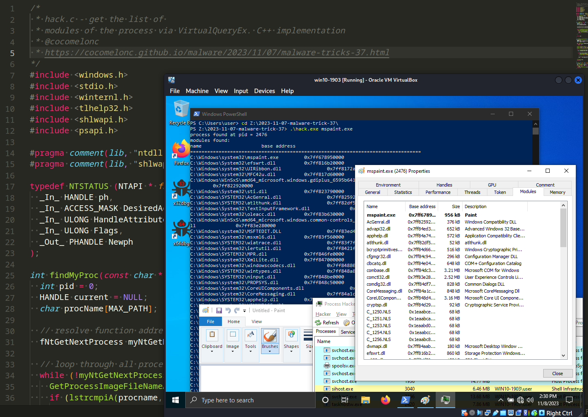
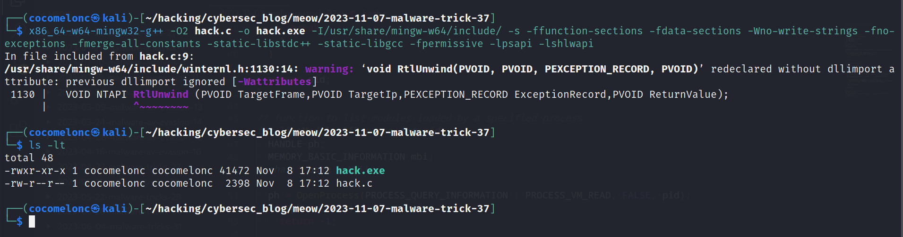
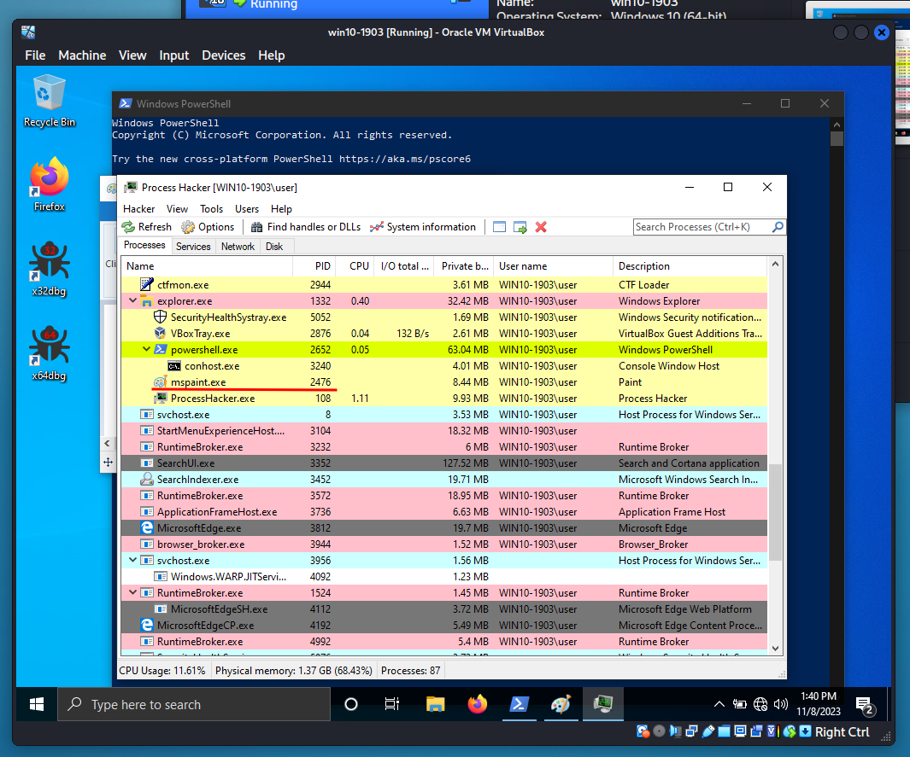
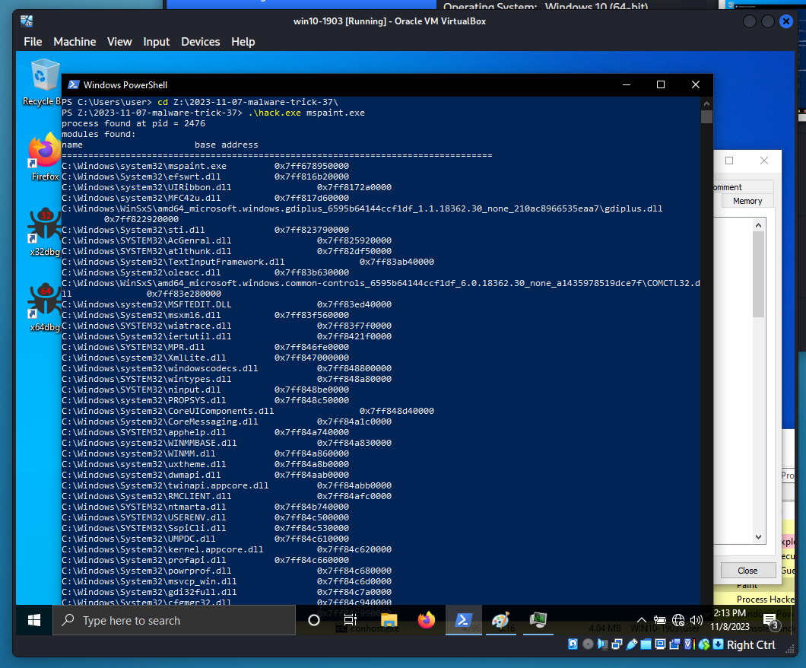
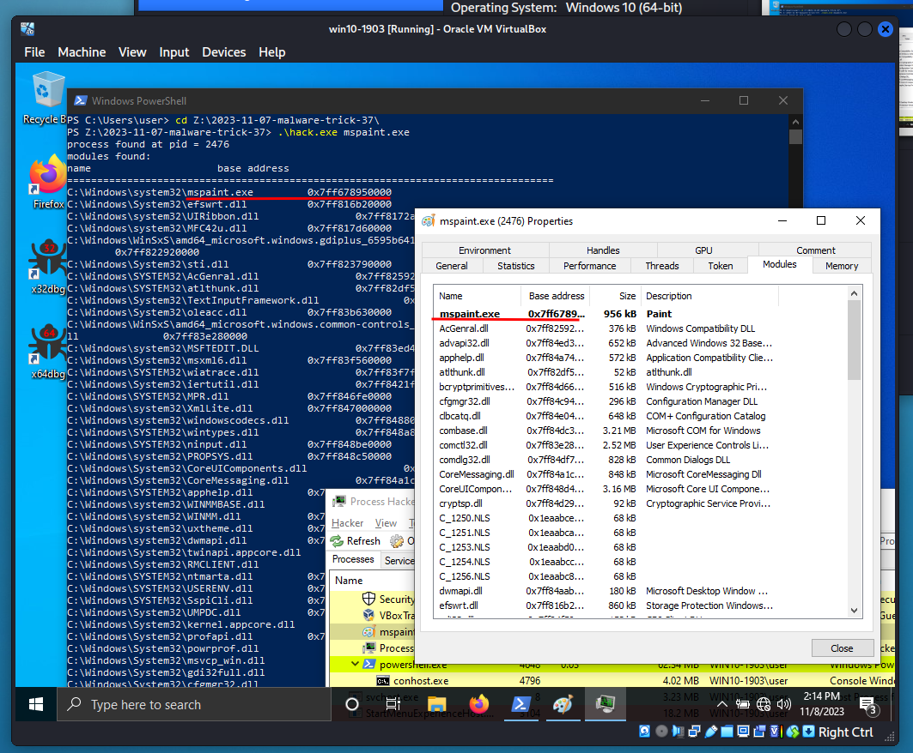

\newpage
\subsection{恶意软件开发技巧：通过 VirtualQueryEx 枚举进程模块（简单的 C++ 示例）}

﷽

{width="80%"}

今天，这篇文章是我自己对另一个流行恶意软件开发技巧的研究结果：获取目标进程的模块列表。

它与我之前那篇关于枚举模块列表的文章类似，只不过这一次我使用了 `VirtualQueryEx`。

### 实战示例

首先，我们只是用其中一种方法来查找目标进程的 PID。例如我用了这个：

```cpp
typedef NTSTATUS (NTAPI * fNtGetNextProcess)(
  _In_ HANDLE ph,
  _In_ ACCESS_MASK DesiredAccess,
  _In_ ULONG HandleAttributes,
  _In_ ULONG Flags,
  _Out_ PHANDLE Newph
);

int findMyProc(const char * procname) {
  int pid = 0;
  HANDLE current = NULL;
  char procName[MAX_PATH];

  // resolve function address
  fNtGetNextProcess myNtGetNextProcess = (fNtGetNextProcess) 
  GetProcAddress(GetModuleHandle("ntdll.dll"), "NtGetNextProcess");

  // loop through all processes
  while (!myNtGetNextProcess(current, MAXIMUM_ALLOWED, 0, 0, &current)) {
  GetProcessImageFileNameA(current, procName, MAX_PATH);
  if (lstrcmpiA(procname, PathFindFileName((LPCSTR) procName)) == 0) {
  pid = GetProcessId(current);
  break;
  }
  }

  return pid;

```

然后，创建一个函数：打开指定进程，用 `VirtualQueryEx` 遍历它的内存区域，并获取已加载模块的信息，包括名称和基址：

```cpp
// function to list modules loaded by a specified process
int listModulesOfProcess(int pid) {
  HANDLE ph;
  MEMORY_BASIC_INFORMATION mbi;
  char * base = NULL;

  ph = OpenProcess(PROCESS_QUERY_INFORMATION | PROCESS_VM_READ, FALSE, pid);
  if (ph == NULL)
  return -1;

  printf("modules found:\n");
  printf("name\t\t\t base address\n");
  printf("======================================================================\n");

  while (VirtualQueryEx(ph, base, &mbi, sizeof(mbi)) == 
  sizeof(MEMORY_BASIC_INFORMATION)) {
  char szModName[MAX_PATH];

  // only focus on the base address regions
  if ((mbi.AllocationBase == mbi.BaseAddress) && (mbi.AllocationBase != NULL)) {
  if (GetModuleFileNameEx(ph, (HMODULE) mbi.AllocationBase, 
  (LPSTR) szModName, sizeof(szModName) / sizeof(TCHAR)))
  printf("%#25s\t\t%#10llx\n", szModName, 
  (unsigned long long)mbi.AllocationBase);
  }
  // check the next region
  base += mbi.RegionSize;
  }
  
  CloseHandle(ph);
  return 0;

```

如你所见，代码进入一个 while 循环，只要 `VirtualQueryEx` 函数能成功获取内存信息就一直继续。

然后检查当前内存区域的 `AllocationBase` 是否与 `BaseAddress` 相同。

——`GetModuleFileNameEx` 函数被调用，用来获取与当前内存区域基址相关联的模块文件名。

如果模块名获取成功，代码就以格式化的方式打印模块名和基址。

处理完当前区域后，`base` 指针会加上该区域的大小，以便在下一次循环迭代中检查下一个区域。

就这些了。

那么，完整源代码看起来是这样的（`hack.c`）：

```cpp
/*
 * hack.c - get the list of 
 * modules of the process via VirtualQueryEx. C++ implementation
 * @cocomelonc
 * https://cocomelonc.github.io/malware/2023/11/07/malware-tricks-37.html
*/
#include <windows.h>
#include <stdio.h>
#include <winternl.h>
#include <tlhelp32.h>
#include <shlwapi.h>
#include <psapi.h>

#pragma comment(lib, "ntdll.lib")
#pragma comment(lib, "shlwapi.lib")

typedef NTSTATUS (NTAPI * fNtGetNextProcess)(
  _In_ HANDLE ph,
  _In_ ACCESS_MASK DesiredAccess,
  _In_ ULONG HandleAttributes,
  _In_ ULONG Flags,
  _Out_ PHANDLE Newph
);

int findMyProc(const char * procname) {
  int pid = 0;
  HANDLE current = NULL;
  char procName[MAX_PATH];

  // resolve function address
  fNtGetNextProcess myNtGetNextProcess = (fNtGetNextProcess) 
  GetProcAddress(GetModuleHandle("ntdll.dll"), "NtGetNextProcess");

  // loop through all processes
  while (!myNtGetNextProcess(current, MAXIMUM_ALLOWED, 0, 0, &current)) {
  GetProcessImageFileNameA(current, procName, MAX_PATH);
  if (lstrcmpiA(procname, PathFindFileName((LPCSTR) procName)) == 0) {
  pid = GetProcessId(current);
  break;
  }
  }

  return pid;

// function to list modules loaded by a specified process
int listModulesOfProcess(int pid) {
  HANDLE ph;
  MEMORY_BASIC_INFORMATION mbi;
  char * base = NULL;

  ph = OpenProcess(PROCESS_QUERY_INFORMATION | PROCESS_VM_READ, FALSE, pid);
  if (ph == NULL)
  return -1;

  printf("modules found:\n");
  printf("name\t\t\t base address\n");
  printf("=====================================================================\n");

  while (VirtualQueryEx(ph, base, &mbi, sizeof(mbi)) == 
  sizeof(MEMORY_BASIC_INFORMATION)) {
  char szModName[MAX_PATH];

  // only focus on the base address regions
  if ((mbi.AllocationBase == mbi.BaseAddress) && (mbi.AllocationBase != NULL)) {
  if (GetModuleFileNameEx(ph, (HMODULE) mbi.AllocationBase, 
  (LPSTR) szModName, sizeof(szModName) / sizeof(TCHAR)))
  printf("%#25s\t\t%#10llx\n", szModName, (unsigned long long)mbi.AllocationBase);
  }
  // check the next region
  base += mbi.RegionSize;
  }
  
  CloseHandle(ph);
  return 0;

int main(int argc, char* argv[]) {
  int pid = 0; // process ID
  pid = findMyProc(argv[1]);
  printf("%s%d\n", pid > 0 ? "process found at pid = " : 
  "process not found. pid = ", pid);
  if (pid != 0)
  listModulesOfProcess(pid);
  return 0;

```

### 演示

我们来看这段逻辑的实际效果。

编译它：

```bash
x86_64-w64-mingw32-g++ -O2 hack.c -o hack.exe \
-I/usr/share/mingw-w64/include/ \
-s -ffunction-sections -fdata-sections -Wno-write-strings -fno-exceptions \
-fmerge-all-constants -static-libstdc++ -static-libgcc \
-fpermissive -lpsapi -lshlwapi
```

{width="80%"}

然后，在受害机器上打开目标进程：

{width="80%"}

然后只需运行我们的 `hack.exe`：

```powershell
.\hack.exe mspaint.exe
```

{width="80%"}

{width="80%"}

我们可以看到一切都完美工作了！=..=

请记住，这段代码可能有一些限制，并依赖于特定的 Windows API。

此外，它依靠进程名称来识别目标，而进程名称可能并不唯一。

这段代码还可以帮助你开发自己的脚本来处理进程内存，例如用于取证或蓝队在实战案例中的其他任务。

我希望这篇文章能让蓝队意识到这项有趣的恶意软件开发技术，同时为红队的武器库增添一件武器。

这个循环遍历目标进程中的内存区域。

这个条件确保它只关注基址区域。如果条件满足，它就去获取模块名称。

如果成功，它把文件名存入 `szModName`。
